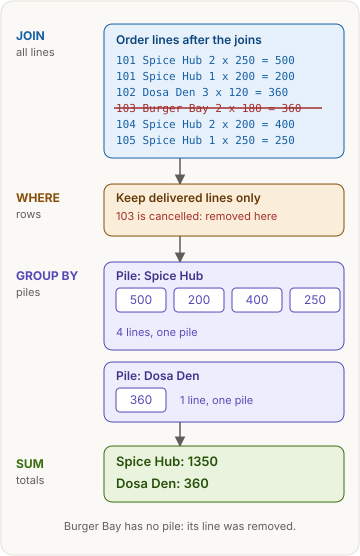
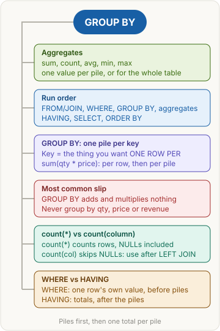

> [!abstract] What this page is for
> **Intent:** the full picture behind the [[databases/group-by|quick Aggregates page]]. Same sections, same order, with every step table, the wrong versions, the NULL edge cases and the harder interview questions.
> **Read the quick page first.** Each section here starts where the quick one stops.
> **Time:** about 20 minutes.

## Words you need first

Everything from the quick page (aggregate function, pile, key, NULL, HAVING), plus:

- **Primary key**: the column that uniquely identifies each row, such as `customers.id`. No two rows share it, and it is never NULL.
- **Alias**: the name you give a column or expression with `AS`, such as `AS revenue`. An alias is visible to ORDER BY, but not to WHERE or HAVING in Postgres.
- **Filler row**: the one row a LEFT JOIN makes for a left-side row with no match. Its right-side columns are NULL.
- **Combined key**: several columns in one GROUP BY. Together they form one key, so each pile is one unique combination.

The tables are the same food-delivery data as on the [[databases/joins|Joins]] page. Orders 101 to 105 have the statuses delivered, delivered, cancelled, delivered and delivered.

## Why it exists

The quick page gave the reason: totals per group. Here is the mechanism behind it. A plain `SELECT` returns one row per input row. An aggregate with no `GROUP BY` squashes the whole input into one row. `GROUP BY` does the same squashing per pile: it sorts the rows into piles by the key and returns one row per pile. Every plain column you select has to be the same value for all rows in a pile, which is why the "must appear in the GROUP BY clause" rule exists.

Window functions differ here, because they keep every row. See [[databases/window-functions|Window functions]].

## The picture



The same four stages as the quick page. The rest of this page zooms into each stage: the table after each step, and the wrong version that goes into each stage.

## How it works, with an example

The run order, one more time, with what each stage hands to the next:

```text
FROM + JOIN   rows: one per (order, dish) pair       -> 6 lines
WHERE         rows: only the ones that pass          -> 5 lines
GROUP BY      piles: one per key value               -> 2 piles
aggregates    one value per pile (sum, count, ...)   -> 2 values
HAVING        piles: only the ones that pass         -> 0 to n piles
SELECT        columns: the ones you asked for
ORDER BY      rows: sorted, nothing added
```

Two facts matter most. First, `WHERE` cannot see piles, because piles do not exist yet. Second, the aggregate runs before `HAVING`, so `HAVING` can read the totals.

## The most common mistake

> [!warning] GROUP BY adds nothing up
> Three slips come from one idea: thinking `GROUP BY` does the arithmetic. It doesn't.
> - **Multiplying:** `sum(qty * price)` multiplies inside each row, then adds per pile. `GROUP BY` multiplies nothing.
> - **Adding:** `ORDER BY` only sorts. `ORDER BY revenue DESC` puts the biggest pile first.
> - **Keying by the numbers:** putting `qty` or `price` in GROUP BY splits piles down to single lines, so no total forms.

The second common mistake is the difference between `sum(a * b)` and `sum(a) * sum(b)`. They are not the same. Both are shown in the GROUP BY section below.

## GROUP BY: one pile per key

**Plain version:** sort your receipts into one pile per restaurant, then write one total on top of each pile. Each receipt line goes into exactly one pile, decided by its key.

**Example:** revenue per restaurant, delivered orders only. The revenue of one line is `qty * price`.

**SQL**

```sql
SELECT r.name AS restaurant, sum(oi.qty * m.price) AS revenue
FROM orders o
JOIN restaurants r ON r.id = o.restaurant_id
JOIN order_items oi ON oi.order_id = o.id
JOIN menu_items m ON m.id = oi.menu_item_id
WHERE o.status = 'delivered'
GROUP BY r.id, r.name
ORDER BY revenue DESC;
```

**Drizzle**

```ts
import { eq, desc, sql } from "drizzle-orm";

const revenue = sql<number>`sum(${orderItems.qty} * ${menuItems.price})`.mapWith(Number);
db.select({ restaurant: restaurants.name, revenue })
  .from(orders)
  .innerJoin(restaurants, eq(restaurants.id, orders.restaurantId))
  .innerJoin(orderItems, eq(orderItems.orderId, orders.id))
  .innerJoin(menuItems, eq(menuItems.id, orderItems.menuItemId))
  .where(eq(orders.status, 'delivered'))
  .groupBy(restaurants.id, restaurants.name)
  .orderBy(desc(revenue));
```

The `revenue` constant is a reusable SQL snippet in the code. It is not a column in any table.

After the joins (6 lines, order 103 still in):

| order | restaurant | item | qty x price |
|---|---|---|---|
| 101 | Spice Hub | Paneer Tikka | 2 x 250 = 500 |
| 101 | Spice Hub | Dal Makhani | 1 x 200 = 200 |
| 102 | Dosa Den | Masala Dosa | 3 x 120 = 360 |
| 103 | Burger Bay | Classic Burger | 2 x 180 = 360 |
| 104 | Spice Hub | Dal Makhani | 2 x 200 = 400 |
| 105 | Spice Hub | Paneer Tikka | 1 x 250 = 250 |

After WHERE (5 lines, order 103 is gone because it is cancelled):

| order | restaurant | item | qty x price |
|---|---|---|---|
| 101 | Spice Hub | Paneer Tikka | 2 x 250 = 500 |
| 101 | Spice Hub | Dal Makhani | 1 x 200 = 200 |
| 102 | Dosa Den | Masala Dosa | 3 x 120 = 360 |
| 104 | Spice Hub | Dal Makhani | 2 x 200 = 400 |
| 105 | Spice Hub | Paneer Tikka | 1 x 250 = 250 |

Piles (key = restaurants.id, restaurants.name). Note that order 101 has two lines, and both go into the Spice Hub pile. The pile is decided per line, not per order:

| pile (restaurant) | lines in the pile | sum |
|---|---|---|
| Spice Hub | 500, 200, 400, 250 | 1350 |
| Dosa Den | 360 | 360 |

Result:

| restaurant | revenue |
|---|---|
| Spice Hub | 1350 |
| Dosa Den | 360 |

Burger Bay is missing from the result. Its only line was removed by WHERE, so it never formed a pile. A restaurant with no rows left makes no pile at all.

**Several columns make one combined key.** `GROUP BY restaurant_id, status` is not two separate groupings. It makes one pile per pair. On the orders table:

| restaurant_id | status | orders in the pile | count(*) |
|---|---|---|---|
| 1 | delivered | 101, 104, 105 | 3 |
| 2 | delivered | 102 | 1 |
| 3 | cancelled | 103 | 1 |

**Passenger columns and the primary key.** Every plain selected column must be grouped or aggregated. Postgres has one shortcut: grouping by a table's primary key lets you select that table's other columns, so `GROUP BY r.id` is enough for `SELECT r.name`. It does not extend to other tables' columns.

**The wrong versions, and what they show.**

Wrong 1: the key includes the summed columns. The query groups by `oi.qty` and `m.price` as well:

| restaurant | qty | price | revenue |
|---|---|---|---|
| Spice Hub | 2 | 250 | 500 |
| Spice Hub | 1 | 200 | 200 |
| Spice Hub | 2 | 200 | 400 |
| Spice Hub | 1 | 250 | 250 |
| Dosa Den | 3 | 120 | 360 |

Five rows, and Spice Hub appears four times. Each line became its own pile, so nothing was totalled per restaurant.

Wrong 2: the key is the total. `GROUP BY revenue` fails in Postgres with "aggregate functions are not allowed in GROUP BY". The total only exists after the piles are made, so it can't define them.

Wrong 3: `sum(qty) * sum(price)` instead of `sum(qty * price)`. For Spice Hub:

| version | calculation | result |
|---|---|---|
| right | 500 + 200 + 400 + 250 | 1350 |
| wrong | sum(qty) = 6, sum(price) = 900, 6 x 900 | 5400 |

The wrong version adds all quantities and all prices first, then multiplies them, which mixes lines together. It only looks right for Dosa Den (360), because that pile has one line.

**Why this, not that:**

- The key is what you want one row per (a restaurant). Not `o.id`, which would give one row per order: the total per order, not per restaurant, so Spice Hub's total never forms.
- Not an aggregate (revenue), and not the summed columns (qty, price). The key has to exist before the totals do.
- `status = 'delivered'` keeps the status you want. `!= 'cancelled'` keeps every other status too, so a future status like 'refunded' would silently enter the total.

> [!tip] Trigger card
> When I see "per restaurant", "for each X" or "by Y", I put X in GROUP BY and the sum or count in SELECT, because GROUP BY decides how many rows come out.

> [!question]- Does GROUP BY multiply qty by price?
> No. `GROUP BY` only decides which pile each row goes into. `qty * price` is computed per line inside `sum()`, and `sum()` adds the lines in each pile. The pile total for Spice Hub is 500 + 200 + 400 + 250 = 1350, not 6 x 900.

> [!question]- Why does Postgres say "must appear in the GROUP BY clause or be used in an aggregate function"?
> A selected column is neither grouped nor aggregated. Postgres can't pick one value for it, because the pile contains several. Add it to GROUP BY, or aggregate it. The shortcut is grouping by its table's primary key.

> [!question]- Why not group by qty and price?
> Those are the numbers being added. Each combination becomes its own pile, so the total per restaurant never forms (wrong 1 above).

## count(*) vs count(column)

**Plain version:** a class register. `count(*)` counts every line on the register, even a line with blanks. `count(column)` counts only the lines where that column has something written in it. `count(distinct column)` counts the different things written, with repeats removed.

**Example:** orders per customer, keeping customers who never ordered. The LEFT JOIN is the same one as on the [[databases/joins|Joins]] page.

**SQL**

```sql
SELECT c.name, count(*) AS all_rows, count(o.id) AS order_count
FROM customers c
LEFT JOIN orders o ON o.customer_id = c.id
GROUP BY c.id, c.name;
```

**Drizzle**

```ts
db.select({ name: customers.name, allRows: count(), orderCount: count(orders.id) })
  .from(customers)
  .leftJoin(orders, eq(orders.customerId, customers.id))
  .groupBy(customers.id, customers.name);
```

In Drizzle, `count()` with no argument is `count(*)`.

After the LEFT JOIN (6 rows). Arjun has no order, so the join gives him one filler row with NULL in `o.id`:

| c.id | name | o.id |
|---|---|---|
| 1 | Riya | 101 |
| 1 | Riya | 103 |
| 1 | Riya | 105 |
| 2 | Kabir | 102 |
| 3 | Meera | 104 |
| 4 | Arjun | NULL |

Piles (key = customer):

| customer | rows in the pile | count(*) | count(o.id) |
|---|---|---|---|
| Riya | 3 | 3 | 3 |
| Kabir | 1 | 1 | 1 |
| Meera | 1 | 1 | 1 |
| Arjun | 1 (the filler row) | 1 (wrong) | 0 (right) |

Result: Riya 3, Kabir 1, Meera 1, Arjun 0.

**The three counts, side by side:**

| function | counts | NULL in the column | on the orders table |
|---|---|---|---|
| `count(*)` | rows | counted (it is one row) | 5 |
| `count(column)` | rows where the column is not NULL | skipped | `count(customer_id)` = 5 |
| `count(distinct column)` | different non-NULL values | skipped | `count(distinct customer_id)` = 3 (customers 1, 2, 3) |

`count(1)` behaves like `count(*)`. For Riya, `count(distinct restaurant_id)` is 2, because her orders went to restaurants 1 and 3.

**Empty input.** `count(*)` over zero rows returns 0. Sum, avg, min and max over zero rows return NULL. This matters when a report must show 0 instead of an empty cell: use `coalesce(sum(...), 0)`.

**Why this, not that:**

- After a LEFT JOIN, count a column from the right table (`count(o.id)`), not `count(*)`. The filler row has NULL there, so it is skipped.
- Use `count(distinct x)` when you want "how many different x", such as customers who ordered.

> [!tip] Trigger card
> When I see a left join followed by a count, I count a column from the right table (`count(orders.id)`), because the filler row for "no match" would make `count(*)` say 1 instead of 0.

> [!question]- Does count(*) count NULLs?
> It counts rows and never looks at column values. A row where a column is NULL is still one row, so it is counted. `count(column)` is the form that skips NULLs.

> [!question]- Why does Arjun show 0 with count(o.id) but 1 with count(*)?
> The LEFT JOIN gives him one filler row with NULL in `o.id`. `count(o.id)` skips the NULL, so he has zero orders. `count(*)` counts the filler row itself.

> [!question]- How many orders did Riya place?
> Three: 101, 103 and 105. The cancelled order 103 is counted here, because this query has no WHERE. The WHERE section below shows how a filter changes the count.

## WHERE vs HAVING

**Plain version:** WHERE is the check at the door, applied to each order as it comes in. HAVING is the check after the pile is totalled: "does this customer have at least two deliveries?" One check runs on rows, the other on piles.

**Example:** customers with 2 or more delivered orders.

**SQL**

```sql
SELECT c.name AS customer, count(o.id) AS delivered_orders
FROM customers c
JOIN orders o ON o.customer_id = c.id
WHERE o.status = 'delivered'
GROUP BY c.id, c.name
HAVING count(o.id) >= 2;
```

**Drizzle**

```ts
db.select({ customer: customers.name, deliveredOrders: count(orders.id) })
  .from(customers)
  .innerJoin(orders, eq(orders.customerId, customers.id))
  .where(eq(orders.status, 'delivered'))
  .groupBy(customers.id, customers.name)
  .having(sql`count(${orders.id}) >= 2`);
```

After the join (5 rows, order 103 still in):

| order | customer | status |
|---|---|---|
| 101 | Riya | delivered |
| 102 | Kabir | delivered |
| 103 | Riya | cancelled |
| 104 | Meera | delivered |
| 105 | Riya | delivered |

After WHERE (4 rows). WHERE checks each row alone, so 103 goes:

| order | customer | status |
|---|---|---|
| 101 | Riya | delivered |
| 102 | Kabir | delivered |
| 104 | Meera | delivered |
| 105 | Riya | delivered |

Piles (key = customer, counted after WHERE):

| customer | orders in the pile | count(o.id) |
|---|---|---|
| Riya | 101, 105 | 2 |
| Kabir | 102 | 1 |
| Meera | 104 | 1 |

After HAVING `count(o.id) >= 2` (piles checked after totalling):

| customer | delivered_orders |
|---|---|
| Riya | 2 |

Result: Riya, 2. Kabir and Meera are removed because their piles have 1 order each.

**Why it can't be a WHERE.** `WHERE count(o.id) >= 2` fails in Postgres with "aggregate functions are not allowed in WHERE". WHERE runs before GROUP BY, so there are no piles to count. HAVING runs after, so it can see the counts.

**Plain columns in HAVING.** `HAVING o.status = 'delivered'` is legal only when status is grouped, but the right place is WHERE: it removes rows before grouping.

**The wrong version: grouping by orders.id.** The query looks similar, but the key is the thing counted:

| order | customer | piles | count(o.id) | HAVING >= 2 |
|---|---|---|---|---|
| 101 | Riya | one pile | 1 | removed |
| 102 | Kabir | one pile | 1 | removed |
| 104 | Meera | one pile | 1 | removed |
| 105 | Riya | one pile | 1 | removed |

Each pile holds one order, so no pile reaches 2, and the result is empty. The rule: group by what you count per (the customer), never by the things you count (the orders).

**Why this, not that:**

- A filter on one row's own value (status, city) goes in WHERE. A filter on a total (count, sum, avg) goes in HAVING.
- `WHERE count(...)` fails. Postgres reports it as an error, so you notice it straight away.

> [!tip] Trigger card
> When the filter is about a total (count, sum, avg), it goes in HAVING. When it is about one row's own value (status, city), it goes in WHERE, because WHERE runs before grouping and HAVING runs after.

> [!question]- Why can't I write `WHERE count(o.id) >= 2`?
> WHERE runs before grouping, so no piles exist and nothing has been counted. Postgres returns "aggregate functions are not allowed in WHERE". Move the test to HAVING.

> [!question]- Why is the result empty when I group by orders.id?
> The key is one order, so each pile holds one order and no pile reaches 2. Group by what you count per, which is the customer.

## Say it in an interview

Start with the 60-second answer from the [[databases/group-by|quick page]]. If they push deeper, add one of these:

- **Order of execution:** "WHERE sees rows, HAVING sees piles. That's why an aggregate in WHERE is an error, and why aliases from SELECT aren't visible in either of them in Postgres."
- **Counting:** "I use `count(*)` to count rows and `count(column)` when NULLs should not count. After a LEFT JOIN, I count the right-side primary key, so the filler row doesn't count."
- **The arithmetic:** "Aggregates work per pile, and the expression inside them is computed per row. `sum(qty * price)` is not `sum(qty) * sum(price)`."

## Questions interviewers ask

The eight from the [[databases/group-by|quick page]], plus these harder ones. Tap a question to see the answer.

> [!question]- Does sum() over zero rows return 0?
> No. It returns NULL. `count()` over zero rows returns 0. Use `coalesce(sum(x), 0)` when a report needs 0.

> [!question]- How do NULLs affect avg()?
> NULLs are skipped, not counted as zero. `avg` of 2, NULL and 4 is 3, not 2. `sum`, `min` and `max` skip them the same way.

> [!question]- What does GROUP BY do with NULL keys?
> All rows with a NULL key go into one pile together. Grouping treats NULLs as equal to each other, even though `NULL = NULL` is not true in a WHERE condition.

> [!question]- Can HAVING be used without GROUP BY?
> Yes. The whole result is then one pile. A rare use, but it shows you understand the order: the aggregate covers all rows, and HAVING keeps the single row or returns nothing.

> [!question]- Why can you select `customers.name` when you group by `customers.id`?
> The primary key rule. Each id has exactly one name, so Postgres accepts it. The same does not hold for columns of other tables, such as `menu_items.name` when you group by restaurant.

> [!question]- Can I use a SELECT alias in WHERE or HAVING?
> Not in Postgres. The alias only exists after SELECT runs. ORDER BY can use it, so repeat the expression in WHERE and HAVING.

> [!question]- Why does sum(a * b) differ from sum(a) * sum(b)?
> `sum(a * b)` multiplies each row, then adds. `sum(a) * sum(b)` adds all the a values and all the b values, then multiplies, which mixes unrelated rows. For Spice Hub, 1350 is correct and 5400 is wrong.

> [!question]- What does count(distinct x) do with NULLs?
> It skips them, the same as `count(x)`, and then counts the different remaining values. For the values 1, NULL, 1 and 2, `count(distinct x)` is 2.

> [!question]- How is GROUP BY different from a window function?
> GROUP BY squashes each pile into one row. A window function keeps every row and writes the pile's value on each one. Use a window when you need each row and its group's number together. See [[databases/window-functions|Window functions]].

> [!question]- How would you find duplicate rows, such as customers with the same email?
> Group by the column that should be unique, then keep only the piles with more than one row: `SELECT email, count(*) FROM customers GROUP BY email HAVING count(*) > 1`.

## Mental map



The same map as the quick page. Each branch is a section above.

## Watch


Alex The Analyst, about 12 minutes: GROUP BY and aggregate functions, in PostgreSQL, the same dialect as this page.


Alex The Analyst, about 4 minutes: HAVING in PostgreSQL, the filter on piles.
