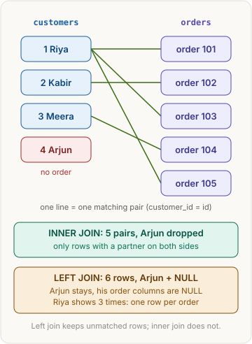
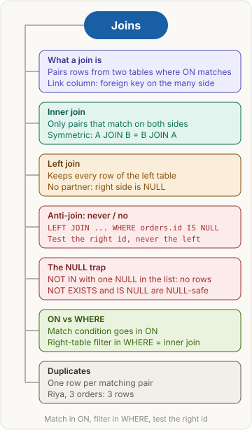

> [!abstract] What this page is for
> **Intent:** the full picture behind the [[databases/joins|quick Joins page]]. Same sections, same order, with more depth: every step table, the wrong versions, the exact NULL rules and the harder interview questions.
> **Read the quick page first.** Each section here starts where the quick one stops.
> **Time:** about 20 minutes.

## Words you need first

Everything from the quick page (table, primary key, foreign key, join, NULL, inner join, left join, anti-join, ON, WHERE), plus:

- **Left side and right side:** in `FROM orders o LEFT JOIN customers c`, `orders` is the left side and `customers` is the right side. The left side is the one a left join keeps in full.
- **Alias:** a short name for a table, written after it. `orders o` means `o` stands for `orders`, so `o.id` means `orders.id`.
- **Subquery:** a query inside another query, written in brackets, such as `(SELECT customer_id FROM orders)`.
- **Three-valued logic:** a comparison gives TRUE, FALSE or UNKNOWN. Comparing with NULL gives UNKNOWN. WHERE keeps only TRUE rows. That is why `NULL = NULL` finds nothing and why NOT IN can return nothing.
- **Cross join:** every combination of rows, with no ON condition.

## Why it exists

The quick version: a join puts split tables back together. The mechanism matters for ON vs WHERE. A database builds the result in this order:

1. **FROM and JOIN.** Each ON decides which pairs exist. Only a left join keeps unmatched left rows.
2. **WHERE.** Filters the rows from step 1.
3. **GROUP BY, HAVING, SELECT, ORDER BY** (see the [[databases/group-by|GROUP BY page]]).

So a condition in ON decides which rows match, and a condition in WHERE removes rows after the join is done. That single fact explains almost every interview question about ON vs WHERE.

## The picture



The same picture as the quick page. The inner join strip shows 5 pairs. The left join strip shows 6 rows, because Arjun gets one row with NULLs.

## How it works, with an example

The same three tables as the quick page (`customers`, `restaurants`, `orders`). The full `orders` table has `customer_id` and `restaurant_id` as foreign keys. These are the only join keys used here:

- `orders.customer_id` points at `customers.id`
- `orders.restaurant_id` points at `restaurants.id`

The general shape of every join, in one block:

```sql
FROM a
JOIN b ON ...             -- inner: keep only matched pairs
LEFT JOIN b ON ...        -- left: keep every row of a; NULLs for b when nothing matches
RIGHT JOIN b ON ...       -- right: keep every row of b; NULLs for a when nothing matches
FULL OUTER JOIN b ON ...  -- keep every row of both; NULLs on whichever side is missing
CROSS JOIN b              -- every combination; no ON. 4 customers x 5 orders = 20 rows
```

`JOIN` alone means inner join. `OUTER` is optional in `LEFT OUTER JOIN`.

## The most common mistake

> [!warning] Five slips that cost points
> - **Writing `customers.orderId`.** The order link is `orders.customer_id`, on the many side. `customers` has no order column and never will, because one customer has many orders.
> - **Thinking WHERE removes rows with no partner.** The join does that, in the ON step. WHERE runs afterwards and only sees the rows the join kept.
> - **Starting from the wrong table.** To find customers who never ordered, start from `customers`. A customer with no orders is not in `orders`, so starting from `orders` can never find them.
> - **Putting the match in WHERE instead of ON.** With a left join, a match condition in WHERE removes the NULL rows, so the left join turns into an inner join without any error message.
> - **Testing the left side for NULL.** `restaurants.id IS NULL` on a left join is always false, because the left side is never NULL. Test the right side's id.

## Inner join and WHERE: two filters

**Plain version:** the join is a bouncer. It lets in only pairs that have a partner on both sides. WHERE is a second check on the pairs already inside. Removing the second check does not let back in the rows the bouncer refused.

**Example:** every delivered order, with the customer and restaurant names, newest first.

**SQL**

```sql
SELECT o.id AS order_id, c.name AS customer, r.name AS restaurant, o.created_at
FROM orders o
JOIN customers c   ON c.id = o.customer_id
JOIN restaurants r ON r.id = o.restaurant_id
WHERE o.status = 'delivered'
ORDER BY o.created_at DESC;
```

**Drizzle** (imports: `eq, desc` from `drizzle-orm`)

```ts
db.select({ orderId: orders.id, customer: customers.name, restaurant: restaurants.name, createdAt: orders.createdAt })
  .from(orders)
  .innerJoin(customers, eq(customers.id, orders.customerId))
  .innerJoin(restaurants, eq(restaurants.id, orders.restaurantId))
  .where(eq(orders.status, 'delivered'))
  .orderBy(desc(orders.createdAt));
```

After the joins (5 rows). Arjun is missing, because the join found no partner for him:

| order_id | customer | restaurant | status | created_at |
|---|---|---|---|---|
| 101 | Riya | Spice Hub | delivered | 2026-10-28 13:05 |
| 102 | Kabir | Dosa Den | delivered | 2026-10-28 20:40 |
| 103 | Riya | Burger Bay | cancelled | 2026-10-29 19:15 |
| 104 | Meera | Spice Hub | delivered | 2026-10-30 12:30 |
| 105 | Riya | Spice Hub | delivered | 2026-10-31 21:10 |

After WHERE (4 rows). Order 103 is removed, because its status is cancelled:

| order_id | customer | restaurant | status | created_at |
|---|---|---|---|---|
| 101 | Riya | Spice Hub | delivered | 2026-10-28 13:05 |
| 102 | Kabir | Dosa Den | delivered | 2026-10-28 20:40 |
| 104 | Meera | Spice Hub | delivered | 2026-10-30 12:30 |
| 105 | Riya | Spice Hub | delivered | 2026-10-31 21:10 |

Result, after ORDER BY (newest first):

| order_id | customer | restaurant | created_at |
|---|---|---|---|
| 105 | Riya | Spice Hub | 2026-10-31 21:10 |
| 104 | Meera | Spice Hub | 2026-10-30 12:30 |
| 102 | Kabir | Dosa Den | 2026-10-28 20:40 |
| 101 | Riya | Spice Hub | 2026-10-28 13:05 |

**What each step removes:**

| Question | Answer |
|---|---|
| Who does the join drop? | Rows with no partner. Arjun has no order. |
| Who does WHERE drop? | Rows that fail a condition. Order 103 is cancelled. |
| Same condition in ON or in WHERE, inner join? | Same rows. Only a left join makes the two differ. |

**Edge cases (one line each):**

- Delete the WHERE and you get 5 rows. The new row is 103, Riya, Burger Bay. Arjun is still absent.
- A what-if (we do not change the table here): if order 102 were cancelled, Kabir would vanish. WHERE removes him. The join would have kept him, because his order still has a partner.

**Why this, not that:**

- **The join vs WHERE.** A join drops a row with no partner. WHERE drops a row that fails a condition. Both shrink the result, but for different reasons, and the reason tells you where to put the condition.
- **Inner join vs left join.** Inner keeps only matched pairs. Left keeps every row of the left table, and fills the right side with NULL where nothing matches. Here `orders` is the left table, and Arjun has no order row at all, so a LEFT JOIN from orders would change nothing. He only comes back when `customers` is the left table (next section).

> [!tip] Trigger card
> When I need only the rows that have a partner in both tables, I use `JOIN` (inner join), because a row with no partner has nothing to pair with, so the join drops it.

> [!question]- Does WHERE remove rows that have no join partner?
> No. That is a common slip. The join removes them in the FROM and JOIN step. WHERE runs afterwards and only sees the pairs the join kept. Arjun is gone before WHERE runs, so WHERE never sees him.

> [!question]- Why does order 103 disappear?
> WHERE `o.status = 'delivered'`. The join keeps 103 because it has a partner (Riya). Only the status check fails, and that check is in WHERE.

> [!question]- Is `customers JOIN orders` the same as `orders JOIN customers`?
> For an inner join, the same rows come back, with the columns in a different order. For a left join they differ, because the left table decides which rows are kept.

## Left join and anti-join: who never ordered

**Plain version:** a class register. Every student has a line. An absent student has a blank (NULL) in the marks column, not a missing line. To find the absent students, look for the blank cells.

**Example:** customers who never ordered.

**SQL**

```sql
SELECT c.id, c.name
FROM customers c
LEFT JOIN orders o ON o.customer_id = c.id
WHERE o.id IS NULL;
```

**Drizzle** (imports: `eq, isNull` from `drizzle-orm`)

```ts
db.select({ id: customers.id, name: customers.name })
  .from(customers)
  .leftJoin(orders, eq(orders.customerId, customers.id))
  .where(isNull(orders.id));
```

After the left join (6 rows). Riya appears three times, once for each order:

| c.id | name | o.id |
|---|---|---|
| 1 | Riya | 101 |
| 1 | Riya | 103 |
| 1 | Riya | 105 |
| 2 | Kabir | 102 |
| 3 | Meera | 104 |
| 4 | Arjun | NULL |

Result, after WHERE `o.id IS NULL` (1 row): **4 · Arjun**.

**The wrong versions, with their tables:**

Filter on the right table in WHERE. This removes Arjun, because his NULL status fails the check. The left join has turned into an inner join:

```sql
SELECT c.id, c.name, o.id AS order_id, o.status
FROM customers c
LEFT JOIN orders o ON o.customer_id = c.id
WHERE o.status = 'delivered';
```

| c.id | name | order_id | status |
|---|---|---|---|
| 1 | Riya | 101 | delivered |
| 2 | Kabir | 102 | delivered |
| 3 | Meera | 104 | delivered |
| 1 | Riya | 105 | delivered |

Same filter in ON. Every customer is kept, and only the matching orders are joined. Arjun comes back with NULLs:

```sql
SELECT c.id, c.name, o.id AS order_id, o.status
FROM customers c
LEFT JOIN orders o ON o.customer_id = c.id AND o.status = 'delivered';
```

| c.id | name | order_id | status |
|---|---|---|---|
| 1 | Riya | 101 | delivered |
| 1 | Riya | 105 | delivered |
| 2 | Kabir | 102 | delivered |
| 3 | Meera | 104 | delivered |
| 4 | Arjun | NULL | NULL |

Match in WHERE. Writing `WHERE o.customer_id = c.id` after a left join throws away Arjun's NULL row. You are left with the 5 inner-join pairs, so the left join has turned into an inner join. Keep the match in ON.

**Testing the right id versus the left id.** For the restaurants question, we add one row for this example only (a fourth restaurant with no orders):

| id | name |
|---|---|
| 1 | Spice Hub |
| 2 | Dosa Den |
| 3 | Burger Bay |
| 4 | Taco Town (added for this example: no orders) |

```sql
SELECT r.id, r.name
FROM restaurants r
LEFT JOIN orders o ON o.restaurant_id = r.id
WHERE o.id IS NULL;   -- right side: returns 4 Taco Town
```

The wrong test, `WHERE r.id IS NULL`, returns no rows. `r.id` is the left side, so it is never NULL. The left join gives six rows: Spice Hub three times (101, 104, 105), Dosa Den once (102), Burger Bay once (103), and Taco Town once with NULLs. Only Taco Town has a NULL order id.

**NOT IN, and why the NULL trap happens:**

```sql
SELECT id, name
FROM customers
WHERE id NOT IN (SELECT customer_id FROM orders);
```

This returns Arjun (4), because no order has customer_id 4. Now the trap. Suppose the subquery list held a NULL, as `(1, 2, NULL, 3)`. For Arjun (4):

- `4 <> 1` is TRUE
- `4 <> 2` is TRUE
- `4 <> NULL` is UNKNOWN
- `4 <> 3` is TRUE

`NOT IN` is the same as joining those with AND. TRUE AND UNKNOWN is UNKNOWN, so WHERE drops Arjun. Every other customer already fails with FALSE, so every row is dropped. The query returns no rows, with no error. Our `orders.customer_id` has no NULL, so NOT IN works on this data. We do not add a NULL row here. A guest order with no customer would be a real case.

**NOT EXISTS** is NULL-safe, because it only asks whether a match exists:

```sql
SELECT c.id, c.name
FROM customers c
WHERE NOT EXISTS (SELECT 1 FROM orders o WHERE o.customer_id = c.id);
```

This returns Arjun, the same as the left join.

**NULL in a join key.** A NULL foreign key never matches anything, not even another NULL. So an order with `customer_id` NULL never finds a customer. A left join from `orders` keeps that order with NULL customer columns. An inner join drops it.

**Right join and full outer join (one line each).** A right join gives 5 rows here, the same as the inner join, because every order has a customer, so no order row is left without a partner. A full outer join gives 6 rows here, the same as the left join, for the same reason. MySQL has no FULL OUTER JOIN; you write a left join UNION a right join instead.

**Why this, not that:**

- **LEFT JOIN + IS NULL vs NOT IN vs NOT EXISTS.** The first and the last are NULL-safe. NOT IN is safe only when the list has no NULL.
- **Test the right table's id.** Only the joined side gets NULLs, and a real row never has a NULL primary key, so it is the best test.
- **ON vs WHERE.** Match conditions and right-table filters that must keep the left rows go in ON. A right-table filter in WHERE turns the left join into an inner join.

> [!tip] Trigger card
> When a question says "never", "no", or "even with none", I start from the table that must keep every row, left join the other table, then keep the rows where the other table's id IS NULL, because a row with no partner gets NULLs there.

> [!question]- Can you start from orders to find customers who never ordered?
> No. A customer with no orders has no row in `orders` to start from. Start from `customers`, keep every row, and look for the missing partner.

> [!question]- Why test `orders.id` and not `customers.id`?
> Only the right side gets NULLs in a left join, and `customers.id` is the left side. `orders.id` is the primary key of the joined table, so a real order row never has a NULL id.

> [!question]- Why does Riya appear three times in the left join?
> A join makes one row for each matching pair. Riya has three orders, so she has three pairs. This is the duplication you have to plan for when you join one-to-many tables.

> [!question]- What exactly goes wrong with NOT IN and NULL?
> The comparison with NULL is UNKNOWN, and NOT IN is an AND of comparisons. One UNKNOWN in the AND makes every non-matching row UNKNOWN, and WHERE drops those rows. The result is empty without an error. NOT EXISTS avoids this.

## Say it in an interview

Start with the 60-second answer on the [[databases/joins#Say it in an interview|quick page]]. If the interviewer goes deeper, add one of these:

- **ON vs WHERE in outer joins:** "A condition in ON decides which rows match and keeps the left rows. A condition in WHERE filters the result after the join. For an inner join they give the same rows. For a left join, a right-table filter in WHERE turns it into an inner join."
- **NULL-safe anti-join:** "I use NOT EXISTS or a left join with IS NULL. NOT IN is risky, because one NULL in the list makes it return nothing."
- **Duplicates:** "A join gives one row per matching pair, so one-to-many joins repeat the parent row. If I then sum a value from the parent, the total is inflated. I check the row count after each join."

## Questions interviewers ask

The eight from the [[databases/joins#Questions interviewers ask|quick page]], plus these harder ones. Tap to reveal.

> [!question]- Does the order of tables in FROM change an inner join's result?
> Only the column order. It changes a left join, because the left table decides which rows are kept.

> [!question]- What happens to a NULL foreign key in a join?
> It never matches anything, not even another NULL. An inner join drops that row. A left join keeps it only if the table with the NULL foreign key is the left side.

> [!question]- Is a condition in ON and in WHERE the same for an inner join?
> Yes, for the rows returned. The difference only appears with outer joins.

> [!question]- How do you find customers with no delivered order?
> Left join to orders with the status condition in ON, then keep the rows where `orders.id` IS NULL. If the status condition is in WHERE instead, it removes the NULL rows first (their status is NULL, so the check fails), and the IS NULL test finds nothing.

> [!question]- How many rows does a cross join return from 4 customers and 5 orders?
> 4 times 5, which is 20. A cross join has no ON, so every row pairs with every row.

> [!question]- Does a join keep the row order?
> Not unless you use ORDER BY. Without it, the database may return the rows in any order.

> [!question]- Can you join on two columns?
> Yes. Use AND in the ON clause: `ON a.x = b.x AND a.y = b.y`. Both must match.

> [!question]- Why can a total look too big after a join?
> If you join a parent table to its children (one order to many order lines), the parent row repeats for each child. Summing a column from the parent counts it once per child. Check the row count after each join, or sum at the child level.

## Mental map



The same map as the quick page. Each branch is a section above.

## Watch


Socratica, about 10 minutes: an overview of SQL joins and the basic join types.

Next: [[databases/group-by|Aggregates: GROUP BY and HAVING]].
