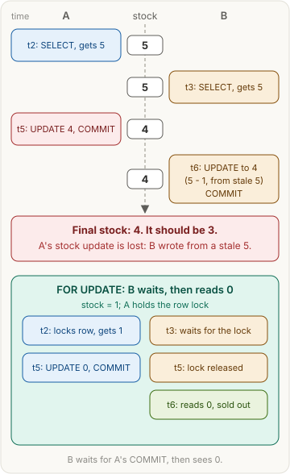
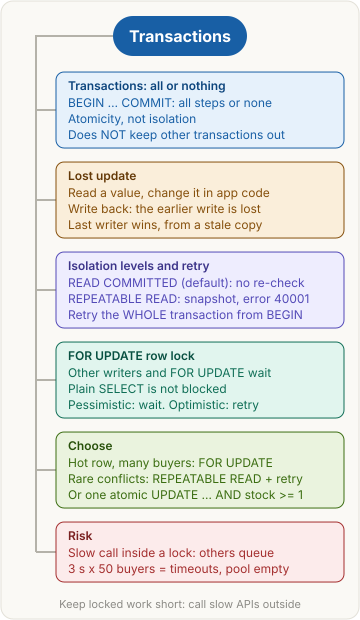

> [!abstract] What this page is for
> **Intent:** the full picture behind the [[databases/transactions|quick Transactions page]]. Same sections, same order, with the wrong version's tables, exact retry rules, slow-work math and the harder questions.
> **Read the quick page first.** Each section here starts where the quick one stops.
> **Time:** about 20 minutes.

## Words you need first

Everything from the quick page (transaction, atomic, isolation, read-modify-write, lost update, snapshot, READ COMMITTED, REPEATABLE READ, 40001, Drizzle), plus:

- **ACID**: the four transaction promises. **Atomicity** (all or nothing), **Consistency** (rules such as "stock is never negative" hold), **Isolation** (concurrent work is hidden from each other, to a degree set by the level), **Durability** (a commit survives a crash).
- **Autocommit**: without `BEGIN`, most clients run each statement as its own transaction.
- **MVCC (multi-version concurrency control)**: Postgres keeps several versions of a row, so plain reads do not wait for writers.
- **SQLSTATE**: the five-character error code Postgres sends. `40001` is a serialization failure, `40P01` a deadlock.
- **Deadlock**: two transactions each hold a lock the other needs. The database aborts one.
- **Connection pool**: a set of open database connections the app reuses. A waiting request holds one.
- **Write skew**: two transactions each check a rule correctly, write different rows, and together break the rule.

This page uses the same shoe shop: `products(id, stock)`, stock = pairs left.

## Why it exists

Three promises to keep: group the statements (atomicity), read a consistent view (isolation), and never silently drop one write (locks, a failed write, or one atomic statement). The app breaks the third most often, because the app does the read, the arithmetic and the write.

## The picture



The top half is the bug. The bottom half is the lock that stops it.

## How it works, with an example

The checkout code is the same in every section: read the stock, check it, insert an order, write the new stock. Each section below asks one question about that code, and gives the table at each step.

## The most common mistake

> [!warning] BEGIN and COMMIT don't keep others out
> A transaction only promises that its own steps happen together. Other transactions keep running, reading and writing. Three slips follow:

- **Outside calls are not rolled back.** `ROLLBACK` undoes database changes only. An email or a charge made inside the callback stays done. Send those after COMMIT, or use an outbox table and an idempotency key.
- **No BEGIN, no transaction.** Without `BEGIN`, each statement autocommits. Statements that must go together need one transaction.
- **Retry scope.** After a failure, the whole transaction runs again from BEGIN, not one query.

## Transactions: all or nothing

**Plain version:** a bank transfer takes money from one account and puts it in another. Both or neither. A shoe order and its stock change are one bundle.

**Example:**

```sql
-- SQL
BEGIN;
INSERT INTO shoe_orders (product_id) VALUES (1);
UPDATE products SET stock = stock - 1 WHERE id = 1;
COMMIT;
```

```ts
// Drizzle
await db.transaction(async (tx) => {
  await tx.insert(shoeOrders).values({ productId: 1 });
  await tx.update(products).set({ stock: sql`${products.stock} - 1` }).where(eq(products.id, 1));
});
```

Drizzle sends BEGIN before the callback and COMMIT after it. If the callback throws, it sends ROLLBACK.

| step | shoe_orders | stock |
|---|---|---|
| before BEGIN | 0 rows | 1 |
| after INSERT (only this transaction sees it) | 1 row | 1 |
| after UPDATE (still only this transaction) | 1 row | 0 |
| after COMMIT (everyone sees it) | 1 row | 0 |

When the UPDATE fails and the transaction rolls back:

| step | shoe_orders | stock |
|---|---|---|
| UPDATE fails, ROLLBACK | 0 rows | 1 |

The wrong version, with no transaction (autocommit):

| step | shoe_orders | stock |
|---|---|---|
| INSERT (autocommit: saved at once) | 1 row | 1 |
| UPDATE fails | 1 row | 1 |

Caption: the order exists, but the stock was never reduced. The shelf still shows a pair that is already sold.

Edge cases: every query in the callback needs `await`, or it can run after the transaction has ended.

**Why this, not that:**

- Atomicity: all steps succeed or none do. It works on one connection's work and does not stop others.
- Isolation: controls what other connections see. It is the separate job.

> [!tip] Trigger card
> When I see several writes that must go together, I use one transaction, because it makes them all-or-nothing. It does not keep other transactions out.

> [!question]- Does BEGIN ... COMMIT stop other transactions from reading the old data?
> No. Atomicity only means this transaction's steps commit together. Keeping others out is isolation's job.

> [!question]- A statement inside the transaction fails. What now?
> The transaction is aborted. Postgres refuses more queries until ROLLBACK, and nothing from it is kept.

## Lost update

**Plain version:** two cashiers read "5 pairs left" from one notebook page. Each sells one and writes the new count. The second write covers the first, and one sale vanishes.

**Example:** both buyers run the same read-modify-write.

```sql
-- SQL, run by A and by B
SELECT stock FROM products WHERE id = 1;     -- app gets 5
UPDATE products SET stock = $1 WHERE id = 1; -- $1 = 5 - 1, computed in the app
```

```ts
// Drizzle, run by A and by B
const [p] = await db.select().from(products).where(eq(products.id, 1));
await db.update(products).set({ stock: p.stock - 1 }).where(eq(products.id, 1));
```

Inside a transaction under READ COMMITTED, the result is the same: each statement sees the newest row, but the app keeps its old number.

| time | A | row | B |
|---|---|---|---|
| t2 | SELECT, gets 5 | 5 | |
| t3 | | 5 | SELECT, gets 5 |
| t5 | UPDATE to 4, COMMIT | 4 | |
| t6 | | 4 | UPDATE to 4 (5 - 1 from its copy), COMMIT |

Caption: final stock 4. Two pairs were sold, so it should be 3. The stale value is B's copy, read at t3.

The wrong version with stock = 1 (oversell):

| time | A | row | B | orders |
|---|---|---|---|---|
| t2 | SELECT, gets 1, passes check | 1 | | 0 |
| t3 | | 1 | SELECT, gets 1, passes check | 0 |
| t5 | INSERT order, UPDATE to 0, COMMIT | 0 | | 1 |
| t6 | | 0 | INSERT order, UPDATE to 0, COMMIT | 2 |

Caption: stock 0 and two orders. The check was right when each buyer read it, and wrong by the time they wrote.

Edge case: saving a whole object writes every column. Update only the columns you changed, or another request's change to a different column gets reverted.

**Why this, not that:**

- The earlier write is lost: A's sale.
- The later write survives: B's, built on a stale 5. Last writer wins.
- One buyer alone never loses an update. The race needs two.

> [!tip] Trigger card
> When I see a SELECT of a value, then an UPDATE of the same row with a number computed in app code, I suspect a lost update. READ COMMITTED does not block that.

> [!question]- In a lost update, which write disappears?
> The earlier one. A common slip is to say the later write is lost. B's write lands last and survives.

> [!question]- Why is the final stock 4, not 3? Which value is stale?
> B computed 5 - 1 from the 5 it read at t3. That stale 5 erased A's sale. A common slip is to point at A's 4, which was fresh when A wrote it.

> [!question]- With stock = 1, what goes wrong?
> Both buyers pass the check and both insert an order: two orders for one pair.

## Isolation levels and retry

**Plain version:** isolation decides what a running transaction may see of the others.

- **READ COMMITTED** (default): each statement sees the latest committed data. Nothing re-checks the earlier decision, so the lost update happens silently.
- **REPEATABLE READ**: one snapshot, taken at the first query (not at BEGIN). A write to a row that changed after that snapshot fails with 40001. The fix is to retry the whole transaction.

**Example:** the checkout under REPEATABLE READ with a retry loop.

```sql
-- SQL, run by A and by B
BEGIN ISOLATION LEVEL REPEATABLE READ;
SELECT stock FROM products WHERE id = 1;     -- snapshot: 5
UPDATE products SET stock = $1 WHERE id = 1; -- $1 = 5 - 1
COMMIT;
```

```ts
// Drizzle
async function buyOne(productId: number) {
  for (let attempt = 1; ; attempt++) {
    try {
      return await db.transaction(async (tx) => {
        const [p] = await tx.select().from(products).where(eq(products.id, productId));
        if (p.stock < 1) throw new Error("sold out");
        await tx.update(products).set({ stock: p.stock - 1 }).where(eq(products.id, productId));
      }, { isolationLevel: "repeatable read" });
    } catch (err) {
      const e = err as { code?: string; cause?: { code?: string } };
      const code = e.code ?? e.cause?.code;
      if ((code !== "40001" && code !== "40P01") || attempt >= 5) throw err;
    }
  }
}
```

The "sold out" error is not 40001, so the loop rethrows it at once.

| time | A | row | B |
|---|---|---|---|
| t2 | BEGIN, snapshot, reads 5 | 5 | |
| t3 | | 5 | BEGIN, snapshot, reads 5 |
| t5 | UPDATE to 4, COMMIT (fine) | 4 | |
| t6 | | 4 | UPDATE: ERROR 40001, ROLLBACK |
| t7 | retry from BEGIN: new snapshot reads 4, writes 3, COMMIT | 3 | |

Caption: B's write is refused, not silently lost. The retry takes a new snapshot and writes 3.

With stock = 2, both buyers succeed after one retry:

| time | A | row | B |
|---|---|---|---|
| t2 | BEGIN, snapshot, reads 2 | 2 | |
| t3 | | 2 | BEGIN, snapshot, reads 2 |
| t5 | UPDATE to 1, COMMIT | 1 | |
| t6 | | 1 | UPDATE: ERROR 40001, ROLLBACK |
| t7 | | 1 | retry: reads 1, UPDATE to 0, COMMIT |

Result: stock 0, two orders, no oversell. A third buyer's retry would read 0, fail the check, and get "sold out". The customer never sees 40001.

Details:

- **Where it comes from.** Postgres raises 40001 on the UPDATE that touches a row changed after the snapshot. The transaction is then aborted until ROLLBACK.
- **Client libraries.** node-postgres puts the code on the error. Newer Drizzle versions may wrap it and keep the original in `cause`, so the helper checks both.
- **Which codes to retry.** 40001 always, and 40P01 (deadlock), since both can succeed on the next try. A SQL typo, a unique-key clash or "sold out" fails the same way every time, so do not retry it.

**Why this, not that:**

- READ COMMITTED (default): each statement sees the newest data. The lost update is silent, and no retry is needed.
- REPEATABLE READ: a conflict raises 40001. Retry the whole transaction from BEGIN.

Two one-line extras:

- **SERIALIZABLE** is the strictest level. It also raises 40001, needs the same retry loop, and also catches write skew.
- **Write skew, in one line:** two on-call doctors each check that the other is still on call, then each goes off call. Nobody is on call. REPEATABLE READ allows this; SERIALIZABLE catches it.

**MySQL, in one line:** MySQL InnoDB's REPEATABLE READ does not stop this lost update, so "does REPEATABLE READ prevent lost updates?" depends on the database.

> [!tip] Trigger card
> When I see error 40001, the transaction tried to write over data that changed after its snapshot. I retry the whole transaction from BEGIN, not the last query.

> [!question]- Why retry the whole transaction, and not just the UPDATE?
> A common slip is to retry only the UPDATE. After an error the transaction is aborted, and the old snapshot still shows 5. A new BEGIN takes a new snapshot, and the value must be read again.

> [!question]- Does REPEATABLE READ stop lost updates?
> In Postgres, yes, when the app retries on 40001. In MySQL InnoDB, no, for this read-compute-write pattern.

## FOR UPDATE vs SERIALIZABLE and retry

**Plain version:** two ways to stop the lost update.

- **Pessimistic:** lock first. `SELECT ... FOR UPDATE` locks the row until COMMIT, and the second buyer waits at the shelf.
- **Optimistic:** no lock. A conflict is found at write time (40001 under REPEATABLE READ or SERIALIZABLE), and the loop retries.

**Example:**

```sql
-- SQL
BEGIN;
SELECT stock FROM products WHERE id = 1 FOR UPDATE; -- row lock until COMMIT
-- app checks stock >= 1 here, then:
UPDATE products SET stock = stock - 1 WHERE id = 1;
COMMIT;
```

```ts
// Drizzle
await db.transaction(async (tx) => {
  const [p] = await tx.select().from(products).where(eq(products.id, 1)).for("update");
  if (p.stock < 1) throw new Error("sold out");
  await tx.update(products).set({ stock: p.stock - 1 }).where(eq(products.id, 1));
});
```

| time | A | row | B |
|---|---|---|---|
| t2 | SELECT ... FOR UPDATE, gets 1, holds the lock | 1 | |
| t3 | | 1 | SELECT ... FOR UPDATE: waits |
| t5 | UPDATE to 0, COMMIT (lock released) | 0 | |
| t6 | | 0 | lock granted, reads 0, "sold out" |

Caption: B waits, then reads 0. No oversell.

Details on the lock:

- **Who it blocks.** UPDATE, DELETE and other `SELECT ... FOR UPDATE` on that row wait. A plain `SELECT` is not blocked, because MVCC gives it the old version.
- **What B reads.** Under READ COMMITTED, B's query returns the newest committed version once the lock is free. That is why B reads 0.
- **Under REPEATABLE READ,** a FOR UPDATE on a row that changed after the snapshot fails with 40001 instead.
- **NOWAIT.** `FOR UPDATE NOWAIT` fails at once instead of waiting.

The single-statement option, with no lock code and no retry:

```sql
UPDATE products SET stock = stock - 1 WHERE id = 1 AND stock >= 1;
-- check that exactly 1 row changed; 0 rows means sold out
```

Read, check and write are one statement, so there is no gap for another buyer.

Optimistic with a version column, when the change is more than one counter:

```sql
-- read the row and its version (say 7), compute the new stock in the app, then:
UPDATE products SET stock = $1, version = version + 1 WHERE id = $2 AND version = 7;
-- 0 rows changed: someone else won first, so read again and retry
```

**Why this, not that:**

- FOR UPDATE: waiters queue, one attempt, no retry loop. Costs wait time and locks. Pick it for a hot row, many buyers at once (a flash sale).
- Retry (REPEATABLE READ or SERIALIZABLE): nobody waits, but a conflict costs wasted work and a capped retry loop. Pick it when conflicts are rare.

> [!tip] Trigger card
> When I see `SELECT ... FOR UPDATE`, other writers queue behind it until COMMIT or ROLLBACK. Plain reads are not blocked.

> [!question]- Does FOR UPDATE stop other transactions from reading the row?
> No. It blocks writers and other FOR UPDATE calls. A plain `SELECT` still reads the last committed version. A common slip is to think it blocks reads.

> [!question]- What does a slow step inside a locked transaction cost?
> Waiting, then timeouts, then an empty pool. Take a 3-second payment API call inside the lock, and 50 buyers arriving together.

| time | buyer 1 (holds the lock) | buyers 2 to 50 |
|---|---|---|
| 0 s | FOR UPDATE, starts the 3 s payment call | waiting for the lock |
| 3 s | COMMIT, lock released | buyer 2 gets it, starts its 3 s call |
| 147 s | (done long ago) | buyer 50 gets the lock, last in line |

Buyer 50 waits about 49 x 3 seconds, around 2.5 minutes. Most request timeouts are far shorter, so those requests fail. Each waiting request holds a connection, so the pool runs dry and other endpoints fail too. The fix: reserve the stock in a short transaction, call the payment outside any lock, then confirm or release the reservation in another short transaction.

## Say it in an interview

Start with the 60-second answer from the [[databases/transactions#Say it in an interview|quick page]]. If the interviewer goes deeper, add one of these:

- **Isolation detail:** "Under REPEATABLE READ the snapshot is taken at the first query, not at BEGIN. A write to a row changed after that snapshot fails with 40001, and the whole transaction is retried."
- **Locking detail:** "FOR UPDATE blocks writers and other FOR UPDATE calls, not plain reads. Waiters hold connections, so keep the locked part short."
- **Simplest fix:** "For one counter, one atomic UPDATE with `stock >= 1` in the WHERE, then check the rows changed. No gap, no retry."

## Questions interviewers ask

The eight from the [[databases/transactions#Questions interviewers ask|quick page]], plus these harder ones. Tap a question to see the answer.

> [!question]- Where is the snapshot taken under REPEATABLE READ?
> At the first query of the transaction, not at BEGIN. Under READ COMMITTED, each statement takes its own view.

> [!question]- Why doesn't Postgres retry for you?
> The query and its values come from app code. Postgres cannot replay that logic, so it aborts and reports 40001. The app runs the whole transaction again.

> [!question]- Is `UPDATE ... SET stock = stock - 1` enough for a counter?
> For one row with a WHERE check, yes. It is not enough when the rule spans rows or tables, such as "total reserved never exceeds stock across three warehouses". Then use locks or SERIALIZABLE.

> [!question]- Why check the rows changed after an atomic UPDATE?
> The WHERE may filter the row out, for example when stock is 0. Zero rows changed means the condition failed, so the answer is "sold out".

> [!question]- What is write skew, and how is it different from a lost update?
> A lost update overwrites the same row. Write skew writes different rows, each based on a check that was true, and together they break a rule. Only SERIALIZABLE, or explicit locks on the rows involved, prevent it.

> [!question]- What is a deadlock, and how do you avoid one?
> A and B each hold a lock the other needs. The database aborts one with 40P01. Lock rows in the same order everywhere.

> [!question]- Why keep transactions short?
> Locks and open snapshots hold resources. Long transactions block writers, delay cleanup of old row versions, and hold connections from the pool.

> [!question]- What does ACID stand for, and which part does a lost update break?
> Atomicity, Consistency, Isolation, Durability. A lost update breaks the stock count's consistency, because isolation is weak (READ COMMITTED) and the app did a read-modify-write with no lock or retry.

## Mental map



The same map as the quick page. Each branch is a section above.

## Watch


The Software Mentor, YouTube: row locks and SELECT FOR UPDATE in PostgreSQL. The title covers the same topic as the last section.

Next topic: [[databases/joins|Joins]].
