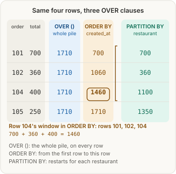
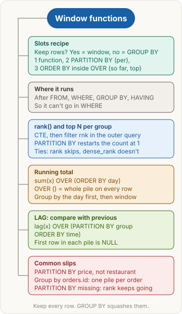

> [!abstract] What this page is for
> **Intent:** the full picture behind the [[databases/window-functions|quick Window functions page]]. Same sections, same order, with every step table, the wrong version of each query, and the harder interview questions.
> **Read the quick page first.** Each section here starts where the quick one stops.
> **Time:** about 20 minutes.

## Words you need first

Everything from the quick page (window function, OVER, PARTITION BY, ORDER BY inside OVER, CTE, LAG and LEAD, NULL), plus:

- **Frame**: the exact rows inside one pile that a window function looks at, for the current row. It is set with words like `ROWS BETWEEN ... AND CURRENT ROW`. If you don't write one, the database uses a default.
- **Default frame**: with ORDER BY and no frame written, the frame runs from the first row of the pile to the current row.
- **Peers**: rows that have the same ORDER BY value inside their pile. They tie, so the default frame treats them as one step.
- **Pile (partition)**: one group made by PARTITION BY. Each pile is worked on separately, and the numbering or running total restarts for each pile.
- **Calendar table**: a table with one row per day, used to show days that have no orders.

Window functions are part of the SQL standard and work in Postgres, MySQL 8 and later, SQL Server and Oracle. The examples use Postgres.

## Why it exists

GROUP BY answers "one row per restaurant". Many questions need every row plus a number about its group. A window function adds that number to each row. The page follows the three jobs from the quick page: top N per group, running totals, and the previous row.

## The picture



The same picture as the quick page. The OVER () column is the whole pile. The ORDER BY column is the pile up to and including the current row. The PARTITION BY column restarts for each restaurant.

## How it works, with an example

The same slots recipe and run order as the quick page: FROM and JOIN, WHERE, GROUP BY, HAVING, the window functions, SELECT, then the final ORDER BY. Because the window comes after GROUP BY, it can use aggregates such as `sum(...)` in its ORDER BY.

> **Slots recipe.** Keep the rows? Yes, so use a window function. No, use GROUP BY.
> 1. Which function: `rank()`, `sum()`, `lag()`.
> 2. PARTITION BY: "per", "for each", "within", "its". It restarts per group.
> 3. ORDER BY inside OVER: "so far", "running", "top", "previous".

## The most common mistake

> [!warning] Forgetting that PARTITION BY restarts the count
> With `rank() OVER (PARTITION BY restaurant ORDER BY revenue DESC)`, every restaurant is its own pile and counting starts at 1 in each one. So Masala Dosa is rank 1 in Dosa Den, not rank 3. A common slip is to count down the whole table anyway. Rank 3 only happens when PARTITION BY is left out: then `rank() OVER (ORDER BY revenue DESC)` ranks Paneer Tikka 1, Dal Makhani 2, Masala Dosa 3 in one pile.

## rank() and top N per group

**Plain version:** each restaurant has its own shelf of dishes. Put the dishes on each shelf in order, best first, and start counting at 1 on every shelf.

**Example.** Top dish by revenue in each restaurant, delivered orders only (the SQL and Drizzle are the same as on the quick page).

```sql
WITH ranked AS (
  SELECT r.name AS restaurant, m.name AS item,
         sum(oi.qty * m.price) AS revenue,
         rank() OVER (PARTITION BY r.id ORDER BY sum(oi.qty * m.price) DESC) AS rnk
  FROM orders o
  JOIN restaurants r ON r.id = o.restaurant_id
  JOIN order_items oi ON oi.order_id = o.id
  JOIN menu_items m ON m.id = oi.menu_item_id
  WHERE o.status = 'delivered'
  GROUP BY m.id, m.name, r.id, r.name
)
SELECT restaurant, item, revenue FROM ranked WHERE rnk = 1;
```

```ts
const revenue = sql<number>`sum(${orderItems.qty} * ${menuItems.price})`.mapWith(Number);
const ranked = db.$with('ranked').as(
  db.select({
    restaurant: restaurants.name,
    item: menuItems.name,
    revenue: revenue.as('revenue'),
    rnk: sql<number>`rank() over (partition by ${restaurants.id} order by ${revenue} desc)`.as('rnk'),
  })
  .from(orders)
  .innerJoin(restaurants, eq(restaurants.id, orders.restaurantId))
  .innerJoin(orderItems, eq(orderItems.orderId, orders.id))
  .innerJoin(menuItems, eq(menuItems.id, orderItems.menuItemId))
  .where(eq(orders.status, 'delivered'))
  .groupBy(menuItems.id, menuItems.name, restaurants.id, restaurants.name)
);
const top = await db.with(ranked).select().from(ranked).where(eq(ranked.rnk, 1));
```

Step 1, after the joins (6 order lines, including the cancelled order 103):

| order | restaurant | item | qty x price |
|---|---|---|---|
| 101 | Spice Hub | Paneer Tikka | 2 x 250 = 500 |
| 101 | Spice Hub | Dal Makhani | 1 x 200 = 200 |
| 102 | Dosa Den | Masala Dosa | 3 x 120 = 360 |
| 103 | Burger Bay | Classic Burger | 2 x 180 = 360 |
| 104 | Spice Hub | Dal Makhani | 2 x 200 = 400 |
| 105 | Spice Hub | Paneer Tikka | 1 x 250 = 250 |

Step 2, after WHERE (order 103 removed, 5 lines). Step 3, the GROUP BY makes one pile per dish:

| item (pile) | lines | revenue |
|---|---|---|
| Paneer Tikka | 500, 250 | 750 |
| Dal Makhani | 200, 400 | 600 |
| Masala Dosa | 360 | 360 |

Step 4, after the window (rank counted inside each restaurant):

| restaurant | item | revenue | rnk |
|---|---|---|---|
| Spice Hub | Paneer Tikka | 750 | 1 |
| Spice Hub | Dal Makhani | 600 | 2 |
| Dosa Den | Masala Dosa | 360 | 1 |

Step 5, the outer `WHERE rnk = 1`. Result: Spice Hub, Paneer Tikka, 750 and Dosa Den, Masala Dosa, 360. Burger Bay has no row, because its only order was cancelled and WHERE removed it.

**The wrong versions, and what they return**

- **Grouped by the order, not the dish:** `GROUP BY o.id, ...` makes one pile per order. Order 101 has two dishes, so the item name is neither grouped nor aggregated, and Postgres stops with "column menu_items.name must appear in the GROUP BY clause or be used in an aggregate function".
- **PARTITION BY price instead of restaurant:** each dish has its own price (250, 200, 120), so each dish is alone in its pile and gets rank 1. All three dishes come back from `WHERE rnk = 1`, including the ones that are not the top dish of their restaurant.
- **No PARTITION BY at all:** the ranks are 1, 2, 3 across all three dishes, so Masala Dosa gets 3 and only Paneer Tikka comes back from `WHERE rnk = 1`.

**Why this, not that**

- **GROUP BY restaurant vs PARTITION BY restaurant:** GROUP BY would give one row per restaurant, and the dish rows would be gone. PARTITION BY keeps every dish row and only sets the pile the rank is counted in.
- **CTE, then filter outside vs `WHERE rnk = 1` in one query:** WHERE runs before the window, so the rank doesn't exist yet. Postgres refuses with "window functions are not allowed in WHERE". The CTE makes the rank a real column, and the outer query can filter it.
- **Ties, one line each.** With the tie example values 90, 90, 80 (a generic illustration, not the food data):

| value | rank() | dense_rank() | row_number() |
|---|---|---|---|
| 90 | 1 | 1 | 1 (or 2, arbitrary) |
| 90 | 1 | 1 | 2 (or 1, arbitrary) |
| 80 | 3 | 2 | 3 |

`rank()` skips to 3 after the tie. `dense_rank()` goes to 2. `row_number()` gives a unique number, so which 90 gets 1 is arbitrary. This matters for "top N": `rank() <= N` can return more than N rows when there are ties at the cut-off, `row_number() <= N` always returns exactly N.

- **Repeat the expression, don't use the alias:** in Postgres you can't write `OVER (ORDER BY revenue DESC)` using the alias `revenue` from the same SELECT. That is why the Drizzle code reuses the `revenue` SQL object inside `rank() over (...)`.

> [!tip] Trigger card
> When I see "top N per X", I use `rank() OVER (PARTITION BY X ORDER BY value DESC)` in a CTE and filter `rnk <= N` outside, because WHERE runs before the window and the rank has to exist first.

> [!question]- Why is grouping by the order wrong in the CTE?
> It builds one pile per order, so there is no dish total. The item name then breaks the GROUP BY rule. Group by the dish (`m.id, m.name`), because the dish is what you rank.

> [!question]- Why does PARTITION BY price give the wrong answer?
> Each price becomes its own pile, so every dish is rank 1 in its own pile. "For each restaurant" means PARTITION BY restaurant, not price.

> [!question]- If I need the ties too, which function do I use?
> `rank()` or `dense_rank()` with `<= N`. They keep every tied row, so the result can have more than N rows. Say that out loud, because it is the answer the interviewer is listening for.

> [!question]- Can I filter rank in HAVING instead of a CTE?
> No. HAVING runs before the window functions too, so the rank doesn't exist yet. Use a CTE or subquery.

## Running total

**Plain version:** a bank passbook. Each line shows the amount and the balance so far. The balance on line 3 is line 1 + line 2 + line 3.

**Example.** `order_totals` has one row per delivered order. Here are the four ways to write OVER, with a fifth column that adds PARTITION BY restaurant_id:

| order_id | total | OVER () | OVER (ORDER BY created_at) | OVER (PARTITION BY restaurant_id ORDER BY created_at) |
|---|---|---|---|---|
| 101 | 700 | 1710 | 700 | 700 (Spice Hub) |
| 102 | 360 | 1710 | 1060 | 360 (Dosa Den) |
| 104 | 400 | 1710 | 1460 | 1100 (Spice Hub) |
| 105 | 250 | 1710 | 1710 | 1350 (Spice Hub) |

With no OVER at all, `sum(total)` collapses the four rows into one row showing 1710, and you can't select order_id beside it.

Now the daily running total, with its two layers. (The SQL and Drizzle are the same as on the quick page.)

```sql
WITH daily AS (
  SELECT o.created_at::date AS day, sum(oi.qty * m.price) AS revenue
  FROM orders o
  JOIN order_items oi ON oi.order_id = o.id
  JOIN menu_items m ON m.id = oi.menu_item_id
  WHERE o.status = 'delivered'
  GROUP BY o.created_at::date
)
SELECT day, revenue, sum(revenue) OVER (ORDER BY day) AS running_total
FROM daily
ORDER BY day;
```

```ts
const day = sql<string>`${orders.createdAt}::date`;
const daily = db.$with('daily').as(
  db.select({ day: day.as('day'), revenue: sql<number>`sum(${orderItems.qty} * ${menuItems.price})`.mapWith(Number).as('revenue') })
    .from(orders)
    .innerJoin(orderItems, eq(orderItems.orderId, orders.id))
    .innerJoin(menuItems, eq(menuItems.id, orderItems.menuItemId))
    .where(eq(orders.status, 'delivered'))
    .groupBy(day)
);
const rows = await db.with(daily).select({
  day: daily.day, revenue: daily.revenue,
  runningTotal: sql<number>`sum(${daily.revenue}) over (order by ${daily.day})`.mapWith(Number),
}).from(daily).orderBy(daily.day);
```

Step 1, after WHERE (order 103 removed). Each line is already a sum of qty x price:

| day | order | line total |
|---|---|---|
| 2026-10-28 | 101 | 500 |
| 2026-10-28 | 101 | 200 |
| 2026-10-28 | 102 | 360 |
| 2026-10-30 | 104 | 400 |
| 2026-10-31 | 105 | 250 |

Step 2, the GROUP BY day makes one pile per day (layer 1):

| day | revenue |
|---|---|
| 2026-10-28 | 500 + 200 + 360 = 1060 |
| 2026-10-30 | 400 |
| 2026-10-31 | 250 |

Step 3, the window over the daily rows (layer 2, the result):

| day | revenue | running_total |
|---|---|---|
| 2026-10-28 | 1060 | 1060 |
| 2026-10-30 | 400 | 1460 |
| 2026-10-31 | 250 | 1710 |

There is no 2026-10-29 row. Its only order was cancelled, so no rows were left for that day, and a day with no rows makes no pile.

**The wrong versions, and what they return**

- **GROUP BY revenue:** Postgres refuses, because an aggregate can't be a GROUP BY key. You want one row per day, so group by the day.
- **OVER () for the running total:** the window covers the whole daily set, so the answer on every row is 1710:

| day | revenue | running_total (wrong) |
|---|---|---|
| 2026-10-28 | 1060 | 1710 |
| 2026-10-30 | 400 | 1710 |
| 2026-10-31 | 250 | 1710 |

- **Skipping the first layer:** putting the window on the order lines gives a running total per order line, not per day. Build the daily rows in the CTE first.

**Why this, not that**

- **OVER () vs OVER (ORDER BY day) vs no OVER:** the table above. OVER () is the whole pile for every row. ORDER BY inside OVER gives the running total. No OVER collapses everything into one row.
- **Group by the day first, then the window:** the first layer answers "what did each day make?", the second answers "what has been made so far?". Mixing them into one query, with the window on the order lines, answers a different question.
- **Default frame in full:** with ORDER BY and no frame written, Postgres uses `RANGE BETWEEN UNBOUNDED PRECEDING AND CURRENT ROW`. That means the pile from its first row to the current row, and every peer (a row with the same ORDER BY value) counts together. So if two rows share the same ORDER BY value, they get the same running total, and that total includes both of them. The frame is the reason the running total works, and it is also why ties behave as they do.
- **Days with no rows:** a calendar table with one row per day, joined with LEFT JOIN to the daily CTE, gives 2026-10-29 a row with revenue NULL. Wrap it in `COALESCE(revenue, 0)` to show 0, and the running total stays 1060 on that day.

> [!tip] Trigger card
> When I see "running total", "cumulative" or "so far", I use `sum(x) OVER (ORDER BY time)`, because the ORDER BY inside OVER makes each row add everything up to itself.

> [!question]- Why does OVER () give 1710 on every row?
> OVER () makes the window the whole result, so every row sees every row. A running total needs ORDER BY inside OVER.

> [!question]- Why is 2026-10-29 not in the output, and how do I show it?
> Its only order was cancelled, so WHERE removed it and there are no rows for that day. To show it with 0, use a calendar table with LEFT JOIN and `COALESCE`.

> [!question]- Why not GROUP BY revenue for the daily totals?
> Revenue is the value being added up, and an aggregate can't be a GROUP BY key. A common slip is to group by the number you want to add. Group by the day.

> [!question]- Why is my running total on the order lines different from the daily one?
> The order-line version gives one running total per order line, so two orders on the same day show two different numbers. The daily version gives one number per day.

## LAG: compare with the previous row

**Plain version:** a class register that shows each student's last score next to today's. For each restaurant, look at the previous order from that same restaurant only.

**Example.** The SQL and Drizzle are the same as on the quick page. The piles are:

- Spice Hub (restaurant_id 1): orders 101, 104, 105, in time order.
- Dosa Den (restaurant_id 2): order 102.

Step 1, the piles with `lag(total)` inside each (rows in their pile order). Each row reads the total of the row above it in its own pile:

| pile | order | total | prev_total (lag) |
|---|---|---|---|
| Spice Hub | 101 | 700 | NULL (first in pile) |
| Spice Hub | 104 | 400 | 700 |
| Spice Hub | 105 | 250 | 400 |
| Dosa Den | 102 | 360 | NULL (first in pile) |

Step 2, the result with the change column (`total - prev_total`):

| order_id | restaurant_id | total | prev_total | change |
|---|---|---|---|---|
| 101 | 1 | 700 | NULL | NULL |
| 104 | 1 | 400 | 700 | -300 |
| 105 | 1 | 250 | 400 | -150 |
| 102 | 2 | 360 | NULL | NULL |

Order 102 is NULL because it is the first row in its own pile. Order 101 is earlier in time, but it belongs to Spice Hub. Any subtraction with NULL is NULL, so the change is NULL too.

**The wrong versions, and what they return**

- **Restaurant in ORDER BY, not PARTITION BY:** `lag(total) OVER (ORDER BY restaurant_id, created_at)` makes one pile. Nothing restarts, so each row compares with the row above it in the whole list:

| order_id | restaurant_id | total | prev_total (wrong) |
|---|---|---|---|
| 101 | 1 | 700 | NULL |
| 104 | 1 | 400 | 700 |
| 105 | 1 | 250 | 400 |
| 102 | 2 | 360 | 250 |

Order 102 now shows 250, which is Spice Hub's last order. The comparison crosses restaurants, which is wrong.

- **Plain GROUP BY restaurant:** you get one row per restaurant, so there is no order row left to hold a "previous" value.

**Why this, not that**

- **PARTITION BY restaurant_id vs restaurant_id in ORDER BY:** ORDER BY only sorts. Only PARTITION BY restarts LAG for each group. The wrong table above is the proof.
- **Window vs GROUP BY:** the window keeps all four order rows. GROUP BY would keep two rows, one per restaurant, and the comparison would be lost.
- **Default value, one line:** `lag(total, 1, 0)` returns 0 instead of NULL when there is no previous row. Order 102's change would then be 360 - 0 = 360, which is only right if "nothing before" should count as zero.
- **LEAD, one line:** `lead(total)` reads the next row instead. For order 101 in Spice Hub it returns 400, the total of order 104.
- **LAG needs ORDER BY:** without ORDER BY, "the row before" is undefined, and the database may return them in any order.

> [!tip] Trigger card
> When I see "previous", "change since last" or "compared to last time", I use `lag(x) OVER (PARTITION BY group ORDER BY time)`, because LAG reads the row before mine and PARTITION BY restarts it for each group.

> [!question]- Why is the first row's prev_total NULL?
> It is the first row in its own pile, so no row before it exists inside the group. A common slip is to say "no order came before it", which is wrong: order 101 came earlier, but in another pile.

> [!question]- What does lag(total, 1, 0) change?
> It returns 0 instead of NULL when there is no previous row. The change then becomes the full total, which may be wrong for your question. Only use a default when zero is the honest answer.

> [!question]- Why does restaurant_id in ORDER BY give 250 for order 102?
> ORDER BY sorts the whole list, so the row before 102 is Spice Hub's last order, 105 (250). Only PARTITION BY makes LAG stop at the restaurant boundary.

## Say it in an interview

Start with the 60-second answer from the [[databases/window-functions#Say it in an interview|quick page]]. If they push deeper, add one of these:

- **Frames and ties:** "With ORDER BY and no frame, the default is RANGE from the start to the current row, so tied rows get the same running total. `ROWS` counts each row separately instead."
- **The LAST_VALUE trap:** "LAST_VALUE usually returns the current row, because the default frame ends at the current row. To get the real last value, set the frame to `ROWS BETWEEN UNBOUNDED PRECEDING AND UNBOUNDED FOLLOWING`."
- **Cost:** "Each window with PARTITION BY and ORDER BY makes the database sort rows inside each pile. On large tables that sort is the cost, so keep the window to the rows you need."

## Questions interviewers ask

The eight from the [[databases/window-functions#Questions interviewers ask|quick page]], plus these harder ones. Tap to reveal.

> [!question]- What is the default frame exactly, and when does it change?
> With ORDER BY and no frame written, it is `RANGE BETWEEN UNBOUNDED PRECEDING AND CURRENT ROW`. Without ORDER BY, the frame is the whole pile, so OVER () shows the total on every row.

> [!question]- ROWS vs RANGE: what is the difference?
> `ROWS` counts physical rows, so each tied row gets its own step. `RANGE` groups peers (equal ORDER BY values) together, so tied rows get the same result.

> [!question]- Why does LAST_VALUE() return the current row?
> The default frame ends at the current row. Give it an explicit frame that runs to `UNBOUNDED FOLLOWING`.

> [!question]- How do I include ties in top N, and what does that cost?
> Use `rank() <= N` or `dense_rank() <= N`. Ties are kept, so you can get more than N rows. `row_number() <= N` returns exactly N, choosing among ties arbitrarily.

> [!question]- Can I use a window alias in the same SELECT?
> Not in Postgres: you can't reference a SELECT alias inside another OVER. Repeat the expression, or move it into a CTE and reference the column there.

> [!question]- How do I show a day with no orders as 0?
> Build a calendar table with one row per day, LEFT JOIN the daily CTE to it, and use `COALESCE(revenue, 0)`. Then the window runs over every day.

> [!question]- What is a percent of total with a window function?
> `100.0 * total / sum(total) OVER ()` gives each row's percent of the whole pile, without a second query (the `100.0` avoids integer division, which would give 0 on every row). Divide by the window, not by a GROUP BY total.

> [!question]- What does NTILE(4) do?
> It splits the ordered rows of the pile into four buckets as evenly as possible, for quartiles. Each row gets its bucket number, 1 to 4.

> [!question]- Can I use a window function in HAVING or WHERE?
> No, for both. Both run before the window functions. Compute the window in a CTE or subquery, then filter outside.

## Mental map



The same map as the quick page. Each branch is a section above.

## Watch


Alex The Analyst, about 4 minutes: "Intermediate SQL Tutorial | Partition By". It covers PARTITION BY, the per-group part of OVER. It does not cover rank, running totals or LAG.


Data with Baraa, about 64 minutes: "SQL Ranking Window Functions | ROW_NUMBER, RANK, DENSE_RANK, NTILE". A longer run through the ranking functions. It does not cover running totals or LAG.
