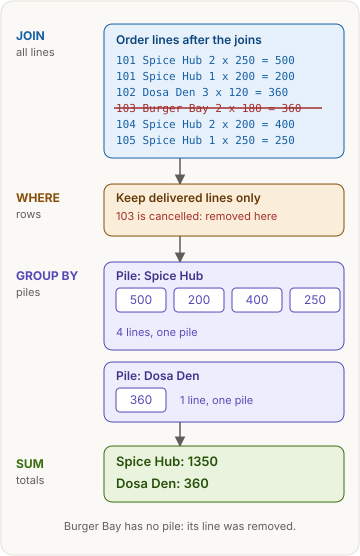
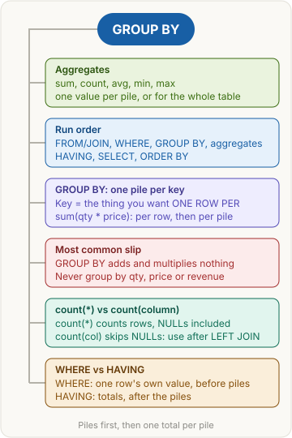

<!-- series:start -->
> [!series]- Databases and SQL · 4 of 5
> 1. [[databases/revision|Databases and SQL quick revision]]
> 2. [[databases/transactions|Transactions and concurrency]]
> 3. [[databases/joins|Joins]]
> 4. **Aggregates: GROUP BY and HAVING** · you are here
> 5. [[databases/window-functions|Window functions]]
<!-- series:end -->

> [!abstract] What this page is for
> **Intent:** turn many order rows into one answer per group (revenue per restaurant, orders per customer), then filter those groups. A very common backend interview question.
> **You'll learn:** aggregate functions · GROUP BY piles · count(*) vs count(column) · WHERE vs HAVING.
> **Time:** about 7 minutes. Read [[databases/joins|Joins]] first, because it builds the rows used here. Every section has a longer version on the [[databases/deep/group-by|detailed Aggregates page]].

## Words you need first

- **Aggregate function**: takes many rows and gives one value. `sum()` adds, `count()` counts, `avg()` averages, `min()` takes the smallest, `max()` the biggest. For the menu prices used here, `min(price)` is 120, `max(price)` is 250, `avg(price)` is 187.5.
- **Pile (group)**: all the rows that share the same key value, such as all of Spice Hub's order lines.
- **Key**: the column or columns in `GROUP BY`. It decides how many piles there are and what one output row means.
- **NULL**: "no value". Not zero, not an empty text. `sum`, `avg`, `min`, `max` and `count(column)` skip NULLs.
- **HAVING**: a filter that runs after the piles are made.

The tables are the same food-delivery ones as on [[databases/joins|Joins]]: orders, order_items, menu_items, restaurants and customers.

## Why it exists

Dashboards and interviewers ask for totals per group: revenue per restaurant, orders per customer. `GROUP BY` builds all those piles in one query.

## The picture



## How it works, with an example

Every query runs in this order, not in the order you type it:

```text
FROM + JOIN   combine the tables into rows
WHERE         keep the single rows that pass (no piles exist yet)
GROUP BY      make one pile per key
aggregates    sum(), count()... run once per pile
HAVING        keep the piles that pass (totals now exist)
SELECT        choose the columns to show
ORDER BY      sort the finished rows (it adds nothing up)
```

`GROUP BY` makes the piles, aggregates total each pile, and `HAVING` filters on those totals.

## The most common mistake

> [!warning] GROUP BY adds nothing up
> A common slip is thinking `GROUP BY` multiplies or adds the numbers. It only makes the piles. `sum(qty * price)` multiplies each line first, then adds the lines in each pile. The key is what you want one row per (a restaurant), not the numbers you add (qty, price) and not the total (revenue).

## GROUP BY: one pile per key

**Plain version:** sort your receipts into one pile per restaurant, then write one total on top of each pile.

**Example:** revenue per restaurant, delivered orders only. The revenue of one line is `qty * price`.

**SQL**

```sql
SELECT r.name AS restaurant, sum(oi.qty * m.price) AS revenue
FROM orders o
JOIN restaurants r ON r.id = o.restaurant_id
JOIN order_items oi ON oi.order_id = o.id
JOIN menu_items m ON m.id = oi.menu_item_id
WHERE o.status = 'delivered'
GROUP BY r.id, r.name
ORDER BY revenue DESC;
```

**Drizzle**

```ts
const revenue = sql<number>`sum(${orderItems.qty} * ${menuItems.price})`.mapWith(Number);
db.select({ restaurant: restaurants.name, revenue })
  .from(orders)
  .innerJoin(restaurants, eq(restaurants.id, orders.restaurantId))
  .innerJoin(orderItems, eq(orderItems.orderId, orders.id))
  .innerJoin(menuItems, eq(menuItems.id, orderItems.menuItemId))
  .where(eq(orders.status, 'delivered'))
  .groupBy(restaurants.id, restaurants.name)
  .orderBy(desc(revenue));
```

Piles after WHERE (order 103 was cancelled, so it is gone):

| pile (restaurant) | lines in the pile | total |
|---|---|---|
| Spice Hub | 500, 200, 400, 250 | 1350 |
| Dosa Den | 360 | 360 |

Result: Spice Hub 1350, Dosa Den 360. Burger Bay has no pile, because its only line was removed by WHERE.

**Why this, not that:**

- Key `r.id, r.name` gives one row per restaurant. Not `o.id`, which gives one row per order.
- Not `revenue`, not `qty`, not `price`. The total is the answer, so it can't be the key. `qty` and `price` are the numbers being added.
- `status = 'delivered'` keeps the status you want. `!= 'cancelled'` would also let in any future status, such as 'refunded'.

> [!tip] Trigger card
> When I see "per restaurant", "for each X" or "by Y", I put X in GROUP BY and the sum or count in SELECT, because GROUP BY decides how many rows come out.

> [!question]- Does GROUP BY multiply qty by price?
> No. `GROUP BY` only decides the piles. `qty * price` is worked out per line inside `sum()`, and `sum()` adds the lines in each pile.

> [!question]- Why does Postgres say "must appear in the GROUP BY clause or be used in an aggregate function"?
> You selected a plain column, such as `m.name`, that is neither grouped nor aggregated. A pile holds several dish names, so Postgres can't pick one. Group by it, or wrap it in an aggregate.

## count(*) vs count(column)

**Plain version:** a class register. `count(*)` counts every line, even a blank one. `count(column)` counts only the lines where that column has something written.

**Example:** orders per customer, keeping customers with no orders (a LEFT JOIN, see [[databases/joins|Joins]]).

**SQL**

```sql
SELECT c.name, count(*) AS all_rows, count(o.id) AS order_count
FROM customers c
LEFT JOIN orders o ON o.customer_id = c.id
GROUP BY c.id, c.name;
```

**Drizzle**

```ts
db.select({ name: customers.name, allRows: count(), orderCount: count(orders.id) })
  .from(customers)
  .leftJoin(orders, eq(orders.customerId, customers.id))
  .groupBy(customers.id, customers.name);
```

Piles (key = customer):

| customer | o.id values | count(*) | count(o.id) |
|---|---|---|---|
| Riya | 101, 103, 105 | 3 | 3 |
| Kabir | 102 | 1 | 1 |
| Meera | 104 | 1 | 1 |
| Arjun | NULL (filler row) | 1 (wrong) | 0 (right) |

Arjun has no orders, so the LEFT JOIN gives him one filler row with NULL in `o.id`. `count(*)` counts that row. `count(o.id)` skips the NULL.

**Why this, not that:**

- After a LEFT JOIN, `count(o.id)` not `count(*)`.
- `count(*)` counts rows. `count(column)` counts non-NULL values. `count(distinct column)` counts different non-NULL values: on orders, 5, 5 and 3 (customers 1, 2, 3).
- `count(*)` does not count "the NULLs". It counts rows and never looks inside them.

> [!tip] Trigger card
> When I see a left join followed by a count, I count a column from the right table (`count(orders.id)`), because the filler row for "no match" would make `count(*)` say 1 instead of 0.

> [!question]- Does count(*) count NULLs?
> It counts rows. A row with a NULL column is still one row, so it is counted. `count(column)` is the one that skips NULLs.

> [!question]- How many orders did Riya place?
> Three: 101, 103 and 105. The cancelled order counts, because this query has no WHERE.

## WHERE vs HAVING

**Plain version:** WHERE is the check at the door, applied to each order as it comes in. HAVING is the check after the pile is totalled: "does this customer have at least two deliveries?"

**Example:** customers with 2 or more delivered orders.

**SQL**

```sql
SELECT c.name AS customer, count(o.id) AS delivered_orders
FROM customers c
JOIN orders o ON o.customer_id = c.id
WHERE o.status = 'delivered'
GROUP BY c.id, c.name
HAVING count(o.id) >= 2;
```

**Drizzle**

```ts
db.select({ customer: customers.name, deliveredOrders: count(orders.id) })
  .from(customers)
  .innerJoin(orders, eq(orders.customerId, customers.id))
  .where(eq(orders.status, 'delivered'))
  .groupBy(customers.id, customers.name)
  .having(sql`count(${orders.id}) >= 2`);
```

After WHERE (4 rows, 103 removed): Riya 101 and 105, Kabir 102, Meera 104.

Piles: Riya 2, Kabir 1, Meera 1.

After HAVING `count(o.id) >= 2`: Riya only. Result: Riya, 2.

**Why this, not that:**

- A filter on one row's own value (status, city) goes in WHERE. A filter on a total (count, sum, avg) goes in HAVING.
- `WHERE count(o.id) >= 2` fails with "aggregate functions are not allowed in WHERE", because WHERE runs before the piles exist.

> [!tip] Trigger card
> When the filter is about a total (count, sum, avg), it goes in HAVING. When it is about one row's own value (status, city), it goes in WHERE, because WHERE runs before grouping and HAVING runs after.

> [!question]- Why is the result empty when I group by orders.id?
> That makes one pile per order. No pile reaches 2 orders, so HAVING keeps nothing. Group by what you count per, which is the customer.

> [!question]- Why can't I write the total in WHERE?
> WHERE runs before grouping, so no piles and no counts exist yet. Move the test to HAVING.

## Say it in an interview

> "GROUP BY puts rows into piles, one per distinct key value. Aggregates like sum, count, avg, min and max run once per pile. The key is the thing you want one row per. WHERE filters rows before the piles exist, HAVING filters the piles after they are totalled. count(*) counts rows, count(column) skips NULLs."

## Questions interviewers ask

Tap a question to see the answer.

> [!question]- What does GROUP BY do?
> It splits the rows into piles, one per distinct key value. Aggregates then give one value per pile.

> [!question]- What is the difference between WHERE and HAVING?
> WHERE filters single rows before grouping. HAVING filters the piles after grouping and aggregating.

> [!question]- Which aggregate functions do you know?
> `sum()`, `count()`, `avg()`, `min()` and `max()`.

> [!question]- Can you use an aggregate in WHERE?
> No. WHERE runs before the piles exist. Use HAVING.

> [!question]- What is the difference between count(*), count(column) and count(distinct column)?
> Rows, rows with a non-NULL value, and different non-NULL values.

> [!question]- What is the difference between GROUP BY and DISTINCT?
> DISTINCT removes duplicate output rows. GROUP BY makes piles, so you can aggregate them. Use GROUP BY as soon as you need sum, count or avg.

> [!question]- Can you group by more than one column?
> Yes. Together the columns form one combined key, so `GROUP BY restaurant_id, status` makes one pile per pair.

> [!question]- Why can you select customers.name when you group by customers.id?
> Postgres accepts it when you group by the table's primary key, because each id has exactly one name. Columns from other tables still need GROUP BY or an aggregate.

## Mental map



## Watch


Alex The Analyst, about 12 minutes: GROUP BY and aggregate functions, in PostgreSQL (the dialect used on this page).

**Want more?** The [[databases/deep/group-by|detailed Aggregates page]] has the same sections with every step table, the wrong versions, NULL edge cases, and more interview questions.

<!-- series-nav:start -->
---

← [[databases/joins|Joins]] · [[databases/window-functions|Window functions]] →
<!-- series-nav:end -->
