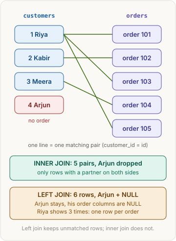
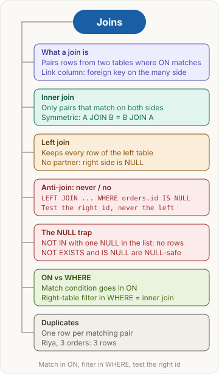

<!-- series:start -->
> [!series]- Databases and SQL · 3 of 5
> 1. [[databases/revision|Databases and SQL quick revision]]
> 2. [[databases/transactions|Transactions and concurrency]]
> 3. **Joins** · you are here
> 4. [[databases/group-by|Aggregates: GROUP BY and HAVING]]
> 5. [[databases/window-functions|Window functions]]
<!-- series:end -->

> [!abstract] What this page is for
> **Intent:** how two tables are joined, why `ON` and `WHERE` differ, and how to find rows with no match.
> **You'll learn:** inner vs left join · ON vs WHERE · the NULL trap · NOT EXISTS · duplicates.
> **Time:** about 8 minutes. The [[databases/deep/joins|detailed Joins page]] repeats each section with every step table.

## Words you need first

- **Table**: rows and columns, like a spreadsheet.
- **Primary key**: the column that names each row once, such as `customers.id`. It is never NULL.
- **Foreign key**: a column that holds another table's primary key. `orders.customer_id` points at `customers.id`.
- **Join**: combines rows of two tables where a condition matches.
- **NULL**: "no value". Not zero, not an empty text. Test it with `IS NULL`, because `= NULL` never matches.
- **Inner join**: keeps only the pairs that match on both sides.
- **Left join**: keeps every row of the left table (written first). Missing right-side values are NULL.
- **Anti-join**: rows of one table with no match in another, such as "never ordered".
- **RIGHT JOIN** keeps every row of the right table. **FULL OUTER JOIN** keeps every row of both. Both are rare. A right join is a left join with the tables swapped.

## Why it exists

A join puts split tables back together for one question.

## The picture



## How it works, with an example

Only the columns joins need are shown.

**customers**

| id | name |
|---|---|
| 1 | Riya |
| 2 | Kabir |
| 3 | Meera |
| 4 | Arjun |

**restaurants**

| id | name |
|---|---|
| 1 | Spice Hub |
| 2 | Dosa Den |
| 3 | Burger Bay |

**orders**

| id | customer_id | restaurant_id | status | created_at |
|---|---|---|---|---|
| 101 | 1 | 1 | delivered | 2026-10-28 13:05 |
| 102 | 2 | 2 | delivered | 2026-10-28 20:40 |
| 103 | 1 | 3 | cancelled | 2026-10-29 19:15 |
| 104 | 3 | 1 | delivered | 2026-10-30 12:30 |
| 105 | 1 | 1 | delivered | 2026-10-31 21:10 |

The link is on the order: `customer_id`. The customer row has no order column. Many orders point at one customer, so the foreign key sits on the many side.

## The most common mistake

> [!warning] Two slips that cost points
> - Writing `customers.orderId`. The link is `orders.customer_id`.
> - Thinking WHERE removes rows with no join partner. The join does that. WHERE only sees rows the join kept.

## Inner join and WHERE: two filters

**Plain version:** the join is a bouncer that lets in only rows with a partner. WHERE is a second check on those inside. Removing it doesn't let back in the rows the bouncer refused.

**Example:** every delivered order, with names, newest first.

**SQL**

```sql
SELECT o.id AS order_id, c.name AS customer, r.name AS restaurant, o.created_at
FROM orders o
JOIN customers c   ON c.id = o.customer_id
JOIN restaurants r ON r.id = o.restaurant_id
WHERE o.status = 'delivered'
ORDER BY o.created_at DESC;
```

**Drizzle**

```ts
db.select({ orderId: orders.id, customer: customers.name, restaurant: restaurants.name, createdAt: orders.createdAt })
  .from(orders)
  .innerJoin(customers, eq(customers.id, orders.customerId))
  .innerJoin(restaurants, eq(restaurants.id, orders.restaurantId))
  .where(eq(orders.status, 'delivered'))
  .orderBy(desc(orders.createdAt));
```

After the join (5 rows). Arjun is missing, because he has no order:

| order | customer | restaurant | status |
|---|---|---|---|
| 101 | Riya | Spice Hub | delivered |
| 102 | Kabir | Dosa Den | delivered |
| 103 | Riya | Burger Bay | cancelled |
| 104 | Meera | Spice Hub | delivered |
| 105 | Riya | Spice Hub | delivered |

Result, after WHERE removes 103 (4 rows):

| order | customer | restaurant | created_at |
|---|---|---|---|
| 105 | Riya | Spice Hub | 2026-10-31 21:10 |
| 104 | Meera | Spice Hub | 2026-10-30 12:30 |
| 102 | Kabir | Dosa Den | 2026-10-28 20:40 |
| 101 | Riya | Spice Hub | 2026-10-28 13:05 |

**Why this, not that:**

- **The join drops a row with no partner** (Arjun). **WHERE drops a row that fails a condition** (103, which is cancelled, though it has a partner).

> [!tip] Trigger card
> When I need only rows with a partner in both tables, I use `JOIN`, because a row with no partner has nothing to pair with.

> [!question]- Does WHERE remove rows that have no join partner?
> No, that is a common slip. The join removes them first. WHERE only checks rows that survived the join.

> [!question]- Is `customers JOIN orders` the same as `orders JOIN customers`?
> For an inner join, yes: the same rows. A left join is not symmetric, because the left table decides which rows are kept.

## Left join and anti-join: who never ordered

**Plain version:** a class register. Every student has a line. An absent student gets a blank (NULL) instead of being skipped. To find the absent ones, look for the blanks.

**Example:** customers who never ordered.

**SQL**

```sql
SELECT c.id, c.name
FROM customers c
LEFT JOIN orders o ON o.customer_id = c.id
WHERE o.id IS NULL;
```

**Drizzle**

```ts
db.select({ id: customers.id, name: customers.name })
  .from(customers)
  .leftJoin(orders, eq(orders.customerId, customers.id))
  .where(isNull(orders.id));
```

After the left join (6 rows). Riya appears three times, once per order:

| c.id | name | o.id |
|---|---|---|
| 1 | Riya | 101 |
| 1 | Riya | 103 |
| 1 | Riya | 105 |
| 2 | Kabir | 102 |
| 3 | Meera | 104 |
| 4 | Arjun | NULL |

Result, after WHERE `o.id IS NULL`: **4 · Arjun**.

**Why this, not that:**

- **LEFT JOIN + IS NULL** works on any data. **NOT IN** (`WHERE id NOT IN (SELECT customer_id FROM orders)`) returns no rows at all if the list has one NULL, because `4 <> NULL` is unknown. **NOT EXISTS** (`WHERE NOT EXISTS (SELECT 1 FROM orders o WHERE o.customer_id = c.id)`) is NULL-safe.
- **Test the right table's id** (`orders.id`). Only the joined side gets NULLs. Testing `customers.id` finds nothing.
- **Match in ON, not WHERE.** A right-table filter in WHERE turns a left join into an inner join: `WHERE o.status = 'delivered'` removes Arjun, whose NULL status fails.

> [!tip] Trigger card
> When a question says "never", "no", or "even with none", I left join from the table that must keep every row, then keep the rows where the other table's id IS NULL.

> [!question]- Can you start from orders to find customers who never ordered?
> No. A customer with no orders has no row in `orders`. Start from `customers`.

> [!question]- Why does Riya appear three times?
> A join makes one row per matching pair. Riya has three orders, so three pairs. That is how joins duplicate rows.

> [!question]- Why is NOT IN risky?
> One NULL in its list makes it return no rows at all, with no error. Use NOT EXISTS.

## Say it in an interview

> "A join combines rows from two tables where a condition matches, usually a foreign key on the many side. An inner join keeps only matched pairs. A left join keeps every row of the left table and fills the right side with NULL. To find rows with no match, I left join and keep the rows where the right table's key IS NULL. The match goes in ON, and a right-table filter in WHERE turns the left join into an inner join. I use NOT EXISTS rather than NOT IN, because one NULL makes NOT IN return nothing."

## Questions interviewers ask

Tap a question to see the answer.

> [!question]- Inner join vs left join?
> Inner keeps only matched rows. Left keeps every left-table row, with NULLs where nothing matches.

> [!question]- Where does the foreign key live?
> On the many side: each order has one customer, and a customer has many orders.

> [!question]- ON or WHERE for a filter in an outer join?
> ON decides which rows match, so unmatched left rows stay. WHERE filters after the join.

> [!question]- What is an anti-join?
> Rows of one table with no match in another. Left join, then keep rows where the other table's id IS NULL.

> [!question]- Why does NOT IN break with NULL?
> The comparison with NULL is unknown, and WHERE keeps only true rows. One unknown in the list makes every row fail. NOT EXISTS is safe.

> [!question]- What is a NULL foreign key in a join?
> It never matches anything, not even another NULL. An inner join drops that row.

> [!question]- How do you join on two columns?
> `ON a.x = b.x AND a.y = b.y`. Both pairs must match.

> [!question]- Why can a join return more rows than its starting table?
> One row can match many; each pair is a row.

## Mental map



## Watch


Socratica, about 10 minutes: an overview of SQL joins and the basic join types.

**Want more?** The [[databases/deep/joins|detailed Joins page]] adds every step table, the wrong versions and harder questions. Next: [[databases/group-by|Aggregates: GROUP BY and HAVING]].

<!-- series-nav:start -->
---

← [[databases/transactions|Transactions and concurrency]] · [[databases/group-by|Aggregates: GROUP BY and HAVING]] →
<!-- series-nav:end -->
