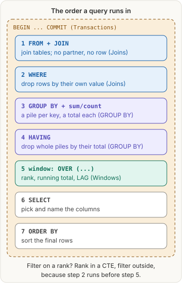
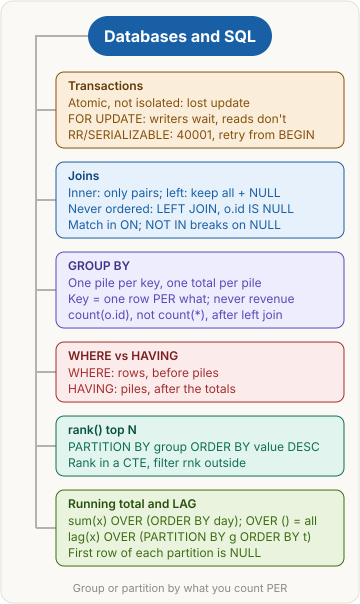

<!-- series:start -->
> [!series]- Databases and SQL · 1 of 5
> 1. **Databases and SQL quick revision** · you are here
> 2. [[databases/transactions|Transactions and concurrency]]
> 3. [[databases/joins|Joins]]
> 4. [[databases/group-by|Aggregates: GROUP BY and HAVING]]
> 5. [[databases/window-functions|Window functions]]
<!-- series:end -->

> [!abstract] What this page is for
> **Intent:** revise transactions and everyday SQL in one go, the night before an interview.
> **Covers:** transactions and concurrency · joins · GROUP BY, count and HAVING · window functions (rank, running total, LAG).
> **Time:** about 10 minutes. Every topic below links to its quick page and its detailed page.

## Words you need first

- **Transaction:** queries between `BEGIN` and `COMMIT` that take effect all together or not at all.
- **Atomicity:** the "all or nothing" promise. It does not keep other transactions out.
- **Lost update:** two transactions read the same value, both write back, and the earlier write disappears.
- **Stale value:** a copy read earlier that no longer matches the row.
- **Isolation level:** how much one transaction is protected from others' changes. Postgres default: `READ COMMITTED`.
- **Snapshot:** the frozen view of committed data a `REPEATABLE READ` transaction works from.
- **40001 (serialization failure):** Postgres refusing a write because your snapshot is out of date. Retry the whole transaction.
- **Row lock (`SELECT ... FOR UPDATE`):** "I will change this row": other writers wait until `COMMIT`.
- **Pessimistic vs optimistic:** lock first and make others wait, or don't lock and retry when a conflict shows up.
- **Join:** pairing rows of two tables where the `ON` condition matches.
- **Foreign key:** the link column, kept on the "many" side (`orders.customer_id`).
- **NULL:** "no value". A left join fills it in when there is no partner.
- **Anti-join:** finding rows with no match (left join, then `IS NULL`).
- **Aggregate:** a function that turns many rows into one value: `sum`, `count`, `avg`, `min`, `max`.
- **GROUP BY:** makes one pile per key; aggregates then run once per pile.
- **HAVING:** a filter on piles, after the totals exist.
- **Window function:** writes a value on every row from related rows, without squashing them (`OVER (...)`).
- **PARTITION BY:** the piles of a window function; the count restarts in each.
- **CTE (common table expression):** a named step, `WITH name AS (SELECT ...)`, read like a table by the next query.
- **Drizzle:** a TypeScript query builder; its calls map almost one to one onto SQL clauses.

## The big picture

All the SQL topics are steps of one query, in the order the database runs them. The transaction wraps the whole thing.

The data used on the joins, GROUP BY and window pages (the transactions page uses a small shoe shop, `products(id, stock)`, instead): 4 customers (Riya, Kabir, Meera, Arjun), 3 restaurants (Spice Hub, Dosa Den, Burger Bay), 5 orders (101 to 105; 103 is cancelled; Arjun never ordered), and the order lines with `qty x price`.

## Topic by topic

### 1. Transactions and concurrency
- A transaction is **atomic, not isolated**. Two checkouts can both read stock 5, both write 4, and one sale's update is lost (it should be 3).
- The **earlier** write is the one lost: last writer wins, from a stale copy.
- `READ COMMITTED` (default) never re-checks a decision made from an earlier read. `REPEATABLE READ` / `SERIALIZABLE` raise **40001**; the backend retries the **whole** transaction from `BEGIN`, and only on errors that can succeed next time (40001, and 40P01 for a deadlock).
- **Fix 1, `FOR UPDATE`:** other writers wait; plain reads don't. Good for hot rows. **Fix 2, retry:** no waiting; good when conflicts are rare. Or one atomic `UPDATE ... SET stock = stock - 1 WHERE id = $1 AND stock >= 1`.
- **Trap:** a slow payment call inside a locked transaction makes every other buyer queue: timeouts and an empty connection pool.
- [[databases/transactions|Quick]] · [[databases/deep/transactions|Detailed]]

### 2. Joins
- **Inner join:** only pairs that match. Arjun (no orders) is dropped by the **join**; cancelled order 103 by the **WHERE**. Two separate filters.
- **Left join:** keeps every row of the `FROM` table; no partner means NULLs on the joined side.
- "Who never ordered?" = `FROM customers LEFT JOIN orders ... WHERE orders.id IS NULL` → Arjun. Test the right side's id, never the left's.
- The match goes in `ON`. `NOT IN` returns nothing if the list holds a NULL; `NOT EXISTS` or the left join are safe.
- **Trap:** the foreign key is `orders.customer_id`; customers hold no order id.
- [[databases/joins|Quick]] · [[databases/deep/joins|Detailed]]

### 3. Aggregates: GROUP BY and HAVING
- Piles: `GROUP BY r.id, r.name` with `sum(oi.qty * m.price)` → Spice Hub 1350, Dosa Den 360. The multiply happens per row, the add per pile.
- **Key rule:** group by what you want one row **per**; add every plain selected column; never the aggregate (revenue) or the summed columns (qty, price).
- After a left join, `count(o.id)` gives Arjun 0; `count(*)` gives 1, because his filler row still exists.
- `WHERE` drops rows before the piles; `HAVING` drops piles after the totals. "2 or more delivered orders" → `HAVING count(o.id) >= 2` → Riya 2.
- **Trap:** grouping by `orders.id` makes one pile per order, so every count is 1 and HAVING keeps nothing.
- [[databases/group-by|Quick]] · [[databases/deep/group-by|Detailed]]

### 4. Window functions
- Same piles as GROUP BY, but every row stays. Runs after GROUP BY and HAVING, so it can't go in WHERE.
- **Top N per group:** `rank() OVER (PARTITION BY restaurant ORDER BY revenue DESC)` in a CTE, then `WHERE rnk = 1` outside → Paneer Tikka 750, Masala Dosa 360. The count restarts at 1 per restaurant.
- **Running total:** group by day first, then `sum(revenue) OVER (ORDER BY day)` → 1060, 1460, 1710. `OVER ()` gives 1710 on every row. 10-29 has no row (its only order was cancelled).
- **LAG:** `lag(total) OVER (PARTITION BY restaurant_id ORDER BY created_at)`; the first row of each partition is NULL. Putting `restaurant_id` only in ORDER BY makes 102 compare with Spice Hub's 250.
- **Trap:** "for each X" goes in PARTITION BY; "by Y", "so far", "previous" go in ORDER BY.
- [[databases/window-functions|Quick]] · [[databases/deep/window-functions|Detailed]]

## Top questions

> [!question]- Does wrapping code in BEGIN/COMMIT prevent a lost update?
> No. A transaction is atomic, not isolated. Under READ COMMITTED two transactions can still read the same old value and overwrite each other.

> [!question]- In a lost update, whose write is lost?
> The earlier one. The later writer overwrites it with a value computed from a stale read.

> [!question]- What does error 40001 mean and what do you do?
> The transaction tried to change data that changed after its snapshot. Catch it in the backend and rerun the whole transaction from BEGIN; retry only errors that can succeed next time (40001, and 40P01 for a deadlock), never "sold out" or a constraint error.

> [!question]- FOR UPDATE or SERIALIZABLE with retry?
> FOR UPDATE for a hot row many requests fight over (others wait). Optimistic retry when conflicts are rare (no waiting, occasional retries). Keep locked transactions short.

> [!question]- Does SELECT ... FOR UPDATE block plain SELECTs?
> No. It blocks other writers and other FOR UPDATE on that row until COMMIT or ROLLBACK.

> [!question]- Inner join vs left join?
> Inner keeps only matched pairs. Left keeps every row of the FROM table and fills NULLs where there is no partner.

> [!question]- How do you find customers who never ordered?
> Left join customers to orders and keep rows where orders.id IS NULL. Or NOT EXISTS. Avoid NOT IN if the list can hold NULL.

> [!question]- Why does WHERE not remove a customer with no orders after an inner join?
> It never sees them: the join already dropped them. WHERE only filters the pairs the join built.

> [!question]- What goes in GROUP BY?
> The thing you want one row per, plus every plain column you select. Never an aggregate like revenue.

> [!question]- count(*) vs count(column)?
> count(*) counts rows. count(column) skips NULLs. After a left join, count the right table's id so "no orders" gives 0.

> [!question]- WHERE vs HAVING?
> WHERE filters rows before grouping. HAVING filters groups after the aggregates. An aggregate in WHERE is an error.

> [!question]- GROUP BY vs PARTITION BY?
> GROUP BY squashes each group to one row. PARTITION BY keeps every row and restarts the window function in each group.

> [!question]- How do you get the top item per restaurant?
> rank() OVER (PARTITION BY restaurant ORDER BY revenue DESC) inside a CTE, then filter rnk = 1 outside, because WHERE runs before window functions.

> [!question]- rank vs dense_rank vs row_number?
> rank: ties share, then skip (1, 1, 3). dense_rank: ties share, no skip (1, 1, 2). row_number: always unique.

> [!question]- How do you write a running total, and why not OVER ()?
> sum(x) OVER (ORDER BY time). OVER () makes the window the whole result, so every row shows the grand total.

> [!question]- Why is LAG NULL on some rows?
> Those rows are the first in their partition, so there is no previous row in that group.

## Mental map

## Watch

Fireship, about 2 minutes: "SQL Explained in 100 Seconds", a fast overview of what SQL and relational databases are. Use the topic pages for joins, GROUP BY, windows and transactions in depth.

<!-- series-nav:start -->
---

← [[databases/index|Databases and SQL]] · [[databases/transactions|Transactions and concurrency]] →
<!-- series-nav:end -->
