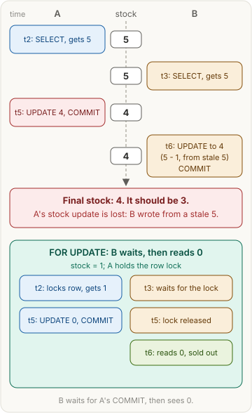
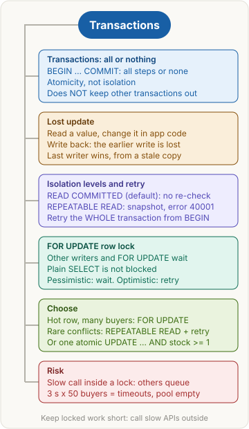

<!-- series:start -->
> [!series]- Databases and SQL · 2 of 5
> 1. [[databases/revision|Databases and SQL quick revision]]
> 2. **Transactions and concurrency** · you are here
> 3. [[databases/joins|Joins]]
> 4. [[databases/group-by|Aggregates: GROUP BY and HAVING]]
> 5. [[databases/window-functions|Window functions]]
<!-- series:end -->

> [!abstract] What this page is for
> **Intent:** understand how two buyers can sell the same last pair, and how transactions, locks and retry stop it.
> **You'll learn:** atomicity · read-modify-write · lost update · READ COMMITTED vs REPEATABLE READ · error 40001 and retry · FOR UPDATE · optimistic vs pessimistic.
> **Time:** about 7 minutes. Every section has a longer version on the [[databases/deep/transactions|detailed Transactions page]].

## Words you need first

- **Transaction**: statements between `BEGIN` and `COMMIT`. All of them are saved, or (on `ROLLBACK`) none. That is **atomic**.
- **Isolation**: how much a running transaction sees of the others running at the same time.
- **Read-modify-write**: read a value, change it in app code, write it back. The gap between read and write is where races happen.
- **Lost update**: two read-modify-writes on one row. One write overwrites the other.
- **Snapshot**: the consistent "photo" of the data a transaction reads from.
- **READ COMMITTED** (Postgres default) and **REPEATABLE READ**: isolation levels. The second one reads from one snapshot.
- **40001**: the error code (SQLSTATE) for "could not serialize access". A write conflicts with a change made after your snapshot.
- **Drizzle**: a TypeScript library. `db.transaction` runs a transaction.

This page uses a small shoe shop: `products(id, stock)`, where stock is the pairs left.

## Why it exists

Many buyers use the shop at once. Two of them can read "1 pair left" and both buy it. Transactions and isolation keep concurrent work correct.

## The picture



## How it works, with an example

Checkout reads the stock, checks it, inserts an order, and writes the new stock. Each section below takes one way that can go wrong, and the fix.

## The most common mistake

> [!warning] BEGIN and COMMIT don't keep others out
> A transaction only promises that its own steps all happen or none do. Other transactions keep running and reading. Stopping them is the job of isolation and locks, not `BEGIN`.

## Transactions: all or nothing

**Plain version:** like a bank transfer. Money leaves one account and arrives in the other, or neither happens.

**Example:**

```sql
-- SQL
BEGIN;
INSERT INTO shoe_orders (product_id) VALUES (1);
UPDATE products SET stock = stock - 1 WHERE id = 1;
COMMIT;
```

```ts
// Drizzle
await db.transaction(async (tx) => {
  await tx.insert(shoeOrders).values({ productId: 1 });
  await tx.update(products).set({ stock: sql`${products.stock} - 1` }).where(eq(products.id, 1));
});
```

| step | shoe_orders | stock |
|---|---|---|
| UPDATE fails, ROLLBACK | 0 rows | 1 |
| COMMIT (success) | 1 row | 0 |

Caption: a failure leaves the table as it was. Nothing is half-done.

**Why this, not that:**

- Atomicity: all steps succeed, or none do. It does not stop others while you run.
- Isolation: controls what others see. That is a different job.

> [!tip] Trigger card
> When I see several writes that must go together, I use one transaction, because it makes them all-or-nothing. It does not keep other transactions out.

> [!question]- Does BEGIN ... COMMIT stop other transactions from reading the old data?
> No. Atomicity only means this transaction's steps commit together. Keeping others out is isolation's job.

> [!question]- A statement inside the transaction fails. What now?
> The transaction is aborted. Postgres refuses more queries until `ROLLBACK`, and nothing from it is kept.

## Lost update

**Plain version:** two cashiers read "5 pairs left" from one notebook page. Each sells one and writes the new count. The second write covers the first, and one sale vanishes.

**Example:** both buyers run the same read-modify-write.

```sql
-- SQL, run by A and by B
SELECT stock FROM products WHERE id = 1;     -- app gets 5
UPDATE products SET stock = $1 WHERE id = 1; -- $1 = 5 - 1, computed in the app
```

```ts
// Drizzle, run by A and by B
const [p] = await db.select().from(products).where(eq(products.id, 1));
await db.update(products).set({ stock: p.stock - 1 }).where(eq(products.id, 1));
```

| time | A | row | B |
|---|---|---|---|
| t2 | SELECT, gets 5 | 5 | |
| t3 | | 5 | SELECT, gets 5 |
| t5 | UPDATE to 4, COMMIT | 4 | |
| t6 | | 4 | UPDATE to 4 (from its copy of 5), COMMIT |

Caption: final stock 4. Two pairs were sold, so it should be 3.

**Why this, not that:**

- The earlier write is lost: A's sale.
- The later write survives: B's, built on a stale 5. Last writer wins.

> [!tip] Trigger card
> When I see a SELECT of a value, then an UPDATE of the same row with a number computed in app code, I suspect a lost update. READ COMMITTED does not block that.

> [!question]- In a lost update, which write disappears?
> The earlier one. A common slip is to say the later write is lost. B's write lands last and survives.

> [!question]- Why is the final stock 4, not 3? Which value is stale?
> B computed 5 - 1 from the 5 it read at t3. That stale 5 erased A's sale. A common slip is to point at A's 4, which was fresh when A wrote it.

## Isolation levels and retry

**Plain version:** isolation decides what a running transaction may see of the others.

- **READ COMMITTED** (default): each statement sees the latest committed data. Nothing re-checks the app's earlier decision, so the lost update happens silently.
- **REPEATABLE READ**: one snapshot, taken at the first query. If the transaction writes a row that changed after that snapshot, Postgres fails the write with **40001**. The fix is to retry the whole transaction.

**Example:** the checkout under REPEATABLE READ, with a retry loop.

```sql
-- SQL, run by A and by B
BEGIN ISOLATION LEVEL REPEATABLE READ;
SELECT stock FROM products WHERE id = 1;     -- snapshot: 5
UPDATE products SET stock = $1 WHERE id = 1; -- $1 = 5 - 1
COMMIT;
```

```ts
// Drizzle
async function buyOne(productId: number) {
  for (let attempt = 1; ; attempt++) {
    try {
      return await db.transaction(async (tx) => {
        const [p] = await tx.select().from(products).where(eq(products.id, productId));
        if (p.stock < 1) throw new Error("sold out");
        await tx.update(products).set({ stock: p.stock - 1 }).where(eq(products.id, productId));
      }, { isolationLevel: "repeatable read" });
    } catch (err) {
      const e = err as { code?: string; cause?: { code?: string } };
      const code = e.code ?? e.cause?.code;
      if ((code !== "40001" && code !== "40P01") || attempt >= 5) throw err;
    }
  }
}
```

| time | A | row | B |
|---|---|---|---|
| t2 | BEGIN, snapshot, reads 5 | 5 | |
| t3 | | 5 | BEGIN, snapshot, reads 5 |
| t5 | UPDATE to 4, COMMIT | 4 | |
| t6 | | 4 | UPDATE: ERROR 40001, ROLLBACK |
| t7 | retry from BEGIN: reads 4, writes 3 | 3 | |

Caption: B's write is refused, not silently lost. The retry sees 4 and writes 3.

**Why this, not that:**

- READ COMMITTED: each statement sees the newest data, and the lost update is silent.
- REPEATABLE READ: a conflict raises 40001, so retry the whole transaction from BEGIN. Retry only errors that can succeed next time: 40001 (and 40P01, a deadlock), never "sold out" or a constraint error.

> [!tip] Trigger card
> When I see error 40001, the transaction tried to write over data that changed after its snapshot. I retry the whole transaction from BEGIN, not the last query.

> [!question]- Why retry the whole transaction, and not just the UPDATE?
> A common slip is to retry only the UPDATE. After an error the transaction is aborted, and the old snapshot still shows 5. A new BEGIN takes a new snapshot.

> [!question]- Does REPEATABLE READ stop lost updates?
> In Postgres, yes, when you retry on 40001. In MySQL InnoDB, REPEATABLE READ does not stop this lost update, so name the database when you answer.

## FOR UPDATE vs SERIALIZABLE and retry

**Plain version:** two ways to stop the lost update.

- **Pessimistic:** lock first. `SELECT ... FOR UPDATE` makes the second buyer wait at the row until COMMIT.
- **Optimistic:** no lock. A conflict fails at write time (40001 under REPEATABLE READ or SERIALIZABLE), and the loop retries.

**Example:**

```sql
-- SQL
BEGIN;
SELECT stock FROM products WHERE id = 1 FOR UPDATE; -- row lock until COMMIT
-- app checks stock >= 1 here, then:
UPDATE products SET stock = stock - 1 WHERE id = 1;
COMMIT;
```

```ts
// Drizzle
await db.transaction(async (tx) => {
  const [p] = await tx.select().from(products).where(eq(products.id, 1)).for("update");
  if (p.stock < 1) throw new Error("sold out");
  await tx.update(products).set({ stock: p.stock - 1 }).where(eq(products.id, 1));
});
```

| time | A | row | B |
|---|---|---|---|
| t2 | SELECT ... FOR UPDATE, gets 1, holds the lock | 1 | |
| t3 | | 1 | SELECT ... FOR UPDATE: waits |
| t5 | UPDATE to 0, COMMIT (lock released) | 0 | |
| t6 | | 0 | lock granted, reads 0, "sold out" |

Caption: B waits, then reads 0. No oversell.

A one-statement option needs no lock or retry: `UPDATE products SET stock = stock - 1 WHERE id = 1 AND stock >= 1`, then check that one row changed.

**Why this, not that:**

- FOR UPDATE: waiters queue at the row. Pick it for a hot row with many buyers at once.
- Retry: nobody waits, but conflicts cost a retry. Pick it when conflicts are rare.

> [!tip] Trigger card
> When I see `SELECT ... FOR UPDATE`, other writers queue behind it until COMMIT or ROLLBACK. Plain reads are not blocked.

> [!question]- Does FOR UPDATE stop other transactions from reading the row?
> No. It blocks writers and other FOR UPDATE calls. A plain `SELECT` still reads. A common slip is to think it blocks reads.

> [!question]- What does a slow step inside a locked transaction cost?
> Waiting. With a 3-second payment API call inside the lock and 50 buyers, the last buyer waits about 49 x 3 seconds, around 2.5 minutes. Requests time out and the connection pool runs out. Call slow APIs outside the transaction.

## Say it in an interview

> "A transaction groups steps so they all commit or none do. That is atomicity. It does not keep other transactions out; isolation does that. Postgres defaults to READ COMMITTED, where a read-modify-write in app code can lose an update: two buyers read stock 5, both write 4, and one sale vanishes. Under REPEATABLE READ the second writer gets error 40001, and I retry the whole transaction from BEGIN. Or I lock the row with SELECT FOR UPDATE, or write one atomic UPDATE with a stock check. I keep locked work short, because a slow call inside the lock makes everyone wait."

## Questions interviewers ask

Tap a question to see the answer.

> [!question]- What is a transaction?
> Statements between BEGIN and COMMIT that take effect together, or not at all.

> [!question]- What is a lost update?
> Two transactions read the same row, both write it, and one overwrites the other's change.

> [!question]- What is the default isolation level in Postgres?
> READ COMMITTED. It does not stop a read-modify-write race in app code.

> [!question]- What does REPEATABLE READ give you?
> One snapshot from the first query. A write that conflicts with a later change fails with 40001.

> [!question]- What do you do with error 40001?
> Retry the whole transaction from BEGIN. Retry only 40001 (and 40P01, a deadlock): those can succeed next time, while "sold out" or a typo fails the same way every time.

> [!question]- What does SELECT ... FOR UPDATE do?
> It takes a row lock. Other writers and FOR UPDATE calls wait until COMMIT or ROLLBACK. Plain reads are not blocked.

> [!question]- Pessimistic vs optimistic locking?
> Pessimistic: lock first, and others wait. Optimistic: no lock, detect the conflict at write time, and retry.

> [!question]- What is write skew, in one line?
> Two transactions each read the same data, each write a different row, and together break a rule. SERIALIZABLE catches it; REPEATABLE READ does not.

## Mental map



## Watch


JaneExplainsIT, YouTube: transaction isolation levels and anomalies in PostgreSQL.

**Want more?** The [[databases/deep/transactions|detailed Transactions and concurrency page]] has every step table, the wrong version's tables, the slow-work timeline and the harder questions. Next topic: [[databases/joins|Joins]].

<!-- series-nav:start -->
---

← [[databases/revision|Databases and SQL quick revision]] · [[databases/joins|Joins]] →
<!-- series-nav:end -->
