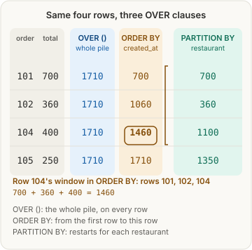
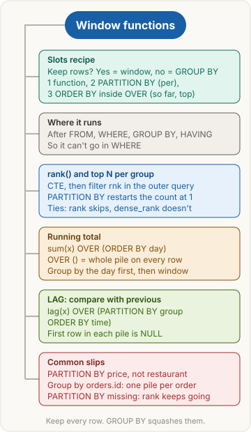

<!-- series:start -->
> [!series]- Databases and SQL · 5 of 5
> 1. [[databases/revision|Databases and SQL quick revision]]
> 2. [[databases/transactions|Transactions and concurrency]]
> 3. [[databases/joins|Joins]]
> 4. [[databases/group-by|Aggregates: GROUP BY and HAVING]]
> 5. **Window functions** · you are here
<!-- series:end -->

> [!abstract] What this page is for
> **Intent:** compute a value for each row from its group or its neighbours, without squashing the rows. Top N per group, running totals, comparing with the previous row.
> **You'll learn:** what OVER does · PARTITION BY vs GROUP BY · rank, dense_rank, row_number · the default frame · LAG and NULL on the first row · why WHERE can't filter a rank.
> **Time:** about 7 minutes. Every section has a longer version on the [[databases/deep/window-functions|detailed Window functions page]]. If piles are new, read [[databases/group-by|Aggregates: GROUP BY and HAVING]] first.

## Words you need first

- **Window function**: a function that writes one value on each row, using related rows (its "window"). Examples: `rank()`, `sum()`, `lag()`. Every row stays in the result.
- **OVER**: turns a function into a window function, as in `sum(total) OVER (...)`. The brackets say which rows make up the window.
- **PARTITION BY**: splits the rows into piles and restarts the function in each pile. Read "for each" or "per" as PARTITION BY.
- **ORDER BY inside OVER**: sets the order inside each pile. Used for "so far", "top" and "previous". It is separate from the query's final ORDER BY.
- **CTE (common table expression)**: a named temporary result, written `WITH name AS (SELECT ...)`. The next query reads it like a table.
- **LAG and LEAD**: `lag(x)` reads the row before, `lead(x)` the row after, in the same pile.
- **NULL**: "no value". LAG returns it when there is no previous row.

## Why it exists

GROUP BY gives one row per group. Often you need every row plus a number about its group: its rank, its running total, or its previous order. A window function adds that number to each row.

## The picture



## How it works, with an example

A window function runs after FROM, WHERE, GROUP BY and HAVING, and before the final ORDER BY. That is why it can't go in WHERE. To write one, use the slots recipe:

> **Slots recipe.** Keep the rows? Yes, so use a window function. No, use GROUP BY.
> 1. Which function: `rank()`, `sum()`, `lag()`.
> 2. PARTITION BY: the words "per", "for each", "within", "its".
> 3. ORDER BY inside OVER: the words "so far", "running", "top", "previous".

## The most common mistake

> [!warning] Forgetting that PARTITION BY restarts the count
> With `rank() OVER (PARTITION BY restaurant ORDER BY revenue DESC)`, every restaurant is its own pile and counting starts at 1 in each one. So Masala Dosa is rank 1 in Dosa Den, not rank 3. A common slip is to count down the whole table anyway. Rank 3 only happens when PARTITION BY is left out and all dishes share one pile.

## rank() and top N per group

**Plain version:** each restaurant has its own shelf of dishes. Put the dishes on each shelf in order, best first, and start counting at 1 on every shelf.

**Example.** Top dish by revenue in each restaurant, delivered orders only.

```sql
WITH ranked AS (
  SELECT r.name AS restaurant, m.name AS item,
         sum(oi.qty * m.price) AS revenue,
         rank() OVER (PARTITION BY r.id ORDER BY sum(oi.qty * m.price) DESC) AS rnk
  FROM orders o
  JOIN restaurants r ON r.id = o.restaurant_id
  JOIN order_items oi ON oi.order_id = o.id
  JOIN menu_items m ON m.id = oi.menu_item_id
  WHERE o.status = 'delivered'
  GROUP BY m.id, m.name, r.id, r.name
)
SELECT restaurant, item, revenue FROM ranked WHERE rnk = 1;
```

```ts
const revenue = sql<number>`sum(${orderItems.qty} * ${menuItems.price})`.mapWith(Number);
const ranked = db.$with('ranked').as(
  db.select({
    restaurant: restaurants.name,
    item: menuItems.name,
    revenue: revenue.as('revenue'),
    rnk: sql<number>`rank() over (partition by ${restaurants.id} order by ${revenue} desc)`.as('rnk'),
  })
  .from(orders)
  .innerJoin(restaurants, eq(restaurants.id, orders.restaurantId))
  .innerJoin(orderItems, eq(orderItems.orderId, orders.id))
  .innerJoin(menuItems, eq(menuItems.id, orderItems.menuItemId))
  .where(eq(orders.status, 'delivered'))
  .groupBy(menuItems.id, menuItems.name, restaurants.id, restaurants.name)
);
const top = await db.with(ranked).select().from(ranked).where(eq(ranked.rnk, 1));
```

The GROUP BY makes one pile per dish. Paneer Tikka = 500 + 250 = 750, Dal Makhani = 200 + 400 = 600, Masala Dosa = 360. The window then ranks them inside each restaurant:

| restaurant | item | revenue | rnk |
|---|---|---|---|
| Spice Hub | Paneer Tikka | 750 | 1 |
| Spice Hub | Dal Makhani | 600 | 2 |
| Dosa Den | Masala Dosa | 360 | 1 |

Result (rnk = 1): Spice Hub, Paneer Tikka, 750 and Dosa Den, Masala Dosa, 360.

**Why this, not that**

- **GROUP BY restaurant vs PARTITION BY restaurant:** GROUP BY squashes each restaurant into one row. PARTITION BY keeps every row and only sets the pile the rank is counted in.
- **CTE, then filter outside vs `WHERE rnk = 1` in one query:** WHERE runs before the window, so `rnk` doesn't exist yet and Postgres refuses. Rank in a CTE, filter outside.
- **Ties, one line each:** `rank()` gives ties the same number, then skips (1, 1, 3). `dense_rank()` gives ties the same number, no skip (1, 1, 2). `row_number()` never ties (1, 2, 3).

> [!tip] Trigger card
> When I see "top N per X", I use `rank() OVER (PARTITION BY X ORDER BY value DESC)` in a CTE and filter `rnk <= N` outside, because WHERE runs before the window.

> [!question]- Why is grouping by orders.id wrong in the CTE?
> It makes one pile per order, so the dish total is never built, and the item name is neither grouped nor aggregated. Postgres then raises an error. Group by the dish (`m.id, m.name`), because the dish is what you rank.

> [!question]- Why is PARTITION BY price wrong here?
> Price puts dishes that cost the same, across restaurants, into one pile. "For each restaurant" means PARTITION BY restaurant.

> [!question]- Why does Masala Dosa get rank 1 and not 3?
> Its restaurant's shelf has only one dish, so it is first there. Without PARTITION BY, all three dishes share one list and it would be third.

## Running total

**Plain version:** a bank passbook. Every line shows the amount and the balance so far. The balance on line 3 is line 1 + line 2 + line 3.

**Example.** Here is `order_totals`, a helper table with one row per delivered order (its columns are order_id, restaurant_id, created_at and total). Four ways to write the window:

| order_id | total | OVER () | OVER (ORDER BY created_at) |
|---|---|---|---|
| 101 | 700 | 1710 | 700 |
| 102 | 360 | 1710 | 1060 |
| 104 | 400 | 1710 | 1460 |
| 105 | 250 | 1710 | 1710 |

With no OVER at all, `sum(total)` collapses the rows into one row showing 1710.

Now running revenue per day. Two layers: GROUP BY the day first, then the window adds up the daily rows.

```sql
WITH daily AS (
  SELECT o.created_at::date AS day, sum(oi.qty * m.price) AS revenue
  FROM orders o
  JOIN order_items oi ON oi.order_id = o.id
  JOIN menu_items m ON m.id = oi.menu_item_id
  WHERE o.status = 'delivered'
  GROUP BY o.created_at::date
)
SELECT day, revenue, sum(revenue) OVER (ORDER BY day) AS running_total
FROM daily
ORDER BY day;
```

```ts
const day = sql<string>`${orders.createdAt}::date`;
const daily = db.$with('daily').as(
  db.select({ day: day.as('day'), revenue: sql<number>`sum(${orderItems.qty} * ${menuItems.price})`.mapWith(Number).as('revenue') })
    .from(orders)
    .innerJoin(orderItems, eq(orderItems.orderId, orders.id))
    .innerJoin(menuItems, eq(menuItems.id, orderItems.menuItemId))
    .where(eq(orders.status, 'delivered'))
    .groupBy(day)
);
const rows = await db.with(daily).select({
  day: daily.day, revenue: daily.revenue,
  runningTotal: sql<number>`sum(${daily.revenue}) over (order by ${daily.day})`.mapWith(Number),
}).from(daily).orderBy(daily.day);
```

Step 1, the order lines after WHERE (103 is gone), with each line's day:

| order | day | qty x price |
|---|---|---|
| 101 | 2026-10-28 | 500 |
| 101 | 2026-10-28 | 200 |
| 102 | 2026-10-28 | 360 |
| 104 | 2026-10-30 | 400 |
| 105 | 2026-10-31 | 250 |

Layer 1, the daily CTE (3 rows, one pile per day; 10-28 = 500 + 200 + 360):

| day | revenue |
|---|---|
| 2026-10-28 | 1060 |
| 2026-10-30 | 400 |
| 2026-10-31 | 250 |

Layer 2, the window (result):

| day | revenue | running_total |
|---|---|---|
| 2026-10-28 | 1060 | 1060 |
| 2026-10-30 | 400 | 1460 |
| 2026-10-31 | 250 | 1710 |

There is no 2026-10-29 row. Its only order was cancelled, so WHERE removed it, and a day with no rows makes no pile.

**Why this, not that**

- **OVER () vs OVER (ORDER BY day) vs no OVER:** the table above. OVER () gives the whole total on every row. ORDER BY inside OVER adds up "so far". No OVER collapses the rows.
- **Group by the day first, then the window:** the CTE builds one row per day. A window on the order lines would give a total per order, not per day.
- **Default frame, one line:** with ORDER BY, the window runs from the first row of the pile to the current row, and rows with the same ORDER BY value count together.

> [!tip] Trigger card
> When I see "running total", "cumulative" or "so far", I use `sum(x) OVER (ORDER BY time)`, because the ORDER BY inside OVER makes each row add everything up to itself.

> [!question]- Why does OVER () show 1710 on every row?
> OVER () means the window is the whole result, so every row sees all the rows. A running total needs ORDER BY inside OVER.

> [!question]- Why not GROUP BY revenue to get daily totals?
> Revenue is the value being added up, and an aggregate can't be a GROUP BY key. Group by the thing you want one row per: the day.

> [!question]- Why is 2026-10-29 missing from the result?
> Its only order was cancelled and WHERE removed it. No rows means no pile, so no row. A zero row needs a calendar table, covered on the detailed page.

## LAG: compare with the previous row

**Plain version:** a class register that shows each student's last score next to today's. Look only at the previous order from the same restaurant.

**Example.** Each order's total and the change from that restaurant's previous order.

```sql
SELECT restaurant_id, order_id, created_at, total,
       lag(total) OVER (PARTITION BY restaurant_id ORDER BY created_at) AS prev_total,
       total - lag(total) OVER (PARTITION BY restaurant_id ORDER BY created_at) AS change
FROM order_totals
ORDER BY restaurant_id, created_at;
```

```ts
const prev = sql<number>`lag(${orderTotals.total}) over (partition by ${orderTotals.restaurantId} order by ${orderTotals.createdAt})`;
const rows = await db.select({
  restaurantId: orderTotals.restaurantId, orderId: orderTotals.orderId,
  total: orderTotals.total, prevTotal: prev,
  change: sql<number>`${orderTotals.total} - ${prev}`,
}).from(orderTotals).orderBy(orderTotals.restaurantId, orderTotals.createdAt);
```

| order_id | restaurant_id | total | prev_total | change |
|---|---|---|---|---|
| 101 | 1 | 700 | NULL | NULL |
| 104 | 1 | 400 | 700 | -300 |
| 105 | 1 | 250 | 400 | -150 |
| 102 | 2 | 360 | NULL | NULL |

Order 102 is NULL because it is the first row in its own pile (Dosa Den). Order 101 came earlier in time, but it belongs to Spice Hub.

**Why this, not that**

- **PARTITION BY restaurant_id vs restaurant_id in ORDER BY:** with the group only in ORDER BY, nothing restarts. This wrong query, `lag(total) OVER (ORDER BY restaurant_id, created_at)`, gives:

| order_id | restaurant_id | total | prev_total (wrong) |
|---|---|---|---|
| 101 | 1 | 700 | NULL |
| 104 | 1 | 400 | 700 |
| 105 | 1 | 250 | 400 |
| 102 | 2 | 360 | 250 |

Order 102 now compares with Spice Hub's last order (250). Put the group in PARTITION BY.

- **Window vs GROUP BY:** GROUP BY leaves one row per restaurant, so no order row is left to compare with.
- **Default value, one line:** `lag(total, 1, 0)` returns 0 instead of NULL when there is no previous row.

> [!tip] Trigger card
> When I see "previous", "change since last" or "compared to last time", I use `lag(x) OVER (PARTITION BY group ORDER BY time)`, because LAG reads the row before mine and PARTITION BY restarts it for each group.

> [!question]- Why is the first row's prev_total NULL?
> It is the first row in its own partition, so there is no row before it inside the group. A common slip is to say "no order came before it", which is wrong: 101 came earlier, but in another partition.

> [!question]- Why does the restaurant need PARTITION BY and not just ORDER BY?
> ORDER BY only sorts the rows. Only PARTITION BY restarts LAG for each group. Without it, order 102 reads Spice Hub's last order.

## Say it in an interview

> "A window function computes a value for each row from related rows, and keeps every row, unlike GROUP BY. OVER defines the window. PARTITION BY splits the rows into groups that restart, and ORDER BY inside OVER sets the order, for ranks, running totals and LAG. Window functions run after WHERE, GROUP BY and HAVING, so you can't filter on one in WHERE. For top N per group, I rank in a CTE with `rank() OVER (PARTITION BY group ORDER BY value DESC)` and filter the rank outside. For a running total I group by the day first, then `sum() OVER (ORDER BY day)`. For the previous value I use LAG with PARTITION BY, and the first row of each group is NULL."

## Questions interviewers ask

> [!question]- What is a window function?
> A function that writes a value on every row, using related rows. It keeps the rows, unlike GROUP BY.

> [!question]- What does OVER do?
> It turns a function into a window function and defines the window with PARTITION BY and ORDER BY.

> [!question]- PARTITION BY vs GROUP BY?
> GROUP BY returns one row per group. PARTITION BY keeps all rows and restarts the function in each group.

> [!question]- Can you filter a window function in WHERE?
> No. WHERE runs first. Compute it in a CTE or subquery, then filter outside.

> [!question]- rank vs dense_rank vs row_number?
> rank: ties share a number, then skip (1, 1, 3). dense_rank: ties share, no skip (1, 1, 2). row_number: always unique (1, 2, 3).

> [!question]- What is the default frame with ORDER BY?
> From the first row of the partition to the current row. Rows with the same ORDER BY value count together.

> [!question]- What do LAG and LEAD return?
> The previous row's value (LAG) or the next row's (LEAD) in the same partition. NULL when there is none.

> [!question]- Why does OVER () give the same number on every row?
> Its window is the whole result, so every row sees every row.

## Mental map



## Watch


Alex The Analyst, about 4 minutes: "Intermediate SQL Tutorial | Partition By". It covers PARTITION BY, the per-group part of OVER. It does not cover rank, running totals or LAG, so use the sections above for those.

**Want more?** The [[databases/deep/window-functions|detailed Window functions page]] has the same sections with every step table, the wrong version's table, the default frame in full, ROWS vs RANGE, LAST_VALUE, and more interview questions.

<!-- series-nav:start -->
---

← [[databases/group-by|Aggregates: GROUP BY and HAVING]] · [[databases/index|Back to Databases and SQL]] →
<!-- series-nav:end -->
