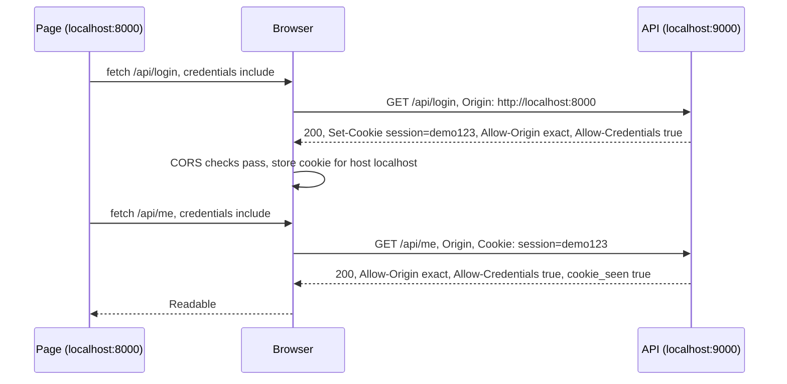
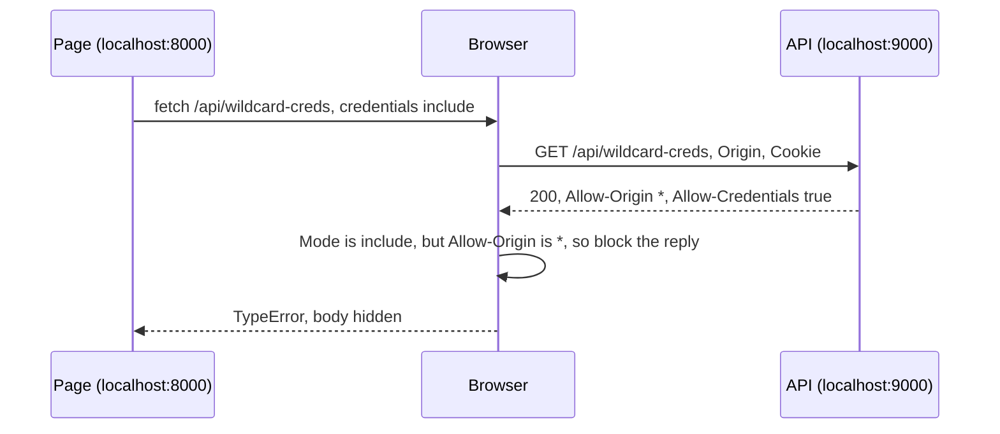

<!-- series:start -->
> [!series]- Networking · 9 of 11
> 1. [[networking/http-message|HTTP message]]
> 2. [[networking/request-lifecycle|Request lifecycle]]
> 3. [[networking/dns|DNS]]
> 4. [[networking/tcp|TCP]]
> 5. [[networking/tls|TLS]]
> 6. [[networking/http-caching|HTTP caching]]
> 7. [[networking/origin|Origin]]
> 8. [[networking/cors|CORS]]
> 9. **CORS and credentials** · you are here
> 10. [[networking/cors-expose-headers|CORS exposed headers]]
> 11. [[networking/cors-lab|CORS lab]]
<!-- series:end -->

> [!tldr] In three lines
> Credentials are the things that prove who you are to a server: cookies, HTTP auth, and client certificates. A cross-origin `fetch` sends them only when the page asks with `credentials: 'include'`, and the server must answer with `Access-Control-Allow-Credentials: true` and an exact origin (never `*`). You meet this when a logged-in app calls its API from another port or domain.
>
> [[#Interview questions|→ Self-test: 5 questions]]

## Why it exists

The [[networking/cors|CORS]] page showed that a server can let other origins read its replies. That is not enough for logged-in apps. The API needs to know **who** is asking, so the request must carry the session cookie. Yet the browser should not send that cookie for every cross-origin call, because then any page could make your browser act as you.

So there are two separate decisions, and each side has to agree:

- The **page** must ask for credentials (`credentials: 'include'`). Without the ask, no cookie is sent.
- The **server** must allow it, with `Access-Control-Allow-Credentials: true` and an exact origin. Without that answer, the browser does not let the page read the reply, and does not keep any cookie the reply sets.

Both must agree, or the request either sends no cookie or the reply stays hidden.

## Picture

<iframe src="/static/widgets/fetch-credentials-include-vs-default.html" width="100%" height="460" style="border:0" loading="lazy"></iframe>

*Two `fetch` calls from the lab page: click button 2 (default) and button 5 (include). Only the include call sends a `Cookie` line.*

<iframe src="/static/widgets/origin-vs-user-and-allow-credentials.html" width="100%" height="620" style="border:0" loading="lazy"></iframe>

*Part A: `Origin` names the page, `Cookie` names the person. Part B: the grid for each credentials mode and header combination.*

## Plain version

A hotel key card opens your room. A guest from another hotel might walk up to the desk with a copy of their own key card, but the desk only accepts a key card if two things are true. The guest asked for their card to be used at this desk, and the desk's sign says "cards from this hotel are accepted here."

The "asked for" part is `credentials: 'include'` in the page. The "sign" is `Access-Control-Allow-Origin` (exact) plus `Access-Control-Allow-Credentials: true` in the reply.

## Precise definition

**Credentials**, in the Fetch Standard, are the state a browser attaches to a request to identify the caller:

- cookies (the `Cookie` request header),
- HTTP authentication (the `Authorization` header from Basic or Bearer schemes entered through the browser's auth flow),
- TLS client certificates.

**Credentials mode** is a `fetch` option that sets when these are sent and when cross-origin responses may set them:

| Mode | Sends credentials to same origin? | Sends credentials cross-origin? | Stores `Set-Cookie` from cross-origin reply? |
|---|---|---|---|
| `'omit'` | No | No | No |
| `'same-origin'` (the default) | Yes | No | Only for same-origin replies |
| `'include'` | Yes | Yes, if CORS checks pass for the response | Yes, if `Access-Control-Allow-Origin` is exact and `Access-Control-Allow-Credentials: true` is present |

| Term | Definition | Where it's used |
|---|---|---|
| Cookie | A small named value the server sends in `Set-Cookie` and the browser returns in `Cookie` | Sessions, login state, preferences |
| `Set-Cookie` | Response header that stores a cookie in the browser | `/api/login` in the lab |
| `Cookie` | Request header that carries stored cookies back to the server | `/api/me` in the lab |
| `Access-Control-Allow-Credentials` | Response header; the only valid value is `true` | Lets credentialed cross-origin calls work |
| `SameSite` | Cookie attribute that limits when the browser sends the cookie on cross-site requests | `Strict`, `Lax`, `None` |
| Site | Scheme plus registrable domain (ports ignored). Different from origin | Decides "same-site" for `SameSite` |
| Cookie scope | Which hosts (and paths) the browser sends a cookie to. Scoped by host, not port | Shared across ports on the same host |

## How it works

The lab's login and then the cookie check:

1. The page calls `fetch('http://localhost:9000/api/login', { credentials: 'include' })`.
2. The browser sends `GET /api/login` with `Origin: http://localhost:8000`. No cookie yet, so no `Cookie` line.
3. The server replies with `Set-Cookie: session=demo123; Path=/; SameSite=Lax`, plus `Access-Control-Allow-Origin: http://localhost:8000` and `Access-Control-Allow-Credentials: true`.
4. The browser runs the CORS check (exact origin, credentials `true`). Both pass, so it stores the cookie for host `localhost`.
5. The page calls `/api/me` with `credentials: 'include'`. The browser now adds `Cookie: session=demo123`.
6. The server reads the cookie and replies with `{"cookie_seen": true, "cookie": "demo123"}`, with the same two CORS headers. The page reads it.



The wildcard case (lab button 4) fails at the CORS check:



The server still ran the route and still sent the body. The browser hid it.

### Why `*` is forbidden with credentials

`Access-Control-Allow-Origin: *` means "any origin may read this." Without credentials, that only exposes public data, which is fine. With credentials, the response may contain private data of the logged-in person. If `*` were allowed, any site could read it. So the Fetch Standard requires an exact origin whenever the request includes credentials, and browsers refuse the reply when they see `*` with `include`.

The same rule applies to `Access-Control-Allow-Headers`, `Access-Control-Allow-Methods`, and `Access-Control-Expose-Headers` in credentialed requests: `*` is not treated as a wildcard there either.

## The real thing

### Raw exchange: `/api/login` (sets the cookie)

The request as the browser sends it, trimmed:

```http
GET /api/login HTTP/1.1
Host: localhost:9000
Origin: http://localhost:8000
Sec-Fetch-Mode: cors
Sec-Fetch-Site: same-site
Sec-Fetch-Dest: empty
Accept: */*
```

No `Cookie` line, because this is the first call. The reply, captured from the lab's `api.py`:

```http
HTTP/1.0 200 OK
Server: BaseHTTP Python/3.15.1
Date: Fri, 30 Oct 2026 17:16:22 GMT
Content-Type: application/json
Content-Length: 19
Set-Cookie: session=demo123; Path=/; SameSite=Lax
Access-Control-Allow-Origin: http://localhost:8000
Access-Control-Allow-Credentials: true

{"logged_in": true}
```

### Raw exchange: `/api/me` before login

```http
GET /api/me HTTP/1.1
Host: localhost:9000
Origin: http://localhost:8000
Sec-Fetch-Mode: cors
Sec-Fetch-Site: same-site
Sec-Fetch-Dest: empty
Accept: */*
```

```http
HTTP/1.0 200 OK
Server: BaseHTTP Python/3.15.1
Date: Fri, 30 Oct 2026 17:16:22 GMT
Content-Type: application/json
Content-Length: 38
Access-Control-Allow-Origin: http://localhost:8000
Access-Control-Allow-Credentials: true

{"cookie_seen": false, "cookie": null}
```

The server answered 200 with `cookie_seen: false`. Not being logged in is a normal answer, not a CORS error.

### Raw exchange: `/api/me` after login

The only difference from the call above is one request line, the `Cookie` header the browser added:

```http
GET /api/me HTTP/1.1
Host: localhost:9000
Origin: http://localhost:8000
Cookie: session=demo123
Sec-Fetch-Mode: cors
Sec-Fetch-Site: same-site
Sec-Fetch-Dest: empty
Accept: */*
```

```http
HTTP/1.0 200 OK
Server: BaseHTTP Python/3.15.1
Date: Fri, 30 Oct 2026 17:16:22 GMT
Content-Type: application/json
Content-Length: 42
Access-Control-Allow-Origin: http://localhost:8000
Access-Control-Allow-Credentials: true

{"cookie_seen": true, "cookie": "demo123"}
```

### Raw exchange: `/api/wildcard-creds` (blocked)

```http
GET /api/wildcard-creds HTTP/1.1
Host: localhost:9000
Origin: http://localhost:8000
Cookie: session=demo123
Sec-Fetch-Mode: cors
Sec-Fetch-Site: same-site
Sec-Fetch-Dest: empty
Accept: */*
```

```http
HTTP/1.0 200 OK
Server: BaseHTTP Python/3.15.1
Date: Fri, 30 Oct 2026 17:16:26 GMT
Content-Type: application/json
Content-Length: 27
Access-Control-Allow-Origin: *
Access-Control-Allow-Credentials: true

{"route": "wildcard-creds"}
```

The request and the response look almost right. The one wrong value is `Access-Control-Allow-Origin: *`. The browser blocks the page from reading the reply. The console shows a CORS error that names the wildcard. The lab's `api.py` still prints `GET /api/wildcard-creds Origin=http://localhost:8000`.

### Field table

| Field | Value in the lab | What it means |
|---|---|---|
| `Set-Cookie` name and value | `session=demo123` | The cookie the browser stores. Its name is `session`, its value is `demo123`. |
| `Path=/` | Set on the cookie | The cookie is sent for every path on this host, not just `/api/`. |
| `SameSite=Lax` | Set on the cookie | Sent on same-site requests, and on cross-site top-level navigations with GET. Not sent on cross-site `fetch`. Here the page and the API are same-site (ports ignored), so it is sent. |
| `Access-Control-Allow-Origin` | `http://localhost:8000` | The one page origin that may read the reply. Exact match. |
| `Access-Control-Allow-Credentials` | `true` | Lets the browser send cookies on the call and keep cookies from the reply. The only valid value. |
| `Cookie` (request) | `session=demo123` | The stored cookie, added by the browser. Only present when the call used `include` (or `same-origin` with a same-origin URL). |
| `Origin` (request) | `http://localhost:8000` | Who is asking (the page). The cookie says who the person is. |

Not set in the lab's cookie: `HttpOnly` and `Secure`. Without `HttpOnly`, script on the page can read the cookie through `document.cookie`. Real logins should set `HttpOnly` so script cannot read the session. `Secure` means the cookie is only sent over HTTPS.

### Cookies are scoped by host, not port

The cookie was set by `localhost:9000` but the page runs on `localhost:8000`. Both are `localhost`, so the browser shares the cookie. Open DevTools > Application > Cookies to see one cookie list for `localhost`, with no port in it.

This matters for security. Another app on a different port of the same host also receives this cookie. Separate apps that must not share sessions need separate hosts (or subdomains with care).

### SameSite values

| Value | Sent on same-site requests | Sent on cross-site top-level GET | Sent on cross-site `fetch` or `img` | Needs `Secure` |
|---|---|---|---|---|
| `Strict` | Yes | No | No | No |
| `Lax` | Yes | Yes | No | No |
| `None` | Yes | Yes | Yes | Yes |

"Site" is the scheme plus the registrable domain. Ports do not count. So `localhost:8000` and `localhost:9000` are same-site, and `app.example` and `api.example` are same-site too. `bank.example` and `evil.example` are cross-site.

If the API is on a different site from the page, a `SameSite=Lax` cookie is not sent on the `fetch`, so credentialed calls quietly fail to carry the login. The fix is `SameSite=None; Secure` on the cookie, plus the CORS headers.

## Common misconceptions

- **Wrong:** `Access-Control-Allow-Credentials: true` means the caller must already be logged in.
  **Right:** The header is a permission. It lets the browser send and accept cookies on a cross-origin call. Whether anyone is logged in is decided by the server's own check. The lab's `/api/me` answers 200 with `cookie_seen: false` before login. It is still allowed to answer, because the header is present.

- **Wrong:** `*` allows everything, including credentials.
  **Right:** `*` cannot be combined with credentials. The browser blocks the reply even when the server sends both headers. The lab's button 4 (`/api/wildcard-creds`) shows the block: the server answers 200, the page gets a `TypeError`. The fix is to echo the exact origin of the page (and send `Vary: Origin`).

- **Wrong:** `Set-Cookie` on any cross-origin reply will store a cookie.
  **Right:** The browser stores it only when the call sent credentials (`include`) and the CORS checks passed (exact origin, `Allow-Credentials: true`). Also, the cookie's `SameSite` must allow it for that site relation.

- **Wrong:** Running two apps on different ports keeps their cookies apart.
  **Right:** Cookies ignore ports. Two apps on `localhost` with different ports share cookies. Use separate hosts for apps that must stay apart.

## Interview questions

> [!question]- Q1. What are credentials in a browser request?
> Anything that proves who the caller is: cookies, HTTP authentication headers, and TLS client certificates. A cross-origin `fetch` sends them only when the page sets `credentials: 'include'`, and the server must allow it with `Access-Control-Allow-Credentials: true` and an exact origin.

> [!question]- Q2. Why does the server need `Access-Control-Allow-Credentials: true` if the page already asked with `include`?
> Both sides must agree. The page's ask lets the browser send cookies, but the server has to agree before the browser lets the page read the reply or keep any `Set-Cookie` from it. Without the server's answer, the call fails the CORS check even though the cookie was sent.

> [!question]- Q3. Why can't a server answer `Access-Control-Allow-Origin: *` for a credentialed call?
> The reply of a logged-in call may contain private data. A wildcard would let any site read it. The browser therefore requires an exact origin whenever credentials are included, and blocks the reply when it sees `*`.

> [!question]- Q4. What does `SameSite=Lax` do, and why might a login cookie not be sent?
> `Lax` sends the cookie on same-site requests and on cross-site top-level GET navigations, but not on cross-site `fetch` or image requests. If the page and the API are on different sites, the cookie is not sent on the API call. Use `SameSite=None; Secure` for a cross-site API, which also requires HTTPS.

> [!question]- Q5. Do cookies isolate two apps running on different ports of localhost?
> No. Cookies are scoped by host and path, not by port. Two apps on `localhost:8000` and `localhost:9000` share cookies set for `localhost`. Use separate hosts when the sessions must be kept apart.

## Trigger card

> [!example] When I see a credentialed call fail with a CORS error, it means the page asked for cookies but the server did not answer with an exact origin and `Access-Control-Allow-Credentials: true`, because the browser only sends and reads credentials when both sides agree.

## Compared with

| | `credentials: 'omit'` | `credentials: 'same-origin'` (default) | `credentials: 'include'` |
|---|---|---|---|
| Cookie sent to same origin | No | Yes | Yes |
| Cookie sent cross-origin | No | No | Yes, if the call is allowed |
| Needs `Allow-Credentials: true` from server | No | No | Yes, for cross-origin reads |
| Needs exact `Allow-Origin` (no `*`) | No | No | Yes |
| Typical use | Public API, no login | Calls to your own origin | Logged-in calls to another origin |

## Where it's used

- Logged-in web apps whose frontend and API are on different origins, for example a single-page app on `app.example` calling `api.example`.
- Single sign-on flows that keep the session in a cookie and call the API with `credentials: 'include'`.
- Login forms that POST to an API on another origin and rely on the response to set the session cookie.
- Browser libraries and HTTP clients that expose a `withCredentials` option (XMLHttpRequest) or `credentials` option (`fetch`) to switch this on.
- Not relevant to `curl` without a cookie jar, or to server-to-server calls, which do not use browser cookie rules.

> [!info]- Sources
> - Study session, 2026-10-30.
> - MDN, [CORS](https://developer.mozilla.org/en-US/docs/Web/HTTP/CORS) (credentialed requests section).
> - WHATWG, [Fetch Standard](https://fetch.spec.whatwg.org/) (credentials mode and CORS protocol).
> - RFC 6265, [HTTP State Management Mechanism (cookies)](https://www.rfc-editor.org/rfc/rfc6265).

<!-- series-nav:start -->
---

← [[networking/cors|CORS]] · [[networking/cors-expose-headers|CORS exposed headers]] →
<!-- series-nav:end -->
