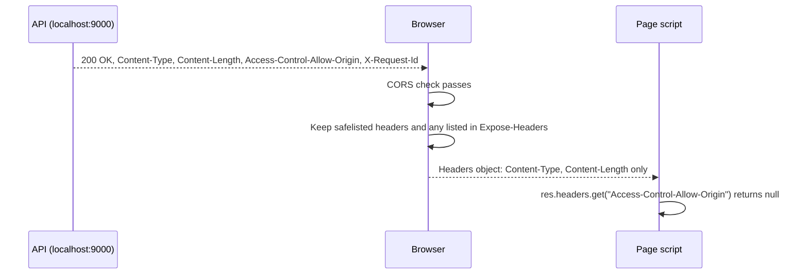

<!-- series:start -->
> [!series]- Networking · 10 of 11
> 1. [[networking/http-message|HTTP message]]
> 2. [[networking/request-lifecycle|Request lifecycle]]
> 3. [[networking/dns|DNS]]
> 4. [[networking/tcp|TCP]]
> 5. [[networking/tls|TLS]]
> 6. [[networking/http-caching|HTTP caching]]
> 7. [[networking/origin|Origin]]
> 8. [[networking/cors|CORS]]
> 9. [[networking/cors-credentials|CORS and credentials]]
> 10. **CORS exposed headers** · you are here
> 11. [[networking/cors-lab|CORS lab]]
<!-- series:end -->

> [!tldr] In three lines
> Even when CORS allows a page to read a reply, JavaScript sees only a short list of response headers. To read any other header, the server must list it in `Access-Control-Expose-Headers`. You meet this when a header that is clearly in the reply (like `Access-Control-Allow-Origin`) comes back as `null` in the page.
>
> [[#Interview questions|→ Self-test: 4 questions]]

## Why it exists

After the CORS check passes, the browser still does not hand the page every header. Headers can carry sensitive or server-only details (session hints, internal IDs, rate-limit counters). Showing all of them to any allowed page would leak more than the server meant to share. So the browser exposes a small, safe default set, and the server opts in to more.

## Picture



## Plain version

A parcel arrives with a label on the outside and the contents inside. The courier shows the sender's standard labels (size, type, date) to the receiver, and hides any extra label the sender did not mark "OK to show." To let the receiver see an extra label, the sender writes a note on the parcel that lists which labels may be shown.

The note is `Access-Control-Expose-Headers`. The standard labels are the **CORS-safelisted response headers**.

## Precise definition

A **CORS-safelisted response header** is one of a fixed set that the Fetch Standard always makes readable by page script on a successful CORS response:

- `Cache-Control`
- `Content-Language`
- `Content-Length`
- `Content-Type`
- `Expires`
- `Last-Modified`
- `Pragma`

**`Access-Control-Expose-Headers`** is a response header whose value is a comma-separated list of other response header names that page script may read. It applies to CORS responses only.

| Term | Definition | Where it's used |
|---|---|---|
| Safelisted response header | A header always readable by page script on a successful CORS response | `Content-Type`, `Content-Length`, and the others above |
| Forbidden response header | A header page script can never read, even if exposed, such as `Set-Cookie` | Cookie values stay out of reach of page script |
| Exposed header | A non-safelisted header listed in `Access-Control-Expose-Headers` | Custom `X-` headers, `ETag`, rate-limit headers, `Access-Control-Allow-Origin` |
| Response header filter | The browser step that drops non-readable headers before the page's `Headers` object is built | Every `fetch` response |

## How it works

1. The server sends a reply with several headers. Some are safelisted, some are not.
2. The browser runs the CORS check for the origin (see [[networking/cors|CORS]]).
3. If the check passes, the browser builds the page's `Headers` object from two sources: the safelisted headers, and any names listed in `Access-Control-Expose-Headers`.
4. Every other header is dropped from that object. The page sees `null` (`res.headers.get(name)` returns `null`) for them.
5. The network tools (DevTools Network tab) still show all headers. The filter applies only to what the page script can read.



## The real thing

### Why the lab shows `Access-Control-Allow-Origin: null`

The lab's page runs this code (from `index.html`):

```js
const res = await call();
const acao = res.headers.get('Access-Control-Allow-Origin') ?? 'null';
```

On `/api/allow`, the server does send `Access-Control-Allow-Origin: http://localhost:8000` (captured with `curl -i` from the lab):

```http
HTTP/1.0 200 OK
Server: BaseHTTP Python/3.15.1
Date: Fri, 30 Oct 2026 17:16:26 GMT
Content-Type: application/json
Content-Length: 18
Access-Control-Allow-Origin: http://localhost:8000

{"route": "allow"}
```

The call succeeds, the body is readable, and the page shows `HTTP 200` with the body. But the line for `Access-Control-Allow-Origin` reads `null`, because `Access-Control-Allow-Origin` is not in the safelisted list and nothing exposes it. The `?? 'null'` in the lab code is what makes the missing value visible. The reply was fine; the page just cannot see that header.

This is a teaching point, not a bug in the lab. The lab's [api.py](cors-lab-files/api.py) does not send `Access-Control-Expose-Headers`, so the page reads `null` on purpose.

### The fix: expose the header on the server

The server adds one header to the reply:

```http
HTTP/1.0 200 OK
Content-Type: application/json
Content-Length: 18
Access-Control-Allow-Origin: http://localhost:8000
Access-Control-Expose-Headers: Access-Control-Allow-Origin

{"route": "allow"}
```

Now `res.headers.get('Access-Control-Allow-Origin')` returns `http://localhost:8000` on the page.

To make this change in the lab, add a tuple to the `reply` call in [api.py](cors-lab-files/api.py):

```python
("Access-Control-Expose-Headers", "Access-Control-Allow-Origin"),
```

The lab code is not changed in this page. Adding the line is the exercise if you want to see the header appear.

### Field table

| Field | Example | What it means |
|---|---|---|
| `Access-Control-Expose-Headers` | `X-Request-Id, ETag` | Comma-separated header names page script may read, in addition to the safelisted ones. Names are case-insensitive. |
| Listed name | `Access-Control-Allow-Origin` | Any response header name can be listed, except forbidden ones. |
| `*` as a value | `*` | Treated as "all headers" for requests without credentials. With credentials it is a literal name, so list names explicitly. |
| `Set-Cookie` | (never readable) | A forbidden response header. Listing it has no effect, so cookie values stay out of page script. |

### Which headers need listing

| Header | Readable from page without listing? | Why |
|---|---|---|
| `Content-Type` | Yes | Safelisted |
| `Content-Length` | Yes | Safelisted |
| `Cache-Control` | Yes | Safelisted |
| `ETag` | No | Not safelisted. Needed for conditional requests if the page handles them |
| `Location` | No | Not safelisted. A redirect target is usually not readable on a cross-origin `fetch` |
| `Access-Control-Allow-Origin` | No | Not safelisted. Listing it lets the page read it, which real code rarely needs. The lab uses it to show the effect |
| `X-Request-Id` (custom) | No | Not safelisted. List it when the page uses it for logs or support |
| `Set-Cookie` | Never | Forbidden for page script |

## Common misconceptions

- **Wrong:** If the CORS check passes, the page can read every response header.
  **Right:** The page reads the safelisted headers and the ones listed in `Access-Control-Expose-Headers`. Everything else is hidden, even on a successful call.

- **Wrong:** A missing header in JavaScript means the server did not send it.
  **Right:** DevTools may show the header while `res.headers.get()` returns `null`. Check the Network tab or `curl -i` to see what the server sent.

- **Wrong:** Listing `Set-Cookie` in `Access-Control-Expose-Headers` lets the page read cookies.
  **Right:** `Set-Cookie` is a forbidden response header. The page cannot read it under any setting. To read cookie values from script, the cookie must not be `HttpOnly` and must be readable through `document.cookie`, which is a different path.

## Interview questions

> [!question]- Q1. Why does a successful CORS call still hide some response headers?
> The browser exposes a fixed set of safe headers (the CORS-safelisted response headers) and only the names the server lists in `Access-Control-Expose-Headers`. Hiding the rest limits what a page can learn from a reply, even when the page is allowed to read the body.

> [!question]- Q2. A JavaScript check of `Access-Control-Allow-Origin` returns null, but curl shows the header. What is going on?
> `Access-Control-Allow-Origin` is not safelisted, so the browser hides it from page script unless the server lists it in `Access-Control-Expose-Headers`. The header was sent. The page just cannot read it.

> [!question]- Q3. How would you let a page read a custom `X-Total-Count` header?
> Send `Access-Control-Expose-Headers: X-Total-Count` from the server, in the same reply that carries the header. The page can then read it with `res.headers.get('X-Total-Count')`. The fix is on the server; page code cannot add it.

> [!question]- Q4. Can a page ever read `Set-Cookie` from a response?
> No. `Set-Cookie` is a forbidden response header. Listing it does nothing. The browser stores the cookie for future requests, and page script gets no access to the header itself.

## Trigger card

> [!example] When a header is in the DevTools response but `headers.get()` returns `null` in the page, it means the header is not CORS-safelisted and the server did not list it in `Access-Control-Expose-Headers`, so the browser hides it from page script.

## Compared with

| | Safelisted response headers | `Access-Control-Expose-Headers` | Forbidden response headers |
|---|---|---|---|
| Set by | Fixed list in the Fetch Standard | Server, in each CORS reply | Not applicable |
| Readable by page | Yes, when CORS passes | Yes, once listed | Never |
| Examples | `Content-Type`, `Content-Length` | `X-Request-Id`, `ETag` | `Set-Cookie` |
| Visible in DevTools | Yes | Yes | Yes |

## Where it's used

- Pagination in APIs: a server sends `Link` or `X-Total-Count` and lists them in `Access-Control-Expose-Headers` so the page can read the total or the next-page link.
- Request tracing: a server sends `X-Request-Id` and the page logs it to link a front-end error to a server log line.
- Caching with `ETag`: a page that revalidates with `If-None-Match` must read `ETag` from the reply, so the server lists it.
- Rate limits: `RateLimit-Remaining` style headers are read by client code to back off before a `429`.
- Debugging: temporarily exposing `Access-Control-Allow-Origin` (as in the lab) shows what the server sent.

> [!info]- Sources
> - Study session, 2026-10-30.
> - MDN, [CORS](https://developer.mozilla.org/en-US/docs/Web/HTTP/CORS) (`Access-Control-Expose-Headers`).
> - WHATWG, [Fetch Standard](https://fetch.spec.whatwg.org/) (CORS-safelisted response-header names and forbidden response-header names).

<!-- series-nav:start -->
---

← [[networking/cors-credentials|CORS and credentials]] · [[networking/cors-lab|CORS lab]] →
<!-- series-nav:end -->
