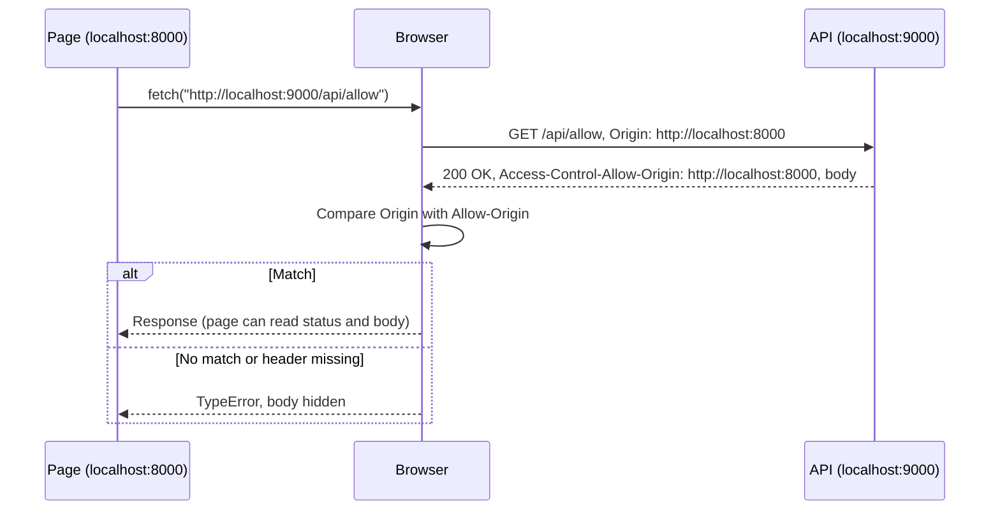
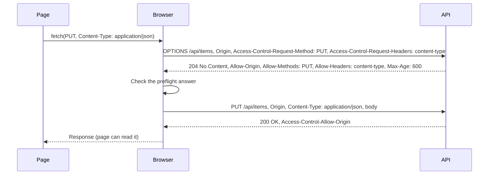

> [!tldr] In three lines
> CORS (Cross-Origin Resource Sharing) is how a server tells the browser which other websites' pages may read its responses. The browser enforces it, not the server. You meet it as the red "blocked by CORS policy" message when a page calls an API on another origin.

## Why it exists

Imagine you log in to your bank at `https://bank.example`. The bank sets a session cookie, and your browser keeps it. From then on, every request your browser sends to `bank.example` carries that cookie, so the bank knows it is you.

Now you open a different site, `https://evil.example`, in another tab. Its page runs this script:

```js
fetch('https://bank.example/api/accounts', { credentials: 'include' })
  .then(r => r.json())
  .then(data => sendToAttacker(data));
```

Your browser attaches the bank cookie to that request, because the cookie belongs to `bank.example` and the request goes to `bank.example`. The bank answers with your account data. If the browser handed that answer to the evil page, the attacker would read your bank data without knowing your password.

So browsers enforce the **same-origin policy**: a page can read responses only from its own origin by default. CORS is the controlled way to relax that rule. The server opts in and lists the pages that may read its answers.

Two things CORS does **not** do here:

- It does not stop the request from being sent. The bank still receives it and still runs the code.
- It does not decide who you are. That is the job of cookies, tokens, and login checks on the server.

## Picture





## Plain version

A bank teller answers a phone call from someone at another bank. The teller does answer, and the call does reach the desk. But before the teller reads the answer out to the caller, a rule checks whether the caller's bank is on the approved list the first bank wrote down. If it is not on the list, the answer is thrown away, and the caller hears only "request failed."

The approved list is the `Access-Control-Allow-Origin` header. The rule is applied by the browser, which plays the role of the caller's side of the phone.

## Precise definition

**CORS** is a protocol, defined in the WHATWG Fetch Standard, in which a server uses `Access-Control-*` response headers to tell the browser:

1. which origins may read a response from a page script, and
2. whether the request may include credentials (cookies, HTTP auth, client certificates).

An **origin** is the triple scheme + host + port. Two URLs are same-origin only if all three parts match exactly. (Origin is explained in [[origin]].)

| Term | Definition | Where it's used |
|---|---|---|
| Origin | scheme + host + port, e.g. `http://localhost:8000` | `Origin` request header; CORS checks; cookies use host only |
| Same-origin policy | Default browser rule: a page script may read responses only from its own origin | Every browser; `fetch`, `XMLHttpRequest`, iframes, canvas |
| Cross-origin request | A request from a page on origin A to a URL on origin B | Any API on another domain or port |
| CORS-safelisted request header | A small set of harmless headers (`Accept`, `Accept-Language`, `Content-Language`, and some `Content-Type` values) that do not trigger a preflight | Decides simple vs preflighted |
| Simple request | A cross-origin request that uses only safelisted methods and headers; sent directly | `GET` with no custom headers |
| Preflight request | An `OPTIONS` request the browser sends first to ask the server for permission | `PUT`, `DELETE`, `Content-Type: application/json`, `Authorization` header |
| Opaque response | A response the page cannot read (status, headers, body are hidden) | `fetch(..., { mode: 'no-cors' })` |
| Credentials | Cookies, HTTP authentication, TLS client certificates sent with a request | `credentials: 'include'` on `fetch` |

## How it works

The steps for a simple request, such as the lab's `fetch('http://localhost:9000/api/allow')` from a page on `http://localhost:8000`:

1. The page script calls `fetch()` for a URL on another origin.
2. The browser adds an `Origin` request header that names the page's origin. Page script cannot set or change this header.
3. The browser sends the request. The server receives it and runs its normal code, whether or not CORS is configured.
4. The server replies with its normal status and body, plus `Access-Control-*` headers if it wants to allow the page.
5. The browser compares the `Origin` it sent with the reply's `Access-Control-Allow-Origin` value.
6. **Match:** the `fetch` promise resolves and the page can read the status, the safelisted headers, and the body.
7. **No match, or header missing:** the promise rejects with a `TypeError` (Chrome says "Failed to fetch"). The body is discarded in the browser and the page never sees it.



### Simple and preflighted requests

A request is **simple** when all of these hold:

- the method is `GET`, `HEAD`, or `POST`,
- the headers are only CORS-safelisted ones (`Accept`, `Accept-Language`, `Content-Language`, and `Content-Type` only with `application/x-www-form-urlencoded`, `multipart/form-data`, or `text/plain`),
- there is no upload event listener and no streamed body.

A simple request is sent directly, with the check described above.

Anything else is **preflighted**. The browser first sends an `OPTIONS` request that asks permission. Typical triggers are `PUT`, `PATCH`, `DELETE`, `Content-Type: application/json` (very common for JSON APIs), and custom headers such as `Authorization`.

Preflight steps:

1. The page calls `fetch` with, for example, `PUT` and `Content-Type: application/json`.
2. The browser sends `OPTIONS` with `Origin`, `Access-Control-Request-Method: PUT`, and `Access-Control-Request-Headers: content-type`.
3. The server answers with a success status (usually `204 No Content`) and the allow headers: `Access-Control-Allow-Origin`, `Access-Control-Allow-Methods`, `Access-Control-Allow-Headers`, and optionally `Access-Control-Max-Age`.
4. The browser checks that the requested method and headers are allowed. The browser caches the answer for `Access-Control-Max-Age` seconds (browsers cap this value).
5. If the check passes, the browser sends the real `PUT`. If the check fails, the real `PUT` is never sent.



> [!note] This is a general example
> The lab's `api.py` has no `OPTIONS` handler, and every lab button sends a simple `GET`. So the lab never shows a preflight. The sequence above is the standard flow, not a captured lab exchange.

## The real thing

### Raw exchange: `/api/open` (no CORS headers)

The request as the browser sends it, trimmed to the important lines. A real browser sends more headers, such as `User-Agent`.

```http
GET /api/open HTTP/1.1
Host: localhost:9000
Origin: http://localhost:8000
Sec-Fetch-Mode: cors
Sec-Fetch-Site: same-site
Sec-Fetch-Dest: empty
Accept: */*
```

The reply, captured from the lab's `api.py` with `curl -i` (the `Server` and `Date` values are what this run printed):

```http
HTTP/1.0 200 OK
Server: BaseHTTP Python/3.15.1
Date: Fri, 30 Oct 2026 17:16:26 GMT
Content-Type: application/json
Content-Length: 17

{"route": "open"}
```

The server answered 200 and sent the body. There is no `Access-Control-Allow-Origin` line, so the browser refuses to let the page read it. The page's `fetch` rejects, and the console shows a CORS error.

### Raw exchange: `/api/allow` (origin allowed)

Request, same as above but for `/api/allow`:

```http
GET /api/allow HTTP/1.1
Host: localhost:9000
Origin: http://localhost:8000
Sec-Fetch-Mode: cors
Sec-Fetch-Site: same-site
Sec-Fetch-Dest: empty
Accept: */*
```

Reply, captured the same way:

```http
HTTP/1.0 200 OK
Server: BaseHTTP Python/3.15.1
Date: Fri, 30 Oct 2026 17:16:26 GMT
Content-Type: application/json
Content-Length: 18
Access-Control-Allow-Origin: http://localhost:8000

{"route": "allow"}
```

The browser compares `http://localhost:8000` (the request `Origin`) with `http://localhost:8000` (the allowed origin). They match exactly, so the page reads the body.

`Sec-Fetch-Site: same-site` appears because `localhost:8000` and `localhost:9000` share the same scheme and site (ports do not count for "site"). It does not change the CORS check, which uses the full origin, port included.

### Header reference

| Header | Sent by | Where | What it does | In the lab |
|---|---|---|---|---|
| `Origin` | Browser | Every cross-origin request from page script; preflight | Names the page's origin (scheme + host + port). Page script cannot change it. | Yes, every route |
| `Access-Control-Request-Method` | Browser | Preflight `OPTIONS` | The method the real request will use | No preflight in the lab |
| `Access-Control-Request-Headers` | Browser | Preflight `OPTIONS` | Non-safelisted headers the real request will send | No |
| `Access-Control-Allow-Origin` | Server | Response, and preflight response | The one origin allowed to read (exact string), or `*` for any origin without credentials | Yes, except `/api/open` |
| `Access-Control-Allow-Credentials` | Server | Response, and preflight response | `true` lets the browser send cookies on the request and let the page read the reply | Yes, on `/api/login`, `/api/me`, `/api/allow-creds`, `/api/wildcard-creds` |
| `Access-Control-Allow-Methods` | Server | Preflight response | Methods the real request may use | No |
| `Access-Control-Allow-Headers` | Server | Preflight response | Request headers the real request may send | No |
| `Access-Control-Max-Age` | Server | Preflight response | Seconds the browser may cache the preflight answer | No |
| `Access-Control-Expose-Headers` | Server | Response | Extra response headers that page script may read | No (see [[cors-expose-headers]]) |
| `Vary: Origin` | Server | Response | Tells caches that the reply depends on `Origin`. Needed when the server sends a different `Allow-Origin` per origin, so a cache does not serve one origin's answer to another | No |

Field notes:

- The allowed origin is compared as an exact string. `http://localhost:8000` matches. `localhost:8000` (no scheme), `http://localhost:8000/` (trailing slash), and `http://localhost` (no port) do not match.
- `Access-Control-Allow-Origin: *` allows any origin to read a response, but only when the request carries no credentials. See [[cors-credentials]].

## Debugging

Check these three places, in this order.

1. **Server log.** The lab's `api.py` prints one line per request, for example `GET /api/allow Origin=http://localhost:8000`. If the line appears, the request reached the server and the `Origin` value is visible. If it does not appear, the request never arrived. Check the URL, the port, and whether the browser blocked the request before sending it (for example, a failed preflight).
2. **Network tab.** Find the request. Check the request headers (is `Origin` there?) and the response headers (is `Access-Control-Allow-Origin` there, and is its value exact?). The status may show 200 while the page still fails. That is the signature of a CORS block: the server did its job, and the browser did not pass the reply to the page. Chrome often marks the row with a CORS error or as failed.
3. **Console.** The real reason is printed here. Chrome's wording is roughly: `Access to fetch at '...' from origin '...' has been blocked by CORS policy: No 'Access-Control-Allow-Origin' header is present on the requested resource.` The lab's page also runs `console.error(err)` on failure, so the same reason shows there.

A quick check outside the browser:

```bash
curl -i -H "Origin: http://localhost:8000" http://localhost:9000/api/allow
```

`curl` shows exactly which headers the server sends. It does not enforce CORS, so a request that works in `curl` and fails in the browser points at CORS, not at the server being down.

## Where it's used

- Single-page apps (React, Vue, Angular) that call an API on another domain or port. In development, the front-end dev server often runs on one port and the API on another, so CORS is needed.
- Font and asset CDNs. Browsers request `@font-face` files and some images in CORS mode, so CDNs send `Access-Control-Allow-Origin` headers to let other sites use them.
- Canvas and images. A cross-origin image without CORS "taints" a `<canvas>`, and reading its pixels (`getImageData`) throws. An `` plus a CORS-enabled image server fixes this.
- Public APIs that want browser clients (weather, maps, open data) and send `Access-Control-Allow-Origin: *`.
- Not used by `curl`, Postman, server-to-server calls, or most mobile native HTTP clients. Those do not enforce the same-origin policy.

## Compared with

| | CORS | Same-origin policy | CSRF defence (SameSite, tokens) | Authentication |
|---|---|---|---|---|
| What it is | Server opt-in for cross-origin reads | Default browser rule: reads only from same origin | Stops a cross-site page from making a state-changing request succeed | Server checks who the caller is |
| Who enforces it | Browser | Browser | Browser (SameSite) and server (tokens) | Server |
| Stops the request being sent? | No | No | Sometimes (SameSite cookies not attached) | No |
| Stops the page reading the reply? | Yes, unless allowed | Yes, unless CORS allows | No, the reply is not the target | No |
| Protects the API from `curl`? | No | No | No | Yes |

## Common misconceptions

- **Wrong:** CORS stops the request from being sent.
  **Right:** For a simple request, the browser sends it, the server runs, and the server replies. The browser then hides the reply from the page. The lab shows this: `api.py` prints the `GET /api/open` line even though the page is blocked. For a preflighted request, the browser does not send the real request if the preflight fails. That is the only case where the real request is held back.

- **Wrong:** CORS is a server-side security wall that protects the API.
  **Right:** CORS is enforced by the browser. `curl`, Postman, and other servers ignore it. Protect the API with authentication and authorization on the server. CORS only controls which web pages in a browser may read the answers.

- **Wrong:** Fix CORS in the page's `fetch` (add a header, or change the mode).
  **Right:** Only the server can send `Access-Control-Allow-Origin`. The page can only ask. `mode: 'no-cors'` does not fix anything: the request still goes out, but the page gets an opaque response it cannot read.

- **Wrong:** `Access-Control-Allow-Origin: localhost:8000` works because the origin is "localhost".
  **Right:** The value must be the exact origin with the scheme and the port: `http://localhost:8000`. The browser compares strings, so a missing `http://` or a trailing slash breaks the match.

## Interview questions

> [!question]- Q1. Why does the browser block a cross-origin response at all?
> Because of the same-origin policy. A page on one site could otherwise call another site with the visitor's cookies and read private data, such as bank account details. The browser blocks reads by default. CORS is the controlled exception: the other server lists which origins may read its responses.

> [!question]- Q2. Does CORS prevent the request from reaching the server?
> No, for a simple request. The browser sends it, and the server runs its code and replies. The browser then withholds the reply from the page if the origin is not allowed. For preflighted requests, the real request is held back only if the preflight check fails. CORS is about what the page may read, not what the server receives.

> [!question]- Q3. What is a preflight request, and when is it sent?
> A preflight is an `OPTIONS` request the browser sends before the real request. It asks the server whether the method and headers are allowed from this origin. It is sent for requests that are not simple, such as `PUT`, `DELETE`, a `Content-Type: application/json` body, or an `Authorization` header. The answer can be cached for `Access-Control-Max-Age` seconds.

> [!question]- Q4. A fetch fails with a CORS error, but curl gets the right data. Why?
> curl does not enforce CORS, so it shows the response even when the browser would hide it. Check the response headers with `curl -i -H "Origin: ..."`. If `Access-Control-Allow-Origin` is missing or does not exactly match the page's origin, the browser blocks the page. The fix belongs on the server.

> [!question]- Q5. Can frontend code fix a CORS error?
> No. The header that allows the page is sent by the server, and the page cannot change the response. Frontend options like a proxy in the dev server are workarounds: the proxy makes the call from the same origin, so no CORS check happens. The real fix is the server's `Access-Control-*` headers.

## Trigger card

> [!example] When I see "blocked by CORS policy" in the console, it means the server answered but the browser did not let the page read the reply, because the reply's `Access-Control-Allow-Origin` is missing or does not exactly match the page's origin.

## Related

- [[origin]] - scheme + host + port, the value CORS compares.
- [[http-message]] - the request and response lines and headers used here.
- [[cors-credentials]] - cookies, `credentials: 'include'`, and why `*` is not allowed with them.
- [[cors-expose-headers]] - which response headers JavaScript can read.
- [[cors-lab]] - run the lab and click through the seven steps.
- [[http-caching]] - why `Vary: Origin` matters for caches.

## Sources

- Prep 1 networking session, 2026-10-30.
- MDN, [CORS](https://developer.mozilla.org/en-US/docs/Web/HTTP/CORS).
- WHATWG, [Fetch Standard](https://fetch.spec.whatwg.org/) (CORS protocol section).
- RFC 6454, [The Web Origin Concept](https://www.rfc-editor.org/rfc/rfc6454).
