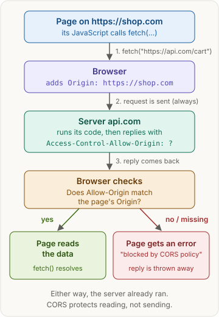
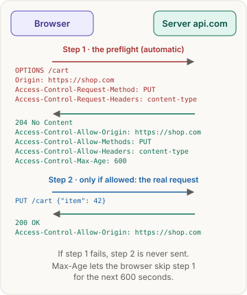
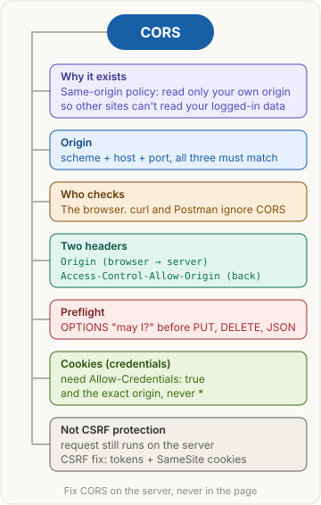

<!-- series:start -->
> [!series]- Networking · 9 of 9
> 1. [[networking/revision|Networking quick revision]]
> 2. [[networking/http-message|HTTP message]]
> 3. [[networking/request-lifecycle|Request lifecycle]]
> 4. [[networking/dns|DNS]]
> 5. [[networking/tcp|TCP and UDP]]
> 6. [[networking/tls|TLS and HTTPS]]
> 7. [[networking/http-caching|HTTP caching]]
> 8. [[networking/origin|Origin]]
> 9. **CORS** · you are here
<!-- series:end -->

> [!abstract] What this page is for
> **Intent:** understand why the browser shows *"blocked by CORS policy"*, and answer every common CORS interview question.
> **You'll learn:** what an origin is · why browsers block reads · the two headers that matter · preflight · cookies across sites · how to fix it · why CORS is not CSRF protection.
> **Time:** about 7 minutes. Every section has a longer version on the [[networking/deep/cors|detailed CORS page]].

## Words you need first

- **Origin**: the "address" of a web page, made of three parts: **scheme** (`https`), **host** (`shop.com`) and **port** (`443`, the default for https). Two URLs share an origin only if all three match. `http://localhost:3000` and `http://localhost:8000` are *different* origins, because the port differs.
- **Same-origin policy (SOP)**: the browser's default safety rule. A page's JavaScript may *read* replies only from its own origin.
- **CORS (Cross-Origin Resource Sharing)**: the way a server says *"pages from these other origins may read my replies too."* It relaxes the same-origin policy, only for the origins the server names.
- **Header**: a `name: value` line sent with a request or a reply, e.g. `Origin: https://shop.com`.
- **`fetch()`**: the JavaScript function a page uses to call an API (a server URL that returns data, usually JSON).
- **Cookie**: a small value the browser stores for a site and sends back on every request to that site. It's how a site remembers you're logged in.

## Why it exists

You're logged in to `bank.com`, so your browser holds its cookie. You open `evil.com` in another tab. Its script calls `fetch("https://bank.com/api/balance", { credentials: "include" })`. If the bank's cookie is allowed to travel to other sites (its `SameSite` setting is `None` and it is `Secure`; with anything else, including the usual `Lax` default, the browser doesn't attach it), the browser attaches it. Without the same-origin policy, `evil.com` could **read your bank data**. So by default the browser hides cross-origin replies from the page, and CORS is the controlled way to allow the ones a server trusts.

## The picture

## How it works, with an example

Your shop's front end is on `https://shop.com`. Its API is on `https://api.com`.

1. The page runs `fetch("https://api.com/cart")`.
2. The browser sends the request and adds `Origin: https://shop.com` on its own, so the server knows which page is asking.
3. The server runs its code and replies. To allow the shop, it adds `Access-Control-Allow-Origin: https://shop.com`.
4. The browser compares the two. If they match (or the value is `*`, meaning "any origin"), the page gets the data. If the header is missing or different, the page gets an error and the reply is thrown away.

## The most common mistake

> [!warning] CORS blocks reading, not sending
> The server still receives the request and runs it. CORS only decides whether the *page* may **read** the reply. curl and Postman aren't browsers, so they ignore CORS completely. That's why an API "works in Postman but not in the browser."

## Preflight

For "non-simple" requests, the browser first sends a small automatic **`OPTIONS`** request (an HTTP method that asks "what's allowed here?") to check permission. This is the **preflight**. The real request is sent only if the server says yes.

- **Simple request (no preflight):** `GET`, `HEAD` or `POST`, with only basic headers, and a body that's a form or plain text.
- **Needs a preflight:** `PUT`, `PATCH` or `DELETE`, a JSON body (`Content-Type: application/json`), or a custom header such as `Authorization`.

In the preflight, `Access-Control-Request-Method` and `Access-Control-Request-Headers` say what the real request *will* use. The server answers with `Access-Control-Allow-Methods` and `Access-Control-Allow-Headers`.

## Cookies across sites

**Credentials** means cookies (and other login data) sent with a request. By default, `fetch` to another origin sends none. To send them:

- the page uses `fetch(url, { credentials: "include" })`;
- the server replies `Access-Control-Allow-Credentials: true`;
- `Access-Control-Allow-Origin` must be the **exact** origin. The **wildcard** `*` ("anyone") isn't allowed, because "any website may read this user's private data" is exactly what the same-origin policy exists to stop.

## How to fix a CORS error

- **Fix it on the server:** allow your front end's origin, e.g. `app.use(cors({ origin: "https://shop.com" }))` in Express.
- **In local development:** use your dev server's **proxy** (a middleman that forwards requests). The page calls `/api` on its own origin, and the dev server passes it to the real API, so there's no cross-origin request at all.
- **Don't:** use a browser extension, turn off browser security, or use `mode: "no-cors"`. That last one only gives you an empty reply you can't read.

## CORS is not CSRF protection

**CSRF (Cross-Site Request Forgery)** is when another site makes your browser send a request you didn't mean to send, with your cookies attached, e.g. a hidden form on `evil.com` that POSTs to `bank.com/transfer`.

CORS doesn't stop this, because CORS doesn't stop the request from being sent. A form POST is a simple request, so it goes out with no preflight, and the server runs it. Real CSRF defenses are **CSRF tokens** (a secret value only your own pages know) and **`SameSite` cookies** (a cookie setting that stops the browser from sending the cookie on requests that come from other sites).

## Say it in an interview

> "Browsers follow the same-origin policy: a page can only read responses from its own origin, which is scheme plus host plus port. That stops a random site from reading your bank data using your cookies. CORS is how a server relaxes that. The browser sends an `Origin` header, and if the server replies with a matching `Access-Control-Allow-Origin`, the page can read the response. Otherwise the browser hides it. The request still reaches the server, so CORS isn't server-side security and isn't CSRF protection. For non-simple requests, like `PUT` or a JSON body, the browser first sends an `OPTIONS` preflight. For cookies, the server must also send `Allow-Credentials: true` with an exact origin, not a wildcard. You fix CORS on the server, or with a proxy in development."

## Questions interviewers ask

Tap a question to see the answer.

> [!question]- What is CORS, and why does it exist?
> A browser mechanism that lets a server allow other origins to read its replies. It exists because the same-origin policy blocks those reads by default, to stop sites from reading your data with your cookies.

> [!question]- Who enforces CORS, the browser or the server?
> The browser. The server only sends headers. That's why curl and Postman ignore it.

> [!question]- Is the request blocked, or the response?
> The response. The request reaches the server and runs. Only a failed preflight stops the real request.

> [!question]- How do you fix a CORS error?
> On the server: return `Access-Control-Allow-Origin` with the front end's origin (plus methods and headers for preflights). In development, use a proxy. Never fix it in the front end.

> [!question]- What is a preflight, and when is it sent?
> An automatic `OPTIONS` request that asks permission before a non-simple request: methods other than GET, HEAD or POST, a JSON body, or custom headers like `Authorization`.

> [!question]- What do Access-Control-Request-Method and Access-Control-Request-Headers do?
> They're preflight request headers that tell the server which method and headers the real request will use, so the server can approve or refuse them.

> [!question]- Why can't you use `*` with cookies?
> Because it would let any website read a logged-in user's private data. With credentials, the server must name the exact origin.

> [!question]- Does CORS protect against CSRF?
> No. CORS hides the reply but the forged request still runs. Use CSRF tokens and `SameSite` cookies.

> [!question]- SOP vs CORS vs CSP?
> **SOP:** the browser's default rule, where a page reads only its own origin. **CORS:** a server loosening SOP for its own replies. **CSP (Content Security Policy):** a header a site puts on its *own* pages to limit where they may load scripts from, a defense against XSS (an attacker getting their script to run inside your page).

> [!question]- Is CORS a defense against XSS?
> No, that's a known wrong answer. CORS is about reading cross-origin replies. XSS defenses are escaping output and CSP.

## Mental map

## Watch

Web Dev Simplified, about 6 minutes: what CORS is and how it relates to the same-origin policy.

**Want more?** The [[networking/deep/cors|detailed CORS page]] has the same sections with raw HTTP, the exact simple-request rules, server config, debugging, and more interview questions.

<!-- series-nav:start -->
---

← [[networking/origin|Origin]] · [[networking/index|Back to Networking]] →
<!-- series-nav:end -->
