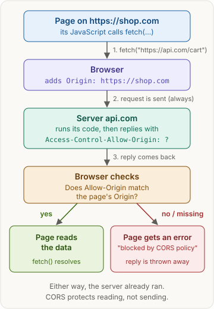
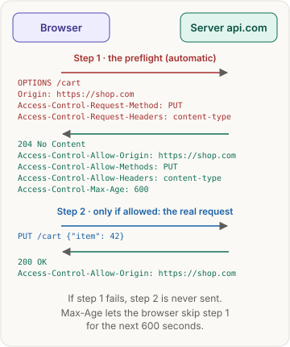
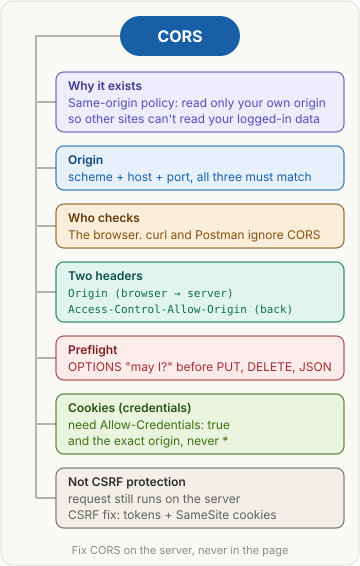

> [!abstract] What this page is for
> **Intent:** the full picture behind the [[networking/cors|quick CORS page]]. Same sections, same order, with more detail in each: raw HTTP, exact rules, server config, debugging and the harder interview questions.
> **Read the quick page first.** Each section here starts where the quick one stops.
> **Time:** about 20 minutes.

## Words you need first

Everything from the quick page (origin, same-origin policy, CORS, header, `fetch()`, cookie), plus:

- **Scheme, host, port:** the three parts of an origin. In `https://api.shop.com:8443/cart`, the scheme is `https`, the host is `api.shop.com`, the port is `8443`. The path (`/cart`) is **not** part of the origin.
- **Site:** a looser idea than origin. Roughly the scheme plus the main domain (`shop.com`). `api.shop.com` and `www.shop.com` are the **same site** but **different origins**. Cookies' `SameSite` rule uses *site*. CORS uses *origin*.
- **HTTP method:** the verb of a request: `GET` (read), `POST` (create or send), `PUT` / `PATCH` (update), `DELETE`, and `OPTIONS` (ask what's allowed).
- **Simple request:** a cross-origin request the browser sends directly, without a preflight (exact rules under [[#Preflight]]).
- **Safelisted header:** a header the browser considers harmless, so it doesn't trigger a preflight (request side) or is always readable by the page (response side).
- **Opaque response:** a reply the page receives but can't look inside (no status, no headers, no body). You get one from `mode: "no-cors"`.
- **Middleware:** code on the server that runs on every request before your route handler, e.g. a CORS middleware that adds the headers.

**Is it the same origin as `https://shop.com`?**

| URL | Same origin? | Why |
|---|---|---|
| `https://shop.com/cart` | Yes | path doesn't count |
| `http://shop.com` | No | scheme differs |
| `https://api.shop.com` | No | host differs (subdomain) |
| `https://shop.com:8443` | No | port differs (default is 443) |

## Why it exists

The full story behind the quick version:

1. You log in to `bank.com`. It sets a session cookie, and your browser sends that cookie on requests to `bank.com`. If the cookie is set with `SameSite=None`, it's sent **even when another site's page started the request**.
2. You visit `evil.com`. Its script runs `fetch("https://bank.com/api/accounts", { credentials: "include" })`.
3. The browser attaches your bank cookie. The bank sees a valid login and returns your accounts.
4. Without the same-origin policy, the script would read that reply and send it to the attacker.

The same-origin policy blocks step 4. But real apps often need cross-origin reads (front end on `shop.com`, API on `api.shop.com`), so CORS lets a server list exactly which origins may read its replies.

Note what the policy does **not** block: loading images, scripts and stylesheets from other origins (``, `<script src>`), or submitting forms to other origins. Those were allowed before CORS existed, and that's why CSRF is still possible (see [[#CORS is not CSRF protection]]).

## The picture



The same four steps as the quick page. The rest of this page zooms into each box: the raw headers in step 2 and 3, the preflight that can come before step 1, and what the browser does at the check.

## How it works, with an example

The same `shop.com` → `api.com` example, as the raw HTTP on the wire.

**Request** (the browser adds `Origin`, your code can't change it):

```http
GET /cart HTTP/1.1
Host: api.com
Origin: https://shop.com
```

**Reply that allows the page to read it:**

```http
HTTP/1.1 200 OK
Content-Type: application/json
Access-Control-Allow-Origin: https://shop.com
Vary: Origin

{"items": [42]}
```

**What the browser checks:** does `Access-Control-Allow-Origin` exactly equal the page's origin, or is it `*` (and the request had no credentials)? Only one value is allowed. A list like `https://a.com, https://b.com` is invalid. A server that allows several origins checks the incoming `Origin` against its allowlist and echoes back the one that matched.

**`Vary: Origin`:** if the reply's `Allow-Origin` depends on who asked, add `Vary: Origin`. It tells caches, such as a CDN (a network of servers that store copies of replies close to users), to keep a separate copy per origin. Otherwise a cache might serve `shop.com`'s header to `other.com`, and their page breaks.

**Reading response headers:** by default the page can only read a few safelisted reply headers (`Cache-Control`, `Content-Language`, `Content-Length`, `Content-Type`, `Expires`, `Last-Modified`, `Pragma`). To let it read others, like `X-Total-Count` for pagination, the server lists them: `Access-Control-Expose-Headers: X-Total-Count`.

## The most common mistake

> [!warning] CORS blocks reading, not sending
> Everything from the quick page holds. Three consequences interviewers like:

- **Side effects still happen.** A blocked cross-origin `POST` that's a simple request still ran on the server. If it deleted something, it's deleted. Only the page couldn't read the answer.
- **Errors can look like CORS errors.** If your server crashes and returns a 500 without the CORS headers (many frameworks skip middleware on errors), the browser reports "blocked by CORS policy", not the 500. Check the Network tab for the real status.
- **CORS is not access control for your API.** Anyone can call your API from curl or a script on their server. Protect data with login checks (authentication) and permission checks (authorization), never with CORS.

## Preflight

**Exact simple-request rules.** A request skips the preflight only if *all* are true:

- the method is `GET`, `HEAD` or `POST`;
- it only sets safelisted headers: `Accept`, `Accept-Language`, `Content-Language`, `Content-Type` (with limits below), and `Range` (simple values);
- `Content-Type`, if set, is `application/x-www-form-urlencoded`, `multipart/form-data` or `text/plain`;
- no upload progress listener and no streaming body.

So `Content-Type: application/json` and `Authorization: Bearer ...` both trigger a preflight. Most real API calls are preflighted.



**The preflight headers:**

| Header | Sent by | Meaning |
|---|---|---|
| `Access-Control-Request-Method` | browser | the method the real request will use |
| `Access-Control-Request-Headers` | browser | the non-safelisted headers it will send |
| `Access-Control-Allow-Methods` | server | methods allowed |
| `Access-Control-Allow-Headers` | server | headers allowed |
| `Access-Control-Max-Age` | server | seconds the browser may cache this answer and skip the preflight (browsers cap it, e.g. Chrome at 2 hours) |

**Preflight gotchas:**

- The preflight carries **no cookies and no `Authorization` header**. If your auth middleware runs before your CORS middleware, it answers the `OPTIONS` with 401 and the preflight fails. Put CORS first.
- The server must answer `OPTIONS` with a 2xx status (usually 204). A 404 or 405 for `OPTIONS` fails the preflight.
- The real reply still needs `Access-Control-Allow-Origin`. Passing the preflight isn't enough.

## Cookies across sites

Everything from the quick page, plus:

- **With credentials, no wildcards anywhere.** `Allow-Origin`, `Allow-Headers`, `Allow-Methods` and `Expose-Headers` must all be explicit lists. A `*` is treated as the literal text "*".
- **The cookie must also be allowed to travel.** For a cross-*site* request, the cookie needs `SameSite=None; Secure`. Chrome treats cookies with no `SameSite` setting as `Lax`, which doesn't send them on cross-site `fetch`. Some browsers also block third-party cookies entirely. So "I set Allow-Credentials and the cookie still isn't sent" is usually a `SameSite` problem, not a CORS one.
- **Same site, different origin is easier.** `shop.com` calling `api.shop.com` is cross-origin (CORS applies) but same-site (`SameSite=Lax` cookies are sent). This is why companies put the API on a subdomain.
- **Tokens instead of cookies.** If the front end sends an `Authorization: Bearer <token>` header instead of cookies, `credentials: "include"` isn't needed, but every request is preflighted (custom header).

## How to fix a CORS error

**Read the console message first.** It names the missing piece, e.g. "No 'Access-Control-Allow-Origin' header is present" or "Request header field authorization is not allowed by Access-Control-Allow-Headers in preflight response".

**Then check the Network tab:** is there an `OPTIONS` row? What's its status? Which `Access-Control-*` headers came back on each row?

**Server config examples:**

```js
// Express (Node.js)
import cors from "cors";
app.use(cors({
  origin: ["https://shop.com", "http://localhost:5173"],
  credentials: true,
}));
```

```python
# FastAPI (Python)
from fastapi.middleware.cors import CORSMiddleware
app.add_middleware(
    CORSMiddleware,
    allow_origins=["https://shop.com", "http://localhost:5173"],
    allow_credentials=True,
    allow_methods=["*"],
    allow_headers=["*"],
)
```

**Dev proxy (Vite):** the page calls `/api/cart` on its own origin, and the dev server forwards it, so the browser never sees a cross-origin request.

```js
// vite.config.js
export default { server: { proxy: { "/api": "http://localhost:8000" } } };
```

**Don't do these:**

- **Reflect any origin.** Copying the request's `Origin` straight into `Allow-Origin` with `Allow-Credentials: true` means *every* site can read your users' data. That's a real security bug. Always check against an allowlist.
- **Allow `null`.** Sandboxed pages and local files send `Origin: null`, and attackers can produce it too.
- **Use `mode: "no-cors"`.** The request goes out, but you get an opaque reply: no status, no headers, no body.
- **Browser extensions or disabling web security.** They only change *your* browser. Your users still get the error.

## CORS is not CSRF protection

**Why CORS can't stop it:** a CSRF attack doesn't need to read the reply. A hidden form on `evil.com` that POSTs to `bank.com/transfer` is a simple request, so there's no preflight. The browser sends it with your cookie (if `SameSite` allows), and the bank moves the money. CORS only hides the reply, which the attacker didn't need.

**What does stop it:**

- **`SameSite` cookies:** `Lax` (Chrome's default) stops cookies on cross-site POSTs. `Strict` stops them on all cross-site requests, even link clicks.
- **CSRF tokens:** the server puts a random secret in its own forms and checks it on submit. `evil.com` can't read your page (same-origin policy), so it can't learn the token.
- **Checking the `Origin` header** on state-changing requests.
- **Requiring JSON or a custom header** forces a preflight, which a strict CORS setup will refuse. It helps, but don't rely on it alone.

**SOP vs CORS vs CSP, in detail:**

| | SOP | CORS | CSP |
|---|---|---|---|
| Who sets it | built into the browser | the API server, per reply | the site, on its own pages |
| What it controls | which replies a page may read | which other origins may read *my* replies | where *my* page may load scripts, images and data from |
| Protects against | sites reading your data | (it loosens SOP, carefully) | XSS: injected scripts running in your page |

## Say it in an interview

Start with the 60-second answer from the [[networking/cors#Say it in an interview|quick page]]. If they push deeper, add one of these:

- **Internals:** "Only one `Allow-Origin` value is allowed, so for several front ends the server checks `Origin` against an allowlist and echoes the match, with `Vary: Origin` so caches don't mix them up."
- **Preflight details:** "The preflight sends `Access-Control-Request-Method` and `-Headers`. It carries no credentials, so CORS middleware must run before auth. `Max-Age` caches the answer."
- **Security:** "CORS isn't access control and isn't CSRF protection. Reflecting arbitrary origins with credentials is a vulnerability."

## Questions interviewers ask

The ten from the [[networking/cors#Questions interviewers ask|quick page]], plus these harder ones. Tap to reveal.

> [!question]- `https://shop.com` calls `https://api.shop.com`. Is CORS involved?
> Yes. Different host means different origin. But it's the same *site*, so `SameSite=Lax` cookies are still sent.

> [!question]- Your API works in Postman but fails in the browser. Why?
> Postman isn't a browser and doesn't enforce the same-origin policy. The server is missing CORS headers for the page's origin, or failing the preflight.

> [!question]- The preflight returns 401. Why?
> The preflight carries no cookies or `Authorization` header, and auth middleware ran before CORS middleware. Let `OPTIONS` through, or put CORS first.

> [!question]- How do you allow two front-end origins?
> Keep an allowlist, compare the request's `Origin`, echo back the one that matches, and add `Vary: Origin`. You can't list two values in the header.

> [!question]- Why is reflecting the Origin header dangerous?
> With `Allow-Credentials: true`, it lets any website read logged-in users' data. It turns CORS off while looking like it's configured.

> [!question]- The page can't read the `X-Total-Count` header. Why?
> Only safelisted response headers are readable cross-origin. The server must send `Access-Control-Expose-Headers: X-Total-Count`.

> [!question]- What does `mode: "no-cors"` do?
> Sends the request but gives the page an opaque reply it can't read. It doesn't "fix" CORS.

> [!question]- The server crashed with a 500, but the console says CORS error. Why?
> The error reply didn't include CORS headers, so the browser hid it and reported a CORS failure. Check the Network tab for the real status.

> [!question]- What does Access-Control-Max-Age do?
> It lets the browser cache the preflight answer for that many seconds, so repeated requests skip the extra `OPTIONS` round trip.

> [!question]- How is CORS different from authentication?
> CORS decides which *pages* may read replies in a browser. Authentication decides which *users* may get data at all. Any non-browser client bypasses CORS, so you always need both.

## Mental map



The same map as the quick page. Each branch is a section above.

## Watch


Web Dev Simplified, about 6 minutes: what CORS is and how it relates to the same-origin policy.
