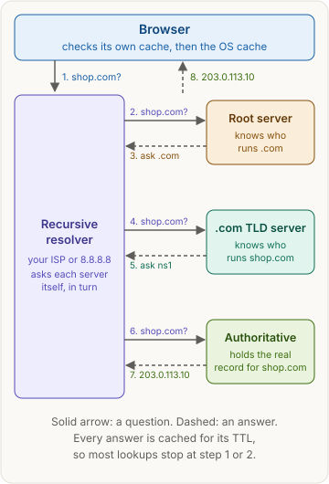
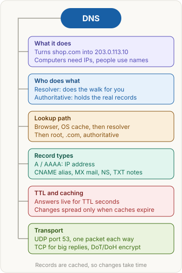

> [!abstract] What this page is for
> **Intent:** the full picture behind the [[networking/dns|quick DNS page]]. Same sections, same order, with more depth in each: the raw message, exact rules, tables, commands, edge cases and the harder interview questions.
> **Read the quick page first.** Each section here starts where the quick one stops.
> **Time:** about 20 minutes.

## Words you need first

Everything from the quick page (DNS, domain name, IP address, resolver, root server, TLD, authoritative server, record, cache, TTL, UDP, TCP, port), plus:

- **Zone**: the part of the name space that one set of authoritative servers manages. `shop.com` is a zone. `api.shop.com` can be in the same zone or in a zone of its own.
- **Referral**: a reply that says "I do not have the answer, ask these servers instead." It is made of NS records, and often glue records too.
- **Glue record**: an address record sent alongside an NS record, so the resolver can reach a name server whose name is inside the zone it serves. Without glue, `ns1.shop.com` would need `shop.com` to be found first.
- **SOA record**: the "start of authority" record for a zone. It holds the zone's serial number and the timing values used for negative caching.
- **Negative caching**: remembering that a name does not exist, so the same missing answer is not asked for again and again.
- **Recursion desired (RD)**: a flag bit in a query that asks the server to do the full walk. Clients set it. Authoritative servers usually answer without doing it.
- **Open resolver**: a resolver that answers queries from anyone on the internet, not only its own users.

## Why it exists

The full story behind the quick version:

1. The original `HOSTS.TXT` file was copied by hand between machines, and the copies drifted.
2. DNS split the file into zones. Each organization runs the authoritative servers for its own zones.
3. Caching spreads the load, so the root and TLD servers see a small share of the traffic.
4. The price is that caches can hold old answers. TTL limits how old an answer can get.

## The picture



The same eight steps as the quick page. The rest of this page zooms into each box: the raw query, the flags, the referrals, and what the browser does with the answer.

## How it works, with an example

The same `shop.com` example, as the wire format.

A DNS message has a 12-byte header and then four sections: question, answer, authority and additional. The header holds the transaction ID, a set of flags, and the counts for the other sections.

**Query** from the resolver to the `.com` server, with the recursion flag off, as a client like `dig` would send it (shown as text, not bytes):

```
;; opcode: QUERY, status: NOERROR
;; flags: (no rd)
;; QUESTION SECTION:
;shop.com.        IN  A
```

**Reply** from the authoritative server with the answer:

```
;; flags: qr aa; QUERY: 1, ANSWER: 1, AUTHORITY: 0, ADDITIONAL: 0
;; ANSWER SECTION:
shop.com.     3600  IN  A  203.0.113.10
```

`qr` means this is a response. `aa` means the answer comes from the authoritative server for the zone, not from a cache.

**Transport.** A query and its reply normally travel in one UDP datagram on port 53. The classic size limit for a UDP reply is 512 bytes. Larger answers use EDNS0, an extension that lets the client advertise a bigger buffer (the `udp: 1232` in the dig output below). If a reply still does not fit, the server sets the **TC (truncated)** bit and the client retries over TCP port 53. TCP is also used for zone transfers between name servers.

**Plain DNS is readable.** Anyone on the path can see the names looked up and the answers. A forged reply can be inserted, unless the resolver validates DNSSEC (DNS Security Extensions, which sign records so a resolver can check that the owner published them).

**DoT (DNS over TLS).** RFC 7858. The DNS message is sent over TLS (a secure, encrypted connection) on TCP port 853. The content is hidden, but the separate port is easy to spot and block.

**DoH (DNS over HTTPS).** RFC 8484. The DNS message is sent as an HTTP request, usually to port 443, inside TLS. A network observer sees ordinary HTTPS traffic to the resolver's address, so it is hard to tell apart from web traffic.

## The most common mistake

> [!warning] Thinking the browser asks the authoritative server
> Everything from the quick page holds. Two consequences that interviewers like:

- **The resolver is the trust point.** A compromised or filtering resolver can change answers, even if the authoritative records are correct.
- **Negative answers stick too.** If a name was missing when a resolver last checked, it can stay missing until the negative cache expires. A brand-new domain can look broken for a while after it is created.

## The lookup step by step

The eight steps of the picture, with the detail for each:

1. **Local caches.** The browser checks its own cache, then the operating system's cache (the stub resolver). A valid entry ends the lookup. Each entry is kept for its remaining TTL.
2. **Query to the resolver.** The stub resolver sends one query with the RD flag set. It asks for an A record (IPv4) or an AAAA record (IPv6). Many systems ask for both at once.
3. **Resolver cache.** A hit returns the answer with the remaining TTL, and the resolver does no further work.
4. **Root server.** The resolver sends a query with RD off. The root does not know `shop.com`, so it returns a referral with the NS records for `.com`.
5. **TLD server.** The `.com` server returns a referral with the NS records for shop.com. If those name servers are inside shop.com itself, the reply also carries glue records.
6. **Authoritative server.** The resolver sends the query to one of the NS servers. The reply has the `aa` flag and the A record with its TTL.
7. **Cache and return.** The resolver stores the answer for its TTL and returns it to the stub resolver, which passes it to the browser.

You can see the walk with `dig`, the standard DNS lookup tool. `dig +trace shop.com` skips the cache and prints every referral from the root down to the authoritative answer.

**Output of `dig shop.com`** from a resolver that had the answer cached. The values are illustrative. The address is from the documentation range in RFC 5737, and the TTL and timing will differ on a real run.

```
; <<>> DiG 9.18.28 <<>> shop.com
;; Got answer:
;; ->>HEADER<<- opcode: QUERY, status: NOERROR, id: 41237
;; flags: qr rd ra; QUERY: 1, ANSWER: 1, AUTHORITY: 0, ADDITIONAL: 1

;; OPT PSEUDOSECTION:
; EDNS: version: 0, flags:; udp: 1232
;; QUESTION SECTION:
;shop.com.                      IN      A

;; ANSWER SECTION:
shop.com.               3600    IN      A       203.0.113.10

;; Query time: 12 msec
;; SERVER: 192.168.1.1#53(192.168.1.1) (UDP)
;; MSG SIZE  rcvd: 56
```

> [!info]- dig field reference
> | Field | Value in the example | What it means |
> |---|---|---|
> | `opcode: QUERY` | Message type | A normal query. Other opcodes include NOTIFY and UPDATE |
> | `status: NOERROR` | Result code | The query worked. A missing name returns `NXDOMAIN` instead |
> | `id: 41237` | Transaction ID | Matches the reply to the query. Makes spoofed replies harder to slip in |
> | `flags: qr rd ra` | Header flags | `qr`: a response. `rd`: recursion was desired. `ra`: the server offers recursion |
> | `QUERY: 1, ANSWER: 1` | Section counts | One question, one answer |
> | `AUTHORITY: 0` | Count of NS records | Empty here, because the reply came from a cache |
> | `ADDITIONAL: 1` | Count of extra records | The OPT record that carries the EDNS options |
> | `udp: 1232` | EDNS0 buffer size | The client accepts UDP replies up to 1232 bytes |
> | `IN A` | Class and type | Internet class, IPv4 address record |
> | `3600` | TTL in seconds | The answer may be cached for one hour |
> | `Query time: 12 msec` | Round trip | Mostly the RTT to the resolver |
> | `SERVER: 192.168.1.1#53` | Responder | A local router answering on port 53 over UDP |
> | `MSG SIZE rcvd: 56` | Reply size | 56 bytes, so it fitted in one UDP packet |

## Record types

The six types from the quick page, with the rules that trip people up:

| Type | Holds | Example | Rules and notes |
|---|---|---|---|
| A | IPv4 address | `shop.com. 3600 IN A 203.0.113.10` | Several A records on one name give several addresses. Clients may use any of them |
| AAAA | IPv6 address | `shop.com. 3600 IN AAAA 2001:db8::10` | Same job as A, for IPv6. Dual-stack clients often ask for both |
| CNAME | Alias to another name | `www.shop.com. CNAME shop.com.` | The target is looked up again. A name with a CNAME cannot have any other record. A CNAME cannot sit at the zone apex |
| MX | Mail server and priority | `shop.com. MX 10 mail.shop.com.` | Lower numbers are tried first. The target must be a name with an A or AAAA record, not an IP address, and not a CNAME |
| NS | Authoritative name servers | `shop.com. NS ns1.dnshost.net.` | Sent in referrals and at the zone apex. Each NS target needs an address the resolver can reach |
| TXT | Free text, in one or more strings | `shop.com. TXT "v=spf1 -all"` | Each string is up to 255 bytes. Used by SPF and DKIM email checks, and by domain ownership checks |

**The zone apex.** The bare domain, such as `shop.com` itself, must have SOA and NS records. Because a CNAME cannot sit beside other records, it cannot be the apex. Providers offer vendor features such as "ALIAS" or "ANAME" records as a workaround. These are not standard DNS records, so behavior depends on the provider.

## Caching and TTL

Caches exist at several layers, and each one follows the TTL:

- **Browser and OS.** Short-lived caches, shared by programs on the same machine.
- **Recursive resolver.** The largest shared cache. Many users behind one resolver share its answers.
- **Remaining TTL.** A cached answer is returned with the time left, not the original TTL. Two clients asking a minute apart can see 3600 and 3540.

**Negative caching (RFC 2308).** When a name does not exist, the reply is NXDOMAIN, and the resolver may cache that result. The negative TTL comes from the SOA record of the zone. A name that was looked up too early, before it was created, can stay missing for that time.

**Changing a record safely.** The usual steps:

1. Lower the TTL, for example to 300 seconds, well before the change. Wait at least the old TTL, so caches expire with the short value.
2. Make the change.
3. Check that the new answer is visible from several resolvers.
4. Raise the TTL again once the change is stable.

Some software ignores the TTL, caps it to a minimum or maximum, or keeps answers longer than told. So the timing can only be estimated.

**DNS-based load balancing.** DNS can spread traffic across several servers, in three common forms:

- **Round robin.** A name has several A records. The order of the list rotates, so different clients get different first addresses.
- **Geo or latency DNS.** The authoritative server picks the address that is closest to the resolver it sees. This is how many CDNs (content delivery networks) route users to nearby servers.
- **Health-checked failover.** The DNS provider stops returning an address that fails its health check.

The limits are important in interviews. Caches hold one answer for the whole TTL, so traffic does not move quickly. The resolver's position is used as a stand-in for the client's position, which is only approximate. A short TTL gives faster failover, but more DNS queries, and some clients ignore it.

## Say it in an interview

Start with the quick answer, then add the part the interviewer asks about:

- **Caching and negative answers:** "Resolvers cache negative answers too, for the SOA-based negative TTL, so a new domain can look missing for a while after it is created."
- **Transport:** "Plain DNS is UDP on port 53, because one packet each way has no handshake. A reply that is too big sets the TC bit, and the client retries over TCP. DoT and DoH add encryption, on ports 853 and 443."
- **Load balancing and TTL:** "DNS can spread traffic with round robin or geo answers, but caches hold answers for the TTL, so failover is only as fast as the TTL. That is why a short TTL is used for these names."

## Questions interviewers ask

The ten from the [[networking/dns#Questions interviewers ask|quick page]], plus these harder ones. Tap a question to see the answer.

> [!question]- What happens when you type a URL into the browser?
> DNS resolves the host name to an IP address first. Then the browser opens a TCP connection to that address on port 443, runs the TLS handshake, and sends the HTTP request. The DNS step is the one that turns the name into something the network can route.

> [!question]- Why does a new domain sometimes return NXDOMAIN and then work later?
> The resolver cached the NXDOMAIN answer. That is negative caching, and the negative TTL comes from the zone's SOA record. Once it expires, the resolver asks again and gets the new record.

> [!question]- What is a glue record, and why does a referral need one?
> A glue record is an address for a name server that sits inside the zone it serves. For example, the `.com` server refers shop.com to `ns1.shop.com`, but to reach `ns1.shop.com` the resolver needs its address, and that address lives inside shop.com. The glue record provides it in the referral, which avoids a loop.

> [!question]- Why can't an MX record point to a CNAME or an IP address?
> The mail system looks up the MX target as a host name and then its address. A CNAME or an IP in that field breaks this chain for some mail servers, and the RFC rules require a plain host name with an address record.

> [!question]- How does DNS-based load balancing work, and what are its limits?
> Round robin rotates several A records. Geo DNS picks an address based on the resolver's location. Health checks remove failed addresses. The limits are the TTL, which delays changes; the resolver's location, which is only a guess for the client's location; and clients that ignore the rotation.

> [!question]- What does DNSSEC protect, and what does it not protect?
> DNSSEC signs records, so a resolver can check that the answer really came from the zone owner and was not changed on the way. It protects integrity. It does not encrypt the query, so the names are still visible on the network. DoT and DoH cover privacy.

> [!question]- What is a DNS amplification attack, and why does UDP make it possible?
> An attacker sends many small queries to an open resolver with the victim's IP address as the source. The resolver's larger replies go to the victim. UDP makes this possible because the source address is not checked by a handshake, so it can be forged, and a small query can produce a large reply. Mitigations are closing open resolvers, rate-limiting replies, and filtering spoofed traffic.

> [!question]- A user says "could not resolve host". How do you debug it?
> Check whether the name resolves at all with `dig` or `nslookup`, and try a public resolver such as 1.1.1.1 to separate a resolver fault from a record fault. Use `dig +trace` to see where the walk stops. Check the NS records and glue. Check whether a negative answer is cached. Check the TTL and whether the record was changed recently.

> [!question]- What is the difference between DoT and DoH?
> Both encrypt the DNS query to the resolver. DoT uses TLS on its own port, 853, so it is easy to spot and to block. DoH wraps the query in HTTPS on port 443, so it looks like normal web traffic. DoH is harder for a network to block, but it also hides DNS from network monitoring.

> [!question]- Why does a short TTL not guarantee instant failover?
> Caches around the world hold the old answer until the TTL expires. A short TTL shortens that window, but some resolvers cap or ignore the TTL, and clients may keep a connection open to the failed server. Failover also needs health checks to notice the failure first.

## Mental map



The same map as the quick page. Each branch is a section above.

## Watch


Fireship, about 2 minutes: what DNS is and how a domain name becomes an IP address.
