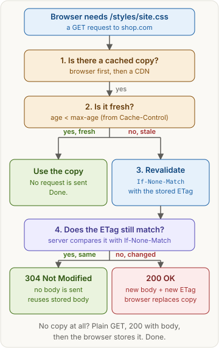
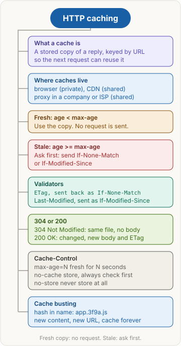

> [!abstract] What this page is for
> **Intent:** the full picture behind the [[networking/http-caching|quick HTTP caching page]]. Same sections, same order, with more detail in each: raw headers, exact rules, `Vary`, edge cases and the harder interview questions.
> **Read the quick page first.** Each section here starts where the quick one stops.
> **Time:** about 20 minutes.

## Words you need first

Everything from the quick page (HTTP, cache, browser cache, CDN, proxy, header, ETag, `304 Not Modified`), plus:

- **RFC (Request for Comments)**: an official internet standard document. HTTP caching is in RFC 9111. Conditional requests are in RFC 9110.
- **Shared cache vs private cache**: a shared cache (CDN, proxy) serves many users. A private cache (the browser) serves one user.
- **Age**: how long a stored copy has been around. A shared cache reports it in an `Age` header.
- **Freshness lifetime**: how long a copy may be used without checking. Set by `max-age` or `Expires`.
- **Validator**: a value that identifies a version of a file. An ETag or a `Last-Modified` date.
- **Conditional request**: a normal request with an extra header (`If-None-Match` or `If-Modified-Since`) that asks for the body only if the file changed.
- **Cache key**: what the cache uses to find a copy. The URL, plus any headers listed in `Vary`.

## Why it exists

The quick page's story, with the numbers. A request has a fixed cost: DNS, connection setup, then one round trip for the reply. On a phone, one round trip can take 100 ms or more. Multiply that by 30 small files and the page feels slow.

A fresh cache hit skips all of it. A revalidation still makes one round trip, but the reply has no body, so the bytes are saved. Caching therefore cuts both time and bandwidth, and it also cuts load on the origin and the CDN bill.

## The picture



The same flow as the quick page. The rest of this page zooms into each box: the exact freshness test, the raw headers for step 3 and 4, and what happens when the server answers `200`.

## How it works, with an example

The same `shop.com/styles/site.css` example as the quick page.

**Step 1, first reply.** The browser asks for the file and gets this:

```http
HTTP/1.1 200 OK
Date: Fri, 30 Oct 2026 10:00:00 GMT
Content-Type: text/css
Content-Length: 80000
Cache-Control: max-age=3600
ETag: "7f3a-9c1"

body-bytes-of-site.css (80000 bytes)
```

The browser stores the body and these headers. The `Date` header is the start of the age count.

**Step 2, ten minutes later, fresh.** The age is 600 seconds, and `max-age` is 3600. The copy is fresh. The browser uses it, and the network panel shows no request at all.

**Step 3, two hours later, stale.** The age is 7200 seconds, which is more than `max-age`. The browser sends a conditional request with the stored validator:

```http
GET /styles/site.css HTTP/1.1
Host: shop.com
If-None-Match: "7f3a-9c1"
```

**Step 4a, unchanged.** The server compares the ETag. It matches, so the server answers without a body:

```http
HTTP/1.1 304 Not Modified
Date: Fri, 30 Oct 2026 12:00:00 GMT
Cache-Control: max-age=3600
ETag: "7f3a-9c1"

```

The blank line after the headers is still there, and nothing follows it. The cache uses its stored body and copies the new headers (such as the new `Date` and `Cache-Control`) into the stored copy. The copy becomes fresh again for another hour.

**Step 4b, changed.** The file was edited, so the ETag differs. The server ignores the old label and sends the full file:

```http
HTTP/1.1 200 OK
Date: Fri, 30 Oct 2026 12:00:00 GMT
Content-Type: text/css
Content-Length: 80400
Cache-Control: max-age=3600
ETag: "7f3a-9d2"

body-bytes-of-site.css (80400 bytes, new version)
```

The browser replaces the stored copy.

**The same flow with Last-Modified.** If the server sends only a date:

```http
HTTP/1.1 200 OK
Last-Modified: Wed, 28 Oct 2026 08:00:00 GMT
Cache-Control: max-age=3600
```

Then the stale revalidation sends `If-Modified-Since: Wed, 28 Oct 2026 08:00:00 GMT`. An unchanged file gets `304`. A file changed after that time gets `200` with a new `Last-Modified`.

**Field reference:**

| Field | Where | Example value | What it does |
|---|---|---|---|
| `Cache-Control` | Response | `max-age=3600` | Sets the freshness lifetime and the storage rules |
| `Date` | Response | `Fri, 30 Oct 2026 10:00:00 GMT` | Start of the age count |
| `ETag` | Response | `"7f3a-9c1"` | Label for this exact version. The quotes are part of the value |
| `If-None-Match` | Request | `"7f3a-9c1"` | "Send the body only if the ETag differs" |
| `Last-Modified` | Response | a date | When the file last changed |
| `If-Modified-Since` | Request | a date | "Send the body only if changed after this time" |
| `Content-Length` | 200 only | `80400` | Body size. Absent on 304 |

**Where to see it.** In DevTools, open the **Network** tab. A size of `(memory cache)` or `(disk cache)` is a fresh hit with no request. A status of `304` is a revalidation. Open **Headers** to see `If-None-Match`.

## The most common mistake

> [!warning] `no-cache` does not mean "do not cache", and `304` is not a resend
> Both ideas are easy to get wrong. A `304` has no body, so the file is not sent again. `no-cache` allows storing, so it does not protect sensitive data. Use `no-store` for that.

Two more consequences interviewers like:

- **Shared caches and credentials.** A response to a request with an `Authorization` header is not stored by a shared cache, unless the response says `public`, `s-maxage` or `must-revalidate`. So a CDN will not keep a private API reply by accident. A reply with cookies can still be stored if it is marked `public`, so always set `private` or `no-store` on personal data.

## Fresh or stale

**The freshness test.** A copy is fresh when:

```text
age < freshness lifetime
freshness lifetime = max-age (if set), otherwise Expires minus Date
```

`max-age` wins over `Expires` when both are present. `Expires` is an older header with a fixed date. Modern code uses `max-age`.

**Heuristic freshness.** If a response has no `Cache-Control` and no `Expires`, RFC 9111 lets a cache guess a lifetime. Many caches use about 10 percent of the time since `Last-Modified`. A guess is not a promise, so set `max-age` to make the behaviour explicit.

**Full directive table:**

| Directive | Meaning | Who may store it |
|---|---|---|
| `max-age=N` | Fresh for N seconds after it was received | Any cache allowed to store the response |
| `s-maxage=N` | Like `max-age`, for shared caches only. Overrides `max-age` there | Shared caches |
| `no-cache` | Store it, but check with the server before every reuse | Any cache, always revalidated |
| `no-store` | Do not store anything. Fetch the full response every time | Nobody |
| `private` | Only the user's browser may store it | Browser only |
| `public` | Any cache may store it, even with cookies or `Authorization` | Any cache |
| `must-revalidate` | Once stale, do not use the copy without checking the server | Any cache |
| `immutable` | The content never changes for this URL during its lifetime. Browsers skip revalidation on reload | Browser |
| `stale-while-revalidate=N` | After the copy is stale, serve it for up to N more seconds while the cache refreshes it in the background | Any cache (RFC 5861) |
| `stale-if-error=N` | If the origin fails (5xx or no reply), serve the stale copy for up to N seconds | Any cache (RFC 5861) |

`stale-while-revalidate` hides latency: the user gets the old copy at once, and the next request gets the new one. `stale-if-error` keeps a site up during an outage.

- `Cache-Control: no-store` on a bank page, a login response, or a personal cart.
- `Cache-Control: private, max-age=0, must-revalidate` for a per-user page that may be checked each time.
- `Cache-Control: public, max-age=31536000, immutable` for `app.3f9a.js`.
- `Cache-Control: public, max-age=60, s-maxage=3600, stale-while-revalidate=30` for a public product list: the browser keeps it 1 minute, the CDN keeps it 1 hour, and a stale CDN copy can be served for 30 seconds while it refreshes.

## Revalidation and 304

**The rules for a 304 (RFC 9110 and RFC 9111).** The server:

- must not send a body in a `304`;
- must send the headers it would have sent in a `200` that matter for caching: `Cache-Control`, `ETag`, `Date`, `Expires` and `Vary` when they apply;
- causes the cache to update its stored headers with those values, while keeping the stored body.

**Precedence.** If a request has both `If-None-Match` and `If-Modified-Since`, the server must ignore `If-Modified-Since`. An ETag names a version exactly. A date has one-second resolution, so two changes in the same second look identical to it.

**Strong and weak comparison.** `If-None-Match` uses the weak comparison: `W/"7f3a-9c1"` matches `"7f3a-9c1"`. This is right for caching, because weak tags promise only the same meaning. A weak ETag is written with a `W/` prefix.

**ETags in practice.** Some servers build ETags from the file's inode, modification time and size. If two servers behind a load balancer build different ETags for the same file, revalidations miss and return `200`. Use a content hash, or the same rule on every server.

## What to cache

**The four kinds of response:**

| Kind | Example | Good headers | Why |
|---|---|---|---|
| Hashed static file | `app.3f9a.js`, `logo.8c21.png` | `public, max-age=31536000, immutable` | Name changes on every change, so the copy never goes wrong |
| HTML page | `/index.html` | `no-cache` (or `max-age=60`), with an ETag | The page links to new asset names on each deploy |
| Public API response | `GET /products?page=1` | `public, max-age=30, s-maxage=300` | Shared data, OK to be a little old |
| Personal data | `GET /cart`, `GET /account` | `private, no-store` | Must never be stored by a shared cache, and should not be stored in the browser either |

**Cache busting in detail.** There are three ways to change the URL:

- **Content hash in the name:** `app.3f9a.js`. The best choice. Build tools (webpack, Vite, esbuild) do this by default.
- **Query string version:** `app.js?v=3`. It works in many caches, but some CDNs and proxies ignore query strings for caching, so the old copy can be served.

Hashed names only need the HTML to be fresh. That is why the HTML rule is `no-cache` (or a short lifetime), while the assets get one year.

**Vary.** `Vary` lists the request headers that changed the reply. A cache must then store a separate copy for each value. The cache key becomes the URL plus those header values.

```http
HTTP/1.1 200 OK
Content-Encoding: gzip
Vary: Accept-Encoding
Cache-Control: public, max-age=3600
```

Without `Vary: Accept-Encoding`, a cache could store the gzip copy and serve it to a client that asked for no compression. Common `Vary` values:

- `Accept-Encoding`: the compression format (gzip, br). Almost every compressed response needs it.
- `Accept-Language`: a page with different languages for the same URL.
- `Origin`: CORS replies that change with the requesting origin (see [[networking/cors]]). Without it, a CDN can serve one origin's header to another, and the other page fails.
- `Cookie` or `Authorization`: avoid these. Each distinct value creates a new cache entry, so the hit rate falls, and private data risks leaking. Use `private` instead.
- `*`: the reply depends on something the cache cannot see. Caches will not reuse it, so treat it as "no caching".

**Purging a CDN.** A CDN may keep its own copy until the lifetime ends. Fixes, in order of effort: change the URL (a new hash), purge that URL or a cache tag in the CDN's dashboard or API, or wait for `max-age` to run out. Changing the URL is the most reliable.

## Say it in an interview

Start with the 60-second answer from the [[networking/http-caching#Say it in an interview|quick page]]. If they push deeper, add one of these:

- **Revalidation detail:** "A `304` has no body and tells the cache to update its stored headers. If `If-None-Match` and `If-Modified-Since` both arrive, the server uses the ETag."
- **Vary and shared caches:** "`Vary` makes the cache key include the listed headers. A CDN with `Vary: Origin` keeps one copy per origin. Personal responses need `private` or `no-store`, because shared caches must not store responses to requests with `Authorization`."
- **Stale rules:** "`stale-while-revalidate` lets the cache answer from a stale copy and refresh in the background. `stale-if-error` keeps the site up when the origin fails."

## Questions interviewers ask

The ten from the [[networking/http-caching#Questions interviewers ask|quick page]], plus these harder ones. Tap to reveal.

> [!question]- What does `Vary` do, and why does it matter?
> It makes the cache key include the listed request headers, so each variant gets its own stored copy. Without `Vary: Accept-Encoding`, a gzip copy can reach a client that asked for plain text.

> [!question]- Can a `POST` response be cached?
> Almost never. A `POST` changes server state, so caches do not store its replies by default. Use `GET` for cacheable reads.

> [!question]- What is heuristic freshness?
> When a response gives no explicit lifetime, a cache may guess one from `Last-Modified`, often about 10 percent of the time since the file last changed. It is a guess, so set `max-age` explicitly.

> [!question]- What does `stale-while-revalidate` do?
> After a copy is stale, the cache may serve it for up to N more seconds while it refreshes in the background. The user does not wait for the server.

> [!question]- A request has an `Authorization` header. Can a CDN store the reply?
> Not by default. Shared caches do not store replies to requests with `Authorization` unless the response says `public`, `s-maxage` or `must-revalidate`. Personal data should use `private` or `no-store`.

> [!question]- After a deploy, users see the old CSS, and the ETag changed. What is wrong?
> Possibly the HTML. If it is cached for a long time, users keep requesting old asset URLs. Or the assets are not hashed and their `max-age` is still running. Check the HTML's `Cache-Control`, the asset URLs, and the CDN.

> [!question]- Why might a load balancer break ETag revalidation?
> If two servers build different ETags for the same file (for example from inode and modification time), a revalidation sent to one server gets `200` from the other. Use a content hash, or the same rule on all servers.

> [!question]- What is the difference between a strong and a weak ETag?
> A strong ETag means the bytes are identical. A weak ETag (`W/` prefix) means the content is the same in meaning. `If-None-Match` uses the weak comparison, so weak tags still produce `304`.

> [!question]- Why does `If-None-Match` take priority over `If-Modified-Since`?
> RFC 9110 requires the server to ignore `If-Modified-Since` when `If-None-Match` is present. An ETag identifies a version exactly, while a date can miss two changes in one second.

## Mental map



The same map as the quick page. Each branch is a section above.
