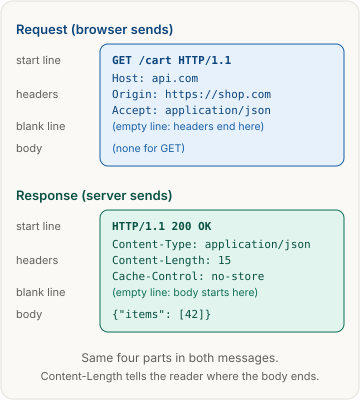
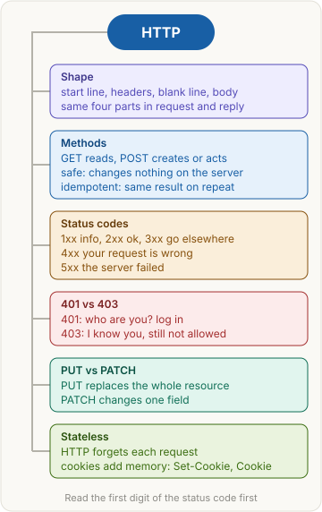

> [!abstract] What this page is for
> **Intent:** the full picture behind the [[networking/http-message|quick HTTP message page]]. Same sections, same order, with more depth in each: raw bytes, exact rules, full tables, commands and the harder questions.
> **Read the quick page first.** Each section here starts where the quick one stops.
> **Time:** about 20 minutes.

## Words you need first

Everything from the quick page (HTTP, request, response, method, status code, header, body, safe, idempotent, cookie, stateless), plus:

- **Request target**: the part after the method. For `GET /cart?page=2 HTTP/1.1` it is `/cart?page=2`. The `?` starts the query string, a set of `name=value` pairs the server can read.
- **Protocol version**: the last word of the start line, such as `HTTP/1.1`. It says which HTTP rules the message follows.
- **CRLF**: the two characters carriage return and line feed (`\r\n`). HTTP/1.1 ends every start line and header line with CRLF.
- **Reason phrase**: the text after the status code, e.g. `OK`. It is free text for humans. Clients must read the number, not the words.
- **Field name**: the name before the colon in a header. Field names are case-insensitive, so `content-type` and `Content-Type` are the same.
- **Framing**: how the reader knows where the body ends. Either `Content-Length` (a byte count) or chunked transfer coding (the body is sent in pieces, each with its size).
- **Location header**: a response header with a URL. Used with 201 and the 3xx redirects.
- **Pseudo-header**: in HTTP/2 and HTTP/3, a header with a leading colon, such as `:method`. It carries the request line data.
- **RFC (Request for Comments)**: an official Internet standard document. HTTP is defined in RFC 9110 (semantics) and RFC 9112 (HTTP/1.1 message syntax).

## Why it exists

The quick version: a browser and a server need one shared format. The detailed version adds two things the format solves. First, it lets many different programs interoperate, because the rules are written down and every field has a meaning. Second, it lets a message be read in a stream, one line at a time, without knowing the whole size first. The blank line and the length rules make that possible.

## The picture



The same picture as the quick page. The parts it labels are the parts the rest of this page takes apart: the start line in each message, the header lines, the empty line, and the body with its length.

## How it works, with an example

The same `shop.com` → `api.com` example, as the raw bytes on the wire.

**Request** (the browser writes it, your page code cannot change `Host` or `Origin`). There's no `Cookie` line: a cross-origin `fetch` sends cookies only with `credentials: "include"` (see [[networking/cors#Cookies across sites|CORS]]):

```http
GET /cart HTTP/1.1
Host: api.com
Origin: https://shop.com
Accept: application/json

```

The final empty line is the blank line. The request has no body, so nothing follows it.

**Response:**

```http
HTTP/1.1 200 OK
Content-Type: application/json
Content-Length: 15
Cache-Control: no-store

{"items": [42]}
```

The body is exactly 15 bytes. Check it yourself with `printf '%s' '{"items": [42]}' | wc -c`. A `Content-Length` that does not match the real body is a classic bug. If it is too small, the client cuts the body short. If it is too big, the client waits for bytes that never come.

**Parsing rules** (RFC 9112):

- The start line is read first. For a request it is `method SP request-target SP version`, where SP is a single space.
- Header lines follow, each `field-name: value`, and end with CRLF. Optional spaces around the value are ignored.
- A line with only CRLF ends the headers. Then the body starts.
- If there is no `Content-Length` and no `Transfer-Encoding`, a request has no body. A response without framing is read until the connection closes.

**Chunked transfer coding.** When the server does not know the size up front, it sends `Transfer-Encoding: chunked`. Each chunk is a hex size, CRLF, the bytes, CRLF. A zero-size chunk ends the body:

```http
HTTP/1.1 200 OK
Transfer-Encoding: chunked

4
Wiki
5
pedia
0

```

That body is `Wikipedia`: `4` bytes, then `5` bytes, then the end.

### HTTP/1.1 vs HTTP/2 vs HTTP/3

- **HTTP/1.1** is the text format above. Replies come back in order on a connection, so a slow reply holds up the ones behind it. Clients open several connections to work around this. It runs over TCP.
- **HTTP/2** keeps the same methods, status codes, headers and body rules. The message is split into binary frames, and many requests share one TCP connection as streams. Header names are always lowercase on the wire. The start line becomes pseudo-headers: `:method: GET`, `:path: /cart`, `:authority: api.com`, `:scheme: https`.
- **HTTP/3** does the same over QUIC, which runs over UDP instead of TCP. It removes the TCP-level wait that can block all streams when one packet is lost.

Application code and most headers do not change between versions. DevTools still shows the familiar text form.

## The most common mistake

> [!warning] Length mistakes and assuming the body is always there
> The quick page's warning still holds, plus three details:
> - **Wrong `Content-Length`.** Count bytes, not characters. A non-ASCII letter like `é` is two bytes in UTF-8.
> - **Missing blank line.** Without the empty line the reader keeps waiting for headers, and the body is never found.
> - **Body on a GET.** RFC 9110 gives a body on GET no defined meaning. Many servers and proxies drop it. Send data on GET in the query string, or use POST.

## Methods

**Exact definitions** (RFC 9110, section 9):

- A **safe** method is one the client does not ask the server to change anything for. Safe methods are GET, HEAD, OPTIONS and TRACE.
- An **idempotent** method is one where sending the request N times has the same effect on server state as sending it once. Idempotent methods are GET, HEAD, OPTIONS, TRACE, PUT and DELETE. All safe methods are idempotent.
- Idempotence is about **state**, not about the response. A DELETE that returns 204 the first time and 404 the second time is still idempotent. The item is gone both times.

| Method | Body in request | Safe | Idempotent | What the server does |
|---|---|---|---|---|
| GET | No defined meaning, avoid | Yes | Yes | Returns a representation of the resource |
| HEAD | No | Yes | Yes | Same as GET, but sends headers only, no body |
| OPTIONS | Optional | Yes | Yes | Says which methods are allowed. Use the `Allow` header in the reply |
| POST | Yes | No | No | Processes the body, often creates a new resource |
| PUT | Yes | No | Yes | Replaces the target resource with the body |
| PATCH | Yes | No | Not guaranteed | Applies a partial change (RFC 5789). Format is set by the media type, e.g. JSON Patch |
| DELETE | Optional | No | Yes | Removes the target resource |

**Plain rules to remember:**

- **GET** and HEAD must not change state. Caches and crawlers rely on this.
- **POST** is the catch-all. Sending it twice can create two orders. Payment APIs fix this with an `Idempotency-Key` header: the server remembers the key and returns the first result on a repeat.
- **PUT** is the full replacement. If you omit a field, the server should treat it as removed or reset. That is why PUT needs the whole resource.
- **PATCH** sends a partial change. The change "add 1 to the count" is not idempotent: sending it twice adds 2. A change "set the name to Ana" is idempotent. So PATCH is not guaranteed either way.

**Commands to try:**

```bash
curl -X PUT -H "Content-Type: application/json" -d '{"name":"Ana"}' https://api.com/profile
curl -I https://api.com/cart    # sends HEAD, shows headers only
curl -X OPTIONS -i https://api.com/cart
```

## Status codes

**The five families** (RFC 9110, section 15):

| Family | Meaning | Client should |
|---|---|---|
| 1xx | Informational. Interim reply, final reply still coming | Keep waiting. 100 Continue lets a client send a body after asking |
| 2xx | Success | Read the body if there is one |
| 3xx | Redirect or use a cached copy | Follow the `Location` URL, or reuse the saved copy |
| 4xx | Client error: the request is wrong or not allowed | Change the request for most 4xx. 408 and 429 are the exceptions: retry those unchanged after a wait (`Retry-After` or backoff) |
| 5xx | Server error: the server failed | Retry later is reasonable, often with backoff |

**Common codes in detail:**

| Code | Name | Details |
|---|---|---|
| 200 | OK | The body holds the answer |
| 201 | Created | A new resource exists. `Location` gives its URL |
| 202 | Accepted | Taken, but not finished. Work happens later |
| 204 | No Content | Success, and no body on purpose |
| 301 | Moved Permanently | Clients and caches may remember the new `Location` |
| 302 | Found | Temporary move. Browsers often change a POST to GET on a follow-up |
| 303 | See Other | Always follow with GET. Common after a POST: "go look at the result here" |
| 304 | Not Modified | Reply to a conditional request (`If-None-Match`, `If-Modified-Since`). No body. See [[networking/http-caching|HTTP caching]] |
| 307 | Temporary Redirect | Like 302, but the method and body are kept |
| 308 | Permanent Redirect | Like 301, but the method and body are kept |
| 400 | Bad Request | Malformed syntax, e.g. bad JSON |
| 401 | Unauthorized | No valid credentials. The reply must include `WWW-Authenticate` |
| 403 | Forbidden | Credentials are fine, but this action is not allowed. Logging in again does not help |
| 404 | Not Found | No resource here. Also used to hide that a resource exists |
| 405 | Method Not Allowed | The URL exists, but not for this method. The reply must include an `Allow` header |
| 409 | Conflict | The change clashes with current state, e.g. a duplicate username |
| 422 | Unprocessable Content | Well-formed JSON with wrong values, e.g. a bad email. Many APIs use it for validation |
| 429 | Too Many Requests | Rate limit. Often sent with `Retry-After` (seconds or a date) |
| 500 | Internal Server Error | Generic server bug |
| 502 | Bad Gateway | A proxy got an invalid reply from the server behind it |
| 503 | Service Unavailable | Overloaded or down. Can include `Retry-After` |
| 504 | Gateway Timeout | A proxy waited too long for the server behind it |

**401 vs 403, precisely.** 401 is about **authentication** (who are you?). The reply must include `WWW-Authenticate` to say how to log in. 403 is about **authorization** (are you allowed?). The server knows the caller and refuses. A common trap: returning 404 instead of 403 on purpose, so an attacker cannot tell that a private resource exists.

**Commands:**

```bash
curl -i https://api.com/cart          # shows the status line and headers
curl -o /dev/null -s -w '%{http_code}\n' https://api.com/cart   # prints just the code
```

## Stateless and cookies

**Stateless** means the server keeps no memory of earlier requests between messages. Each request must carry everything the server needs: the method, the path, the credentials. This makes it easy to put many servers behind a load balancer, because any server can answer any request.

**Cookies** add state on top, using two headers.

1. The server replies with `Set-Cookie: session=abc123; Path=/; HttpOnly; Secure; SameSite=Lax; Max-Age=3600`.
2. The browser stores it for the matching domain and path.
3. On later requests that match, the browser adds `Cookie: session=abc123` by itself.

What the attributes do:

- **Path** and **Domain** limit where the browser sends the cookie.
- **Max-Age** or **Expires** sets how long it lives. Without either, it is a session cookie, deleted when the browser closes.
- **HttpOnly** hides it from page JavaScript (`document.cookie`). It reduces theft by injected scripts.
- **Secure** sends it only over HTTPS.
- **SameSite** controls cross-site sending. `Lax` is the default in current Chrome when no value is set. See [[networking/cors|CORS]] for the cross-origin side.

A common design: the cookie holds only a random session ID. The server stores the real data (who you are, your cart) in a database or cache keyed by that ID. Some APIs skip cookies and send `Authorization: Bearer <token>` on each request. The page code must add that header itself, so the browser does not send it automatically.

## Say it in an interview

Start with the 60-second answer from the [[networking/http-message#Say it in an interview|quick page]]. If they push deeper, add one of these:

- **Framing:** "The reader needs the blank line to find the end of the headers, and `Content-Length` or chunked encoding to find the end of the body. A mismatch breaks the next message on the connection."
- **Idempotency in practice:** "PUT and DELETE are safe to retry after a timeout because repeating them is harmless. POST is not, so payment APIs use an idempotency key."
- **Stateless and scaling:** "Because the server keeps no session state in memory, any instance can answer, which is why the state lives in a cookie, a token, or a shared store."

## Questions interviewers ask

The ten from the [[networking/http-message#Questions interviewers ask|quick page]], plus these harder ones. Tap to reveal.

> [!question]- Is `DELETE` safe? Is it idempotent?
> Not safe, since it changes state. Idempotent, since deleting twice leaves the item deleted. The second reply may be 404, and that is fine.

> [!question]- Why can PATCH be non-idempotent?
> The semantics depend on the patch document. "Add 1" repeated adds more each time. "Set to 5" repeated keeps the same result. RFC 5789 does not require it.

> [!question]- What does 405 need that 404 does not?
> A 405 reply must include an `Allow` header listing the methods that the URL does accept.

> [!question]- What is the difference between 302 and 307?
> Both are temporary. 302 lets clients change a POST into a GET on the new request. 307 keeps the method and body.

> [!question]- Why would an API return 404 for a resource the user cannot see?
> So an attacker cannot learn that the resource exists. The 403 would reveal it.

> [!question]- How do you retry a 429 or 503 correctly?
> Wait for `Retry-After` if present, otherwise back off exponentially with jitter. Do not retry a 400 or 422 unchanged, since it will fail the same way.

> [!question]- What is chunked transfer encoding and when is it used?
> The body is sent in size-prefixed chunks ending with a zero-size chunk. It is used when the server cannot know the length before it starts sending, such as streamed output.

> [!question]- What is the difference between `Content-Type` and `Accept`?
> `Content-Type` describes the body that is being sent. `Accept` lists the response formats the client can read. The server uses `Accept` to choose the reply format.

> [!question]- How does HTTP/2 change the start line?
> It has no text start line. The method and path go in pseudo-headers such as `:method` and `:path`. Header names are lowercase.

> [!question]- Does HTTP/3 still use TCP?
> No. It uses QUIC over UDP. The message semantics are the same as HTTP/2.

> [!question]- Why must a 304 reply have no body?
> The client already has the content, and the 304 only confirms that the saved copy is still valid. A body would make the framing ambiguous.

## Mental map



The same map as the quick page. Each branch is a section above.

## Watch


KobbyKernel, about 14 minutes: what a request and a response are made of, and persistent vs non-persistent connections.

Longer, hands-on:


Traversy Media, about 38 minutes: HTTP methods, headers and status codes, then real requests in the browser's dev tools and Postman.
