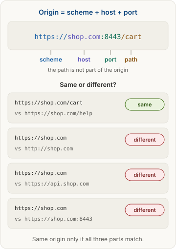
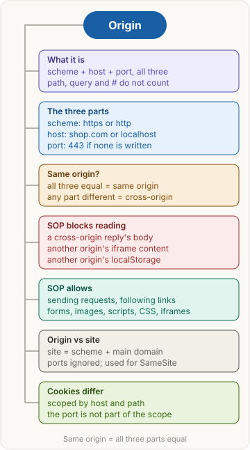

> [!abstract] What this page is for
> **Intent:** the full picture behind the [[networking/origin|quick Origin page]]. Same sections, same order, with more detail in each: the exact parts of an origin, the raw `Origin` header, what the browser does with it, cookie attributes, and the harder interview questions.
> **Read the quick page first.** Each section here starts where the quick one stops.
> **Time:** about 18 minutes.

## Words you need first

Everything from the quick page (origin, scheme, host, port, same-origin policy, site, cookie, SameSite, `fetch()`, XHR, DOM, iframe, localStorage, CORS), plus:

- **Default port**: the port used when a URL does not write one. It is 80 for `http` and 443 for `https`. The URL `https://shop.com:443` is the same URL as `https://shop.com`.
- **Host case**: host names are not case-sensitive. `SHOP.com` and `shop.com` are the same host. The browser lowercases hosts before it compares them.
- **Public suffix**: a suffix that people register names under, such as `com`, `co.uk` or `github.io`. The public suffix list is the official list of these.
- **Registrable domain**: the name you actually own, one step below the public suffix. For `api.shop.co.uk` it is `shop.co.uk`. Site uses this idea. Specs call it eTLD+1, meaning effective top-level domain plus one.
- **Opaque origin**: an origin the browser cannot name, shown as `Origin: null`. Sandboxed iframes and `file:` pages are the usual cases.
- **Sandboxed iframe**: an iframe with restricted rights, set with the `sandbox` attribute. It is often treated as an opaque origin.
- **Preflight**: an automatic `OPTIONS` request the browser sends before some cross-origin requests to ask permission. See [[networking/cors|CORS]].
- **postMessage**: a browser function that sends a message from one window to another, even across origins. The receiver checks where the message came from.
- **Tainted canvas**: a `<canvas>` that has drawn cross-origin pixels. The page cannot read the pixels back.

**Is it the same origin as `https://shop.com/cart`?**

| URL | Same origin? | Why |
|---|---|---|
| `https://shop.com/help` | Yes | path does not count |
| `https://shop.com:443/` | Yes | 443 is the default for https |
| `https://SHOP.com` | Yes | host names ignore case |
| `http://shop.com` | No | scheme differs |
| `https://api.shop.com` | No | host differs (subdomain) |
| `https://shop.com:8443` | No | port differs |
| `https://shop.co.uk` | No | host differs (different domain) |

## Why it exists

The full story behind the quick version:

1. You log in to `bank.com`. It sets a session cookie, and your browser sends that cookie on requests to `bank.com`. If the cookie is set with `SameSite=None`, it's sent **even when another site's page started the request**.
2. You visit `evil.com`. Its script runs `fetch("https://bank.com/api/accounts", { credentials: "include" })`.
3. The browser attaches your bank cookie. The bank sees a valid login and returns your accounts.
4. Without a rule, the script would read that reply and send it to the attacker.

The same-origin policy blocks step 4. It has been part of browsers since the mid-1990s. The same rule also covers pages in frames. Without it, `evil.com` could embed `bank.com` in an invisible iframe and read the page inside it.

Real apps often need cross-origin reads, for example a front end on `shop.com` calling `api.shop.com`. So CORS lets a server list exactly which origins may read its replies. CORS is a controlled hole in the policy, not a removal of it.

What the policy does **not** block: loading images, scripts and stylesheets from other origins (``, `<script src>`, `<link rel="stylesheet">`), or submitting forms to other origins. These were allowed before CORS existed. That is why CSRF (a forged request that uses your cookies) is still possible, and why it needs its own defenses.

## The picture



The same picture as the quick page. The first box breaks one URL into its parts. The four rows show how one changed part turns "same" into "different." The path row is the one people miss.

## How it works, with an example

The same `shop.com` to `api.shop.com` example, now with the raw HTTP and the browser's checks.

**Request** (the browser adds `Origin`, your code cannot change it):

```http
GET /items HTTP/1.1
Host: api.shop.com
Origin: https://shop.com
Accept: application/json
```

The browser sends `Origin` on cross-origin requests. It also usually sends `Origin` on `POST`, `PUT`, `PATCH` and `DELETE`, even when they are same-origin. A plain same-origin `GET` usually has no `Origin` header.

**Reply without CORS headers:**

```http
HTTP/1.1 200 OK
Content-Type: application/json

{"items": [42]}
```

The server ran its code and sent the data. The browser sees no `Access-Control-Allow-Origin` header, so it hides the body from the page. The page's `fetch` rejects with a network error. The developer tools show the CORS message in the console.

**The browser's three checks, in order:**

1. Work out the origin of the page that started the request. This is the page's own origin, scheme, host and port.
2. Compare it with the origin of the request URL. If they match, the response is readable as usual.
3. If they differ, the response can be read only when the reply's CORS headers allow the page's origin. Otherwise the body is hidden.

The server does the work in every case. The browser only decides what the page may read. That is the single most important idea on this page.

## The most common mistake

> [!warning] Thinking a path or a subdomain makes a new origin
> Everything from the quick page holds. Four more traps interviewers like:

- **Same site is not same origin.** `shop.com` and `api.shop.com` are the same site and different origins. The page still needs CORS to read the API, but the browser still sends `SameSite=Lax` cookies to the API.
- **Changing the scheme changes the origin.** Moving a site from `http://shop.com` to `https://shop.com` creates a new origin. Its localStorage starts empty. Users can seem to lose saved data after an HTTP to HTTPS move.
- **Local development mixes hosts.** `localhost:8000` and `127.0.0.1:8000` are different origins. A login cookie set for one host is not sent to the other, so the same app can seem logged in on one and logged out on the other.
- **Sending is not reading.** A cross-origin `POST` that a simple request sends still runs on the server. Only the page's read is blocked.

## Same origin or not?

The browser compares the three parts after normalizing them: the host is lowercased and the default port is filled in. Then the parts are compared as strings.

| Page URL | Other URL | Same origin? | What differs |
|---|---|---|---|
| `https://shop.com/cart` | `https://shop.com/help?x=1#top` | Yes | Nothing. Path, query and fragment do not count |
| `https://shop.com` | `https://shop.com:443` | Yes | Nothing. 443 is implied |
| `http://shop.com` | `http://shop.com:80` | Yes | Nothing. 80 is implied |
| `https://shop.com` | `http://shop.com` | No | Scheme |
| `https://shop.com` | `https://www.shop.com` | No | Host: `www` is a different host |
| `https://shop.com` | `https://shop.com:8443` | No | Port |
| `http://localhost:8000` | `http://localhost:9000` | No | Port |
| `http://localhost:8000` | `http://127.0.0.1:8000` | No | Host: names are compared as text |
| `https://a.github.io` | `https://b.github.io` | No | Host |

Pages opened from `file:` addresses are a special case. Most browsers treat each `file:` page as an opaque origin, so do not rely on two local files sharing an origin.

## What the policy blocks and allows

The policy limits **reading**. It does not limit **sending**.

**Blocked: page JavaScript cannot read:**

- the body of a cross-origin `fetch` or XHR reply, unless [[networking/cors|CORS]] allows it;
- response headers other than the safelisted ones. A few headers, such as `Content-Type` and `Content-Length`, are always readable. Others need `Access-Control-Expose-Headers`;
- the DOM of a cross-origin `iframe`. The parent and the child cannot read each other's content in either direction;
- the localStorage, sessionStorage and IndexedDB of another origin, because each is stored per origin;
- the location or document of a cross-origin popup. A page can still send it to a new address, but cannot read where it is;
- the pixels of a cross-origin image drawn to a `<canvas>`. The canvas becomes tainted, and reading it with `getImageData` throws an error. The image needs CORS and the `crossorigin` attribute to be readable.
- the details of an error from a cross-origin script. Without CORS, the browser reports only "Script error." with no stack trace.

**Allowed:**

- **sending** requests to other origins. Simple requests go straight out. Others wait for the preflight to pass;
- following links and navigating to other origins, including a page sending a popup to a new address;
- submitting HTML forms to other origins;
- displaying ``, running `<script>`, applying `<link rel="stylesheet">`, playing `<video>`, and embedding `<iframe>` from other origins. The page can show or run them, but cannot read their bytes;
- **postMessage** between windows of different origins. This is the safe way to talk across origins. The receiver must check `event.origin` before it trusts the message.

**Embedding can still be refused by the server.** A site can send `X-Frame-Options` or a `frame-ancestors` rule in Content Security Policy to stop other pages from framing it. This is a server opt-out. It is not part of the same-origin policy itself.

## Origin vs site

Origin is strict. Site is looser: the scheme plus the registrable domain, with ports ignored. Cookies have their own scope.

| Pair | Same origin? | Same site? | Why |
|---|---|---|---|
| `https://shop.com` and `https://api.shop.com` | No | Yes | Subdomain of the same registrable domain |
| `https://shop.com` and `https://shop.com:8443` | No | Yes | Port ignored for site |
| `https://shop.com` and `http://shop.com` | No | No | Scheme counts for site in modern browsers |
| `https://shop.co.uk` and `https://shop.com` | No | No | Different registrable domains |
| `https://a.github.io` and `https://b.github.io` | No | No | `github.io` is a public suffix, so each user owns their own site |

Why the difference matters:

- **Origin** decides the same-origin policy, CORS, and what a page may read.
- **Site** decides the `SameSite` cookie setting. `SameSite=Strict` sends the cookie only for same-site requests. `Lax` is the default in Chrome, and it sends the cookie on top-level navigation from other sites, but not on cross-site subresource requests or cross-site POSTs. `SameSite=None` sends it cross-site, and it requires `Secure`.

**Cookie scope** is a third rule, and it is the one that surprises people:

| Attribute | What it does | Port? |
|---|---|---|
| No `Domain` attribute | The cookie is for the exact host that set it (host-only) | Ignored |
| `Domain=shop.com` | The cookie is sent to `shop.com` and its subdomains | Ignored |
| `Path=/cart` | The cookie is sent only for paths under `/cart` | Not relevant |
| `Secure` | The cookie is sent only over `https` | Not relevant |

Example response from `localhost:9000`:

```http
Set-Cookie: session=demo123; Path=/; SameSite=Lax
```

There is no `Domain` attribute, so the cookie is stored for host `localhost`. It is sent to `localhost:8000` too, because cookies do not isolate by port. Its localStorage, by contrast, is separate for each port.

A subtle point: a cookie set over `http` can be sent to `https` on the same host, unless it is marked `Secure`. The scheme is only checked for the `Secure` flag, not for every cookie.

## Say it in an interview

Start with the 60-second answer from the [[networking/origin#Say it in an interview|quick page]]. If they push deeper, add one of these:

- **Storage:** "localStorage, IndexedDB and sessionStorage are all per origin. So a scheme change, a port change, or a subdomain each gives the app a fresh, empty store."
- **Site vs origin:** "CORS uses origin, but `SameSite` uses site. So a subdomain API still gets `SameSite=Lax` cookies from its parent site, but the page still needs CORS to read the reply."
- **postMessage:** "Two windows from different origins talk with postMessage. The receiver must check `event.origin` against an allowlist, or any site can send it messages."

## Questions interviewers ask

The nine from the quick page, plus these harder ones. Tap to reveal.

> [!question]- Does `https://shop.com` share localStorage with `http://shop.com`?
> No. The scheme is part of the origin, so the two have separate localStorage. Moving a site from http to https starts with an empty store.

> [!question]- What is `Origin: null`, and why is it a risk?
> It means the browser cannot name an origin. You see it from sandboxed iframes, `file:` pages and some redirects. A server that allows `null` lets any sandboxed page read its responses, so never allow it.

> [!question]- Can a cross-origin iframe read the parent page's DOM?
> No. Neither side can read the other's DOM, in either direction. The parent and child can talk with postMessage, checking the origin each time.

> [!question]- Why can't I read pixels from a cross-origin image with canvas?
> Drawing the image taints the canvas, because the pixels are cross-origin data. `getImageData` then throws. The fix is CORS on the image server, plus the `crossorigin` attribute on the ``.

> [!question]- Why does a cross-origin script error show only "Script error."?
> Without CORS, the browser hides the error details of a cross-origin script, so a page cannot learn the message or stack trace. The script still runs, only the error is hidden.

> [!question]- If `api.shop.com` is cross-origin to `shop.com`, does it get `SameSite=Lax` cookies?
> Yes. The two are the same site, so `Lax` cookies are sent. CORS still applies for reading the reply, and `credentials: 'include'` is still needed for cookies on a fetch.

> [!question]- Why can't `a.github.io` read `b.github.io`'s localStorage?
> Different hosts mean different origins, so the storage is separate. They are also different sites, because `github.io` is on the public suffix list, so each user's subdomain is its own site.

> [!question]- Does the same-origin policy stop a cross-origin form POST?
> No. Forms and simple POSTs can be sent cross-origin. The policy only blocks reading the reply. Stopping forged POSTs needs CSRF tokens, `SameSite` cookies, or checking the `Origin` header on the server.

> [!question]- Is checking the `Origin` header on the server enough security?
> It helps against browser-based attacks, but not alone. Any non-browser client, such as `curl`, can send any `Origin` it likes. Combine it with real authentication and CSRF protection.

> [!question]- How should two windows from different origins exchange data?
> With `postMessage`. The sender sets a target origin, and the receiver checks `event.origin` against an allowlist before it acts on `event.data`.

## Mental map



The same map as the quick page. Each branch is a section above.
