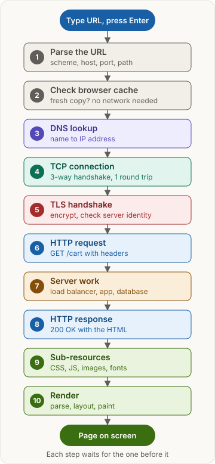
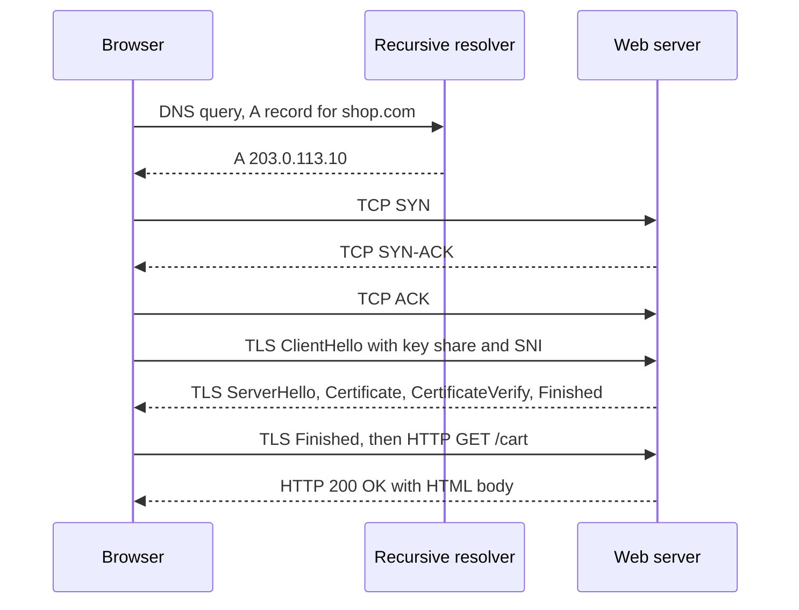
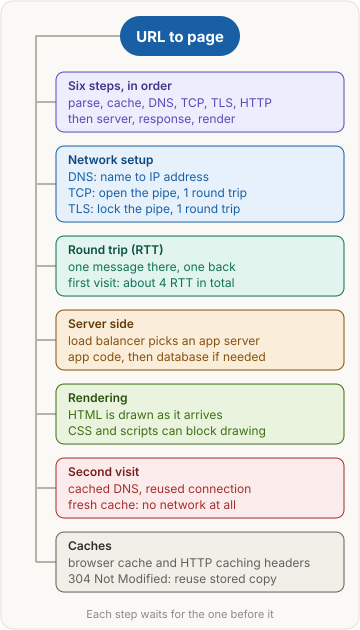

> [!abstract] What this page is for
> **Intent:** the full version behind the [[networking/request-lifecycle|quick request lifecycle page]]. Same sections, same order, with more depth in each: raw messages, exact round-trip math, edge cases and the harder interview questions.
> **Read the quick page first.** Each section here starts where the quick one stops.
> **Time:** about 20 minutes.

## Words you need first

Everything from the quick page (URL, DNS, TCP, TLS, HTTP, round trip, cache), plus:

- **SYN, SYN-ACK, ACK**: the three TCP handshake messages. SYN asks to open a connection, SYN-ACK agrees, and ACK confirms.
- **Sequence number**: a counter in each TCP segment that lets the receiver put bytes back in order and spot gaps.
- **Certificate chain**: the server's certificate, plus the certificates that link it to a root authority the browser trusts.
- **SNI (Server Name Indication)**: the host name sent in plain text in the first TLS message, so one IP address can serve many sites with different certificates.
- **Load balancer**: a server that accepts requests on one address and passes each to one of several back-end servers.
- **Sub-resource**: a file the HTML names, such as a stylesheet, script, image or font.
- **DOM (Document Object Model)**: the browser's tree of the page's elements.
- **CSSOM (CSS Object Model)**: the browser's tree of the page's styles.

## Why it exists

The quick page gave the short reason. Here is the longer one, step by step.

1. A browser holds a name, not a route. Routers forward packets by IP address, so the name must become an address (DNS).
2. A page is many kilobytes or megabytes. IP packets can be lost, duplicated or reordered. A reliable, ordered byte stream is needed (TCP).
3. The stream crosses networks owned by others. Anyone on the path can read or change plain bytes, so the stream must be encrypted and the server's identity proven (TLS).
4. Only then can the browser send an application request in a format both sides understand (HTTP).

## The picture



The same ten steps as the quick page. The rest of this page zooms into each box: the raw messages, the timing, and what can go wrong.

## How it works, with an example

The same `https://shop.com/cart` example as the quick page, as the messages that cross the wire. The IP address `203.0.113.10` comes from the documentation range in RFC 5737, so real values will differ.

```
 #  layer  direction            content
 1  DNS    client -> resolver   QUERY  shop.com  type A
 2  DNS    resolver -> client   ANSWER shop.com  A 203.0.113.10  TTL 3600
 3  TCP    client -> server     SYN      seq=1000
 4  TCP    server -> client     SYN-ACK  seq=5000 ack=1001
 5  TCP    client -> server     ACK      seq=1001 ack=5001
 6  TLS    client -> server     ClientHello (key_share, SNI shop.com, ALPN h2 http/1.1)
 7  TLS    server -> client     ServerHello (key_share)
 8  TLS    server -> client     EncryptedExtensions, Certificate, CertificateVerify, Finished
 9  TLS    client -> server     Finished
10  HTTP   client -> server     GET /cart HTTP/1.1, Host: shop.com  (inside TLS)
11  HTTP   server -> client     HTTP/1.1 200 OK, Content-Type: text/html  (inside TLS)
```

| Row | What it means |
|---|---|
| 1 | The resolver is asked for the IPv4 address of `shop.com` |
| 2 | The answer is valid for 3600 seconds, so caches may reuse it for an hour |
| 3 to 5 | The three TCP handshake messages. The sequence numbers start the byte counting in each direction |
| 6 | The first TLS message. SNI is the server name in plain text, so the server can pick the right certificate |
| 7 | The server picks the cipher and sends its half of the key exchange |
| 8 | The certificate chain, then a signature proving the server holds the matching private key |
| 9 | The browser confirms the handshake was not tampered with |
| 10 | The first HTTP request, now encrypted by TLS |
| 11 | The status line and headers. The HTML body follows in the same encrypted stream |

Rows 3 to 5 cost 1 round trip. Rows 6 to 9 cost 1 round trip in TLS 1.3. Rows 10 and 11 cost 1 more. Rows 1 and 2 cost at least 1 round trip to the resolver.



## The most common mistake

> [!warning] One request is not one page
> Everything from the quick page holds. Three wrong ideas show up often in interviews:

- **Wrong:** TCP is secure, so the page data is encrypted by default. **Right:** TCP only delivers bytes in order and without loss. It does not encrypt them. TLS adds encryption, integrity and server identity on top of TCP.
- **Wrong:** TLS starts before TCP is up, so the handshakes overlap and save time. **Right:** TLS messages travel inside the TCP byte stream, so the TCP handshake must finish first. The two costs add up. QUIC, which HTTP/3 uses, combines transport and TLS setup, but it is not TCP.
- **Wrong:** HTTP itself caches the page. **Right:** HTTP defines headers such as `Cache-Control`, `ETag` and `Last-Modified`. The caches (browser, CDN, proxy) are separate software that read those headers and decide what to store.

## The steps one by one

1. **Parse the URL.** Default ports are 80 for http and 443 for https. The `#fragment` part (for example `#reviews`) is never sent to the server. The browser may also decide first whether the input is a URL or a search query.
2. **Check the browser cache.** Each stored response has a freshness lifetime, set by `Cache-Control: max-age` or `Expires`. Within that lifetime the copy is fresh and used with no network. After it, the copy is stale and must be checked. Before any of this, the browser checks its HSTS list (HTTP Strict Transport Security, a memory of sites that must use https). For an HSTS site, a plain `http://` address is upgraded to https before anything is sent.
3. **DNS lookup.** The browser checks its own DNS cache, then the operating system's, then asks a recursive resolver. The resolver walks the hierarchy: root server, then the `.com` servers, then the authoritative server for `shop.com`. An IPv4 answer is an A record, and an IPv6 answer is an AAAA record. The resolver usually sends its queries over UDP port 53, and very large answers can move to TCP. The TTL on each record tells caches how long they may keep it.
4. **TCP connection.** The client sends SYN with its starting sequence number. The server replies SYN-ACK, with its own sequence number and an acknowledgment of the client's. The client sends ACK. No application data is sent until this handshake finishes, which costs 1 round trip. When a host has both IPv6 and IPv4 addresses, browsers can start both attempts with a short head start for one of them (called Happy Eyeballs). The first connection to succeed is used.
5. **TLS handshake (TLS 1.3).** The client sends ClientHello with a key share, the SNI host name, and ALPN (the list of protocols it can speak, such as `h2` for HTTP/2 or `http/1.1`). The server replies with ServerHello and its key share, then EncryptedExtensions, its Certificate, a CertificateVerify signature, and Finished. The client checks the certificate chain up to a trusted root, checks that the name matches, checks that the certificate has not expired, then sends its own Finished. The HTTP request can go in that same flight. The whole handshake costs 1 round trip. TLS 1.2 needs 2. A returning client can use session resumption, and in TLS 1.3 it can send early data (0-RTT), but early data can be replayed, so it should only carry requests that are safe to repeat. See [[networking/tls|TLS]].
6. **Send the HTTP request.** HTTP/1.1 is text. The request line and headers look like this:

   ```http
   GET /cart HTTP/1.1
   Host: shop.com
   Accept: text/html
   User-Agent: Mozilla/5.0 ...
   ```

   `Host` is required in HTTP/1.1, because one server can host many sites. HTTP/2 sends the same information as binary frames, and a single TCP connection can carry many requests at once. See [[networking/http-message|HTTP message]].
7. **Server work.** A load balancer or reverse proxy (a server that stands in front of the app and forwards requests to it) often ends TLS here, then talks to the app over a private network. The app server runs the route handler. It may read a cache such as Redis, query a database, call other services, and build the reply. Each of those is a hop, and each adds latency that the round-trip math below does not count.
8. **HTTP response.** The response starts with a status line (`HTTP/1.1 200 OK`), then headers, then a blank line, then the body. Useful headers are `Content-Type` (what the body is), `Content-Encoding` (for example `gzip` or `br` compression), `Cache-Control` (how long to keep it), and `ETag` (a version tag for later checks). The response body follows the same encrypted stream.
9. **Sub-resources.** The browser's preload scanner looks ahead in the HTML and starts fetching stylesheets, scripts and images early. HTTP/1.1 browsers open a small number of connections per host (Chrome uses six), so many files queue up. HTTP/2 multiplexes many requests over one connection, which removes most of that queue. A stylesheet or synchronous script can block rendering, so these requests sit on the critical path.
10. **Render.** The browser parses HTML into the DOM and CSS into the CSSOM. It combines them into a render tree of only the visible boxes, runs layout (works out each box's size and position), paints the pixels, and composites the layers. JavaScript can change the DOM at any time, which makes the browser repeat layout and paint for the changed parts.

### Counting round trips

Each request and response exchange costs one round trip. The formula in plain text:

```
first visit  ≈ DNS + TCP + TLS 1.3 + HTTP round trips
             ≈ 1 + 1 + 1 + 1 = 4 RTT
TLS 1.2      adds one more round trip, so about 5 RTT
DNS miss     adds the resolver's own queries, so the DNS part grows
```

A worked example: RTT = 50 milliseconds, the resolver answer is cached, TLS 1.3.

```
first visit  ≈ 4 x 50 ms = 200 ms
second visit (cached DNS, reused connection, stale HTTP entry)
             ≈ 1 x 50 ms = 50 ms
second visit (fresh HTTP entry) ≈ 0 ms, no request is sent
```

These numbers ignore transfer time for large bodies and server processing time. They count only setup and round trips.

## Second visit: what gets skipped

The quick page's table, with more detail behind each row.

- **DNS.** The cached answer is valid until its TTL ends. After that, the next lookup asks the resolver again.
- **TCP.** Browsers keep idle connections for a short time. A reused connection needs no handshake. An idle connection that the server has closed must be replaced, which costs the full handshake again.
- **TLS.** A reused connection needs no handshake. A new connection can still resume an earlier TLS session. TLS 1.3 resumption still takes 1 round trip unless 0-RTT early data is used.
- **HTTP cache.** A fresh copy is returned with no request. A stale copy triggers a conditional request. The browser sends `If-None-Match` (with the ETag) or `If-Modified-Since`. If the resource has not changed, the server replies `304 Not Modified` with no body, and the browser reuses its stored copy. The check still costs 1 round trip.

## Say it in an interview

Start with the quick answer. If the interviewer goes deeper, add one of these:

- **Connection cost:** "HTTP/2 multiplexing reuses one TCP connection for many requests. HTTP/3 runs over QUIC on UDP, so a lost packet only stalls its own stream. QUIC also combines transport and TLS setup, which can save a round trip."
- **Edge and CDN:** "A CDN can make DNS return a nearby edge server, so the first steps end close to the user. Some CDNs also use anycast, where one IP address is announced from many places, and routing picks the nearest one. The edge may answer the HTTP step from its own cache."
- **Server side:** "The load balancer often ends TLS. A slow database query can be the largest cost in the whole chain."

## Questions interviewers ask

The ten from the quick page, plus these harder ones. Tap to reveal.

> [!question]- DNS returns several IP addresses. Which one does the browser use?
> The browser tries them. With Happy Eyeballs, it starts IPv6 and IPv4 attempts with a small delay between them and uses whichever connects first. If one address fails, it tries the next.

> [!question]- What is the TTL in a DNS answer?
> The number of seconds a cache may reuse the answer. In the example, 3600 means one hour. A low TTL lets you move a site quickly. A high TTL reduces DNS queries.

> [!question]- What is 0-RTT in TLS 1.3?
> On a resumed session, the client can send early data in its first flight, saving a round trip. The server cannot prevent a copy of that data from being replayed, so it should only accept requests that are safe to repeat, such as a GET.

> [!question]- Why does SNI matter?
> One IP address can host many sites. The server needs the host name before it can pick the right certificate, and SNI sends it in plain text in ClientHello. Encrypted Client Hello is a newer extension that hides it.

> [!question]- Why does HTTP/2 still suffer from TCP head-of-line blocking?
> HTTP/2 sends many streams over one TCP connection. TCP delivers bytes in order, so one lost packet stalls every stream on that connection until it is resent. HTTP/3 avoids this by running each stream over QUIC, where loss only affects its own stream.

> [!question]- Why does a new TCP connection send data slowly at first?
> TCP slow start. The sender begins with a small congestion window and grows it as acknowledgments return, so a large response on a fresh connection may take several round trips.

> [!question]- If the user types only `shop.com`, what extra step can happen?
> The browser may first try `http://`, then receive a redirect to `https://`. That costs extra round trips. HSTS, and browser HTTPS-first modes, skip the plain http step for sites that have opted in.

> [!question]- Why does a script in the `<head>` slow down rendering?
> A synchronous script stops HTML parsing until it is fetched and run. Scripts marked `async` or `defer` do not stop the parser in the same way.

> [!question]- What does a load balancer do with TLS?
> It often terminates TLS, decrypting the request at the edge of the data center. It may then forward the request as plain HTTP on a private network, or re-encrypt it for the backend. The choice affects latency and where certificates live.

## Mental map



The same map as the quick page. Each branch is a section above.

## Watch


ByteByteGo, short video: the whole journey from typing a URL to the page on screen, with DNS, TCP, TLS and HTTP.
