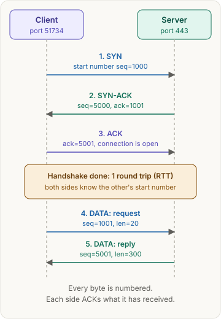
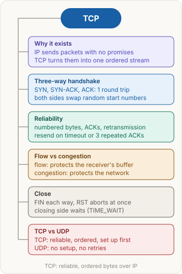

> [!abstract] What this page is for
> **Intent:** the full picture behind the [[networking/tcp|quick TCP page]]. Same sections, same order, with more depth in each: raw header fields, exact rules, timers, connection states, SYN cookies, TIME_WAIT and harder interview questions.
> **Read the quick page first.** Each section here starts where the quick one stops.
> **Time:** about 20 minutes.

## Words you need first

Everything from the quick page (IP, packet, TCP, port, socket, sequence number, ACK, SYN, FIN, RST, RTT, TLS, UDP, QUIC, HTTP/3), plus:

- **Segment:** one TCP message: a header plus data, carried inside one IP packet. Sizes are limited, so TCP never sends a segment too big to fit.
- **ISN (initial sequence number):** the random start number a side picks in its SYN.
- **MSS (maximum segment size):** the largest data chunk one segment may carry. On Ethernet it is usually 1460 bytes: the 1500-byte IP packet limit minus 20 bytes of IP header and 20 bytes of TCP header.
- **Window:** how many bytes the receiver can accept right now. It is advertised in every segment.
- **RTO (retransmission timeout):** how long the sender waits for an ACK before resending.
- **cwnd (congestion window):** the sender's own limit on bytes in flight, based on how well the network is doing.
- **Half-open connection:** a connection the server has half set up, after a SYN and before the final ACK.
- **Backlog:** the server's queue of finished handshakes waiting for the app to `accept()` them. Half-open connections (SYN received, final ACK not yet) wait in a separate SYN queue.
- **MSL (maximum segment lifetime):** how long a stray packet may live on the network. TIME_WAIT is measured in multiples of it.
- **Head-of-line blocking:** when one lost packet stops the delivery of everything behind it, even data that already arrived.

## Why it exists

The network moves packets. A packet can be lost, delayed, duplicated, reordered or dropped by a router with no notice. TCP runs in the operating system kernel, so every app gets the same behavior, and it can be tuned in one place. The app sees a socket: `write()` puts bytes in, `read()` takes bytes out, and it never sees a packet.

## The picture

The same three steps as the quick page. The rest of this page zooms into what each box holds: the header fields, the state each side is in, and what the numbers mean.

## How it works, with an example

The same `api.shop.com` example, with the header fields and the state changes.

Connection states on each side, in order:

| Step | Client state | Server state | Segment |
|---|---|---|---|
| Start | CLOSED | LISTEN | none |
| 1 | SYN-SENT | LISTEN | SYN, seq=1000 |
| 2 | SYN-SENT | SYN-RECEIVED | SYN-ACK, seq=5000, ack=1001 |
| 3 | ESTABLISHED | ESTABLISHED | ACK, ack=5001 |

**Data.** Each segment's sequence number is the position of its first byte. The request is 20 bytes, so it covers 1001 to 1020. The server's ACK says `ack=1021`, meaning "I have all of it, send 1021 next". The reply covers 5001 to 5300.

**Close.** Either side can close first, and each direction closes separately.

1. The client has no more data, so it sends FIN, which uses one sequence number, say `seq=1021`.
2. The server ACKs it with `ack=1022`. The client may still receive data. This is a half-close.
3. When the server is done, it sends its own FIN, and the client ACKs it.

The side that sends the first FIN is the active closer. It goes to FIN-WAIT states and then to TIME_WAIT. The passive side moves through CLOSE-WAIT and LAST-ACK.

### TIME_WAIT

The active closer waits in TIME_WAIT for twice the MSL before the connection is removed. The standard (RFC 9293) suggests an MSL of 2 minutes. Linux ignores the formula and hard-codes TIME_WAIT to 60 seconds. It exists for two reasons:

- **Lost final ACK:** if the last ACK is lost, the other side resends its FIN. The waiting side can answer it again.
- **Late packets:** a stray segment from the old connection may still be on the network. Waiting stops it from landing in a new connection that uses the same four-tuple (source IP, source port, destination IP, destination port).

At scale, TIME_WAIT costs ports. A busy client that opens many short connections to one server can run out of local ports. The usual fix is connection reuse (keep-alive), not turning TIME_WAIT off.

### RST

RST aborts the connection at once, with no FIN exchange. The usual cases are a SYN to a port with no listener, which gets an RST back, and a peer that has closed its program while data is still arriving. The app then sees "connection refused" or "connection reset by peer".

## The most common mistake

> [!warning] TCP is not encryption, and not a guarantee
> Four traps show up as interview follow-ups.

- **TCP encrypts the data.** It does not. TLS adds encryption and identity checks on top of the same bytes. (See [[networking/tls|TLS]].)
- **TCP guarantees delivery whatever happens.** It retransmits only while the path works. If the path stays broken, the sender gives up after a timeout, and the app gets an error.
- **One TCP connection equals one HTTP request.** A connection can carry many requests. HTTP/1.1 keep-alive sends them one after another. HTTP/2 interleaves them on one connection.
- **The handshake is free.** The client cannot send its request until the handshake finishes, so it costs one RTT before the first request byte leaves.

## The three-way handshake

Both sides pick an ISN. RFC 6528 requires ISNs to be generated unpredictably, so an off-path attacker cannot guess them. A fixed ISN would let an attacker forge segments into a live stream.

Each SYN uses one sequence number even though it carries no data. The SYN-ACK's `ack` field is the client's ISN plus one. The client's ACK's `ack` field is the server's ISN plus one. Two messages would not work: the server would have no proof that the client received its ISN. Three is the smallest exchange that confirms both directions.

**If the SYN is lost,** the client resends it after its SYN timer expires. The timer doubles each time. The client gives up after several tries, so a connection to a dead host can take a long time to fail.

### SYN floods and SYN cookies

The server keeps a half-open entry for every SYN it answers, until the final ACK arrives or the entry times out. An attacker sends a flood of SYNs, often from fake addresses, and never sends the final ACK. The SYN queue fills, and new real clients are refused.

**SYN cookies** stop this without storing state. The server encodes what it would have remembered (a hash of the addresses and ports, a coarse timestamp, and a few options) into the ISN of its SYN-ACK. It stores nothing. When the final ACK comes back, the server recomputes the value from the ACK number, minus one. If it matches, the connection is real and the server builds it then. On Linux this is on by default, through the `tcp_syncookies` setting. The trade-off is that some TCP options are lost when a cookie is used.

Other defenses: a larger SYN queue (Linux `tcp_max_syn_backlog`), shorter half-open timeouts, and rate limits at a firewall.

## How TCP stays reliable

**Acknowledgments.** ACKs are cumulative. A receiver that gets bytes 1001 to 1020, then 1041 to 1060, can only ACK 1021. The later bytes are held.

**SACK.** The SACK option (selective acknowledgment) lets the receiver list the ranges it has. It can say "I have 1041 to 1060 too". The sender then resends only the missing 1021 to 1040, not everything after it.

**Retransmission timer.** RFC 6298 keeps a smoothed RTT and an RTT variance from the ACKs it sees, and sets RTO from them. RFC 6298 suggests a floor of 1 second. Linux uses a lower floor. Each timeout doubles the RTO (exponential backoff), so a path that keeps failing gets fewer retries over time.

**Fast retransmit.** Three duplicate ACKs, meaning three more ACKs for the same byte, mean a segment was probably lost. The sender resends it without waiting for the timer (RFC 5681).

**Ordering.** The receiver keeps out-of-order data in a buffer and hands bytes to the app only in sequence. A lost byte stalls the stream until it is resent. This is head-of-line blocking at the TCP level.

### Flow control: the window

The window field in every segment says how many bytes the receiver's buffer can still take. The sender never has more unacknowledged bytes in flight than the window. The field is 16 bits, so without scaling the window tops out at 65,535 bytes. The window scale option (RFC 7323) multiplies it, so windows can reach far larger sizes. That matters on long, fast links, where the sender must keep many bytes in flight to use the link. This is the bandwidth-delay product: link speed multiplied by round-trip time.

### Congestion control: the cwnd

The sender keeps a second limit, cwnd. The sender may send up to the smaller of cwnd and the receiver's window.

- **Slow start.** cwnd starts small and grows by about one MSS for each ACK. That roughly doubles it each round trip, until a limit called ssthresh.
- **Congestion avoidance.** Past the limit, cwnd grows by about one MSS per round trip, a slower climb.
- **On loss.** A triple duplicate ACK halves cwnd (RFC 5681, Reno-style). An RTO timeout is worse: cwnd drops to one MSS and slow start begins again.

Modern Linux usually uses CUBIC, which keeps the same idea with a different growth curve.

## TCP vs UDP

The quick table, with more rows and detail.

| | TCP | UDP |
|---|---|---|
| Header size | 20 bytes minimum, up to 60 with options | 8 bytes: source port, destination port, length, checksum |
| Setup | Three-way handshake, 1 RTT | None |
| Connection state | Kept on both ends | None |
| Reliability | Acknowledgments and retransmission | None. The app adds it if needed |
| Ordering | Byte stream in order | Each datagram stands alone |
| Message boundaries | None. The app frames messages | Kept. One send is one receive |
| Flow and congestion control | Window and cwnd | None |
| Head-of-line blocking | Yes, within one connection | No |

**Web and APIs.** HTTP/1.1 and HTTP/2 run over TCP, with TLS on top for HTTPS. These need every byte, so TCP's guarantees are exactly right.

**Video and voice calls.** Real-time media usually runs over UDP. WebRTC sends encrypted media (SRTP) over UDP. A late frame is worse than a lost one, so the app drops frames and adjusts its quality instead of waiting for retransmits.

**Games.** Position updates go over UDP. Each update is sent often, so a lost one is replaced by the next. Important events, such as a purchase, may use a reliable channel the game builds on top of UDP.

**DNS.** Queries and most answers use UDP port 53. A DNS answer that is too big for one UDP packet is marked truncated (the TC flag). The client then retries over TCP. Zone transfers between DNS servers always use TCP.

**QUIC and HTTP/3.** QUIC runs over UDP and builds its own connection, reliability and encryption. Three things matter for interviews:

- **Encryption is built in.** QUIC uses TLS 1.3 inside its handshake. A new HTTPS connection over TCP needs one RTT for TCP and then one more for TLS, so 2 RTT. QUIC combines both in 1 RTT.
- **Independent streams.** Each request is its own QUIC stream. A lost packet stalls only the stream it belongs to, which avoids TCP's head-of-line blocking across requests.
- **Connection IDs.** A QUIC connection is identified by an ID, not by the IP and port pair. It can survive a phone switching from Wi-Fi to mobile data.

Middleboxes such as firewalls already pass UDP, so QUIC ships without changing the network.

## Say it in an interview

Start with the quick answer. If the interviewer goes deeper, add one of these:

- **Connection state:** "A connection exists only as state in the two kernels. The handshake sets it up, and FIN or RST takes it down. The active closer keeps TIME_WAIT for twice the MSL, so late packets cannot corrupt a new connection on the same ports."
- **Flow versus congestion:** "The receiver's window caps the bytes in flight. The sender's cwnd caps them too, and it shrinks on loss. The sender uses the smaller of the two."
- **Why QUIC is on UDP:** "Changing TCP would mean changing every router and middlebox on the path, so QUIC uses UDP, which those devices pass. QUIC then sets up encryption and streams inside the protocol."

## Questions interviewers ask

The ten from the quick page, plus these harder ones. Tap to reveal.

> [!question]- Why does the server need TIME_WAIT, and why is it a problem at scale?
> The waiting side covers two cases: a lost final ACK, which may need to be answered again, and late packets from the old connection. At scale, many TIME_WAIT entries use up local ports on busy clients. Keep-alive and connection pools reduce this.

> [!question]- What is a SYN flood, and how do SYN cookies stop it?
> A flood of SYNs that never finish the handshake fills the server's half-open queue. SYN cookies encode the connection state into the SYN-ACK's ISN, so the server stores nothing until a valid final ACK comes back.

> [!question]- Why are initial sequence numbers random?
> A predictable ISN lets an off-path attacker guess the numbers and forge segments into a connection. RFC 6528 requires unpredictable ISNs.

> [!question]- What happens if the SYN is lost?
> Nothing is sent back, so the client's SYN timer expires and it resends. The timer doubles each time. A dead host takes a long time to fail.

> [!question]- What is head-of-line blocking, and how does QUIC avoid it?
> One lost TCP segment holds back all the bytes after it, even if they already arrived, because TCP delivers in order. QUIC keeps separate streams, so a loss blocks only the stream it belongs to.

> [!question]- Why is the QUIC handshake faster than TCP plus TLS?
> TCP needs one RTT before TLS can start, and TLS 1.3 needs another. QUIC merges the transport and TLS handshakes, so a new connection is ready after one RTT.

> [!question]- Why does a 64 KB window limit a fast link?
> The window field is 16 bits, so without the window scale option the sender can have at most 65,535 bytes unacknowledged. On a long, fast link, the bandwidth-delay product is larger than that, so the link stays idle. Window scaling fixes it.

> [!question]- What is "connection reset by peer"?
> The other side sent an RST, which aborts the connection at once. Often the server process died or closed the socket while data was still arriving.

> [!question]- How does TCP detect that a peer crashed?
> Only when it sends data and gets no ACK, through retransmissions and RTO backoff. An idle connection stays open silently unless the app enables keep-alive probes, which are off by default and wait a long time before the first probe.

> [!question]- Does TCP keep message boundaries?
> No. TCP is a byte stream. A reader may get several messages in one read, or half of one. The app must frame messages with a length prefix or a delimiter. UDP keeps boundaries, one send is one receive.

## Mental map

The same map as the quick page. Each branch is a section above.

## Watch

PowerCert Animated Videos, short video: TCP vs UDP, with the handshake, reliability and when each one is used.
