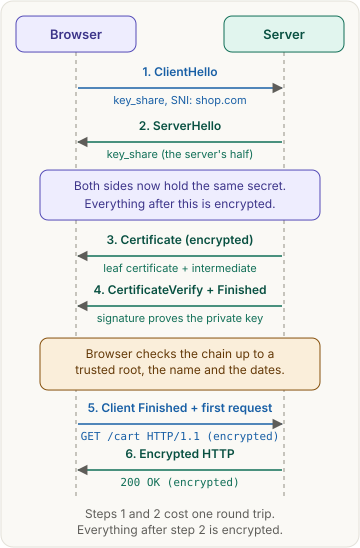
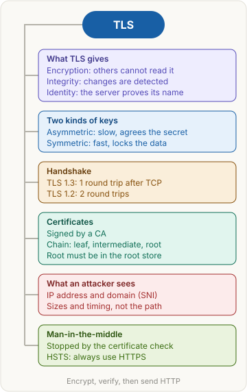

> [!abstract] What this page is for
> **Intent:** the full picture behind the [[networking/tls|quick TLS page]]. Same sections, same order, with more depth: raw handshake messages, certificate rules, commands, session resumption, 0-RTT and the harder interview questions.
> **Read the quick page first.** Each section here starts where the quick one stops.
> **Time:** about 20 minutes.

## Words you need first

Everything from the quick page (HTTP, HTTPS, TLS, encryption, symmetric and asymmetric encryption, certificate, CA, RTT, man-in-the-middle), plus:

- **Key share**: the public half of a key agreement. It travels in the `key_share` extension. Each side keeps its private half.
- **ECDHE (Elliptic Curve Diffie-Hellman, ephemeral)**: the key agreement TLS 1.3 uses. "Ephemeral" means a new key pair for each connection, thrown away afterwards.
- **Cipher suite**: a named set of algorithms, such as `TLS_AES_128_GCM_SHA256`.
- **AEAD (Authenticated Encryption with Associated Data)**: a cipher mode that encrypts and checks integrity in one step. AES-GCM and ChaCha20-Poly1305 are examples.
- **Record**: the framed unit of data after the handshake. Each record is encrypted and carries an authentication tag.
- **Extension**: an optional field in a handshake message. SNI and ALPN are extensions.
- **ALPN (Application-Layer Protocol Negotiation)**: the protocols the client can speak, such as `h2` (HTTP/2) or `http/1.1`. The server picks one.
- **SAN (Subject Alternative Name)**: the list of names inside a certificate. Browsers check this list, not the older Common Name field.
- **PSK (pre-shared key)**: a secret from an earlier session that lets a new session resume.
- **OCSP and CRL**: two ways to check revocation. A CRL (Certificate Revocation List) is a signed list of revoked certificates. OCSP (Online Certificate Status Protocol) asks about one certificate.

**Does the certificate cover the name?**

| Certificate names | Name dialled | Match? | Why |
|---|---|---|---|
| `shop.com` | `shop.com` | Yes | exact match |
| `shop.com` | `www.shop.com` | No | a different name |
| `*.shop.com` | `api.shop.com` | Yes | a wildcard covers one label |
| `*.shop.com` | `a.b.shop.com` | No | two labels deep |

## Why it exists

The full story behind the quick version:

1. On public Wi-Fi, every packet passes through devices the user does not control.
2. The browser sends `GET /login` with a password in plain text. Anyone on the path can read it.
3. An attacker can answer first with a fake page. Plain HTTP gives the browser no way to tell.

TLS fixes both. Encryption makes step 2 unreadable. The certificate chain and a signature make step 3 fail.

The three guarantees map to three mechanisms:

- **Confidentiality** comes from encryption with keys agreed in the handshake.
- **Integrity** comes from an AEAD tag on every record. A flipped bit fails the check, and the connection closes.
- **Authentication** comes from the certificate chain plus the CertificateVerify signature.

TLS does not hide that a connection exists. It hides the content.

## The picture



The same four steps as the quick page. The rest of this page zooms into each box: the messages inside ClientHello and ServerHello, which parts are encrypted, and what the browser checks before it sends Finished.

## How it works, with an example

The same `https://shop.com/cart` example, with the handshake messages named.

**1. ClientHello** (plain text). Its fields include:

- `supported_versions`: TLS 1.3, and maybe 1.2;
- `cipher_suites`: for example `TLS_AES_128_GCM_SHA256`, `TLS_AES_256_GCM_SHA384`, `TLS_CHACHA20_POLY1305_SHA256`;
- `key_share`: the client's public ECDHE value, for example on the X25519 curve;
- `server_name`: SNI, `shop.com`;
- `application_layer_protocol_negotiation`: ALPN, for example `h2`, `http/1.1`;
- `signature_algorithms` and a 32-byte `random` value.

**2. ServerHello** (plain text). It carries the chosen version and cipher suite, the server's `key_share`, and its own random value. Both sides now compute the shared secret. Keys from here on come from that secret.

**3. Encrypted from here on:**

- `EncryptedExtensions`: the chosen ALPN protocol and other settings.
- `Certificate`: the leaf certificate, then any intermediates. The root is not sent, because the client already has it.
- `CertificateVerify`: a signature, made with the server's private key, over a hash of all handshake messages so far.
- `Finished`: a MAC (message authentication code) that proves the server derived the same keys.

**4. Client:** checks the chain, the name, the dates and the signatures. It sends its own `Finished` and can send `GET /cart` in the same flight.

**The real thing.** A trimmed summary from `openssl s_client`, which opens a TLS connection and prints what it learned. The CA names are made up, and the session IDs are shortened.

```
$ openssl s_client -connect example.com:443 -servername example.com
CONNECTED(00000003)
depth=2 C = US, O = Example Root CA, CN = Example Root CA
verify return:1
depth=1 C = US, O = Example Intermediate, CN = Example TLS Issuer 1
verify return:1
depth=0 CN = example.com
verify return:1
---
Certificate chain
 0 s:CN = example.com
   i:C = US, O = Example Intermediate, CN = Example TLS Issuer 1
   a:PKEY: EC, (prime256v1) 256 bits
   v:NotBefore: Oct  1 00:00:00 2026 GMT; NotAfter: Dec 30 23:59:59 2026 GMT
---
Peer signature type: ECDSA
Negotiated TLS1.3 group: X25519
SSL handshake has read 3412 bytes and written 1854 bytes
Verification: OK
New, TLSv1.3, Cipher is TLS_AES_256_GCM_SHA384
Session-ID: 6F1A...C9E2
TLS session ticket lifetime hint: 7200 (seconds)
Verify return code: 0 (ok)
```

> [!info]- openssl output reference
> | Line | What it means |
> |---|---|
> | `depth=2` to `depth=0` | Chain position. Depth 0 is the leaf, depth 2 is the root |
> | `i:` | The issuer. It matches the next certificate up the chain |
> | `NotBefore` and `NotAfter` | The dates the certificate is valid |
> | `Cipher: TLS_AES_256_GCM_SHA384` | AES-256 in GCM mode for records, SHA-384 for the handshake hash |
> | `session ticket lifetime hint: 7200` | The server suggests keeping the resumption ticket for 2 hours |

## The most common mistake

> [!warning] HTTPS hides the page, not the visit
> Everything from the quick page holds. The metadata that stays visible:

- **IP address.** Visible on every packet. A VPN or proxy moves it to another address.
- **Domain name.** In TLS 1.3 the host name is in SNI, in plain text. Encrypted Client Hello (ECH) can hide it, but it is not yet universal. The DNS lookup is often plain text too, unless DNS over HTTPS (DoH) or DNS over TLS (DoT) is used.
- **Size and timing.** A 4 KB reply and a 2 MB reply look different, and so do bursts of traffic. Researchers have guessed pages from these patterns alone.
- **Certificate.** In TLS 1.2 the certificate travels in clear, so anyone on the path can read its names. In TLS 1.3 it is encrypted, so only SNI stays visible.

## The handshake

**TLS 1.3 round trips.** The client sends ClientHello one RTT after TCP starts. The server's answer arrives one RTT later, and the client's Finished and first request go out then. For a new connection, the setup before the request leaves is:

```
TCP handshake        = 1 RTT
TLS 1.3 handshake    = 1 RTT
Total before request = 2 RTT    (with RTT = 100 ms, that is 200 ms)
```

The response then needs one more RTT to come back.

**TLS 1.2 round trips.** A full TLS 1.2 handshake takes 2 RTT. The client waits for ServerHello, Certificate, ServerKeyExchange and ServerHelloDone, then sends ClientKeyExchange, ChangeCipherSpec and Finished, and waits for the server's ChangeCipherSpec and Finished. So a new TLS 1.2 connection costs 1 RTT (TCP) + 2 RTT (TLS) = 3 RTT before the request leaves.

```
TLS 1.2 (new session)
  Client  ClientHello                                -->
          <--  ServerHello, Certificate, ServerKeyExchange, ServerHelloDone
  Client  ClientKeyExchange, ChangeCipherSpec, Finished  -->
          <--  ChangeCipherSpec, Finished
  Client  application data                           -->
```

**Forward secrecy.** TLS 1.2 still allowed static RSA key exchange, where the session key is encrypted with the server's long-term key. A later leak of that key exposes every recorded session. TLS 1.3 removed static RSA and static Diffie-Hellman. Every session uses ephemeral ECDHE, so forward secrecy is always on.

**Removed in TLS 1.3:** RC4, 3DES, CBC ciphers, SHA-1 signatures, compression, renegotiation and static key exchange.

**Session resumption.** After a full handshake, the server can send a `NewSessionTicket` message, which contains a PSK encrypted for the server itself. A later connection presents the ticket in the `pre_shared_key` extension. The certificate and its signature checks are skipped, so the handshake is cheaper. The client usually still runs a fresh key share, so forward secrecy holds. It still takes 1 RTT after TCP.

**0-RTT (early data).** With a valid ticket, the client can send application data in its first flight, together with ClientHello. The request goes out one RTT after TCP, instead of waiting for the handshake to finish.

The cost is **replay risk**. An attacker who records that flight can send it again, and the server cannot always tell the copy from the original. So 0-RTT should carry only requests that are safe to repeat, such as an idempotent `GET` with no side effects. A payment or form submission must never travel as early data. Many servers turn 0-RTT off or add an anti-replay cache.

## Certificates and trust

**Inside a certificate.** It is written in the X.509 format (RFC 5280). Its main fields are:

- **Subject:** the owner. Browsers ignore the Common Name here and check the SAN list.
- **Subject Alternative Name:** the names it covers, such as `shop.com` and `*.shop.com`.
- **Public key:** the key used to check the server's signature.
- **Validity:** the start and end dates.
- **Issuer and signature:** the CA that signed it, and the signature over all of the above.

**The chain in detail.** Each certificate's signature is checked with the public key of its issuer, the next certificate up. The chain must end at a root that is in the root store. The client must not trust a self-signed certificate it does not already know.

**Why a missing intermediate breaks clients.** A server must send the leaf and every intermediate, but not the root. If it forgets an intermediate, some browsers fetch the missing piece on their own and still connect. `curl`, Java and many programmatic clients do not, and they fail. The fix is to configure the full chain on the server.

**Revocation.** A CA can revoke a certificate before its end date, for example after a key leak. The client can check with OCSP or a CRL. Many clients do not check reliably, so servers often use OCSP stapling: they send a fresh, CA-signed OCSP response inside the handshake. This is faster, and it does not tell the CA about each visit. Short-lived certificates also reduce the need for revocation.

**HSTS in detail.** `Strict-Transport-Security: max-age=31536000; includeSubDomains` tells the browser to use HTTPS for the domain and its subdomains for a year. The first visit can still be the risky one, because the browser has not seen the header yet. Browsers solve this with a preload list built into the browser. A site joins it by sending the `preload` directive and submitting the domain.

**Man-in-the-middle, precisely.** Against TLS 1.3 an attacker can block the connection or show a fake certificate. The fake fails the chain check, unless the attacker has a certificate from a trusted CA for that name or has installed a root on the victim's device. In practice, MITM succeeds through a rogue or stolen CA key, a root installed on the device, or a user who clicks through a warning.

**Certificate pinning.** An app can hard-code the expected key or CA and reject other chains. It stops rogue CAs, and it breaks when the certificate is rotated without an app update.

**Checking a live server.** The `openssl` output above is one way to see the chain. These commands check a server directly:

```
openssl s_client -connect shop.com:443 -servername shop.com </dev/null | openssl x509 -noout -subject -issuer -dates
curl -v https://shop.com/ 2>&1 | grep -E "SSL certificate verify|TLSv1"
```

The first prints the subject, issuer and validity dates of the leaf. Add `-showcerts` to see the whole chain.

## Say it in an interview

Start with the 60-second answer from the [[networking/tls#Say it in an interview|quick page]]. If the interviewer pushes deeper, add one or more of these:

- **Round trips:** "TLS 1.3 needs 1 RTT after TCP because the client sends its key share first and can send its request with Finished. TLS 1.2 needs 2. Resumption keeps 1 RTT but skips the certificate, and 0-RTT removes the wait for the request, with a replay risk."
- **Trust:** "A chain goes from the leaf to an intermediate to a root in the root store. The server sends the leaf and intermediates. The client checks the signatures, the SAN list, the dates, and the CertificateVerify signature that proves the private key."
- **Forward secrecy:** "TLS 1.3 uses ephemeral ECDHE only, so a later leak of the server's long-term key does not reveal old sessions."

## Questions interviewers ask

The ten from the [[networking/tls#Questions interviewers ask|quick page]], plus these harder ones. Tap to reveal.

> [!question]- Walk through the TLS 1.3 handshake message by message. Which messages are encrypted?
> ClientHello and ServerHello are plain text. They carry the key shares, the cipher suite, SNI and ALPN. After ServerHello, the server sends EncryptedExtensions, Certificate, CertificateVerify and Finished, all encrypted. The client then sends its Finished, and its first request follows.

> [!question]- Why does TLS 1.3 send the key share in the first message?
> So the server can compute the shared secret as soon as it gets ClientHello, and answer with its own key share in the next message. That removes the extra round trip of TLS 1.2.

> [!question]- What does CertificateVerify prove that the certificate alone does not?
> That the server holds the private key. The certificate is public, so anyone can copy it. The signature over the handshake proves the server holds the key.

> [!question]- The certificate is valid, but the browser reports a name mismatch. Why?
> The dialled host name is not in the SAN list. Check for `www` versus the bare domain, a wildcard that covers only one label, or a certificate that lists only an old name.

> [!question]- The site works in a browser but fails in curl and a Java client. What is likely wrong?
> The server is missing an intermediate certificate. Some browsers fetch missing intermediates on their own. Strict clients do not, so the server must send the full chain.

> [!question]- What is session resumption, and does it reduce round trips?
> The server sends a ticket after a full handshake. A later connection presents it, which skips the certificate and its signature checks. It still needs a fresh key exchange, so it takes 1 RTT after TCP, but it is cheaper.

> [!question]- What is 0-RTT, and when should you refuse it?
> Early data sent in the first flight of a resumed connection. Refuse it, or allow only safe requests, for anything with side effects such as a payment, because an attacker can replay it.

> [!question]- What is HSTS preload, and what gap does it close?
> A list built into browsers of domains that must always use HTTPS. The first visit is protected too, because the browser never sends plain HTTP to those domains. Without preload, the very first request can still be downgraded.

> [!question]- How does OCSP stapling help?
> The server fetches the CA's signed status for its own certificate and sends it during the handshake. The client needs no separate lookup, which is faster and does not tell the CA about each visit.

> [!question]- What is certificate pinning, and what is its main risk?
> The app stores the expected key or CA and rejects other chains. It stops rogue CAs. The risk is breakage: if the server rotates its certificate without a matching app update, every client fails.

## Mental map


