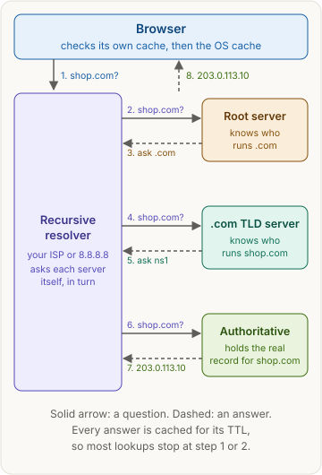
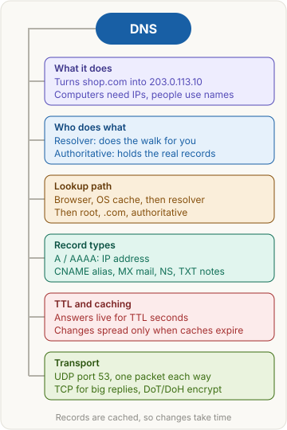

<!-- series:start -->
> [!series]- Networking · 4 of 9
> 1. [[networking/revision|Networking quick revision]]
> 2. [[networking/http-message|HTTP message]]
> 3. [[networking/request-lifecycle|Request lifecycle]]
> 4. **DNS** · you are here
> 5. [[networking/tcp|TCP and UDP]]
> 6. [[networking/tls|TLS and HTTPS]]
> 7. [[networking/http-caching|HTTP caching]]
> 8. [[networking/origin|Origin]]
> 9. [[networking/cors|CORS]]
<!-- series:end -->

> [!abstract] What this page is for
> **Intent:** understand how a name like `shop.com` becomes an IP address, and answer the common DNS interview questions.
> **You'll learn:** what DNS is · the lookup path from browser to authoritative server · recursive vs iterative queries · the record types · TTL and why changes are slow · why DNS mostly uses UDP port 53.
> **Time:** about 7 minutes. Every section has a longer version on the [[networking/deep/dns|detailed DNS page]].

## Words you need first

- **DNS (Domain Name System)**: the system that turns names into addresses. It is a database spread across many servers.
- **Domain name**: a human name such as `shop.com`.
- **IP address**: the number a computer uses to reach another computer, such as `203.0.113.10`. Computers connect by IP address, not by name. **IPv4** is the older form (four numbers). **IPv6** is the newer, longer form with colons.
- **Resolver**: a server that does the DNS lookup for you. The one your network uses is a **recursive resolver**, which does the whole walk.
- **Root server, TLD server**: the top levels of DNS. A **TLD** (top-level domain) is the last part of a name, such as `.com`. The TLD server knows which servers run the names under it.
- **Authoritative name server**: the server that holds the real records for a domain, such as shop.com's own DNS server.
- **Record**: one entry in that database, such as "the name `shop.com` has the address `203.0.113.10`".
- **Cache**: a stored copy of an answer, kept so the next question is faster.
- **TTL (time to live)**: how many seconds an answer may stay in a cache.
- **UDP and TCP**: two ways to send data. UDP sends one packet with no setup. TCP opens a connection first and checks that all data arrives.
- **Port**: a number that says which service on a machine gets the data. DNS uses port 53.

## Why it exists

Computers reach each other by IP address, but people remember names. Early networks kept one text file that mapped every name to an address, and every machine downloaded a new copy whenever a host changed. That broke as the network grew.

DNS replaced the file with a distributed database. Each organization runs servers for its own names, and caching spares the system from answering every question.

## The picture

Solid arrows are queries. Dashed arrows are replies. The numbers are the order of the steps.

## How it works, with an example

You type `https://shop.com` in your browser. The browser needs an IP address before it can connect. It does not know the address yet, so it asks DNS. Often the answer is already cached. If not, a chain of servers finds it.

Your browser never has to know where shop.com's records live. It asks one helper, and the helper does the walk.

## The most common mistake

> [!warning] Thinking the browser asks the authoritative server
> The browser asks only one server, its recursive resolver. The resolver does the walk through the root and TLD servers. Your browser never talks to the root, or to shop.com's DNS server, directly.

## The lookup step by step

The browser and operating system check their caches first. If a valid answer is there, the lookup ends. Otherwise:

1. The browser asks the recursive resolver: "What is the address of shop.com?" This is a **recursive query**: the client wants the final answer, and the server does all the work.
2. The resolver asks a root server.
3. The root server does not know shop.com, so it returns a **referral**: a pointer to the servers for `.com`.
4. The resolver asks a `.com` TLD server.
5. The TLD server returns a referral to the authoritative servers for shop.com.
6. The resolver asks the authoritative server.
7. The authoritative server returns the answer, the A record `203.0.113.10`.
8. The resolver caches the answer and returns it to the browser.

Steps 2 to 7 are **iterative queries**: each server answers with the best it knows, even if that is only a referral. Each referral narrows the search, until the server that owns the record gives the answer.

## Record types

| Type | What it holds | One-line example |
|---|---|---|
| A | An IPv4 address | `shop.com. A 203.0.113.10` |
| AAAA | An IPv6 address | `shop.com. AAAA 2001:db8::10` |
| CNAME | An alias that points to another name | `www.shop.com. CNAME shop.com.` |
| MX | The mail server for the domain, with a priority | `shop.com. MX 10 mail.shop.com.` |
| NS | The authoritative name servers for the domain | `shop.com. NS ns1.dnshost.net.` |
| TXT | Free text, used for ownership and email checks | `shop.com. TXT "v=spf1 -all"` |

## Caching and TTL

Every answer carries a TTL, in seconds. The browser, the operating system and the resolver each keep the answer, so most lookups never reach the authoritative server.

**Why DNS changes take time:** suppose shop.com moves to a new IP address, and the old record had a TTL of 3600 seconds. Caches may keep the old IP for up to an hour. Until they expire, some users still reach the old server. Teams lower the TTL well before a planned change, then raise it again after the move.

A short TTL means changes spread fast, but more queries reach the DNS servers. A long TTL means fewer queries, but changes spread slowly.

## Say it in an interview

> "DNS turns a name like shop.com into an IP address, because computers connect by address and people use names. My browser asks a recursive resolver. If the resolver has no cached answer, it asks a root server, which points to the .com servers. Those point to shop.com's authoritative server, which returns the A record. The resolver caches the answer for its TTL and returns it. DNS mostly uses UDP port 53, because one small packet each way is fast, and it switches to TCP when the answer is too big. Because answers are cached for the TTL, a DNS change takes time to reach everyone."

## Questions interviewers ask

Tap a question to see the answer.

> [!question]- What is DNS?
> The Domain Name System. It maps names such as shop.com to IP addresses. It is a database spread across many servers.

> [!question]- What is the difference between a recursive and an iterative query?
> A recursive query asks for the final answer, and the server does all the work. An iterative query asks for the best answer the server knows, which is often a referral to another server. Clients send recursive queries to the resolver, and the resolver sends iterative queries up the chain.

> [!question]- What is the difference between a recursive resolver and an authoritative server?
> The resolver serves clients, walks the hierarchy and caches the results. The authoritative server holds the real records for one domain. It does not walk the chain for other names.

> [!question]- What are the main record types?
> A and AAAA hold IP addresses (IPv4 and IPv6). CNAME is an alias. MX names the mail server. NS names the authoritative servers. TXT holds free text, used for ownership and email checks.

> [!question]- What is a CNAME, and what can't it do?
> An alias that points to another name, which is then looked up again. It cannot sit beside other records on the same name, and it cannot be used at the bare domain itself, such as shop.com.

> [!question]- What is TTL?
> The number of seconds an answer may be cached. It controls how long the old answer keeps being used after a change.

> [!question]- Why does a DNS change take time to spread?
> Caches keep the old answer until its TTL expires. Some software ignores or caps the TTL, so the exact timing is not guaranteed.

> [!question]- Why does DNS mostly use UDP rather than TCP?
> A query and its reply each fit in one small UDP packet. There is no connection setup, so a lookup costs one round trip. TCP is used when the answer is too big for one UDP packet, and for large zone transfers.

> [!question]- What port does DNS use?
> Port 53. It uses UDP for normal queries and TCP for large answers.

> [!question]- Is DNS encrypted?
> Classic DNS is not, so anyone on the network path can read the names being looked up. DNS over TLS and DNS over HTTPS add encryption.

## Mental map

## Watch

Fireship, about 2 minutes: what DNS is and how a domain name becomes an IP address.

**Want more?** The [[networking/deep/dns|detailed DNS page]] has the same sections with the raw dig output, transport details, load balancing, and more interview questions.

<!-- series-nav:start -->
---

← [[networking/request-lifecycle|Request lifecycle]] · [[networking/tcp|TCP and UDP]] →
<!-- series-nav:end -->
