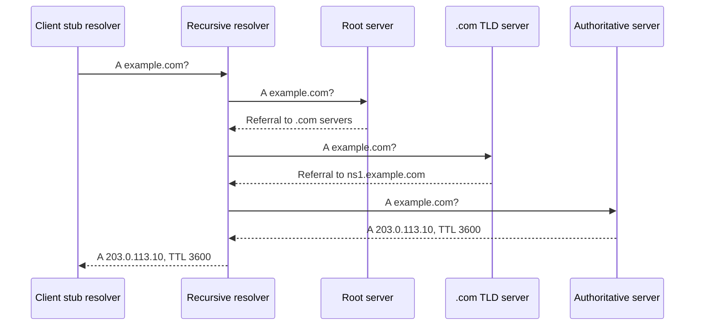

> [!tldr] In three lines
> DNS turns a name such as `example.com` into an IP address such as `203.0.113.10`. A recursive resolver does the lookup work for the client, and it walks a chain of servers if its cache is empty. Answers are cached for their TTL, which is why a changed record can take time to appear everywhere.

## Why it exists

Machines find each other by IP address. People remember names. Early networks kept a single shared text file that mapped names to addresses, and every machine downloaded a new copy when hosts changed. That broke down as the network grew.

DNS replaced the file with a distributed database. Each organization runs the servers for its own names. Clients ask a chain of servers, and the answers are cached so the whole system does not have to answer every question each time.

## Picture

No diagram is assigned for this page yet. The sequence diagram in "How it works" shows the lookup.

## Plain version

DNS is like finding a person's new address when you only know their name.

You ask a helpful friend who knows where to look. The friend checks what they remember first. If they do not know, they ask the national directory, which points to the regional directory for that country. The regional directory points to the office that keeps the person's record. The office gives the address, and the friend writes it down for a while, so the next question is faster. The note on the paper says how long it is valid. That is the TTL.

## Precise definition

| Term | Definition | Where it's used |
|---|---|---|
| DNS | A distributed, hierarchical database that maps names to records | Every connection that starts from a name |
| Stub resolver | The small DNS client in the operating system or browser that sends queries | `getaddrinfo()` and similar calls |
| Recursive resolver | A server that accepts a query and does all the steps to find the final answer, then caches it | ISP resolvers, `1.1.1.1`, `8.8.8.8`, company resolvers |
| Authoritative name server | The server that holds the real records for a zone and answers for them | Run by the domain owner or a DNS host |
| Root server | The top of the hierarchy. It refers queries to the right top-level domain servers | Step 2 of an uncached lookup |
| TLD server | Serves a top-level domain such as `.com`. It refers queries to the domain's authoritative servers | Step 3 of an uncached lookup |
| Zone | The part of the name space that one set of authoritative servers manages | `example.com` is one zone |
| Record | One entry in a zone, such as an A record or MX record | The answer to a query |
| TTL (time to live) | How many seconds an answer may be cached | Resolvers, operating systems, browsers |
| Negative caching | Caching the fact that a name does not exist | `NXDOMAIN` answers, per RFC 2308 |

## How it works

A client almost never talks to the root servers itself. It asks one recursive resolver, and the resolver does the rest.

1. **Check the local caches.** The browser checks its own DNS cache. Then the operating system checks its cache. A valid entry ends the lookup here.
2. **Ask the recursive resolver.** The stub resolver sends one query with the recursion-desired flag set. The resolver is asked for an A record, which is an IPv4 address, or an AAAA record for IPv6.
3. **The resolver checks its cache.** A hit returns the answer with the remaining TTL.
4. **The resolver asks a root server.** The root does not know `example.com`, but it knows the servers for `.com`, so it returns a referral.
5. **The resolver asks a TLD server.** The `.com` server returns a referral to the authoritative servers for `example.com`. These are listed as NS records.
6. **The resolver asks an authoritative server.** The authoritative server returns the A record with the address and a TTL. It sets the authoritative-answer flag, which says the answer comes from the owner of the zone.
7. **The resolver caches the answer and returns it.** The client gets the address. The client then caches it for the TTL.



### Record types

| Type | Holds | Example | Notes |
|---|---|---|---|
| A | An IPv4 address | `example.com. A 203.0.113.10` | The most common answer before a TCP connection |
| AAAA | An IPv6 address | `example.com. AAAA 2001:db8::10` | Same job as A, for IPv6 |
| CNAME | An alias pointing to another name | `www.example.com. CNAME example.com.` | The target is resolved again. A CNAME cannot sit beside other records on the same name, and it cannot be used at the zone apex |
| MX | A mail server and a priority | `example.com. MX 10 mail.example.com.` | Lower priority numbers are tried first. Used by mail senders, not browsers |
| NS | The authoritative name servers for a zone | `example.com. NS ns1.example-dns.net.` | Used for referrals in step 5 above |
| TXT | Free text | `example.com. TXT "v=spf1 -all"` | Used for domain ownership checks and email policies such as SPF and DKIM |

## The real thing

Output of `dig example.com`, the standard DNS lookup tool. The values are illustrative. The address is from the documentation range in RFC 5737, and the TTL and timing will differ on a real run.

```
; <<>> DiG 9.18.28 <<>> example.com
;; global options: +cmd
;; Got answer:
;; ->>HEADER<<- opcode: QUERY, status: NOERROR, id: 41237
;; flags: qr rd ra; QUERY: 1, ANSWER: 1, AUTHORITY: 0, ADDITIONAL: 1

;; OPT PSEUDOSECTION:
; EDNS: version: 0, flags:; udp: 1232
;; QUESTION SECTION:
;example.com.                   IN      A

;; ANSWER SECTION:
example.com.            3600    IN      A       203.0.113.10

;; Query time: 12 msec
;; SERVER: 192.168.1.1#53(192.168.1.1) (UDP)
;; WHEN: Fri Oct 30 10:00:00 CET 2026
;; MSG SIZE  rcvd: 56
```

| Field | Value in the example | What it means |
|---|---|---|
| `; <<>> DiG 9.18.28` | Tool name and version | The `dig` client that printed the output |
| `opcode: QUERY` | Message type | A normal query. Other opcodes include NOTIFY and UPDATE |
| `status: NOERROR` | Result code | The query worked. A name that does not exist returns `NXDOMAIN` instead |
| `id: 41237` | Transaction ID | A 16-bit number that matches the answer to the query. Used to block spoofed replies |
| `flags: qr rd ra` | Header flags | `qr`: this is a response. `rd`: recursion was desired. `ra`: recursion is available on the server that answered |
| `QUERY: 1, ANSWER: 1` | Section counts | One question was asked and one answer came back |
| `AUTHORITY: 0` | Count of NS records | Empty here, because the answer came from a cache. An authoritative reply would often include NS records |
| `ADDITIONAL: 1` | Count of extra records | The OPT record that carries EDNS options |
| `OPT PSEUDOSECTION`, `udp: 1232` | EDNS0 option | The client says it can accept UDP replies up to 1232 bytes. Larger replies use TCP |
| `QUESTION SECTION` | The question | Asks for the `A` record of `example.com.`, class `IN` (Internet) |
| `ANSWER SECTION` | The answer record | `example.com.` is the name. `3600` is the TTL in seconds. `IN A` is the class and type. `203.0.113.10` is the address |
| `Query time: 12 msec` | Round trip | Time from sending the query to reading the reply. Mostly the RTT to the resolver |
| `SERVER: 192.168.1.1#53` | Responder | The server that answered, here a local router, on port 53 over UDP |
| `MSG SIZE rcvd: 56` | Reply size | The reply was 56 bytes, which fits in one UDP packet |

A tip for learning: `dig +trace example.com` skips the cache and prints each step of the walk from the root down to the authoritative server.

### Transport: UDP 53, TCP 53, DoT and DoH

- **UDP port 53.** The classic transport. A query is one small packet and the reply is one packet, with no handshake. That keeps latency low. Replies larger than the UDP size limit, such as zone transfers, switch to TCP port 53.
- **Plain DNS is readable.** Anyone on the path can see the names being looked up and the answers, and a forged reply can be inserted unless the resolver validates DNSSEC. Plain DNS does not encrypt the query.
- **DoT (DNS over TLS).** RFC 7858. Queries run over TLS on TCP port 853. The content is encrypted, but a separate port makes the traffic easy to spot.
- **DoH (DNS over HTTPS).** RFC 8484. Queries are HTTP requests, usually on port 443, inside TLS. Network observers see ordinary HTTPS traffic to the resolver.

## Where it's used

- **Every network request by name.** A browser, `curl`, a mobile app or a server making an API call all start with a DNS lookup unless they already have the IP address.
- **Email.** Mail servers look up MX records to find where to deliver a message, and TXT records for SPF, DKIM and DMARC checks.
- **CDNs and load balancers.** A CDN can return a different IP address to each client, chosen by location or load. The record TTL is often short so that the CDN can change its answers quickly.
- **Certificate issuance and domain verification.** Some certificate authorities and cloud services ask the domain owner to publish a specific TXT record to prove control.
- **Service discovery.** Inside a cluster, names resolve to service addresses, so applications do not need fixed IPs.

## Compared with

| | Recursive resolver | Authoritative name server |
|---|---|---|
| Job | Answers any client, does the walk, caches | Holds the records for one zone |
| Who runs it | ISP, company, public resolver service | The domain owner or a DNS hosting provider |
| Answers from | Cache, or the chain of servers | Its own zone data |
| Client sees it as | The DNS server in the network settings | Not contacted by clients directly |

| | UDP 53 | DoT | DoH |
|---|---|---|---|
| Transport | UDP | TCP and TLS | HTTP/2 or HTTP/3 over TLS |
| Port | 53 | 853 | 443 |
| Encrypted | No | Yes | Yes |
| Handshake cost | None | TCP plus TLS | TCP plus TLS, usually reused |
| Looks like | DNS traffic | DNS on a special port | Ordinary web traffic |

## Common misconceptions

- **Wrong:** DNS is one big server that knows every name.
  **Right:** DNS is a hierarchy. The root, TLD and authoritative servers each know only a part of the answer. Recursive resolvers combine the parts and cache them.
- **Wrong:** Changing a DNS record takes effect immediately everywhere.
  **Right:** Caches keep the old answer until its TTL expires. Lower the TTL well before a planned change, then raise it again once the change is done. Some clients also ignore TTL values, so an exact time cannot be promised.
- **Wrong:** The browser asks the authoritative server directly.
  **Right:** The browser asks a recursive resolver. The resolver does the walk through the hierarchy on the client's behalf.
- **Wrong:** DNS is always encrypted.
  **Right:** Classic DNS over UDP port 53 is plain text. DoT and DoH add encryption, and they are a separate choice made by the client or the network.

## Interview questions

> [!question]- Q1. What is the difference between a recursive resolver and an authoritative name server?
> A recursive resolver serves clients. It takes a query, follows referrals from the root through the TLD servers to the authoritative servers, caches each answer for its TTL, and returns the final answer. An authoritative name server holds the actual records for a zone and answers only for that zone. It does not walk the hierarchy for clients.

> [!question]- Q2. Why does DNS normally use UDP rather than TCP?
> A query and its reply usually fit in one small UDP packet each. There is no handshake, so the lookup costs one round trip. TCP needs a handshake before the query can be sent, which adds a round trip. DNS switches to TCP when a reply is too large for UDP, such as a large zone transfer or a response that is truncated.

> [!question]- Q3. What does the TTL do, and why does a DNS change not take effect at once?
> TTL is the number of seconds a resolver or client may keep an answer. Until it expires, every cache along the path can answer from memory, so the old address keeps being used. Changing a record only affects clients that query again after their cached copy has expired.

> [!question]- Q4. Why can a CNAME not be placed at the zone apex?
> The zone apex, such as `example.com` itself, must hold SOA and NS records. A CNAME cannot exist on a name alongside any other record, so it cannot be used there. Services that need an alias at the apex use vendor-specific features or an address record instead.

> [!question]- Q5. What do DoT and DoH change, and what do they not change?
> They encrypt the DNS query and reply between the client and the resolver, so a network observer cannot read the names being looked up. They do not change how the hierarchy works, and they do not hide the destination IP address of the later connection. They also do not change what the resolver itself knows.

> [!question]- Q6. What does the `NXDOMAIN` status mean, and is it cached?
> `NXDOMAIN` means the name does not exist. Resolvers can cache this fact for a period taken from the zone's SOA record, which is called negative caching in RFC 2308. A new name that was looked up too early can therefore stay missing for a while.

> [!example] When I see a "could not resolve host" error, it means the lookup failed before any TCP connection, because the client never received an IP address to connect to.

## Related

- [[request-lifecycle]]
- [[tcp]]
- [[tls]]
- [[http-message]]

## Sources

- Prep 1 networking session, 2026-10-30
- RFC 1034, Domain Names: Concepts and Facilities
- RFC 1035, Domain Names: Implementation and Specification
- RFC 2308, Negative Caching of DNS Queries
- RFC 7858, Specification for DNS over Transport Layer Security (TLS)
- RFC 8484, DNS Queries over HTTPS (DoH)
- RFC 5737, IPv4 Address Blocks Reserved for Documentation
