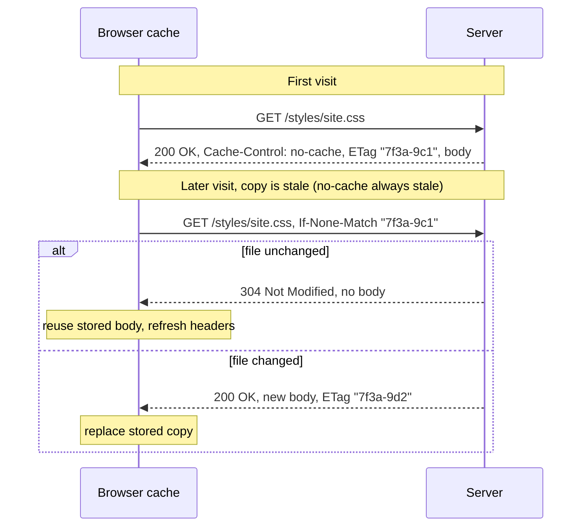

<!-- series:start -->
> [!series]- Networking · 6 of 11
> 1. [[networking/http-message|HTTP message]]
> 2. [[networking/request-lifecycle|Request lifecycle]]
> 3. [[networking/dns|DNS]]
> 4. [[networking/tcp|TCP]]
> 5. [[networking/tls|TLS]]
> 6. **HTTP caching** · you are here
> 7. [[networking/origin|Origin]]
> 8. [[networking/cors|CORS]]
> 9. [[networking/cors-credentials|CORS and credentials]]
> 10. [[networking/cors-expose-headers|CORS exposed headers]]
> 11. [[networking/cors-lab|CORS lab]]
<!-- series:end -->

> [!tldr] In three lines
> HTTP caching is the set of rules (RFC 9111, for HyperText Transfer Protocol responses) that lets a cache keep a copy of a response, so the next request can skip the network or ask only "is my copy still good?".
> It solves the problem of paying the full download cost for files that have not changed.
> You meet it in every browser reload, every CDN-served image, and every `304` in DevTools.
>
> [[#Interview questions|→ Self-test: 5 questions]]

## Why it exists

A page that loads `logo.png`, `app.css`, and `app.js` on every visit downloads the same bytes again and again. On a slow phone network that costs seconds. Servers and CDNs pay for the bandwidth too.

A cache stores a copy of a response next to the URL it came from. The next time the same URL is needed, the cache can:

1. use the stored copy with no network at all (the copy is still **fresh**), or
2. check with the server that the copy is still valid (**revalidate**), and download only if it changed.

HTTP defines the rules through headers, so every cache along the path can follow them without knowing anything about the site.

## Picture



The top row is a first visit: DNS, TCP, TLS, then HTTP, each waiting for the one before. The bottom row is a second visit. The connection setup is saved, and the cache decides whether HTTP is still needed. The cache part is covered on this page; the connection setup part is covered in [[networking/tcp|TCP]] and [[networking/tls|TLS]].

## Plain version

A library book has a due date. While the book is still within its loan period, you use your copy at home and do not visit the library. When the due date passes, you call the library and ask "has this edition changed?". If the answer is no, you keep your copy. If the answer is yes, you borrow the new edition.

HTTP caching works the same way. `max-age` is the due date. A conditional request with `If-None-Match` or `If-Modified-Since` is the phone call. `304 Not Modified` is the answer "no change, keep your copy".

## Precise definition

A **cache** is a store of HTTP responses keyed by the request URL (and any headers listed in `Vary`). RFC 9111 defines the rules.

| Term | Definition | Where it's used |
|---|---|---|
| Browser cache | Per-browser store of responses. Private to one user's browser | Every browser, every page |
| CDN | Content delivery network: servers in many places that cache responses close to users. A shared cache | Images, JS, CSS for big sites |
| Proxy cache | Shared cache run by a company or ISP between client and server | Corporate networks, some ISPs |
| Fresh | The stored copy is young enough to use without asking the server | `max-age` not yet used up |
| Stale | The stored copy is older than its freshness lifetime; it must be checked before use | Any copy after its `max-age` |
| Revalidation | Asking the server "is my stored copy still valid?" with a conditional request | Stale copies that have a validator |
| Validator | A value that identifies a version: an `ETag` or a `Last-Modified` date | Revalidation requests |
| Conditional request | A request with `If-None-Match` or `If-Modified-Since` that asks for a body only if changed | Revalidation |
| 304 Not Modified | Server answer: the stored copy is still valid. Empty body | Revalidation |

Freshness is a simple test. A stored response is fresh when its age is less than its `max-age`:

$$\text{fresh} \iff \text{age} < \text{max-age}$$

Age is how long the response has been stored, counted from the `Date` header or the time the cache received it. Everything else follows from this test.

### Cache-Control directives

`Cache-Control` is the header that tells every cache what it may do. Several directives can be combined with commas.

> [!info]- Cache-Control reference
> | Directive | Meaning | Who may store it |
> |---|---|---|
> | `max-age=N` | Fresh for N seconds after it was received | Any cache allowed to store the response |
> | `no-cache` | Store it, but check with the server before every reuse | Any cache (stored, always revalidated) |
> | `no-store` | Do not store it at all. Fetch the full response every time | Nobody |
> | `private` | Only the user's own browser may store it. Shared caches (CDN, proxy) must not | Browser only |
> | `public` | Any cache may store it, even when the request had cookies or auth | Any cache |
> | `s-maxage=N` | Like `max-age`, but only for shared caches (CDN, proxy). Overrides `max-age` there | Shared caches |
> | `must-revalidate` | Once stale, do not use the copy without checking the server | Any cache |
> | `immutable` | The content never changes for this URL; do not revalidate during the lifetime | Browser |

Two common mistakes with these:

- `no-cache` does not mean "do not cache". It means "store it, but ask first every time".
- `no-store` is the directive that means "do not store".

### Validators

| Validator | Set by server | Sent back in | Detail |
|---|---|---|---|
| `ETag` | `ETag: "7f3a-9c1"` | `If-None-Match: "7f3a-9c1"` | An opaque tag for one version. Exact match is needed. `W/"..."` marks a weak tag (same meaning, bytes may differ) |
| `Last-Modified` | `Last-Modified: Wed, 28 Oct 2026 08:00:00 GMT` | `If-Modified-Since: Wed, 28 Oct 2026 08:00:00 GMT` | A time. Resolution is one second, so it is weaker than an ETag |

If a response has both, `If-None-Match` wins. The server must ignore `If-Modified-Since` in that case.

## How it works

Three paths through the cache, in order of cheapness.

1. **Fresh hit.** The cache has a copy and it is fresh. The browser uses the copy. No request leaves the machine. DevTools shows the row with a size like `(memory cache)` or `(disk cache)`.
2. **Revalidation, not changed.** The copy is stale, but it has a validator. The browser sends the same request plus `If-None-Match` (or `If-Modified-Since`). The server checks and answers `304 Not Modified` with no body. The browser reuses its stored body and updates the stored headers from the 304.
3. **Revalidation, changed or no validator.** The server answers `200 OK` with a new body and new validators. The browser replaces the stored copy. If there was no validator at all, the browser sends a plain request and gets a plain `200`.

Step by step for the normal case:

1. The first response arrives with `Cache-Control` and `ETag`. The browser stores the body and the headers.
2. Later, the browser needs the same URL. It checks the stored copy's age against `max-age`.
3. If the copy is fresh, it is used. Done. No network.
4. If the copy is stale, the browser adds `If-None-Match: <stored ETag>` and sends the request.
5. The server compares the ETag it has now with the one sent.
6. Same version: the server sends `304` with no body. Changed version: the server sends `200` with the new body and a new `ETag`.
7. The browser uses the stored body on `304`, or the new body on `200`.

Heuristic freshness: when a response has no `Cache-Control` and no `Expires`, RFC 9111 lets a browser guess a lifetime from `Last-Modified` (often a fraction of the time since the file last changed). A guess is not a promise. Set `max-age` to make the behaviour explicit.



Fresh hit, for comparison: when `max-age=3600` was set and the visit happens 10 minutes later, the copy is still fresh. The browser uses it directly, and the diagram would show no arrow at all, because nothing is sent.

## The real thing

### Exchange 1: ETag, unchanged (304)

These are illustrative raw messages, not captured from the lab. The lab's `frontend.py` serves files with Python's built-in file server, which sends `Last-Modified` but no `ETag`, so this example uses a generic static file.

First response, the browser stores it:

```http
HTTP/1.1 200 OK
Date: Fri, 30 Oct 2026 10:20:00 GMT
Content-Type: text/css
Content-Length: 2048
Cache-Control: no-cache
ETag: "7f3a-9c1"

body-bytes-of-site.css (2048 bytes)
```

Second request, the browser sends its stored ETag:

```http
GET /styles/site.css HTTP/1.1
Host: example.com
If-None-Match: "7f3a-9c1"
```

Server answer, file unchanged. Note the empty body:

```http
HTTP/1.1 304 Not Modified
Date: Fri, 30 Oct 2026 10:25:00 GMT
Cache-Control: no-cache
ETag: "7f3a-9c1"

```

The blank line after the headers is still there, and nothing follows it. A `304` never has a body, so there is no `Content-Length` and no bytes to read.

### Exchange 2: ETag, changed (200)

Same request, file changed on the server:

```http
GET /styles/site.css HTTP/1.1
Host: example.com
If-None-Match: "7f3a-9c1"
```

```http
HTTP/1.1 200 OK
Date: Fri, 30 Oct 2026 10:30:00 GMT
Content-Type: text/css
Content-Length: 2100
Cache-Control: no-cache
ETag: "7f3a-9d2"

body-bytes-of-site.css (2100 bytes, new version)
```

The server ignored the old ETag because it did not match, and sent the full new file with a new ETag.

### Exchange 3: Last-Modified and If-Modified-Since

Same idea with a date instead of a tag. First response:

```http
HTTP/1.1 200 OK
Date: Fri, 30 Oct 2026 10:20:00 GMT
Content-Type: text/css
Content-Length: 2048
Last-Modified: Wed, 28 Oct 2026 08:00:00 GMT

body-bytes-of-site.css (2048 bytes)
```

Revalidation, unchanged. The server compares the date and returns 304:

```http
GET /styles/site.css HTTP/1.1
Host: example.com
If-Modified-Since: Wed, 28 Oct 2026 08:00:00 GMT
```

```http
HTTP/1.1 304 Not Modified
Date: Fri, 30 Oct 2026 10:25:00 GMT
Last-Modified: Wed, 28 Oct 2026 08:00:00 GMT

```

If the file had changed after 08:00 on 28 October, the server would answer `200` with the new body and a new `Last-Modified`.

### The fields explained

| Field | Where | Value in the example | What it means |
|---|---|---|---|
| `Cache-Control: no-cache` | Response | `no-cache` | Store the copy, but revalidate before every reuse |
| `ETag` | Response | `"7f3a-9c1"` | Version tag for this exact file. Quotes are part of the value |
| `If-None-Match` | Request | `"7f3a-9c1"` | "Send the body only if the ETag is different from this" |
| `304 Not Modified` | Status | none | Stored copy is valid. Body is empty |
| `Last-Modified` | Response | `Wed, 28 Oct 2026 08:00:00 GMT` | When the file last changed |
| `If-Modified-Since` | Request | same date | "Send the body only if the file changed after this time" |
| `Date` | Both | time of answer | Used to work out the age of stored copies |
| `Content-Length` | 200 response | `2048` | Body size. Absent on 304 |

### Where to see it

In DevTools, open the **Network** tab. Tick **Disable cache** only when you want to test without caches. Click a row and read the **Headers** tab: `If-None-Match` and `If-Modified-Since` appear in Request Headers on revalidation, and the status column shows `304`. A row with `(memory cache)` or `(disk cache)` in the Size column was a fresh hit that sent no request.

Reloading with Cmd+R and hard reloading with Cmd+Shift+R behave differently. A normal reload revalidates the main document. A hard reload asks the browser to skip the cache for the main resources.

## Common misconceptions

- **Wrong:** A `304 Not Modified` means the server sent the file again.
  **Right:** A `304` has an empty body. The server only says "your stored copy is still valid". The browser reuses the body it already has and updates the headers from the 304. The file was not sent again, which is the whole point of the status.

- **Wrong:** `Cache-Control: no-cache` means do not cache.
  **Right:** `no-cache` means the response may be stored, but must be revalidated with the server before every reuse. The directive that means "do not store" is `no-store`. A common mix-up is to set `no-cache` on something sensitive and expect nothing to be stored; use `no-store` for that.

## Interview questions

> [!question]- Q1. What is the difference between a fresh hit and a revalidation?
> A fresh hit means the stored copy's age is below its `max-age`, so the cache serves it with no request at all. A revalidation happens when the copy is stale. The cache sends a conditional request (`If-None-Match` or `If-Modified-Since`). The server answers `304 Not Modified` with no body if the file is unchanged, or `200` with a new body if it changed. Revalidation still costs a round trip, but it saves the body.

> [!question]- Q2. Why does `If-None-Match` take priority over `If-Modified-Since`?
> RFC 9110 says a server that receives both must ignore `If-Modified-Since`. An ETag identifies a specific version exactly, while a date has only one-second resolution and can miss changes made within the same second. So when a stronger validator is present, the server must use it.

> [!question]- Q3. What is the difference between `private`, `public`, and `s-maxage`?
> `private` means only the user's browser may store the response, so a CDN or proxy must not. `public` means any cache may store it, including when the request carried cookies or an `Authorization` header. `s-maxage` sets a lifetime for shared caches only, and it overrides `max-age` for them. A typical setup is `public, max-age=60, s-maxage=3600`: browsers keep 60 seconds, the CDN keeps an hour.

> [!question]- Q4. Why do build tools put a hash in file names, and how does that interact with caching?
> The hash changes whenever the content changes, so the URL changes too. The old URL is never requested again by new pages, so it can be cached for a very long time (`max-age=31536000, immutable`) without going stale. The HTML that links to the file is usually served with a short lifetime or `no-cache` so new pages pick up new URLs quickly.

> [!question]- Q5. A user says "I updated the CSS but the old style still shows". What do you check?
> Check the `Cache-Control` of the CSS response and whether `max-age` is still running. Check whether the URL changed (a hashed name would). Check the `ETag` or `Last-Modified` the browser sends and whether the server answers `200` or `304`. Check any CDN in front of the server, which may hold its own copy. Purge the CDN or change the URL if needed. Do not rely only on a hard reload.

## Trigger card

> [!example] When I see a `304` with no body in DevTools, it means the stored copy is still valid, because the browser sent `If-None-Match` and the server's ETag matched.

## Compared with

| | Fresh hit (`max-age`) | Revalidation (`ETag`) | Full fetch |
|---|---|---|---|
| Network request | None | Yes, small one | Yes, full body |
| Body transferred | None | None if unchanged | Always |
| Server work | None | A comparison | Build and send |
| Good for | Files that rarely change, or hashed file names | Files that change sometimes | Responses that must never be stored (`no-store`) |

## Where it's used

- **Browsers** store static files and API responses, and revalidate them on reload.
- **CDNs** (for example Cloudflare, Fastly, CloudFront) cache images and scripts at edge locations. They read `s-maxage` and `public`, and they usually ignore `private`.
- **Proxies** in companies and ISPs cache public files to save bandwidth.
- **Frameworks** set long `max-age` plus a hash in the file name (`app.3f9c1a.js`), so a changed file gets a new URL and the old one can be cached forever with `immutable`.
- **API servers** return `ETag` on resources so clients can avoid re-downloading large JSON.

> [!info]- Sources
> - study session 2026-10-30
> - RFC 9111 - HTTP Caching: https://www.rfc-editor.org/rfc/rfc9111
> - RFC 9110 - HTTP Semantics (conditional requests): https://www.rfc-editor.org/rfc/rfc9110
> - MDN - HTTP caching: https://developer.mozilla.org/en-US/docs/Web/HTTP/Caching

<!-- series-nav:start -->
---

← [[networking/tls|TLS]] · [[networking/origin|Origin]] →
<!-- series-nav:end -->
