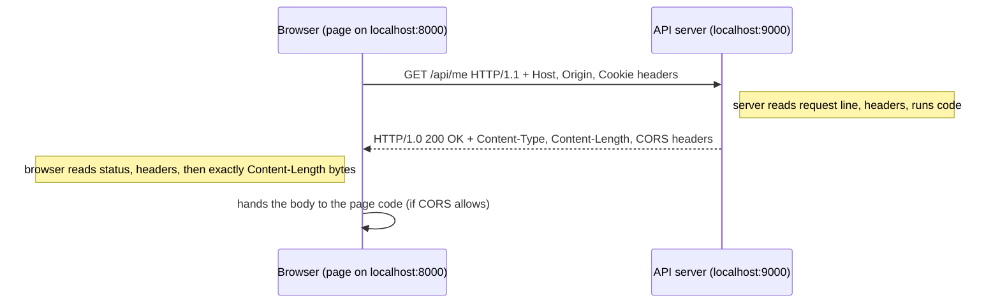

<!-- series:start -->
> [!series]- Networking · 1 of 11
> 1. **HTTP message** · you are here
> 2. [[networking/request-lifecycle|Request lifecycle]]
> 3. [[networking/dns|DNS]]
> 4. [[networking/tcp|TCP]]
> 5. [[networking/tls|TLS]]
> 6. [[networking/http-caching|HTTP caching]]
> 7. [[networking/origin|Origin]]
> 8. [[networking/cors|CORS]]
> 9. [[networking/cors-credentials|CORS and credentials]]
> 10. [[networking/cors-expose-headers|CORS exposed headers]]
> 11. [[networking/cors-lab|CORS lab]]
<!-- series:end -->

> [!tldr] In three lines
> An HTTP (HyperText Transfer Protocol) message is plain text that a client sends (a request) and a server answers with (a response). Both have a first line, a list of headers, a blank line, and an optional body.
> It solves the problem of "what do I want, and what did I get back" in a format any browser, phone, or server can read.
> You meet it every time a page, image, script, or API call loads.
>
> [[#Interview questions|→ Self-test: 5 questions]]

## Why it exists

A browser and a server are separate programs, often on different machines. They need one shared format for asking and answering. Without one, the server could not tell a page request from an image request, and the browser could not tell a JSON answer from a page of HTML.

HTTP (HyperText Transfer Protocol) is that format. It defines what the first line says, how headers (labelled extra facts) are written, and how the body (the payload) is separated from the rest. Because every message looks the same, one browser can talk to any web server, and one server can answer any browser.

## Picture

<!-- interactive widget: runs on the site only; src path is from the site root -->
<iframe src="/static/widgets/raw-http-api-me-after-login.html" width="100%" height="520" style="border:0" loading="lazy"></iframe>

*Step 1 is the browser's request, step 2 the server's response. Each line is labelled with what it does.*

## Plain version

Think of a letter with a form on the outside. The envelope has the address and what you want to do ("send the package to X"). Inside the envelope there is a stack of labelled notes ("this is fragile", "reply to this address"). The contents come last.

An HTTP request works the same way. The request line says what to do and where. The headers are the labelled notes. The body is the contents, and most GET requests have no body at all. An HTTP response is the reply letter: a status line says how it went, headers describe the reply, and the body holds the answer.

## Precise definition

An HTTP/1.1 message (RFC 9112) is text lines ending in CRLF (carriage return plus line feed, the two characters `\r\n`).

- **Request** = request line, zero or more header lines, one empty line, optional body.
- **Response** = status line, zero or more header lines, one empty line, optional body.

| Term | Definition | Where it's used |
|---|---|---|
| Client | The program that sends the request (browser, `curl`, mobile app) | Every request |
| Server | The program that answers | Web servers, API servers |
| Method | The verb in the request line that says what to do (GET, POST, ...) | Request line |
| Request target | The path (and optional query string) the method applies to, e.g. `/api/me` | Request line |
| Status code | A three-digit number in the status line that says how the request went | Response line |
| Header | A `Name: value` line that carries metadata | Both messages |
| Body | The payload bytes after the blank line | Both messages |
| Message framing | How the reader knows where the body ends (`Content-Length` or chunked encoding) | Reading any message |

### Methods

A method is the verb. Two properties matter:

- **Safe**: the request should not change server state. Read-only.
- **Idempotent**: sending the same request twice leaves the same result as sending it once.

> [!info]- Method reference
> | Method | Purpose | Body? | Safe | Idempotent | Typical use |
> |---|---|---|---|---|---|
> | GET | Read a resource | No (not used) | Yes | Yes | Load a page, fetch `/api/me` |
> | POST | Create or do an action | Yes | No | No | Submit a form, create an order |
> | PUT | Replace a resource at a known URL | Yes | No | Yes | Save a whole profile document |
> | PATCH | Change part of a resource | Yes | No | Not necessarily | Update one field |
> | DELETE | Remove a resource | Optional | No | Yes | Delete a comment |
> | OPTIONS | Ask what the server allows | Optional | Yes | Yes | Browser CORS preflight |
> | HEAD | Same as GET but no body returned | No | Yes | Yes | Check size or freshness without downloading |

A common mistake: thinking "idempotent" means "returns the same answer". It means the server state is the same after one or many identical calls. A DELETE that returns 404 the second time is still idempotent, because the resource is gone both times.

### Status code classes

| Class | Meaning | Example codes |
|---|---|---|
| 1xx | Informational, more is coming | 100 Continue, 101 Switching Protocols |
| 2xx | Success | 200, 201, 204 |
| 3xx | Redirect or go check a copy | 301, 302, 304 |
| 4xx | The client asked for something wrong or not allowed | 400, 401, 403, 404, 409, 429 |
| 5xx | The server failed | 500, 502, 503 |

### Common status codes

> [!info]- Status code reference
> | Code | Name | Meaning |
> |---|---|---|
> | 200 | OK | Request worked, body holds the answer |
> | 201 | Created | A new resource was made; `Location` header often gives its URL |
> | 204 | No Content | Worked, and there is intentionally no body |
> | 301 | Moved Permanently | The URL has a new permanent address (`Location` header) |
> | 302 | Found | Temporary redirect to the `Location` URL |
> | 304 | Not Modified | Your saved copy is still valid; body is empty (see [[networking/http-caching|HTTP caching]]) |
> | 400 | Bad Request | The request is malformed (bad JSON, missing field) |
> | 401 | Unauthorized | Not authenticated: no valid credentials were sent |
> | 403 | Forbidden | Authenticated (or public), but not allowed to do this |
> | 404 | Not Found | No resource at this URL |
> | 409 | Conflict | The request clashes with current state (e.g. duplicate username) |
> | 429 | Too Many Requests | Rate limit hit; often sent with a `Retry-After` header |
> | 500 | Internal Server Error | Generic server bug |
> | 502 | Bad Gateway | A proxy or gateway got a bad reply from the server behind it |
> | 503 | Service Unavailable | Server is overloaded or down for maintenance |

The first digit is the most useful part. A 4xx means "fix the request", a 5xx means "the server side is broken, retrying may help".

## How it works

1. The browser builds the request line from the method and the URL: `GET /api/me HTTP/1.1`.
2. The browser adds headers. Some come from the page code (for example `Content-Type` on a POST). Others are added by the browser itself (`Host`, `Origin`, `Cookie`, `Sec-Fetch-*`).
3. The browser sends the bytes over an open TCP connection (a reliable byte stream, set up earlier, see the page-load steps).
4. The server reads the request line first, then the headers until the empty line, then reads the body if one is declared.
5. The server runs its code for that method and path.
6. The server writes the status line, its own headers (`Content-Type`, `Content-Length`, `Set-Cookie`, CORS headers, and others), an empty line, and the body.
7. The browser reads the status line, then the headers, then exactly `Content-Length` bytes (or chunks) of body.
8. The browser hands the response to the page code, which can read it only if the browser's rules allow (see [[networking/origin|Origin]] and [[networking/cors|CORS]]).



HTTP is a request-response protocol: one reply per request, always initiated by the client. The server never starts a message on its own in plain HTTP (WebSockets and server-sent events are separate mechanisms built on top).

## The real thing

### The request

This is the request the lab page sends when the "who am I" button runs after login. It is a `fetch` call with `credentials: 'include'`, sent from the page at `http://localhost:8000` to the API at `http://localhost:9000`.

```http
GET /api/me HTTP/1.1
Host: localhost:9000
Connection: keep-alive
Origin: http://localhost:8000
Cookie: session=demo123
Accept: */*
Accept-Encoding: gzip, deflate
Accept-Language: en-US,en;q=0.9
Referer: http://localhost:8000/
Sec-Fetch-Dest: empty
Sec-Fetch-Mode: cors
Sec-Fetch-Site: same-site
User-Agent: Mozilla/5.0 (Macintosh; Intel Mac OS X 10_15_7) AppleWebKit/537.36 (KHTML, like Gecko) Chrome/130.0 Safari/537.36

```

The blank line after the last header is required. It marks the end of the headers. A GET has no body, so nothing follows.

> [!info]- Request line reference
> | Line | Value | What it means |
> |---|---|---|
> | Request line | `GET /api/me HTTP/1.1` | Method GET, path `/api/me`, protocol version HTTP/1.1 |
> | `Host` | `localhost:9000` | Which site on the server is wanted. Required in HTTP/1.1. Includes the port when it is not the default. Added by the browser |
> | `Connection` | `keep-alive` | Hint that the TCP connection can stay open for more requests. Added by the browser |
> | `Origin` | `http://localhost:8000` | Which page (scheme, host, port) started this request. Added by the browser, not by page code. See [[networking/origin|Origin]] |
> | `Cookie` | `session=demo123` | Cookies the browser has stored for `localhost` that it sends back. Sent here because the fetch used `credentials: 'include'` |
> | `Accept` | `*/*` | What response types the client can take. `*/*` means anything |
> | `Accept-Encoding` | `gzip, deflate` | Compressions the client can decode. The server may compress the body |
> | `Accept-Language` | `en-US,en;q=0.9` | Preferred human languages, with weights (`q`) |
> | `Referer` | `http://localhost:8000/` | The page that made the request. Spelled wrong on purpose in the spec; keep the spelling |
> | `Sec-Fetch-Dest` / `Mode` / `Site` | `empty` / `cors` / `same-site` | Metadata the browser adds so servers can tell where a request came from. `same-site` means the two ports share a site, even though the origins differ |
> | `User-Agent` | Browser identification string | What client is calling. Often used for logs and statistics |

### The response

This is the reply to the request above. Values are from the lab server. The `Date` and `Server` values depend on the machine and time, so treat them as examples.

```http
HTTP/1.0 200 OK
Server: BaseHTTP/0.6 Python/3.12.4
Date: Fri, 30 Oct 2026 10:15:02 GMT
Content-Type: application/json
Content-Length: 42
Access-Control-Allow-Origin: http://localhost:8000
Access-Control-Allow-Credentials: true

{"cookie_seen": true, "cookie": "demo123"}
```

> [!info]- Response line reference
> | Line | Value | What it means |
> |---|---|---|
> | Status line | `HTTP/1.0 200 OK` | Protocol version, status code 200, reason phrase "OK". The reason phrase is free text; clients should use the code |
> | `Server` | `BaseHTTP/0.6 Python/3.12.4` | Software that answered. Python's built-in server adds this |
> | `Date` | `Fri, 30 Oct 2026 10:15:02 GMT` | When the server wrote the reply, in GMT. Caches use it for age calculations |
> | `Content-Type` | `application/json` | The body is JSON text. The browser and the page use this to decide how to parse it |
> | `Content-Length` | `42` | The body is exactly 42 bytes. The reader stops after 42 bytes |
> | `Access-Control-Allow-Origin` | `http://localhost:8000` | Only this origin may read the reply in the page. Checked by the browser, not by the server |
> | `Access-Control-Allow-Credentials` | `true` | The browser may let the page read a reply that came with cookies |
> | Empty line | | Ends the headers. The body starts after it |
> | Body | `{"cookie_seen": true, "cookie": "demo123"}` | The answer. `cookie_seen` is true because the request had a `session` cookie |

Two details that often surprise people:

- The lab server speaks `HTTP/1.0` in its status line. That is the default for Python's `BaseHTTPRequestHandler`. It closes the connection after each reply. Browsers accept this without trouble.
- The body is 42 bytes. Count the characters yourself with `printf '%s' '...' | wc -c`. A mismatch between `Content-Length` and the real body is a classic bug.

### Where to see it

Open DevTools (Cmd+Option+I on macOS, F12 on Windows), go to the **Network** tab, click the request row (for example `me`), then open the **Headers** tab. Request Headers and Response Headers are listed there. A **Payload** tab shows the request body, and **Response** shows the body. Turn on "view source" in the Headers section to see the raw lines.

### Common headers

> [!info]- Header reference
> | Header | Direction | Example | What it is for |
> |---|---|---|---|
> | `Host` | Request | `Host: example.com` | Name of the site wanted. Lets one IP address serve many sites |
> | `Content-Type` | Both | `Content-Type: application/json` | Format of the body |
> | `Content-Length` | Both | `Content-Length: 42` | Body size in bytes |
> | `Cookie` | Request | `Cookie: session=demo123` | Cookies the browser sends back to the server |
> | `Set-Cookie` | Response | `Set-Cookie: session=demo123; Path=/; SameSite=Lax` | Asks the browser to store a cookie |
> | `Authorization` | Request | `Authorization: Bearer <token>` | Credentials for an API. Set by page code (not sent automatically) |
> | `Origin` | Request | `Origin: http://localhost:8000` | Page origin that started a cross-origin or POST request. Added by the browser |
> | `Cache-Control` | Both | `Cache-Control: max-age=3600` | Rules for storing and reusing the response (see [[networking/http-caching|HTTP caching]]) |
> | `ETag` | Response | `ETag: "a1b2c3"` | A version tag for a resource, used for revalidation (see [[networking/http-caching|HTTP caching]]) |

Headers are case-insensitive by name. `content-type` and `Content-Type` are the same. In HTTP/2 and HTTP/3 the names are always lowercase on the wire.

### HTTP/2 and HTTP/3

HTTP/2 and HTTP/3 keep the same semantics: the same methods, status codes, headers, and body rules. What changes is the wire format. Instead of text lines, messages are split into binary frames on one connection, so many requests can run at once. HTTP/2 runs over TCP. HTTP/3 runs over QUIC, which runs over UDP.

The request line becomes pseudo-headers such as `:method: GET`, `:path: /api/me`, `:authority: localhost:9000`, and `:scheme: http`. DevTools still shows them in the familiar form, so the lab's text view stays useful even when the protocol is HTTP/2.

## Common misconceptions

- **Wrong:** The page code writes every header.
  **Right:** The browser adds `Host`, `Origin`, `Cookie`, `Connection`, `Accept-Encoding`, and `Sec-Fetch-*` itself. Page code can set some headers (`Content-Type`, `Authorization`) but cannot choose the value of `Host`, `Origin`, or `Cookie`. This is why the server can trust `Origin` as a hint about which page asked, and why cookies appear without any code in the page.

## Interview questions

> [!question]- Q1. What are the parts of an HTTP/1.1 request?
> A request line with method, request target, and version (`GET /api/me HTTP/1.1`). Then header lines in `Name: value` form, each ending in CRLF. Then one empty line that marks the end of the headers. Then an optional body. The body length is given by `Content-Length` or by chunked encoding. A GET normally has no body.

> [!question]- Q2. Which headers does the browser add by itself?
> `Host` (required in HTTP/1.1), `Origin` on cross-origin and most non-GET requests, `Cookie` for stored cookies that match the request, `Accept-Encoding`, `Accept-Language`, `User-Agent`, and the `Sec-Fetch-*` metadata. Page code can set some headers, such as `Content-Type` and `Authorization`, but it cannot choose `Host`, `Origin`, or the browser's cookies.

> [!question]- Q3. What is the difference between 401 and 403?
> 401 Unauthorized means the request has no valid authentication, so the client should log in or send credentials (the response often includes `WWW-Authenticate`). 403 Forbidden means the server knows who the caller is, or does not need to know, and still refuses. Sending the right login again does not fix a 403; a different permission does.

> [!question]- Q4. Compare PUT and PATCH, and explain why GET should be safe.
> PUT replaces the whole resource at a URL and is idempotent, so sending it twice gives the same result. PATCH changes part of the resource and is not guaranteed to be idempotent (for example, "add 1 to the count" is not). GET must be safe because browsers, crawlers, and caches may send it at any time, prefetch it, or repeat it. If GET changed state, those automatic requests would change data.

> [!question]- Q5. What stays the same and what changes in HTTP/2 and HTTP/3?
> The semantics stay the same: methods, status codes, headers, and body rules work as before. The wire format changes. HTTP/2 uses binary frames and many streams on one TCP connection, and turns the request line into pseudo-headers like `:method` and `:path`. HTTP/3 does the same over QUIC on UDP. Application code and most headers do not need to change.

## Trigger card

> [!example] When I see a request in DevTools with a `Cookie` line but no `Authorization` line, it means the browser attached a stored cookie on its own, because cookies are stored and sent by the browser per host, not written by page code.

## Compared with

| | HTTP message | Raw TCP bytes | WebSocket frame |
|---|---|---|---|
| Who starts | Client always | Either side | Either side, after an upgrade |
| Shape | Text lines, headers, body | Any bytes you like | Binary or text frames |
| One reply per request | Yes | No protocol rule | No |
| Typical use | Pages, APIs | Custom protocols | Chat, live updates |

## Where it's used

- **Browsers** build and parse these messages for every page, image, script, and `fetch` call.
- **curl** and **HTTPie** print the same lines with `curl -v` (or `-i` to show headers).
- **API servers** (Express, Django, Spring, FastAPI) read the request line and headers, then return status and body.
- **CDNs and reverse proxies** (Cloudflare, nginx) read and rewrite headers on the way through.
- **Mobile apps** send the same messages from their own HTTP client libraries.

> [!info]- Sources
> - study session 2026-10-30
> - RFC 9110 - HTTP Semantics: https://www.rfc-editor.org/rfc/rfc9110
> - RFC 9112 - HTTP/1.1 message syntax: https://www.rfc-editor.org/rfc/rfc9112
> - MDN - HTTP overview: https://developer.mozilla.org/en-US/docs/Web/HTTP/Overview

<!-- series-nav:start -->
---

← [[networking/index|Networking]] · [[networking/request-lifecycle|Request lifecycle]] →
<!-- series-nav:end -->
