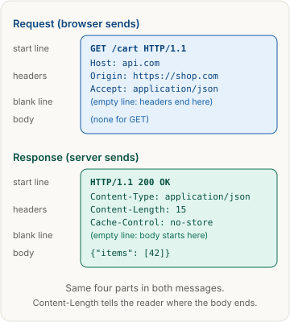
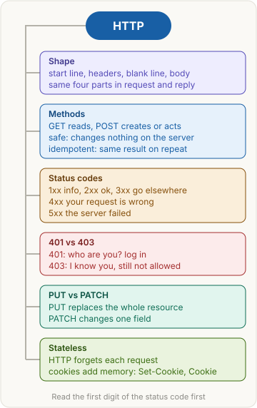

<!-- series:start -->
> [!series]- Networking · 2 of 9
> 1. [[networking/revision|Networking quick revision]]
> 2. **HTTP message** · you are here
> 3. [[networking/request-lifecycle|Request lifecycle]]
> 4. [[networking/dns|DNS]]
> 5. [[networking/tcp|TCP and UDP]]
> 6. [[networking/tls|TLS and HTTPS]]
> 7. [[networking/http-caching|HTTP caching]]
> 8. [[networking/origin|Origin]]
> 9. [[networking/cors|CORS]]
<!-- series:end -->

> [!abstract] What this page is for
> **Intent:** know what an HTTP request and response look like, what the methods and status codes mean, and why HTTP forgets you between requests.
> **You'll learn:** the four parts of a message · safe and idempotent · GET vs POST · PUT vs PATCH · status code families · 401 vs 403 · stateless HTTP and cookies.
> **Time:** about 7 minutes. Every section has a longer version on the [[networking/deep/http-message|detailed HTTP message page]].

## Words you need first

- **HTTP (HyperText Transfer Protocol)**: the rule set browsers and servers use to talk. The browser asks, the server answers.
- **Request**: a message the client (browser, app, `curl`) sends to ask for something.
- **Response**: the server's message back, with a result and optionally an answer.
- **Method**: the verb of a request, such as `GET` (read) or `POST` (create or act).
- **Status code**: a three-digit number in the response that says how it went, e.g. `200` means OK.
- **Header**: a `Name: value` line of extra facts, e.g. `Content-Type: application/json`.
- **Body**: the payload after the headers, e.g. the JSON answer.
- **Safe**: the request changes nothing on the server. Read only.
- **Idempotent**: sending the same request twice leaves the server in the same state as sending it once.
- **Cookie**: a small value the server asks the browser to store and send back on later requests.
- **Stateless**: the server keeps no memory of earlier requests unless you add it.

## Why it exists

A browser and a server are separate programs. They need one shared format for asking and answering, so a server can tell a page request from an image request. HTTP is that format, and because every message looks the same, one browser can talk to any server.

## The picture

Both messages have the same four parts: a **start line**, **headers**, a **blank line**, and an optional **body**. The blank line is what tells the reader that the headers are finished.

## How it works, with an example

Your shop page on `shop.com` runs `fetch("https://api.com/cart")`.

1. The browser writes the request line: `GET /cart HTTP/1.1`. The method is GET, the path is `/cart`.
2. It adds headers, such as `Host: api.com` and `Origin: https://shop.com`, then a blank line. A GET has no body.
3. The server reads the start line and headers, then runs its code.
4. The server replies with a status line: `HTTP/1.1 200 OK`. Then headers such as `Content-Type: application/json` and `Content-Length: 15`.
5. It sends a blank line, then the body: `{"items": [42]}`. `Content-Length` says the body is 15 bytes, so the browser knows where it ends.

## The most common mistake

> [!warning] Using GET to change data
> GET is meant to be safe. Browsers, caches and link previewers may repeat or prefetch a GET. A GET like `/cart/delete?id=42` can delete an item by accident. Use POST, PUT, PATCH or DELETE for changes.

## Methods

The method says what to do. Two properties matter:

| Method | Purpose | Safe | Idempotent | Typical use |
|---|---|---|---|---|
| GET | Read | Yes | Yes | Load `/cart` |
| HEAD | Same as GET, but no body comes back | Yes | Yes | Check a size without downloading |
| OPTIONS | Ask what the server allows | Yes | Yes | Browser CORS check |
| POST | Create, or do an action | No | No | Place an order |
| PUT | Replace the whole resource | No | Yes | Save a whole profile |
| PATCH | Change part of a resource | No | Not guaranteed | Change one field |
| DELETE | Remove | No | Yes | Delete a comment |

- **GET vs POST:** GET reads and its details travel in the URL. POST sends data in the body and usually creates something. A POST sent twice may create two orders. A GET sent twice just reads twice.
- **PUT vs PATCH:** PUT sends the full new version. PATCH sends only the fields to change.

## Status codes

The first digit is the family:

| Family | Meaning | Examples |
|---|---|---|
| 1xx | Information, more is coming | 100 Continue |
| 2xx | It worked | 200 OK, 201 Created, 204 No Content |
| 3xx | Go somewhere else or use your copy | 301, 302, 304 |
| 4xx | Your request is wrong or not allowed | 400, 401, 403, 404, 409, 429 |
| 5xx | The server failed | 500, 502, 503 |

Common codes:

| Code | Meaning |
|---|---|
| 200 | OK, the body holds the answer |
| 201 | Created, a new item was made |
| 204 | Worked, and there is no body on purpose |
| 301 | Moved permanently to the `Location` URL |
| 302 | Moved temporarily to the `Location` URL |
| 304 | Not modified, use your saved copy |
| 400 | Bad request, the message is malformed |
| 401 | Not logged in: no valid credentials |
| 403 | Logged in, but not allowed |
| 404 | No resource at this URL |
| 409 | Conflict with current state, e.g. the name is taken |
| 429 | Too many requests, slow down |
| 500 | Generic server bug |
| 502 | A proxy got a bad answer from the server behind it |
| 503 | Overloaded or down for maintenance |

**401 vs 403:** 401 means "who are you?" The fix is to log in. 403 means "I know who you are, and you still cannot do this." Logging in again does not fix a 403. A different permission does.

## Stateless and cookies

HTTP is **stateless**. Each request stands alone. Sites still need to know you are logged in, so they add state with **cookies**. The server sends `Set-Cookie: session=abc123` in a response. The browser stores it, then sends `Cookie: session=abc123` with each later request to that site. The server reads the cookie and finds your session. Cookies are the memory.

## Say it in an interview

> "An HTTP message has a start line, headers, a blank line, and an optional body. A request's start line holds the method, path and version. A response's start line holds the status code. GET reads, POST creates or acts, PUT replaces, and PATCH changes part of a resource. Safe methods do not change server state. Idempotent methods give the same state when repeated. GET, PUT and DELETE are idempotent, POST is not. Status codes group into five families, where 4xx means the request is wrong and 5xx means the server failed. HTTP is stateless, so cookies carry the login between requests."

## Questions interviewers ask

Tap a question to see the answer.

> [!question]- What are the parts of an HTTP message?
> A start line, zero or more headers, a blank line, and an optional body. The blank line ends the headers.

> [!question]- What is the difference between safe and idempotent?
> Safe means the request does not change server state. Idempotent means repeating it leaves the same state as one call. All safe methods are idempotent, but not the reverse.

> [!question]- GET vs POST?
> GET reads and is safe. POST sends a body and usually creates or triggers something. POST is neither safe nor idempotent.

> [!question]- PUT vs PATCH?
> PUT replaces the whole resource and is idempotent. PATCH changes only some fields and is not guaranteed to be idempotent.

> [!question]- 401 vs 403?
> 401 means not authenticated: send credentials. 403 means authenticated but not permitted.

> [!question]- 4xx vs 5xx?
> 4xx means the client should change the request. 5xx means the server failed, and retrying may help.

> [!question]- 301 vs 302?
> 301 is a permanent move, and clients may remember it. 302 is a temporary move.

> [!question]- What does 304 mean?
> Not Modified. The saved copy is still valid, so the server sends no body. See [[networking/http-caching|HTTP caching]].

> [!question]- 201 vs 204?
> 201 means something was created, often with a `Location` header. 204 means success with no body.

> [!question]- Why is HTTP stateless, and how do cookies add state?
> Each request stands alone. The server sends `Set-Cookie`, and the browser sends the value back in `Cookie` on later requests. The server uses it to find the session.

## Mental map

## Watch

KobbyKernel, about 14 minutes: what a request and a response are made of, and persistent vs non-persistent connections.

**Want more?** The [[networking/deep/http-message|detailed HTTP message page]] has the raw request and response, every header that matters, exact rules for safe and idempotent methods, the full status code table, and harder questions.

<!-- series-nav:start -->
---

← [[networking/revision|Networking quick revision]] · [[networking/request-lifecycle|Request lifecycle]] →
<!-- series-nav:end -->
