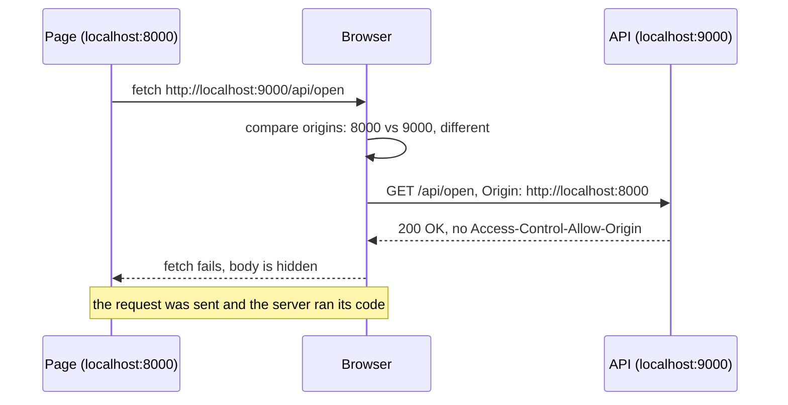

> [!tldr] In three lines
> An origin is the three parts of a URL that matter for browser security: scheme, host, and port. The browser's same-origin policy stops a page on one origin from reading responses from another origin.
> It solves the problem of a random website reading your bank page, or your email, through the browser.
> You meet it as CORS errors in the console, the `Origin` header in DevTools, and the rule that cookies are sent to a host, not to a page.

## Why it exists

A browser loads many sites in tabs and frames, and each site has its own data and its own logins. Without a rule, a page you opened by accident could send a request to your bank, the browser would attach your bank cookie, and the page could read the account details in the reply.

The same-origin policy (SOP) is the rule that stops this. Page code may freely load and run things from other origins, but it may not read what comes back, unless the other origin says it is allowed. CORS (Cross-Origin Resource Sharing) is the explicit "allowed" signal, and [[cors]] covers it in detail.

The word "origin" names the unit that the rule works with. If that unit is wrong, the rule is wrong, so it is worth being exact.

## Picture

<!-- interactive widget: runs on the site only; src path is from the site root -->
<iframe src="/static/widgets/origin-vs-user-and-allow-credentials.html" width="100%" height="620" style="border:0" loading="lazy"></iframe>

Part A shows three requests with different Origin and Cookie values: Origin says which page asked, Cookie says which person. Part B is a grid: pick a `fetch` credentials mode and reply headers, and see whether the page can read the reply. The buttons in the lab page reproduce the same cases on a real server.

## Plain version

A hotel has floors. The door of each room has a number, and the door next to it belongs to a different guest. A guest on floor 8 can knock on any door. The hotel only lets the guest in to see what is inside if the room's own occupant says so.

An origin is the room's address: the building (host), the floor (port), and the kind of door (scheme). Two URLs on different floors are different rooms, even in the same building.

## Precise definition

An **origin** is a tuple of three values taken from a URL (defined in the HTML standard, used by the Fetch standard):

- **scheme**: `http` or `https` (the protocol part before `://`)
- **host**: the domain name or IP address (`localhost`, `sub.example.com`, `127.0.0.1`)
- **port**: the number after the colon. If none is given, the default for the scheme is used: 80 for `http`, 443 for `https`

Path, query string, and fragment (`#...`) are not part of the origin. Two pages on the same origin can have different paths and still share it.

| Term | Definition | Where it's used |
|---|---|---|
| Origin | The triple scheme + host + port | Browser security checks, CORS, `Origin` header |
| Same-origin | All three parts are equal | Pages can read each other's DOM and responses |
| Cross-origin | Any part differs | Reads blocked unless CORS allows |
| Same-origin policy (SOP) | Browser rule that blocks reading cross-origin responses and documents | Every browser |
| CORS | Server headers (`Access-Control-*`) that relax SOP for named origins | APIs called from another site |
| `Origin` header | Request header with the origin of the page that started the request. Set by the browser | Cross-origin requests, POST and other unsafe methods |
| Site | Scheme plus the registrable domain (eTLD+1), with the port ignored. Used for cookies' `SameSite` | Cookie rules, not SOP |
| Opaque origin | An origin with no comparable value, shown as `Origin: null` | Sandboxed iframes, `file:` pages, some redirects |

### Same or different origin

| Page URL | Other URL | Same origin? | Which part differs |
|---|---|---|---|
| `http://localhost:8000` | `http://localhost:8000/lab.html` | Yes | Path does not count |
| `http://localhost:8000` | `http://localhost:9000` | No | Port: 8000 vs 9000 |
| `http://example.com` | `https://example.com` | No | Scheme: http vs https |
| `https://example.com` | `https://sub.example.com` | No | Host: `example.com` vs `sub.example.com` |
| `https://example.com` | `https://example.com:443` | Yes | 443 is the default for https, so it is implied |
| `http://localhost:8000` | `http://127.0.0.1:8000` | No | Host names differ, even though both mean "this computer" |
| `https://example.com` | `https://example.org` | No | Host: different domain |

The `localhost:8000` and `localhost:9000` pair is the lab case. The same machine, the same host name, two ports, so two origins.

## How it works

1. A page at `http://localhost:8000` runs a `fetch` to `http://localhost:9000/api/open`.
2. The browser compares the page origin with the request URL's origin. They differ (port), so the request is cross-origin.
3. The browser adds an `Origin: http://localhost:8000` request header. The page code cannot change this value.
4. The request is sent to the server. For a simple cross-origin request (a plain GET, or a simple POST), the server receives it and can act on it. The browser does not stop the request from being sent. Requests that need extra permission (for example a JSON `POST` with a `Content-Type` of `application/json`) first get a preflight `OPTIONS` request. If the preflight is refused, the browser never sends the real request. [[cors]] covers preflight.
5. The server replies. The browser checks the response headers for `Access-Control-Allow-Origin` (and credentials rules, see below).
6. If the header allows this origin, the browser gives the body to the page. If not, the page's `fetch` promise fails, and the body is hidden from the page's JavaScript.

The lab server prints one line per request, which makes step 4 visible. Calling `/api/open` produces a line like `GET /api/open Origin=http://localhost:8000` in the server's terminal, even though the page never sees the reply.



Note on the diagram: the server does the work. The browser only decides what the page may read. This is the single most important idea on this page.

### What the same-origin policy blocks

- Reading the body of a cross-origin `fetch` or `XMLHttpRequest` response, unless CORS allows it.
- Reading response headers other than the CORS-safelisted ones (see [[cors]]).
- Reading the DOM of a cross-origin `iframe`.
- Reading the contents of a cross-origin page opened in a popup.

### What the same-origin policy allows

- **Sending** requests to other origins. A cross-origin `fetch` is sent, and so is a simple cross-origin `POST`. Requests that need a preflight are sent only after the preflight passes.
- **Following links** and submitting HTML forms to other origins. Navigation is allowed.
- **Embedding** resources from other origins: ``, `<script>`, `<link rel="stylesheet">`, `<video>`, `<iframe>`. The page can display or run them, but not read their bytes through JavaScript (scripts run in their own context).
- **Cookies**: the browser attaches cookies to requests by host rules, not origin rules. A cross-origin request to a host that has cookies may carry them (see the credentials section).

A consequence: sending a request is not the same as being allowed to read it. Protection against actions that change server state (CSRF) is a separate problem, handled with `SameSite` cookies and tokens.

## The real thing

### The Origin header

A request from the lab page, sent cross-origin to the API:

```http
GET /api/open HTTP/1.1
Host: localhost:9000
Origin: http://localhost:8000
Accept: */*
Sec-Fetch-Mode: cors
Sec-Fetch-Site: same-site
```

| Line | Value | What it means |
|---|---|---|
| `Origin` | `http://localhost:8000` | The origin of the page that started the request. Scheme, host, and port, with no path. Added by the browser |
| `Host` | `localhost:9000` | The origin of the request target. Added by the browser |
| `Sec-Fetch-Mode` | `cors` | The browser sent this as a CORS request |
| `Sec-Fetch-Site` | `same-site` | The page and the target share a site (same registrable domain, ports ignored). They are different origins but the same site |

When the same request runs from a page on the same origin (for example the page at `localhost:9000` calling `localhost:9000/api/me`), `Origin` is usually missing on a GET. It is present for cross-origin requests and for `POST`, `PUT`, `PATCH`, and `DELETE`, even same-origin ones.

An `Origin` value of `null` is the browser's way of saying "I cannot name an origin". You will see it from sandboxed iframes, pages opened from `file:`, and some redirects. A server that allows `null` by mistake lets any sandboxed page read its responses.

### The Access-Control response headers

The server answers with headers that name the origin allowed to read:

```http
HTTP/1.0 200 OK
Content-Type: application/json
Content-Length: 24
Access-Control-Allow-Origin: http://localhost:8000
Access-Control-Allow-Credentials: true

{"route": "allow-creds"}
```

`Access-Control-Allow-Origin` must match the page origin exactly, or be `*` (not allowed with credentials). `Access-Control-Allow-Credentials: true` lets the browser send cookies with the request and let the page read the reply.

### Credentials modes

The `fetch` call chooses whether cookies travel with the request. The three modes are:

| `credentials` value | Cookies sent cross-origin? | Cookies accepted from the reply? | Default? |
|---|---|---|---|
| `'omit'` | No, never | No | No |
| `'same-origin'` | No, only to the same origin | Only from the same origin | Yes (default) |
| `'include'` | Yes, if the cookie rules allow | Yes, if `Access-Control-Allow-Credentials: true` is also sent | No |

The lab button "3. allow with credentials" uses `credentials: 'include'` with an exact origin and `Allow-Credentials: true`. It succeeds. The button "4. wildcard with credentials" uses `*`, and the browser refuses it.

| `fetch` credentials | Reply headers | Can the page read the reply? | Lab button |
|---|---|---|---|
| default (`same-origin`) | `Access-Control-Allow-Origin: http://localhost:8000` | Yes, but no cookies were sent | 2. allow |
| `'include'` | `Access-Control-Allow-Origin: http://localhost:8000` only | No: `Allow-Credentials` missing | none in lab |
| `'include'` | exact origin + `Access-Control-Allow-Credentials: true` | Yes, cookies sent and accepted | 3, 5 |
| `'include'` | `Access-Control-Allow-Origin: *` + `Allow-Credentials: true` | No: `*` is not allowed with credentials | 4 |

`Allow-Credentials` is not a login check. It does not know who the user is. It only lets the browser send cookies on a cross-origin call and lets the page read the answer. Whether the answer is private is still the server's decision.

### Origin vs Cookie

Two headers in the same request answer two different questions:

| Header | Question it answers | Example | Set by |
|---|---|---|---|
| `Origin` | Which page is asking? | `Origin: http://localhost:8000` | Browser, from the page's own origin |
| `Cookie` | Which browser session is this? | `Cookie: session=demo123` | Browser, from cookies stored earlier with `Set-Cookie` |

A request can have one without the other. An anonymous visitor to a public page sends an `Origin` but no `Cookie`. A logged-in person on another site sends a `Cookie` for the bank but an `Origin` of the other site.

### Cookies follow hosts, not origins

Cookies are scoped by host (and path, and the `Domain` and `Secure` attributes), not by the full origin. Port is not part of the cookie scope. This is why the lab's login cookie works across both ports:

```http
Set-Cookie: session=demo123; Path=/; SameSite=Lax
```

The response came from `localhost:9000`, with no `Domain` attribute, so the cookie is stored for host `localhost`. The page at `localhost:8000` can receive it on `credentials: 'include'` requests to `localhost:9000` because the host matches and the two ports are the same site. You can see the cookie in DevTools under **Application** > **Cookies** (then `http://localhost`), with the value `demo123`.

The browser also does not isolate cookies by scheme in the way people often assume. A cookie set over `http` can be sent to `https` on the same host unless it is marked `Secure`.

### Where to see it

- **Console**: a CORS failure says something like "blocked by CORS policy: No 'Access-Control-Allow-Origin' header". The reason is in the console, not in the page's `catch` block.
- **Network**: select the request, open **Headers**, and read **Request Headers** for `Origin` and **Response Headers** for `Access-Control-*`.
- **Application** > **Cookies**: the cookies for each host, with their attributes.
- **Server terminal**: the lab prints `GET /path Origin=...`, which shows what the server received even when the page got nothing.

## Where it's used

- **Single-page apps** on one domain calling an API on a subdomain (`app.example.com` calling `api.example.com`). Those are different origins, so CORS is needed.
- **Local development** where the front end runs on one port and the back end on another. This is the lab setup.
- **Third-party widgets** (payment forms, maps, analytics) that load scripts from other origins without reading their data.
- **Security reviews** that check whether an API reflects arbitrary `Origin` values or accepts `null`.
- **Mobile apps and `curl`** are not browsers. They do not enforce SOP or add `Origin` for you, so `Origin` is not a login and not a security check on its own.

## Compared with

| | Origin | Site | Cookie scope |
|---|---|---|---|
| Parts | scheme + host + port | scheme + registrable domain | host + path (+ attributes) |
| Ports count? | Yes | No | No |
| Used for | SOP, CORS, `Origin` header | `SameSite` cookie rules | Which cookies are sent |
| Example, same? | `localhost:8000` vs `localhost:9000`: no | same | `localhost` cookie visible on both ports: yes |

## Common misconceptions

- **Wrong:** `Origin` identifies the user.
  **Right:** `Origin` identifies the page that started the request, as scheme, host, and port. The user, or the session, is identified by `Cookie` or `Authorization`. Two different people on the same page send the same `Origin` and different cookies.

- **Wrong:** A page can set its own `Origin` header to whatever it likes.
  **Right:** Browsers add `Origin` themselves, and page code cannot choose its value. A non-browser client, such as `curl` or a script on a server, can send any `Origin` it wants. So a server must not treat `Origin` as proof of who is asking. It is only a hint the browser gives honestly.

- **Wrong:** Cookies are stored per origin, so the port separates them.
  **Right:** Cookies are scoped by host and path, not by port. `localhost:8000` and `localhost:9000` see the same `localhost` cookies, if the cookie allows it. Use separate host names if you need isolated cookies.

## Interview questions

> [!question]- Q1. What are the three parts of an origin, and what is the default port for `https`?
> Scheme, host, and port. The default port is 443 for `https` and 80 for `http`. A URL with the default port written out is the same origin as the URL without it. Path, query, and fragment are not part of the origin.

> [!question]- Q2. What does the same-origin policy block, and what does it allow?
> It blocks page JavaScript from reading the body and most headers of a cross-origin response (unless CORS allows it), and from reading the DOM of a cross-origin iframe. It allows sending cross-origin requests, following links, submitting forms, and embedding images, scripts, stylesheets, and iframes. Sending is allowed; reading is what is restricted.

> [!question]- Q3. Why does a request to another origin reach the server even when the page gets an error?
> For simple requests the browser sends the request and enforces the rule at the reading step: after the server replies, the browser checks CORS headers and hides the response from the page if they do not allow it. The server has already run its code, so CORS does not protect the server. (For requests that need a preflight, a refused preflight stops the real request from being sent.) Server-side checks (authentication, authorization, CSRF protection) are still needed.

> [!question]- Q4. Why does `Access-Control-Allow-Origin: *` fail when credentials are included?
> A wildcard would let any origin read a response that comes with the user's cookies. That is the exact leak SOP exists to prevent. So the browser refuses the combination: with `credentials: 'include'`, the allowed origin must be named exactly, and `Access-Control-Allow-Credentials: true` must be present.

> [!question]- Q5. Explain `Origin` versus `Cookie` in one request.
> `Origin` says which page started the request, as scheme, host, and port. `Cookie` says which stored session the browser is sending. A request from a logged-in person's browser on a third-party page carries the third-party `Origin` and the person's own `Cookie`. The server can use the cookie to find the person and the origin to decide whether the calling page is allowed.

> [!question]- Q6. Is `localhost:8000` the same origin as `127.0.0.1:8000`?
> No. Host names are compared as strings, so `localhost` and `127.0.0.1` are different hosts even though both mean the local machine. Cookies set for one are not sent to the other. This is a common source of confusing CORS and login bugs in local development.

## Trigger card

> [!example] When I see a CORS error in the console, it means the browser refused to show the page the reply, because the server's `Access-Control-Allow-Origin` did not name the page's origin (scheme, host, and port) exactly.

## Related

- [[cors]] - the headers the server sends to relax the same-origin policy
- [[http-message]] - the `Origin`, `Cookie`, and `Set-Cookie` headers in full
- [[http-caching]] - why a cached response should `Vary` on `Origin` when the response differs per origin
- [[tls]] - why `https` and `http` are different origins even for the same host name

## Sources

- Prep 1 networking session 2026-10-30
- MDN - Same-origin policy: https://developer.mozilla.org/en-US/docs/Web/Security/Same-origin_policy
- MDN - CORS: https://developer.mozilla.org/en-US/docs/Web/HTTP/Guides/CORS
- RFC 6265 - HTTP State Management (cookies): https://www.rfc-editor.org/rfc/rfc6265
- WHATWG Fetch Standard: https://fetch.spec.whatwg.org/
