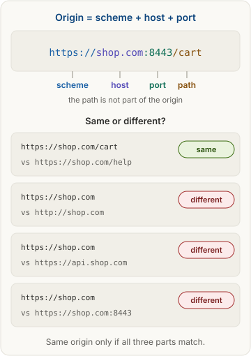
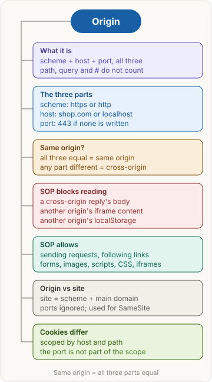

<!-- series:start -->
> [!series]- Networking · 8 of 9
> 1. [[networking/revision|Networking quick revision]]
> 2. [[networking/http-message|HTTP message]]
> 3. [[networking/request-lifecycle|Request lifecycle]]
> 4. [[networking/dns|DNS]]
> 5. [[networking/tcp|TCP and UDP]]
> 6. [[networking/tls|TLS and HTTPS]]
> 7. [[networking/http-caching|HTTP caching]]
> 8. **Origin** · you are here
> 9. [[networking/cors|CORS]]
<!-- series:end -->

> [!abstract] What this page is for
> **Intent:** learn what an origin is and what the same-origin policy blocks, so CORS errors and cookie rules make sense.
> **You'll learn:** what counts as an origin · same origin or not · what the policy blocks and allows · origin vs site · why cookies follow hosts, not origins.
> **Time:** about 6 minutes. Every section has a longer version on the [[networking/deep/origin|detailed Origin page]].

## Words you need first

- **Origin**: the "address" of a web page. It has three parts: **scheme** (`https`), **host** (`shop.com`) and **port** (`443`). Two URLs share an origin only if all three match. The path (`/cart`) is not part of it.
- **Scheme**: the protocol at the start of a URL, `http` or `https`. **Host**: the domain name, such as `shop.com`. **Port**: the number after the colon, such as `:8000`. Left out, it is 80 for `http` and 443 for `https`.
- **Same-origin policy (SOP)**: the browser's default safety rule. A page's JavaScript may read data only from its own origin.
- **Site**: a looser idea than origin. It is the scheme plus the main domain, with ports ignored. `shop.com` and `api.shop.com` are different origins but the same site.
- **Cookie**: a small value a site stores in your browser and gets back on each request. It is how a site remembers you are logged in.
- **SameSite**: a cookie setting that limits when the browser sends the cookie on requests from other sites.
- **`fetch()`**: the JavaScript function a page uses to call a server. **XHR** is the older way to do the same.
- **DOM**: the page's content as JavaScript sees it. **iframe**: a box inside a page that shows another page.
- **localStorage**: browser storage a page can use to save data. Each origin has its own.
- **CORS**: the way a server says "pages from these other origins may read my replies." See [[networking/cors|CORS]].

## Why it exists

You are logged in to `bank.com`, so your browser holds its cookie. You open `evil.com`, and its script calls `fetch("https://bank.com/api/balance", { credentials: "include" })`. If the bank's cookie is allowed to travel to other sites (`SameSite=None`), the browser attaches it. Without a rule, `evil.com` could read the reply.

The same-origin policy stops this: a page may only read what its own origin sent.

## The picture

## How it works, with an example

Your shop's page is at `https://shop.com/cart`. Its script wants data from `https://api.shop.com/items`.

1. The browser compares the two URLs part by part. Scheme: `https` and `https`, the same. Host: `shop.com` and `api.shop.com`, different.
2. Because one part differs, the request is cross-origin.
3. The browser sends the request and adds `Origin: https://shop.com` on its own, so the server knows who is asking. Page code cannot change this header.
4. The server replies. The browser checks whether the reply allows this origin ([[networking/cors|CORS]]). If not, the page's `fetch` fails and the reply is hidden from the page's JavaScript.

## The most common mistake

> [!warning] Thinking a path or a subdomain makes a new origin
> Only scheme, host and port count. `https://shop.com/cart` and `https://shop.com/help` are the **same** origin. But `https://shop.com` and `https://api.shop.com` are **different** origins. So are `localhost:8000` and `localhost:9000`. And `localhost` and `127.0.0.1` are different hosts, so they are different origins too.

## Same origin or not?

| Page URL | Other URL | Same origin? | What differs |
|---|---|---|---|
| `https://shop.com/cart` | `https://shop.com/help` | Yes | Nothing. The path does not count |
| `https://shop.com` | `https://shop.com:443` | Yes | Nothing. 443 is the default for https |
| `https://shop.com` | `http://shop.com` | No | Scheme |
| `https://shop.com` | `https://api.shop.com` | No | Host |
| `http://localhost:8000` | `http://localhost:9000` | No | Port |

## What the policy blocks and allows

The policy limits **reading**. It does not limit **sending**.

**Blocked**: page JavaScript cannot read:
- the body of a cross-origin `fetch` or XHR reply, unless [[networking/cors|CORS]] allows it;
- the DOM of a cross-origin `iframe`, so a page cannot see inside an embedded page from another origin;
- the localStorage of another origin.

**Allowed**:
- **sending** requests to other origins. Simple requests go straight out. Others wait for a preflight check ([[networking/cors|CORS]]);
- following links and submitting HTML forms to other origins;
- showing images, scripts, stylesheets and iframes from other origins. The page can display or run them, but it cannot read their bytes.

## Origin vs site

Origin is strict: scheme, host and port must all match. Site is looser: scheme and main domain, ports ignored. Cookies follow their own rule: host and path, with no port.

| | Origin | Site | Cookie scope |
|---|---|---|---|
| Parts | scheme + host + port | scheme + main domain | host + path |
| Port counts? | Yes | No | No |
| Used for | the same-origin policy, CORS, the `Origin` header | the `SameSite` cookie setting | which cookies get sent |
| `localhost:8000` vs `localhost:9000` | different | same site | same cookies |

So a cookie set by `localhost:9000` is visible to a page on `localhost:8000`. But their localStorage is separate, because localStorage follows the origin.

## Say it in an interview

> "An origin is the scheme, host and port of a URL. The path doesn't count. The same-origin policy lets a page read only responses from its own origin, so a random site can't read your bank data with your cookie. Site is looser: scheme plus main domain, ports ignored. Cookies follow host and path, not origin, and ignore the port. localStorage follows the origin. The policy blocks reading, not sending: a page can send a cross-origin request and show cross-origin images, scripts and iframes, but it can't read the reply or the other origin's storage. CORS is how a server allows exceptions."

## Questions interviewers ask

Tap a question to see the answer.

> [!question]- What is an origin?
> The scheme, host and port of a URL. The path, query and fragment are not part of it.

> [!question]- Is `https://shop.com/cart` the same origin as `https://shop.com/help`?
> Yes. Only scheme, host and port are compared.

> [!question]- Is `https://shop.com` the same origin as `https://shop.com:443`?
> Yes. 443 is the default port for https, so it is implied.

> [!question]- What does the same-origin policy block?
> Page JavaScript reading a cross-origin reply, reading the content of a cross-origin iframe, and reading another origin's localStorage.

> [!question]- What does the same-origin policy allow?
> Sending requests, following links, submitting forms, and showing images, scripts, stylesheets and iframes from other origins.

> [!question]- What is the difference between same origin and same site?
> Origin compares scheme, host and port. Site compares scheme and main domain, and ignores the port. `api.shop.com` and `shop.com` are the same site but different origins.

> [!question]- Do cookies follow the origin rules?
> No. Cookies are scoped by host and path, not port. So a cookie set by `localhost:9000` is sent to `localhost:8000` too.

> [!question]- Can two ports on localhost share localStorage?
> No. A different port is a different origin, and localStorage is per origin.

> [!question]- Are `localhost` and `127.0.0.1` the same origin?
> No. The host names differ, even though both mean this computer.

## Mental map

## Watch

Cyber Security Entertainment, about 4 minutes: what the same-origin policy is and which attacks it stops.

**Want more?** The [[networking/deep/origin|detailed Origin page]] has the same sections with the raw `Origin` header, cookie attributes, `Origin: null`, and harder interview questions.

<!-- series-nav:start -->
---

← [[networking/http-caching|HTTP caching]] · [[networking/cors|CORS]] →
<!-- series-nav:end -->
