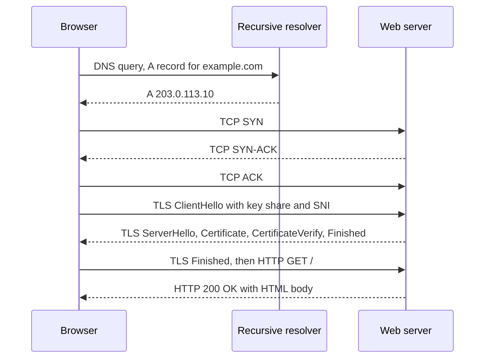

<!-- series:start -->
> [!series]- Networking · 2 of 11
> 1. [[networking/http-message|HTTP message]]
> 2. **Request lifecycle** · you are here
> 3. [[networking/dns|DNS]]
> 4. [[networking/tcp|TCP]]
> 5. [[networking/tls|TLS]]
> 6. [[networking/http-caching|HTTP caching]]
> 7. [[networking/origin|Origin]]
> 8. [[networking/cors|CORS]]
> 9. [[networking/cors-credentials|CORS and credentials]]
> 10. [[networking/cors-expose-headers|CORS exposed headers]]
> 11. [[networking/cors-lab|CORS lab]]
<!-- series:end -->

> [!tldr] In three lines
> The request lifecycle, from typing a URL to a rendered page, runs four network steps in order: DNS finds the server's IP address, TCP opens a connection, TLS secures it, and HTTP asks for the page. Each step waits for the one before it, so a first visit pays for all four in round trips. A second visit can skip most of that work.
>
> [[#Interview questions|→ Self-test: 6 questions]]

## Why it exists

A browser starts with a name such as `example.com`. Networks do not route by names. They route packets to IP addresses, and they can lose or reorder those packets. The name has to be turned into an address first. A reliable path then has to be opened, because a page is far too big to send as loose packets. That path crosses networks run by other people, so it must be encrypted and the server's identity must be checked. Only then can the browser ask for the page itself.

Each layer solves one problem and hands a clean result to the next layer. Without this order, the steps look arbitrary. With it, every step has a clear reason to exist.

## Picture



*Four steps, each waiting for the one before it.*



*A first visit against a second visit: on the second visit, DNS, TCP and TLS are skipped or saved.*

## Plain version

Think of ordering food by phone from a restaurant you have never called.

1. Look up the restaurant's number in a directory. That is DNS.
2. Dial and wait until the line connects and both sides say hello. That is TCP.
3. Agree on a secret language and check that the voice on the line really is the restaurant. That is TLS.
4. Place the order. That is HTTP.

Next time, you already know the number, and the line may still be open. Most of the waiting disappears. That is the second visit.

## Precise definition

The request lifecycle is the ordered chain of steps a browser runs to turn a URL into a rendered page. The terms it uses are listed below.

> [!info]- Terms reference
> | Term | Definition | Where it's used |
> |---|---|---|
> | URL (Uniform Resource Locator) | A string with a scheme, host, optional port, path and query, such as `https://example.com/docs?q=1` | Address bar, links, `fetch()`, `curl` |
> | Scheme | The protocol named at the front of a URL, such as `https` | Chooses the default port: 443 for https, 80 for http |
> | Host | The name part of the URL, which DNS must resolve | DNS lookup |
> | DNS (Domain Name System) | The system that maps names to IP addresses | First step of every connection by name |
> | IP address | A numeric address used to route packets between machines | Target of the TCP connection |
> | TCP (Transmission Control Protocol) | Delivers a reliable, ordered stream of bytes between two ports | Carries TLS and HTTP |
> | TLS (Transport Layer Security) | Encrypts the stream, checks it is not changed, and proves the server's identity | Carries HTTP in HTTPS |
> | HTTP (HyperText Transfer Protocol) | The request and response format for web resources | Asks for the page, images, API data |
> | RTT (round-trip time) | Time for a message to go to the other side and back | The unit used to count the cost of each step |
> | Connection reuse (keep-alive) | Sending more requests over an already open TCP connection | Second visits, many requests to one host |
> | HTTP cache | A store of responses, controlled by HTTP headers, that can answer a request without the network | Browser, CDN, proxies |

## How it works

1. **Parse the URL.** The browser reads `https://example.com/`. The scheme is `https`, the host is `example.com`, the port defaults to 443, and the path is `/`.
2. **Check the caches for the address.** The browser checks its own DNS cache, then the operating system's cache. A hit skips DNS.
3. **Ask a resolver for the IP address.** On a miss, the operating system sends a DNS query to a recursive resolver. The resolver does the work of walking the DNS hierarchy and returns an A record (IPv4) or AAAA record (IPv6). See [[networking/dns|DNS]].
4. **Open a TCP connection.** The client sends a SYN to the server's IP on port 443. The server answers SYN-ACK, and the client answers ACK. This costs 1 RTT before any data can move. See [[networking/tcp|TCP]].
5. **Start TLS inside the TCP stream.** The client sends a ClientHello that includes its key share and the server name (SNI). The server answers with its certificate and proof that it holds the private key. The client checks the chain of trust and the host name. In TLS 1.3, the client's first HTTP request can ride in the same flight as its Finished message, so this costs 1 RTT. See [[networking/tls|TLS]].
6. **Send the HTTP request.** The browser writes `GET / HTTP/1.1` (or the HTTP/2 equivalent) with headers such as `Host`, `User-Agent` and `Accept`. The bytes travel encrypted through TLS. See [[networking/http-message|HTTP message]].
7. **Check the HTTP cache.** Before or after the request, the browser checks whether a stored copy is still fresh. A fresh copy is used with no network traffic. A stale copy can be revalidated with a conditional request, and the server may answer 304 Not Modified with no body. See [[networking/http-caching|HTTP caching]].
8. **Receive the response.** The server returns `200 OK` with the HTML. The browser parses the HTML as it arrives.
9. **Fetch the sub-resources.** The HTML names CSS, JavaScript, images and fonts. The browser fetches them, often over the same connection or a few parallel ones. Each is a new request, so each costs at least 1 RTT on a fresh connection.
10. **Render.** The browser builds the DOM and CSSOM, combines them into a render tree, runs layout, paints the pixels, and runs the JavaScript that was loaded.



### Counting round trips

Each request and response exchange costs one RTT. The four steps of a first visit add up as:

$$T_{first} \approx 1\,\text{RTT}_{DNS} + 1\,\text{RTT}_{TCP} + 1\,\text{RTT}_{TLS1.3} + 1\,\text{RTT}_{HTTP}$$

The DNS term is 1 RTT only when the resolver already has the answer. On a cache miss, the resolver may make several queries of its own, so the DNS term grows.

For TLS 1.2, the handshake costs 2 RTT instead of 1:

$$T_{first}^{TLS1.2} \approx 1\,\text{RTT}_{DNS} + 1\,\text{RTT}_{TCP} + 2\,\text{RTT}_{TLS1.2} + 1\,\text{RTT}_{HTTP} = 5\,\text{RTT}$$

A worked example with RTT = 50 ms, a resolver answer in the cache and TLS 1.3:

$$T_{first} \approx 4 \times 50\,\text{ms} = 200\,\text{ms}$$

A second visit with a cached DNS answer, a reused connection and a stale HTTP cache entry:

$$T_{second} \approx 1\,\text{RTT}_{HTTP} = 50\,\text{ms}$$

A second visit with a fresh HTTP cache entry makes no network request, so $T_{second} \approx 0$.

These numbers ignore transfer time for large bodies and server processing time. They show only the cost of setup and round trips.

## The real thing

A first visit, listed as the messages that cross the wire. The IP address uses 203.0.113.10, a documentation address from RFC 5737. Real values differ.

```
 #  layer  direction         content
 1  DNS    client -> resolver  QUERY  example.com  type A
 2  DNS    resolver -> client  ANSWER example.com  A 203.0.113.10  TTL 3600
 3  TCP    client -> server    SYN   seq=1000
 4  TCP    server -> client    SYN ACK seq=5000 ack=1001
 5  TCP    client -> server    ACK   seq=1001 ack=5001
 6  TLS    client -> server    ClientHello  (key_share, SNI example.com, ALPN h2 http/1.1)
 7  TLS    server -> client    ServerHello  (key_share)
 8  TLS    server -> client    EncryptedExtensions, Certificate, CertificateVerify, Finished
 9  TLS    client -> server    Finished
10  HTTP   client -> server    GET / HTTP/1.1  (encrypted by TLS)
11  HTTP   server -> client    HTTP/1.1 200 OK  Content-Type text/html  (encrypted by TLS)
```

| Row | Field | What it means |
|---|---|---|
| 1 | DNS QUERY, type A | The resolver is asked for the IPv4 address of the host |
| 2 | ANSWER, TTL 3600 | The address is valid for 3600 seconds, so caches may reuse it for an hour |
| 3 | SYN, seq=1000 | The client opens a connection and sends its starting sequence number |
| 4 | SYN ACK, ack=1001 | The server accepts and acknowledges the client's SYN by sending the next expected number |
| 5 | ACK, ack=5001 | The client acknowledges the server's SYN, and the connection is open |
| 6 | ClientHello, SNI | The client's first TLS message. SNI is the server name in plain text, so the server can pick the right certificate |
| 7 | ServerHello, key_share | The server picks the cipher and sends its half of the key exchange |
| 8 | Certificate, CertificateVerify | The server sends its certificate chain, then a signature proving it holds the matching private key |
| 9 | Finished | The client confirms that the handshake was not tampered with |
| 10 | GET / HTTP/1.1 | The first HTTP request, now encrypted |
| 11 | 200 OK, text/html | The status line and headers of the response. The HTML body follows |

Rows 3 to 5 cost 1 RTT. Rows 6 to 9 cost 1 RTT in TLS 1.3. Row 10 and row 11 cost 1 RTT. Row 1 and row 2 cost at least 1 RTT to the resolver.

## Common misconceptions

- **Wrong:** TCP is secure, so the page data is encrypted by default.
  **Right:** TCP only delivers bytes in order and without loss. It does not encrypt them. Anyone on the path can read plain TCP data. TLS adds encryption, integrity and server identity on top of TCP. (See [[networking/tcp|TCP]] and [[networking/tls|TLS]].)
- **Wrong:** TLS can start before TCP is up, so the handshakes overlap and save time.
  **Right:** TLS messages are carried inside the TCP byte stream, so the TCP handshake must finish before the first TLS message can be sent. The two steps add up. QUIC, which HTTP/3 uses, is a different transport that combines transport and TLS setup, but it is not TCP.
- **Wrong:** HTTP itself caches the page.
  **Right:** HTTP defines headers such as `Cache-Control`, `ETag` and `Last-Modified`. The caches (the browser cache, CDNs and proxies) are separate software that read those headers and decide what to store. (See [[networking/http-caching|HTTP caching]].)

## Interview questions

> [!question]- Q1. What happens when you type `https://example.com` into a browser and press Enter?
> The browser parses the URL and checks its caches for the IP address. On a miss, it asks a recursive resolver, which returns the IP address. The browser opens a TCP connection to that IP on port 443, which takes a three-way handshake. It runs a TLS handshake inside the connection, which verifies the server's certificate and derives the keys. It then sends an HTTP GET request over TLS. The server responds, the browser parses the HTML, fetches sub-resources, and renders the page.

> [!question]- Q2. Why is a first visit slower than a second visit?
> The first visit has to do DNS, TCP and TLS setup before the HTTP request can be sent. Those steps cost round trips. A second visit can use a cached DNS answer, reuse the TCP and TLS connection, and sometimes skip the request entirely with a fresh HTTP cache entry.

> [!question]- Q3. How many round trips does a first HTTPS visit need with TLS 1.3?
> Roughly four when the DNS answer is cached in the resolver: one for DNS, one for the TCP handshake, one for the TLS 1.3 handshake, and one for the HTTP request and response. A cache miss at the resolver adds more. TLS 1.2 adds one more round trip, which gives about five.

> [!question]- Q4. Why does DNS come before TCP?
> TCP connects to an IP address, not to a name. The browser cannot open a connection until it knows the address, so DNS must finish first. A DNS failure stops the page load before any connection is attempted.

> [!question]- Q5. What is the difference between a fresh cache hit and a 304 revalidation?
> A fresh cache hit uses the stored copy with no network traffic. The response is considered valid until its freshness lifetime ends, such as when `Cache-Control: max-age` has not expired. A revalidation happens after the copy is stale. The browser sends a conditional request with `If-None-Match` or `If-Modified-Since`. If the resource has not changed, the server answers 304 Not Modified with no body, and the browser reuses its stored copy. A revalidation still costs one round trip.

> [!question]- Q6. Why do sub-resources make a page slower even when each file is small?
> Each sub-resource is a separate request. On a fresh connection, each costs at least one round trip. Browsers open a few parallel connections and reuse them, which helps, but many small files still add latency. Bundling, caching and HTTP/2 multiplexing reduce the cost.

## Trigger card

> [!example] When I see a page stall before any bytes arrive, it means setup is still running (DNS, TCP or TLS), because the HTTP request cannot be sent until all three are finished.

## Compared with

| | First visit | Second visit (typical) | Second visit (fresh cache) |
|---|---|---|---|
| DNS | Query to resolver | Cached, 0 RTT | Cached, 0 RTT |
| TCP | New handshake, 1 RTT | Reused connection, 0 RTT | Not needed |
| TLS | New handshake, 1 RTT (TLS 1.3) | Reused session, 0 RTT | Not needed |
| HTTP | Full request, 1 RTT | Conditional request, 1 RTT (304 possible) | Served from cache, 0 RTT |
| Round trips | About 4 RTT | About 1 RTT | 0 RTT |

## Where it's used

- **Browsers.** Every navigation and every sub-resource follows this path, with caches cutting it short.
- **curl and command-line tools.** `curl -v https://example.com` prints the TCP and TLS steps and the HTTP messages in order, which makes it a good way to see the lifecycle.
- **Mobile apps and API clients.** An app calling a backend performs the same steps, usually reusing one connection for many calls.
- **CDNs.** A CDN returns a nearby edge IP from DNS, so the first three steps end close to the user. The HTTP step may be answered from the edge cache.
- **Databases and other TCP services.** PostgreSQL, MySQL and SSH use the TCP and TLS steps, but not HTTP.

> [!info]- Sources
> - study session, 2026-10-30
> - RFC 1035, Domain Names: Implementation and Specification
> - RFC 9293, Transmission Control Protocol (TCP)
> - RFC 8446, The Transport Layer Security (TLS) Protocol Version 1.3
> - RFC 9110, HTTP Semantics
> - RFC 9111, HTTP Caching
> - RFC 5737, IPv4 Address Blocks Reserved for Documentation
> - MDN Web Docs, How the web works

<!-- series-nav:start -->
---

← [[networking/http-message|HTTP message]] · [[networking/dns|DNS]] →
<!-- series-nav:end -->
