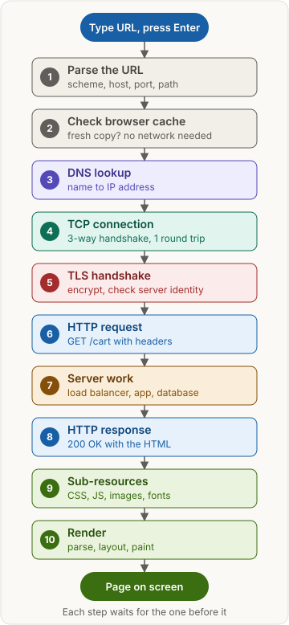
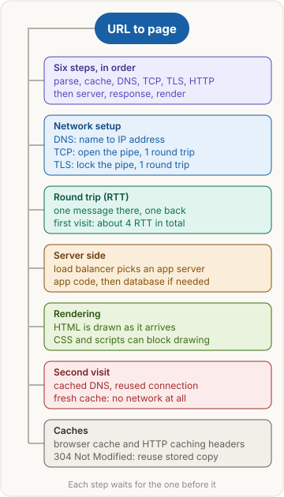

<!-- series:start -->
> [!series]- Networking · 3 of 9
> 1. [[networking/revision|Networking quick revision]]
> 2. [[networking/http-message|HTTP message]]
> 3. **Request lifecycle** · you are here
> 4. [[networking/dns|DNS]]
> 5. [[networking/tcp|TCP and UDP]]
> 6. [[networking/tls|TLS and HTTPS]]
> 7. [[networking/http-caching|HTTP caching]]
> 8. [[networking/origin|Origin]]
> 9. [[networking/cors|CORS]]
<!-- series:end -->

> [!abstract] What this page is for
> **Intent:** answer "What happens when you type a URL and press Enter?" step by step, in the order interviewers expect.
> **You'll learn:** the ten steps from URL to page on screen · what a round trip costs · why a second visit is faster · the questions that follow.
> **Time:** about 8 minutes. Every step has a longer version on the [[networking/deep/request-lifecycle|detailed request lifecycle page]].

## Words you need first

- **URL (Uniform Resource Locator)**: the address you type, such as `https://shop.com/cart`. It has a scheme (`https`), a host (`shop.com`), an optional port (`443` is the default for https) and a path (`/cart`).
- **DNS (Domain Name System)**: the internet's phone book. It turns a name like `shop.com` into an IP address like `203.0.113.10`. Networks route by IP address, never by name.
- **TCP (Transmission Control Protocol)**: the way two computers open a reliable pipe. Bytes arrive in order, and lost bytes are sent again.
- **TLS (Transport Layer Security)**: the layer that encrypts the pipe, proves the server really is `shop.com`, and detects tampering.
- **HTTP (HyperText Transfer Protocol)**: the language of the web. A request asks for something, and a response carries the answer.
- **Round trip (RTT)**: one message going to the other side and one coming back. If the path takes 50 milliseconds each way, one RTT is 100 milliseconds.
- **Cache**: a stored copy kept so the browser does not have to ask again.

## Why it exists

A browser starts with a name, `shop.com`. Networks route packets to IP addresses, not names, so the name must become an address first. Then a reliable pipe must be opened, because a page is too big to send as loose packets. That pipe crosses networks run by other people, so it must be encrypted and the server's identity checked. Only then can the browser ask for the page.

## The picture

*Ten steps, top to bottom. Each one waits for the step above it.*

## How it works, with an example

You type `https://shop.com/cart` and press Enter. The browser reads the URL and has no fresh copy of the page. It asks DNS for the address of `shop.com` and gets `203.0.113.10`. It opens a TCP pipe to that address, which takes 1 round trip. It runs TLS over the pipe, which takes 1 more, and checks that the certificate names `shop.com`. It sends `GET /cart` over the secure pipe, and the server answers `200 OK` with the HTML one round trip later. The browser then fetches the files the HTML names and draws the page.

Added up, a first visit costs about 4 round trips: DNS 1, TCP 1, TLS 1, HTTP 1.

## The most common mistake

> [!warning] One request is not one page
> Many people say "the browser sends a request and gets the page." The page is the end of a long chain. DNS, TCP and TLS come first. And the HTML is only the start: each stylesheet, script and image is another request. A normal page makes many requests, often dozens.

## The steps one by one

1. **Parse the URL.** The browser splits it into scheme, host, port and path. For https with no port, it uses 443. No network traffic yet.
2. **Check the browser cache.** If it holds a fresh copy of the page, it shows that copy and skips the rest. See [[networking/http-caching|HTTP caching]].
3. **DNS lookup.** The browser checks its own DNS cache, then asks a recursive resolver (a DNS helper that does the searching). The answer is kept for its TTL (time to live, how many seconds it may be reused). A cached answer costs about 1 round trip. See [[networking/dns|DNS]].
4. **TCP connection.** The browser sends SYN, the server answers SYN-ACK, and the browser sends ACK. This three-message handshake opens the pipe and costs 1 round trip. No page data moves before it. See [[networking/tcp|TCP]].
5. **TLS handshake.** The two sides agree on keys, and the browser checks the server's certificate. In TLS 1.3 this costs 1 round trip. See [[networking/tls|TLS]].
6. **Send the HTTP request.** The browser sends `GET /cart HTTP/1.1` with headers such as `Host` and `Accept`, encrypted by TLS. See [[networking/http-message|HTTP message]].
7. **Server work.** A load balancer, a machine that spreads requests over many identical servers, picks one app server. The app runs its code and often asks a database for data.
8. **HTTP response.** The server sends `200 OK`, headers such as `Cache-Control` (how long to keep the copy), and the HTML. It arrives 1 round trip after the request.
9. **Sub-resources.** The HTML names more files: CSS, JavaScript, images and fonts. Each is a new request, often sent over the open connection.
10. **Render.** The browser builds the DOM (the page's structure) and the CSSOM (its styles), works out where each box goes, paints the pixels, and runs the JavaScript.

## Second visit: what gets skipped

A second visit can skip most of the first visit's work.

- **DNS.** The answer is still cached until its TTL runs out, so no query is needed.
- **TCP and TLS.** If the pipe is still open, the browser reuses it.
- **HTTP.** A fresh cached copy is shown with no network traffic. A stale copy is checked, and the server may answer `304 Not Modified` with no body. That check still costs 1 round trip.

| Step | First visit | Second visit |
|---|---|---|
| DNS | 1 RTT or more | skipped (cached) |
| TCP | 1 RTT | skipped if the pipe is open |
| TLS | 1 RTT | skipped if the pipe is open |
| HTTP | 1 RTT | 0 if fresh, 1 RTT if checked |
| Total | about 4 RTT | about 1 RTT, or 0 if fresh |

## Say it in an interview

> "I'd walk the path in order. The browser parses the URL and checks its cache. On a miss, DNS turns the host into an IP address. TCP opens a connection with a three-way handshake, one round trip. TLS encrypts it and checks the certificate, one more round trip in TLS 1.3. Then the HTTP request goes out, a load balancer picks a server, and the app answers. The browser fetches the CSS, scripts and images, and renders the page. A first visit costs about four round trips. A second visit usually skips DNS and the handshakes."

## Questions interviewers ask

Tap a question to see the answer.

> [!question]- What happens when you type a URL and press Enter?
> Parse the URL, check the cache, DNS for the IP address, TCP connection, TLS handshake, HTTP request and response, fetch the sub-resources, render.

> [!question]- Why does DNS come before TCP?
> TCP connects to an IP address, not a name. If DNS fails, no connection is tried.

> [!question]- How many round trips does a first HTTPS visit need?
> About 4 with TLS 1.3 and a cached DNS answer: DNS, TCP, TLS and HTTP, one each. TLS 1.2 adds one more. A DNS miss adds more.

> [!question]- Why is a second visit faster?
> A cached DNS answer, a reused connection and a fresh cache entry skip most of the setup.

> [!question]- Why can't the setup steps overlap?
> TLS messages travel inside the TCP pipe, and the HTTP request travels inside TLS. Each step needs the one before it, so the costs add up.

> [!question]- What does TLS add on top of TCP?
> Encryption, so others on the path cannot read the data. A check that nothing was changed. And proof that the server holds the certificate for its name.

> [!question]- Where does a load balancer fit?
> Between the internet and the app servers. It sends each HTTP request to one of many identical servers.

> [!question]- Why does one page cause many requests?
> The HTML only names the other files. Each stylesheet, script, image and font is its own request.

> [!question]- Does the browser wait for the whole HTML before drawing?
> No. It parses as the bytes arrive. But a script without `async` or `defer` stops the parser, and CSS can block drawing.

> [!question]- What is the difference between a fresh cache hit and a 304?
> A fresh hit uses the stored copy with no network traffic. A 304 means the stale copy is still valid, so the browser reuses it, but the check costs a round trip.

## Mental map

## Watch

ByteByteGo, short video: the whole journey from typing a URL to the page on screen, with DNS, TCP, TLS and HTTP.

**Want more?** The [[networking/deep/request-lifecycle|detailed request lifecycle page]] has the same sections with raw messages, exact round-trip math, and more interview questions.

<!-- series-nav:start -->
---

← [[networking/http-message|HTTP message]] · [[networking/dns|DNS]] →
<!-- series-nav:end -->
