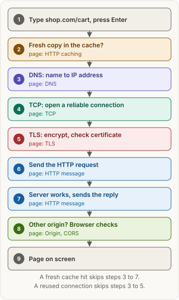
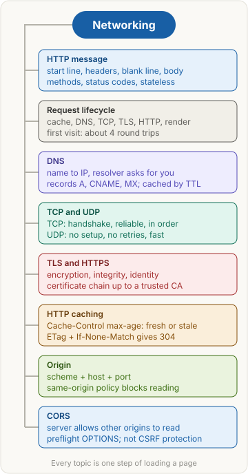

<!-- series:start -->
> [!series]- Networking · 1 of 9
> 1. **Networking quick revision** · you are here
> 2. [[networking/http-message|HTTP message]]
> 3. [[networking/request-lifecycle|Request lifecycle]]
> 4. [[networking/dns|DNS]]
> 5. [[networking/tcp|TCP and UDP]]
> 6. [[networking/tls|TLS and HTTPS]]
> 7. [[networking/http-caching|HTTP caching]]
> 8. [[networking/origin|Origin]]
> 9. [[networking/cors|CORS]]
<!-- series:end -->

> [!abstract] What this page is for
> **Intent:** revise all of networking in one go, the night before an interview.
> **Covers:** HTTP messages · what happens when you type a URL · DNS · TCP and UDP · TLS and HTTPS · HTTP caching · origin · CORS.
> **Time:** about 10 minutes. Every topic below links to its quick page and its detailed page.

## Words you need first

- **Client / server:** the client (your browser or app) asks; the server answers.
- **IP address:** a machine's number on the internet, e.g. `203.0.113.10`.
- **Port:** a number that picks the program on a machine. HTTPS uses 443, HTTP uses 80.
- **Packet:** a small piece of data sent across the network on its own.
- **Round trip (RTT):** one message there and the reply back. Most setup steps cost one each.
- **HTTP (HyperText Transfer Protocol):** the language of web requests and replies.
- **Header:** a `name: value` line sent with a request or reply.
- **Status code:** the 3-digit result of a request, e.g. `200 OK`, `404 Not Found`.
- **DNS (Domain Name System):** the internet's phone book: turns `shop.com` into an IP address.
- **Resolver:** the DNS server (your ISP's, or `8.8.8.8`) that does the lookup for you.
- **TTL (time to live):** how many seconds an answer may be cached.
- **TCP (Transmission Control Protocol):** turns lost, out-of-order packets into one reliable, ordered stream.
- **UDP (User Datagram Protocol):** sends single messages with no setup and no retries.
- **Handshake:** the messages two sides exchange before real data flows.
- **TLS (Transport Layer Security):** encrypts the connection and proves the server's identity. HTTPS is HTTP over TLS.
- **Certificate:** a signed file that says "this public key belongs to shop.com".
- **CA (certificate authority):** a company browsers trust to sign certificates.
- **Cache:** a stored copy of a reply, reused so you don't ask again.
- **ETag:** a version label for a reply, used to ask "has this changed?".
- **Origin:** scheme + host + port, e.g. `https://shop.com:443`.
- **Same-origin policy (SOP):** the browser rule that a page may read replies only from its own origin.
- **CORS (Cross-Origin Resource Sharing):** how a server lets pages from other origins read its replies.
- **Preflight:** an automatic `OPTIONS` request that asks permission before a risky cross-origin request.
- **Cookie:** a small value the browser stores for a site and sends back to it, usually your login session.

## The big picture

Every topic is one step of loading a page:

## Topic by topic

### 1. HTTP message
- A request is a **start line** (`GET /cart HTTP/1.1`), **headers**, a **blank line**, then an optional **body**. A response is the same, but its start line has the status (`HTTP/1.1 200 OK`).
- **Methods:** GET reads, POST creates, PUT replaces, PATCH changes part, DELETE removes. **Safe** = changes nothing (GET, HEAD, OPTIONS; HEAD is GET without the body). **Idempotent** = repeating it has the same effect as once (GET, HEAD, OPTIONS, PUT, DELETE). POST isn't idempotent, and PATCH isn't guaranteed to be.
- **Status families:** 2xx worked, 3xx go elsewhere, 4xx your request is wrong, 5xx the server failed. **401** = who are you? **403** = I know you, still no.
- HTTP is **stateless**: each request stands alone, and the server remembers nothing between them. Cookies add memory.
- **Trap:** POST is not idempotent, so a retried POST can create two orders.
- [[networking/http-message|Quick]] · [[networking/deep/http-message|Detailed]]

### 2. Request lifecycle
- Type URL → cache check → DNS → TCP handshake → TLS handshake → HTTP request → server (load balancer, app, database) → response → browser renders and fetches CSS, JS, images.
- A first HTTPS visit costs about **4 round trips** before the first byte (DNS from the resolver's cache, TCP, TLS 1.3, HTTP). A full DNS lookup adds several more.
- A second visit is faster: cached DNS, reused connection, cached files.
- **Trap:** the steps can't overlap; you need the IP before TCP, and TCP before TLS.
- [[networking/request-lifecycle|Quick]] · [[networking/deep/request-lifecycle|Detailed]]

### 3. DNS
- Browser cache → OS cache → **recursive resolver** → it asks the **root** server, then the **TLD** server (`.com`), then the **authoritative** server, which holds the real record.
- **Records:** A (IPv4 address), AAAA (IPv6), CNAME (alias to another name), MX (mail server), NS (who's authoritative), TXT (notes, e.g. verification).
- Answers are cached for their **TTL**, which is why DNS changes take time to spread.
- Mostly **UDP port 53** (one small packet each way); TCP when the answer is too big.
- **Trap:** the browser doesn't ask the authoritative server itself; the resolver does the walk.
- [[networking/dns|Quick]] · [[networking/deep/dns|Detailed]]

### 4. TCP and UDP
- **Three-way handshake:** SYN → SYN-ACK → ACK, one round trip; both sides exchange random starting sequence numbers.
- **Reliable:** every byte is numbered, the receiver ACKs (acknowledges) what arrived, and the sender resends what wasn't ACKed.
- **Flow control** protects the receiver's buffer; **congestion control** protects the network.
- **UDP:** no handshake, no retries, no ordering. Used for video calls, games, DNS, and QUIC (which HTTP/3 runs on).
- **Trap:** TCP doesn't encrypt anything; TLS does.
- [[networking/tcp|Quick]] · [[networking/deep/tcp|Detailed]]

### 5. TLS and HTTPS
- TLS gives **encryption** (nobody can read it), **integrity** (nobody can change it unnoticed) and **identity** (the server proves it's really shop.com).
- **Asymmetric** keys (public and private) are used once to agree a secret; fast **symmetric** encryption protects everything after.
- **TLS 1.3** handshake: 1 round trip (TLS 1.2 needed 2).
- The server sends a **certificate**; the browser follows the chain up to a CA it trusts and checks the name and dates. That's what stops a man-in-the-middle.
- **Trap:** HTTPS hides the path and content, but an observer still sees the IP address and the domain name (sent unencrypted in the handshake's SNI field, Server Name Indication).
- [[networking/tls|Quick]] · [[networking/deep/tls|Detailed]]

### 6. HTTP caching
- `Cache-Control: max-age=N` = the copy is **fresh** for N seconds; reuse it with no request.
- After that it's **stale**: the browser revalidates with `If-None-Match: <ETag>`. Unchanged → **304 Not Modified** (no body); changed → 200 with the new copy.
- **no-cache** = store it, but check with the server every time. **no-store** = never store it.
- Static files get a hash in the name (`app.3f9a.js`) and cache "forever"; HTML is revalidated.
- **Trap:** no-cache doesn't mean "don't cache"; that's no-store.
- [[networking/http-caching|Quick]] · [[networking/deep/http-caching|Detailed]]

### 7. Origin and same-origin policy
- **Origin** = scheme + host + port. The path doesn't count. `http` vs `https`, `api.shop.com` vs `shop.com`, or port 8443 vs 443 each make a different origin.
- The **same-origin policy** blocks a page from *reading* another origin's replies, iframe content and storage. It still allows loading images, scripts and CSS, submitting forms and following links.
- **Site** (scheme + main domain) is looser than origin; cookies' `SameSite` uses site.
- **Trap:** the policy blocks reading, not sending.
- [[networking/origin|Quick]] · [[networking/deep/origin|Detailed]]

### 8. CORS
- The browser adds `Origin: https://shop.com`; the server replies `Access-Control-Allow-Origin: https://shop.com`; if they match, the page may read the reply.
- **Preflight:** for PUT, PATCH or DELETE, a JSON body or custom headers, the browser first sends `OPTIONS` to ask.
- **Cookies** cross-origin need `credentials: "include"`, `Access-Control-Allow-Credentials: true`, an exact origin (no `*`), and a `SameSite=None; Secure` cookie.
- Fix CORS on the **server** (or with a dev proxy), never in the front end.
- **Trap:** CORS is not CSRF protection (CSRF, cross-site request forgery: another site makes your browser send a request with your cookies). The request still runs on the server.
- [[networking/cors|Quick]] · [[networking/deep/cors|Detailed]]

## Top questions

Tap a question to see the answer.

> [!question]- What happens when you type a URL and press Enter?
> Cache check, DNS lookup, TCP handshake, TLS handshake, HTTP request, server work, HTTP response, then the browser fetches the page's CSS, JS and images and renders it.

> [!question]- TCP vs UDP?
> TCP sets up a connection and delivers every byte reliably and in order. UDP sends independent messages with no setup or retries: faster, used for calls, games, DNS and QUIC.

> [!question]- Explain the TCP three-way handshake.
> SYN (client's start number), SYN-ACK (server's start number, acknowledging the client's), ACK (acknowledging the server's). It costs one round trip.

> [!question]- How does DNS resolution work?
> The resolver checks its cache, then asks a root server, then the TLD server, then the authoritative server, and caches the answer for its TTL.

> [!question]- Why does DNS use UDP?
> One small question and answer fit in one packet each way, so a handshake would cost more than the lookup. It falls back to TCP for large answers.

> [!question]- What's the difference between HTTP and HTTPS?
> HTTPS is HTTP inside a TLS connection: encrypted, protected from changes, and the server proves its identity with a certificate.

> [!question]- How does the browser know a certificate is real?
> It checks the signature chain up to a root CA it already trusts, and checks that the name matches the site and the dates are valid.

> [!question]- Symmetric vs asymmetric encryption, and why does TLS use both?
> Asymmetric (public/private keys) lets strangers agree a secret but is slow. Symmetric (one shared key) is fast. TLS uses asymmetric once to agree the key, then symmetric for the data.

> [!question]- GET vs POST?
> GET reads and should change nothing; it can be cached and bookmarked. POST sends data to create or act; it isn't idempotent.

> [!question]- PUT vs PATCH?
> PUT replaces the whole resource; PATCH changes part of it.

> [!question]- 401 vs 403?
> 401: you're not logged in (who are you?). 403: you're logged in but not allowed.

> [!question]- no-cache vs no-store?
> no-cache may store the copy but must check with the server before using it. no-store never stores it.

> [!question]- What is an ETag and a 304?
> An ETag is a version label. The browser sends it back in `If-None-Match`; if nothing changed, the server replies 304 Not Modified with no body.

> [!question]- What is an origin, and what does the same-origin policy do?
> Scheme + host + port. The policy stops a page from reading replies from other origins, so one site can't read your data from another.

> [!question]- What is CORS, and who enforces it?
> A way for a server to let other origins read its replies, using `Access-Control-*` headers. The browser enforces it; curl and Postman ignore it.

> [!question]- What is a preflight request?
> An automatic `OPTIONS` request the browser sends before non-simple cross-origin requests (PUT, PATCH, DELETE, JSON body, custom headers) to ask permission.

> [!question]- Does CORS protect against CSRF?
> No. CORS only hides the reply; the forged request still runs. Use CSRF tokens and `SameSite` cookies.

> [!question]- Does TCP encrypt data?
> No. TLS, running on top of TCP, does.

## Mental map

## Watch

ByteByteGo, short video: the whole journey from typing a URL to the page on screen. For the long version, Hussein Nasser's [detailed analysis](https://www.youtube.com/watch?v=dh406O2v_1c) (about 45 minutes) goes step by step.

<!-- series-nav:start -->
---

← [[networking/index|Networking]] · [[networking/http-message|HTTP message]] →
<!-- series-nav:end -->
