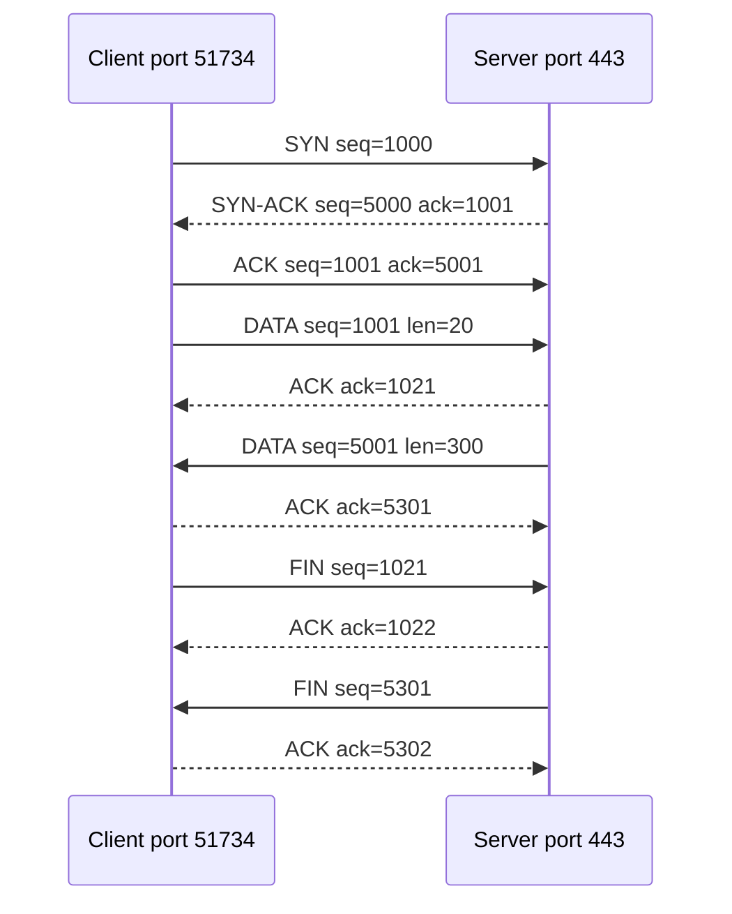

<!-- series:start -->
> [!series]- Networking · 4 of 11
> 1. [[networking/http-message|HTTP message]]
> 2. [[networking/request-lifecycle|Request lifecycle]]
> 3. [[networking/dns|DNS]]
> 4. **TCP** · you are here
> 5. [[networking/tls|TLS]]
> 6. [[networking/http-caching|HTTP caching]]
> 7. [[networking/origin|Origin]]
> 8. [[networking/cors|CORS]]
> 9. [[networking/cors-credentials|CORS and credentials]]
> 10. [[networking/cors-expose-headers|CORS exposed headers]]
> 11. [[networking/cors-lab|CORS lab]]
<!-- series:end -->

> [!tldr] In three lines
> The Transmission Control Protocol (TCP) turns the unreliable packet service of IP into a reliable, ordered stream of bytes between two ports. It needs a three-way handshake, which costs 1 RTT, before any data moves. It does not encrypt anything, so TLS runs on top of it.
>
> [[#Interview questions|→ Self-test: 6 questions]]

## Why it exists

The network moves packets, not streams. A packet can be lost, delayed, duplicated or delivered out of order, and it can be dropped by a router with no notice. A web page or a database query needs every byte, in the right order, exactly once. Each application would otherwise have to solve these problems itself.

TCP solves them once, in the operating system. The application writes bytes to a socket and reads bytes from it. It never sees the packets, the losses or the reordering.

## Picture



*The three-way handshake, then data with sequence numbers, then the close.*

## Plain version

TCP is like a phone call compared with sending postcards.

A phone call starts with a dial and an answer. Both sides confirm they can hear each other ("hello?" "yes, hello"). Then the talk runs in order. If a word is lost on a bad line, the listener says "sorry, say that again" and the speaker repeats it. The call ends with a goodbye from each side.

Postcards arrive in any order, and some never arrive. Someone has to number them, check which ones are missing and ask for copies. TCP does that work for the application.

## Precise definition

TCP is the transport protocol that gives an application a reliable, ordered byte stream over IP. The terms it uses are listed below.

> [!info]- Terms reference
> | Term | Definition | Where it's used |
> |---|---|---|
> | Segment | One TCP unit: a header plus a chunk of data, carried inside one IP packet | Every TCP message |
> | Port | A 16-bit number that picks the application on a machine. Servers listen on well-known ports, such as 443 for HTTPS | Destination port in the header |
> | Socket | The pair of an IP address and a port. A connection is identified by the two sockets, the four-tuple of source IP, source port, destination IP and destination port | `connect()`, `accept()` |
> | Ephemeral port | A temporary port the client picks for its side of the connection, usually from a high range | Client side of every connection |
> | Sequence number | The position of the first data byte in a segment within the byte stream, counted from the initial sequence number (ISN) | Ordering and loss detection |
> | Acknowledgment number | The next byte the receiver expects. It acknowledges everything before it | Confirming delivery |
> | SYN, ACK, FIN, RST | Control flags: open, acknowledge, close politely, abort | Handshake, data, closing |
> | Window | How many bytes the receiver can accept now, advertised in each segment | Flow control |
> | RTO (retransmission timeout) | How long the sender waits for an ACK before sending the data again | Recovery from loss |
> | Flow control | Stops the sender from overwhelming the receiver's buffer | Window field |
> | Congestion control | Stops the sender from overwhelming the network. It slows down when loss or delay shows congestion | Slow start, congestion avoidance |
> | RTT (round-trip time) | Time from sending a segment to receiving its ACK | Timing for retransmission and cost of each step |

## How it works

1. **Pick the ports.** The client chooses an ephemeral port, such as 51734. The server listens on port 443.
2. **Client sends SYN.** It sends a segment with the SYN flag set and its random initial sequence number, for example `seq=1000`. The SYN uses one sequence number even though it carries no data.
3. **Server answers SYN-ACK.** It sends its own SYN with its ISN, for example `seq=5000`, and acknowledges the client's SYN with `ack=1001`, the next byte it expects.
4. **Client sends ACK.** It acknowledges the server's SYN with `ack=5001`. The connection is now open, and data can flow in both directions. This is the 1 RTT cost.
5. **Send data with sequence numbers.** The client sends its request bytes. Each segment carries the sequence number of its first byte. The receiver buffers out-of-order data and acknowledges the next byte it is missing.
6. **Recover from loss.** If an ACK does not arrive before the RTO, the sender resends the segment. Three duplicate ACKs for the same byte trigger a fast retransmit, before the timer expires.
7. **Control the rate.** The window field limits how much the sender may have in flight, which is flow control. The sender also limits its rate using congestion control, which starts slowly and grows the rate while the network is not dropping packets.
8. **Close.** Each side sends a FIN when it has no more data. The other side ACKs it. A FIN uses one sequence number, like a SYN. A RST segment aborts the connection at once, for example when a port is closed.

### Why three messages

Both sides need to pick a starting number and confirm that the other side received it. The client's SYN confirms its number to the server. The server's SYN-ACK confirms the client's number and sends the server's number. The client's ACK confirms the server's number. Two messages would leave the server unable to know whether the client ever saw its own number. Three is the smallest exchange that does both directions.

### Flow control and congestion control

These two are often mixed up.

- **Flow control** protects the receiver. The receiver advertises its free buffer space in the window field. The sender never has more unacknowledged data in flight than that window.
- **Congestion control** protects the network. The sender keeps a separate congestion window. It grows the window while ACKs arrive, and cuts it when loss or rising delay shows that a link is full. RFC 5681 describes slow start and congestion avoidance.

The sender may send only up to the smaller of the two windows.

### Keep-alive and connection reuse

Opening a TCP connection costs a handshake. Keeping a connection open lets the next request skip that cost. HTTP/1.1 uses persistent connections by default, and sends one request after another on the same connection. HTTP/2 sends many requests at once on one connection. Idle connections are closed after a timeout.

## The real thing

The first segment of a connection, the SYN, dumped as the fields of the TCP header. The values are illustrative. Real initial sequence numbers are random, and real options vary by operating system.

```
TCP header (SYN, client -> server)
  Source port:       51734
  Destination port:  443
  Sequence number:   1000
  Ack number:        0          (not used, because ACK flag is 0)
  Data offset:       10         (10 x 4 = 40 bytes of header)
  Reserved:          0
  Flags:             SYN
  Window size:       64240
  Checksum:          0x3c1a
  Urgent pointer:    0
  Options:           MSS 1460, SACK permitted, Timestamps, NOP, Window scale 7
```

Field table for the header format from RFC 9293, section 3.1:

> [!info]- Header field reference
> | Field | Size | Value in the example | What it means |
> |---|---|---|---|
> | Source port | 16 bits | 51734 | The client's ephemeral port |
> | Destination port | 16 bits | 443 | The server's listening port |
> | Sequence number | 32 bits | 1000 | Position of the first data byte, or the ISN in a SYN |
> | Acknowledgment number | 32 bits | 0 | The next byte expected. Only valid when the ACK flag is set |
> | Data offset | 4 bits | 10 | Length of the header in 32-bit words. Ten words means 40 bytes, including options. The minimum is 5 words, or 20 bytes |
> | Reserved | 4 bits | 0 | Must be zero |
> | Flags | 8 bits | SYN | Control bits: CWR, ECE, URG, ACK, PSH, RST, SYN, FIN, in that order |
> | Window size | 16 bits | 64240 | Free receive buffer in bytes. Scaled by the window scale option |
> | Checksum | 16 bits | 0x3c1a | Covers the header, the data and a pseudo-header with the IP addresses |
> | Urgent pointer | 16 bits | 0 | Used only with the URG flag. Rarely used today |
> | Options | 0 to 40 bytes | MSS 1460 and others | Extra settings. MSS is the largest segment size. SACK lets the receiver report gaps. Timestamps help measure RTT. Window scale raises the window above 65535 bytes |

The fixed part of the header is 20 bytes. The data offset field allows up to 60 bytes in total, which leaves room for options.

## Common misconceptions

- **Wrong:** TCP encrypts the data.
  **Right:** TCP sends the bytes exactly as written. Anyone on the path can read them and change them. Encryption comes from TLS, which runs on top of TCP. (See [[networking/tls|TLS]].)
- **Wrong:** TCP guarantees delivery no matter what happens.
  **Right:** TCP retransmits lost data, but only while the path works. If the network stays broken, the sender gives up after a timeout and the application gets an error.
- **Wrong:** One TCP connection equals one HTTP request.
  **Right:** A connection can carry many requests, one after another with keep-alive, or at the same time with HTTP/2 multiplexing.
- **Wrong:** The handshake is free because it happens in the background.
  **Right:** The client cannot send its request until the handshake finishes. On a link with a 100 ms RTT, the handshake alone costs 100 ms before the first byte of the request is sent.

## Interview questions

> [!question]- Q1. How does TCP provide reliability?
> The sender numbers each byte with a sequence number. The receiver acknowledges the next byte it expects, and it buffers out-of-order data. The sender retransmits any segment that is not acknowledged before its timer expires, and it retransmits early after three duplicate ACKs. The receiver uses the sequence numbers to put the bytes back in order before passing them to the application.

> [!question]- Q2. Walk through the three-way handshake. Why three messages?
> The client sends SYN with its initial sequence number. The server replies with SYN-ACK, which carries its own initial sequence number and acknowledges the client's. The client sends ACK, which acknowledges the server's number. Three messages let both sides confirm the other's starting number. With two, the server could not know that the client received its own number.

> [!question]- Q3. What is the difference between flow control and congestion control?
> Flow control protects the receiver. The receiver advertises its free buffer in the window field, and the sender stays within it. Congestion control protects the network. The sender limits its rate based on loss and delay signals, using a congestion window that grows slowly and shrinks on loss.

> [!question]- Q4. Why does connection reuse matter for web pages?
> Each new connection costs a handshake, and HTTPS adds a TLS handshake on top. A page with many requests to one host benefits when those requests share one connection. Keep-alive lets HTTP/1.1 send requests one after another on the same connection, and HTTP/2 can run them at the same time.

> [!question]- Q5. When would you choose UDP over TCP?
> When the application can tolerate loss or prefers a fresh packet over a late one, and when the handshake cost matters. Live video and voice, games and DNS queries are common cases. The application then handles any retries or ordering it needs. QUIC builds reliability on top of UDP for this reason.

> [!question]- Q6. Does TCP encrypt the data?
> No. TCP provides ordering and reliability only. Encryption and authentication come from TLS, which runs inside the TCP stream.

## Trigger card

> [!example] When I see a slow first byte from a host I have not used recently, it means the setup cost is in TCP, because the handshake takes one round trip before any request can be sent.

## Compared with

| | TCP | UDP |
|---|---|---|
| Connection | Handshake first, then a connection | No connection, each datagram stands alone |
| Reliability | Retransmits lost data | No retransmission. The application handles loss |
| Order | Delivers bytes in order | Delivers datagrams as they arrive, possibly out of order |
| Header size | 20 bytes minimum | 8 bytes |
| Flow and congestion control | Yes | No, the application must add it |
| Typical uses | Web pages, APIs, databases, mail | DNS queries, video calls, games, QUIC |
| Latency cost | 1 RTT to open | None |

## Where it's used

- **HTTP/1.1 and HTTP/2.** Browsers, `curl` and servers exchange HTTP over TCP connections, with TLS on top for HTTPS.
- **Databases.** PostgreSQL, MySQL and Redis clients connect over TCP.
- **SSH, SMTP and IMAP.** Remote shells and mail delivery and access run over TCP.
- **File transfer.** SFTP runs over SSH, which runs over TCP.
- **HTTP/3 is the exception.** It uses QUIC over UDP, which builds its own reliability and encryption instead of using TCP.

> [!info]- Sources
> - study session, 2026-10-30
> - RFC 9293, Transmission Control Protocol (TCP)
> - RFC 5681, TCP Congestion Control
> - RFC 768, User Datagram Protocol

<!-- series-nav:start -->
---

← [[networking/dns|DNS]] · [[networking/tls|TLS]] →
<!-- series-nav:end -->
