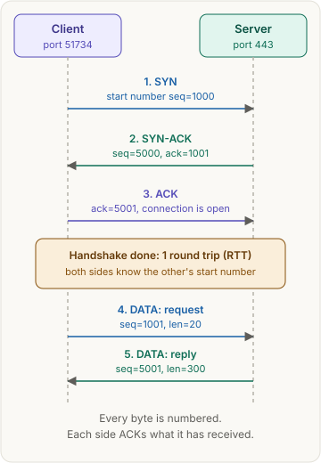
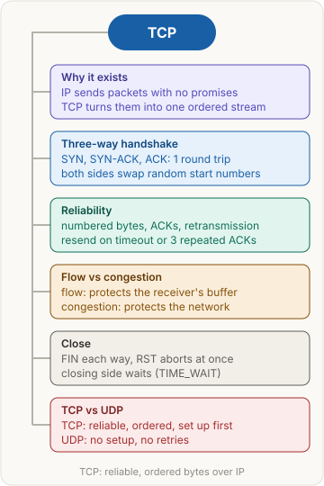

<!-- series:start -->
> [!series]- Networking · 5 of 9
> 1. [[networking/revision|Networking quick revision]]
> 2. [[networking/http-message|HTTP message]]
> 3. [[networking/request-lifecycle|Request lifecycle]]
> 4. [[networking/dns|DNS]]
> 5. **TCP and UDP** · you are here
> 6. [[networking/tls|TLS and HTTPS]]
> 7. [[networking/http-caching|HTTP caching]]
> 8. [[networking/origin|Origin]]
> 9. [[networking/cors|CORS]]
<!-- series:end -->

> [!abstract] What this page is for
> **Intent:** explain what TCP does under every web request, and answer the TCP and UDP questions interviewers ask most.
> **You'll learn:** what IP does underneath · ports · the three-way handshake · reliability · flow and congestion control · closing · SYN floods · TCP vs UDP.
> **Time:** about 8 minutes. Every section has a longer version on the [[networking/deep/tcp|detailed TCP page]].

## Words you need first

- **IP (Internet Protocol):** the delivery system of the internet. It moves small pieces called **packets** between machine addresses, and it makes no promises. A packet can be lost, delayed or arrive out of order.
- **TCP (Transmission Control Protocol):** a layer on top of IP. It turns unreliable packets into one reliable stream of bytes, in order, with no gaps.
- **Port:** a number from 0 to 65535 that picks the program on a machine that gets the data. HTTPS servers listen on port 443.
- **Socket:** the program's handle for one connection. The app writes bytes into it and reads bytes from it.
- **Segment:** one TCP message: a small header plus some data, carried inside one IP packet.
- **Sequence number (seq):** the position of a segment's first byte in the stream.
- **ACK (acknowledgment):** a reply that says "I have everything before byte N, send N next." Written `ack=N`.
- **SYN, FIN, RST:** segment flags. SYN opens a connection, FIN closes it politely, RST aborts it at once.
- **RTT (round-trip time):** the time for a message to reach the other side and the reply to return.
- **TLS (Transport Layer Security):** the encryption layer under HTTPS.
- **UDP (User Datagram Protocol):** the other common transport. It sends single messages with no setup and no retries.
- **QUIC and HTTP/3:** QUIC is a newer transport built on UDP. HTTP/3 is the newest HTTP version, and it runs over QUIC.

## Why it exists

IP moves packets, not streams. A web page or a database query needs every byte, in order, exactly once. TCP solves that once, in the operating system. The app writes bytes to a socket and reads bytes back. It never sees a lost packet.

## The picture

## How it works, with an example

Your phone app calls `api.shop.com` over HTTPS, which means port 443.

1. **Ports.** The phone picks a temporary port for its side, say 51734. The server listens on 443.
2. **Handshake.** The phone sends SYN with a random start number, `seq=1000`. The server replies SYN-ACK with its own start number, `seq=5000`, and `ack=1001`. The phone replies ACK with `ack=5001`. The connection is open.
3. **Data.** The request bytes are numbered from 1001. The server ACKs them, then sends the reply, numbered from 5001.
4. **Reliability.** If an ACK does not arrive in time, the sender sends the data again.
5. **Close.** When a side has no more data, it sends FIN, and the other side ACKs it.

The handshake costs one round trip. With a 100 ms RTT, the request leaves the phone about 100 ms after the first SYN.

## The most common mistake

> [!warning] TCP does not encrypt anything
> The bytes travel as written, so anyone on the path can read them. Encryption comes from TLS, which runs on top of TCP.

## The three-way handshake

Three messages: SYN, SYN-ACK, ACK. Each side picks a random start number and tells the other side. The client's SYN carries its number. The server's SYN-ACK acknowledges it and carries the server's number. The client's ACK acknowledges the server's number. Two messages would leave the server unsure the client got its number.

## How TCP stays reliable

- **Numbers.** Every byte has a sequence number, so the receiver can spot gaps and put bytes in order.
- **Acknowledgments.** The receiver ACKs the next byte it expects. Early data waits until the gap fills.
- **Retransmission.** If no ACK comes before a timer runs out, the sender resends. Three repeated ACKs for the same byte trigger an early resend.
- **Flow control, in plain words.** The receiver says how much room its buffer has, in the window field. The sender never sends more than that. This protects the receiver.
- **Congestion control, in plain words.** When packets are lost, the network is probably full, so the sender slows down, then speeds up slowly. This protects the network.

The detailed page gives the exact timer and window rules.

## TCP vs UDP

| | TCP | UDP |
|---|---|---|
| Setup | Handshake first, 1 RTT | None. Each message stands alone |
| Lost data | Retransmitted | Never retransmitted. The app decides |
| Order | Bytes arrive in order | Messages arrive as they come |
| Flow and congestion control | Built in | None |
| Header size | 20 bytes minimum | 8 bytes |
| Typical uses | Web pages, APIs, databases, email | Video calls, games, DNS, QUIC and HTTP/3 |

**Use TCP** when every byte must arrive: web pages, API responses, downloads, database traffic.

**Use UDP** when a late message is worse than a lost one:

- **Video and voice calls:** a frame two seconds late is useless, so the app skips it.
- **Games:** the newest player position matters more than the old one.
- **DNS:** one small question and one small answer. A handshake would cost more than the lookup.
- **QUIC and HTTP/3:** QUIC runs over UDP so it can build its own encryption and avoid TCP's stall, where one lost packet holds up every later byte.

## Say it in an interview

> "TCP gives an application a reliable, ordered byte stream over IP. IP delivers packets with no promises, so TCP numbers every byte, acknowledges what arrives and retransmits what doesn't. Before data flows, it does a three-way handshake, SYN, SYN-ACK, ACK, which costs one round trip and exchanges random start numbers. Flow control keeps the sender within the receiver's buffer. Congestion control slows the sender when the network drops packets. UDP skips all of that, so it fits where a late packet is worse than a lost one, such as video calls, games, DNS and QUIC."

## Questions interviewers ask

Tap a question to see the answer.

> [!question]- What is TCP, and what does IP do underneath?
> IP delivers packets between addresses with no guarantees. TCP gives the app a reliable, ordered stream of bytes.

> [!question]- Walk through the three-way handshake. Why three messages?
> SYN carries the client's start number. SYN-ACK carries the server's start number and acknowledges the client's. ACK acknowledges the server's. Both sides confirm each other's number.

> [!question]- How does TCP stay reliable?
> Every byte is numbered. The receiver ACKs the next byte it expects and reorders what arrives. The sender resends anything not ACKed before a timer runs out, or early after three repeated ACKs.

> [!question]- Flow control vs congestion control?
> Flow control protects the receiver: the sender stays within the advertised window. Congestion control protects the network: the sender slows when packets are lost.

> [!question]- How does a connection close?
> Each side sends FIN when it has nothing more to send, and the other side ACKs it. RST is the abort: it ends the connection at once.

> [!question]- What is a port, and what is a socket?
> A port is a number that picks the program on a machine. A socket is the program's handle for one connection.

> [!question]- TCP vs UDP?
> TCP sets up a connection, retransmits lost data and delivers bytes in order. UDP sends independent messages with no setup, no retries and no ordering.

> [!question]- When would you choose UDP?
> When a late packet is worse than a lost one, such as video calls, games and DNS. The app adds only the reliability it needs. QUIC uses UDP for this reason.

> [!question]- Does TCP encrypt data?
> No. Encryption comes from TLS, which runs inside the TCP stream.

> [!question]- What is a SYN flood?
> An attack where many SYNs arrive, often with fake addresses, and the handshake is never finished. The server keeps a half-open entry for each until its queue fills. SYN cookies are the defense: the server stores no state until a valid final ACK comes back.

## Mental map

## Watch

PowerCert Animated Videos, short video: TCP vs UDP, with the handshake, reliability and when each one is used.

**Want more?** The [[networking/deep/tcp|detailed TCP page]] has the same sections with raw headers, exact timers, TIME_WAIT, SYN cookies and harder questions.

<!-- series-nav:start -->
---

← [[networking/dns|DNS]] · [[networking/tls|TLS and HTTPS]] →
<!-- series-nav:end -->
