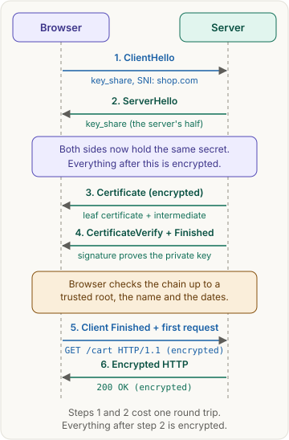
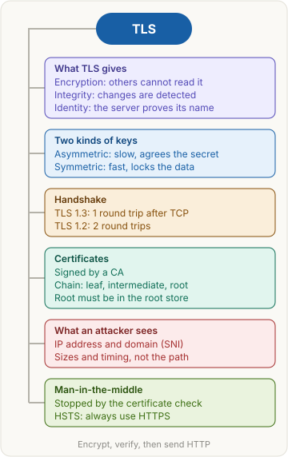

<!-- series:start -->
> [!series]- Networking · 6 of 9
> 1. [[networking/revision|Networking quick revision]]
> 2. [[networking/http-message|HTTP message]]
> 3. [[networking/request-lifecycle|Request lifecycle]]
> 4. [[networking/dns|DNS]]
> 5. [[networking/tcp|TCP and UDP]]
> 6. **TLS and HTTPS** · you are here
> 7. [[networking/http-caching|HTTP caching]]
> 8. [[networking/origin|Origin]]
> 9. [[networking/cors|CORS]]
<!-- series:end -->

> [!abstract] What this page is for
> **Intent:** understand what HTTPS adds to HTTP, how the TLS handshake works, and answer the common TLS and certificate interview questions.
> **You'll learn:** the three guarantees · symmetric vs asymmetric · the TLS 1.3 handshake · certificates and trust · what an attacker sees · man-in-the-middle.
> **Time:** about 7 minutes. The longer version is on the [[networking/deep/tls|detailed TLS page]].

## Words you need first

- **HTTPS**: HTTP sent over TLS. The same requests and replies travel inside an encrypted tunnel.
- **TLS (Transport Layer Security)**: the protocol that encrypts a connection. It runs on top of [[networking/tcp|TCP]] (the reliable byte stream) and under HTTP. Its older name is SSL.
- **Symmetric encryption**: one shared key locks and unlocks the data. It is fast, so it handles big downloads. AES is the usual example.
- **Asymmetric encryption** (public-key): each side has a private value it keeps and a public value it shares. Each side combines its own private value with the other side's public value, and both get the same secret. The private values never travel. It is slow, so TLS uses it only at the start.
- **Certificate**: a signed ID card for a server. It names the host, such as `shop.com`, and holds the server's public key.
- **CA (Certificate Authority)**: an organization that checks a server owns its name, then signs its certificate.
- **RTT (round trip time)**: one message to the other side and the reply back. For example, 100 ms.
- **Man-in-the-middle (MITM)**: an attacker who sits between the client and the server and reads or changes the traffic.

## Why it exists

Plain HTTP sends bytes as they are. Anyone on the path can read or change them, such as the Wi-Fi owner or a router. A plain connection also does not show who answered.

Say a user on coffee-shop Wi-Fi logs in to `shop.com`. Without TLS, the person on the same network reads the password, or sends a fake login page while pretending to be `shop.com`.

TLS gives three guarantees:

1. **Encryption:** others cannot read the bytes.
2. **Integrity:** a changed byte is detected, and the connection fails.
3. **Server identity:** the server proves it owns `shop.com`.

## The picture



## How it works, with an example

The user types `https://shop.com/cart`. DNS and TCP are already done. Now TLS starts.

1. **ClientHello.** The browser sends the TLS versions it supports, its cipher options and a **key share** (its public value for the secret). It also sends `shop.com` in plain text, in a field called SNI (Server Name Indication). SNI lets one IP address serve many sites.
2. **ServerHello.** The server replies with its own key share. Both sides compute the same secret. Everything after this is encrypted.
3. **Certificate.** The server sends its certificate and proves it holds the matching private key.
4. **Check.** The browser checks the certificate. If it passes, the browser sends **Finished**, and the first request goes out encrypted: `GET /cart`.

In plain words: two people agree on a secret over a public phone line, then talk privately with it.

## The most common mistake

> [!warning] HTTPS hides the page, not the visit
> The path, query string, headers and body are encrypted. The network still sees the **IP address**, the **domain name** (in SNI and in the DNS lookup) and the **size and timing** of packets. Encryption is not anonymity.

## The handshake

TLS 1.3 needs **1 round trip** after TCP. The client sends its key share in the first TLS message. The server answers with its key share, and the client sends Finished together with its first HTTP request. For a new connection, that means 1 RTT for TCP plus 1 RTT for TLS before the request leaves. With an RTT of 100 ms, that is 200 ms.

TLS 1.2 needs **2 round trips**, because the client waits for the server's key data before it sends its own key. That extra wait is why TLS 1.3 is faster.

Why TLS uses both kinds of encryption:

- **Asymmetric math** is slow, but it lets strangers agree on a secret over a public line. TLS runs it once per connection.
- **Symmetric encryption** is fast, so the agreed secret locks all the data.
- The temporary agreement keys are thrown away after the session. This is **forward secrecy**: a later leak of the server's long-term key does not expose old sessions.

## Certificates and trust

A certificate says: "this public key belongs to `shop.com`, and I, the CA, vouch for it until this date."

Browsers and operating systems ship with a list of trusted root CAs, the **root store**. The server sends a chain that leads from its certificate up to a root:

```
Root CA            (in the browser's root store)
  signs
Intermediate CA    (signs the day-to-day certificates)
  signs
shop.com leaf      (sent by the server)
```

The browser checks that every signature is valid and the chain ends at a trusted root, that `shop.com` is in the certificate, that today is within the validity dates, and that the server signed the handshake with the matching private key.

**Man-in-the-middle:** the attacker can relay bytes, but cannot get a trusted CA to certify `shop.com` for them, and cannot sign the handshake without the real private key. The browser shows an error.

**HSTS (HTTP Strict Transport Security):** a header such as `Strict-Transport-Security: max-age=31536000`. It tells the browser to use HTTPS only for that domain for a year, so an attacker cannot push a plain `http://` version.

A certificate proves only that a trusted CA checked that the server controls the name. It does not prove the site is honest.

## Say it in an interview

> "HTTPS is HTTP over TLS. TLS gives encryption, integrity and server identity. It uses public-key math once to agree on a secret, then symmetric encryption for the data, because that's much faster. In TLS 1.3 the handshake takes one round trip after TCP: the client sends its key share and SNI, the server replies with its key share and certificate, and the client checks the chain up to a trusted root. The CA's signature is what stops a man-in-the-middle. An attacker on the network still sees the IP address, the domain name in SNI, and the sizes and timing."

## Questions interviewers ask

> [!question]- What does TLS give you?
> Encryption, so others can't read the data. Integrity, so changes are detected. Server identity, so the client knows it talks to the real owner of the name.

> [!question]- What is HTTPS?
> HTTP sent over TLS, with the same messages inside.

> [!question]- Why does TLS use both symmetric and asymmetric encryption?
> Asymmetric (public-key) math lets two sides agree on a secret over a public channel, but it is slow. Symmetric encryption is fast. TLS uses the slow one once, then the fast one for the data.

> [!question]- How many round trips does the TLS 1.3 handshake take?
> One after TCP. The client sends its key share first, and the server replies with its key share. TLS 1.2 needs two.

> [!question]- What is a certificate?
> A signed document that binds a public key to one or more host names, with validity dates. A certificate authority (CA) signs it.

> [!question]- What is the chain of trust?
> The server's certificate is signed by an intermediate CA, which is signed by a root CA. The root is in the browser's or operating system's root store, so the browser can trust the whole chain.

> [!question]- What does the client check on a certificate?
> The signatures up to a trusted root, that the host name matches, that the date is valid, and that the server proved it holds the private key.

> [!question]- How do certificates stop a man-in-the-middle?
> The attacker can't get a trusted CA to certify the real name, and can't sign the handshake without the real private key. So the client sees a bad certificate and refuses to connect.

> [!question]- What can someone on the network still see in HTTPS?
> The IP address, the domain name (in SNI and often in the DNS lookup), and the size and timing of packets. They can't see the path, headers or body.

> [!question]- What is HSTS?
> A response header that tells the browser to use HTTPS only for that domain for a set time. It stops a downgrade to plain HTTP.

## Mental map



## Watch


Computerphile, about 17 minutes: how a TLS handshake sets up an encrypted connection between client and server.

**Want more?** The [[networking/deep/tls|detailed TLS page]] adds raw handshake messages, certificate rules, session resumption, 0-RTT and harder questions.

<!-- series-nav:start -->
---

← [[networking/tcp|TCP and UDP]] · [[networking/http-caching|HTTP caching]] →
<!-- series-nav:end -->
