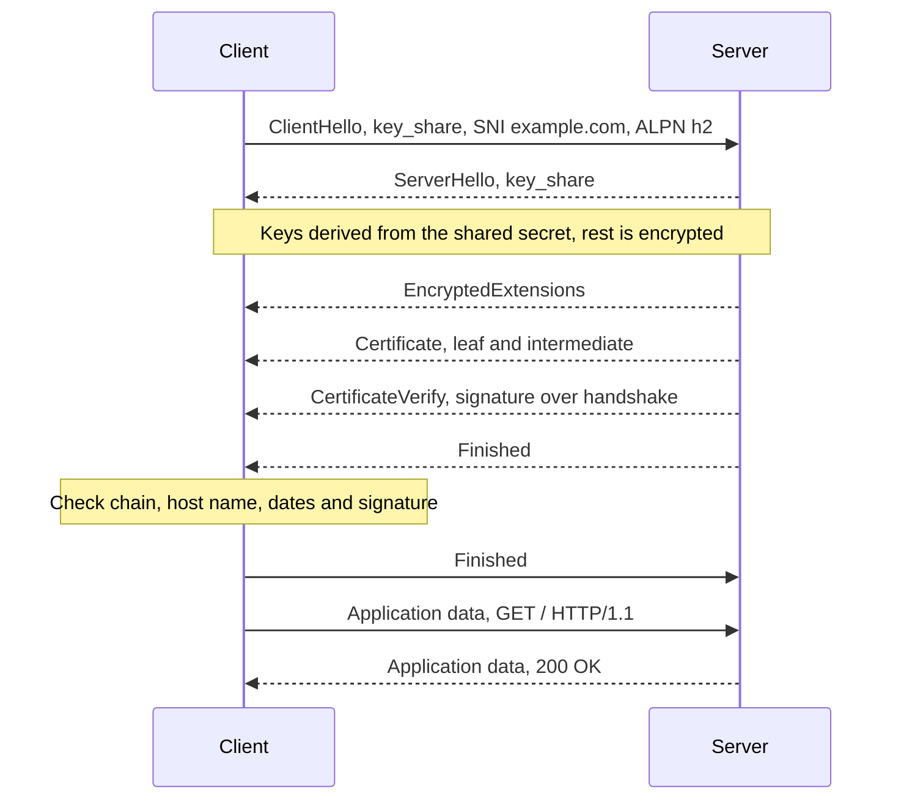
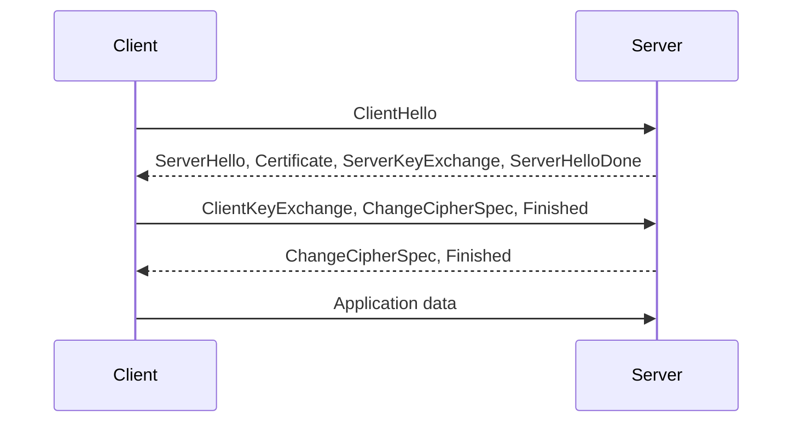

<!-- series:start -->
> [!series]- Networking · 5 of 11
> 1. [[networking/http-message|HTTP message]]
> 2. [[networking/request-lifecycle|Request lifecycle]]
> 3. [[networking/dns|DNS]]
> 4. [[networking/tcp|TCP]]
> 5. **TLS** · you are here
> 6. [[networking/http-caching|HTTP caching]]
> 7. [[networking/origin|Origin]]
> 8. [[networking/cors|CORS]]
> 9. [[networking/cors-credentials|CORS and credentials]]
> 10. [[networking/cors-expose-headers|CORS exposed headers]]
> 11. [[networking/cors-lab|CORS lab]]
<!-- series:end -->

> [!tldr] In three lines
> Transport Layer Security (TLS) runs inside a TCP connection and gives three guarantees: the bytes are encrypted, they cannot be changed without detection, and the server has proved it is the owner of its domain name. HTTPS is HTTP sent over TLS. TLS 1.3 finishes its handshake in 1 RTT after TCP.
>
> [[#Interview questions|→ Self-test: 6 questions]]

## Why it exists

TCP delivers bytes exactly as they were written, and anyone on the path can read them. Routers, Wi-Fi hotspots, internet providers and malicious software can all see the bytes. They can also change them, and a plain connection does not reveal whether the other end is the real server or an impostor.

TLS fixes all three problems at once. Think of a sealed letter sent through the post. The seal stops others from reading it, a broken seal shows it was tampered with, and a signature from a notary the reader trusts shows who really wrote it.

## Picture



*The TLS 1.3 handshake. The client's first HTTP request can ride with its Finished, so the handshake costs one round trip.*

## Plain version

Two people want to talk privately, but the phone line is public and one of them has never heard the other's voice.

First, they agree on a secret without saying it out loud. Each side makes a random private number, sends a public value derived from it, and both compute the same secret. An eavesdropper hears the public values but cannot work out the secret. That step is key exchange.

Next, the secret protects everything they say with fast locking and unlocking. That step is symmetric encryption.

Last, the server shows an ID card signed by an office the client already trusts. The client checks the signature and checks that the name on the card matches the name it dialled. That step is authentication.

## Precise definition

TLS is the protocol that secures a TCP byte stream with encryption, integrity and server authentication. The terms it uses are listed below.

> [!info]- Terms reference
> | Term | Definition | Where it's used |
> |---|---|---|
> | TLS | A protocol that secures a byte stream with encryption, integrity and authentication | Under HTTPS, SMTP, IMAP, database connections |
> | Handshake | The first part of a TLS connection, where the sides agree on settings and keys | Start of every TLS session |
> | Record layer | The framing that carries encrypted application data after the handshake | Every byte after the handshake |
> | Cipher suite | A named set of algorithms, such as `TLS_AES_128_GCM_SHA256` | Chosen in the handshake |
> | Key exchange | How both sides derive the same secret over a public channel. TLS 1.3 uses (EC)DHE, with ephemeral keys | ClientHello and ServerHello key_share |
> | Symmetric encryption | Encryption with one shared key, fast enough for bulk data. AES-GCM and ChaCha20-Poly1305 are examples | Record layer |
> | Forward secrecy | If the server's long-term key leaks later, past sessions stay secret, because each session used its own ephemeral key | TLS 1.3 by design |
> | Certificate | A signed document that binds a public key to one or more names, such as `example.com`. Uses the X.509 format | Certificate message |
> | Leaf certificate | The certificate for the server itself | Sent first in the Certificate message |
> | Intermediate CA | A certificate authority whose certificate is signed by the root and which signs leaf certificates | Between leaf and root |
> | Root CA | A trusted certificate authority whose certificate is pre-installed in the operating system or browser | Root store |
> | Root store | The list of trusted root certificates shipped with an operating system, browser or application | Certificate checks |
> | SNI (Server Name Indication) | The host name sent in plain text in the ClientHello, so one IP address can serve many certificates | ClientHello |
> | ALPN (Application-Layer Protocol Negotiation) | Lets the client and server agree on the next protocol, such as `h2` or `http/1.1` | ClientHello and ServerHello |
> | PSK and session ticket | A secret from an earlier session that lets a later connection skip parts of the handshake | Resumption |
> | 0-RTT | Sending application data in the first flight of a resumed connection | Resumption, with a replay risk |

## How it works

### TLS 1.3 in 1 RTT

1. **ClientHello.** After TCP is open, the client sends its supported TLS versions, its cipher suites, a random value, and a `key_share` with its ephemeral public key, for example for the X25519 curve. It also sends SNI with the host name and ALPN with the protocols it can speak.
2. **ServerHello.** The server picks a cipher suite and sends its own `key_share`. Both sides now compute the same shared secret from the two key shares. Everything after this message is encrypted with keys derived from that secret.
3. **EncryptedExtensions.** The server sends its chosen ALPN and other settings, encrypted.
4. **Certificate.** The server sends its leaf certificate and any intermediate certificates. The certificate contains the public key and the names it is valid for.
5. **CertificateVerify.** The server signs a hash of the whole handshake so far with the private key that matches the certificate. This proves it holds the key, and not only a copy of the certificate.
6. **Finished.** The server sends a message authentication code over the handshake, which proves it derived the same keys.
7. **Client checks.** The client verifies the chain of trust up to a trusted root, checks that the host name matches the certificate, checks the expiry dates, verifies the CertificateVerify signature, and verifies the server's Finished message.
8. **Client Finished.** The client sends its own Finished message. It can send its first HTTP request in the same flight, so no extra round trip is needed.

### The count of round trips

TCP costs 1 RTT, as described on [[networking/tcp|TCP]]. TLS adds to that:

- TLS 1.3 needs 1 RTT, because the client sends its key share in the first message and can send data with its Finished.
- TLS 1.2 needs 2 RTT, because the client waits for the server's key exchange and Finished before it sends its own key and Finished.

$$T_{TLS1.3} = 1\,\text{RTT}, \qquad T_{TLS1.2} = 2\,\text{RTT}$$

With RTT = 100 ms, TLS 1.3 adds 100 ms and TLS 1.2 adds 200 ms, before any HTTP request is sent. For a fresh connection with TCP and TLS 1.3, the total setup is:

$$T_{setup} = 1\,\text{RTT}_{TCP} + 1\,\text{RTT}_{TLS1.3} = 2\,\text{RTT} = 200\,\text{ms}$$

### TLS 1.2 handshake for comparison



### Certificates and the chain of trust

A certificate is a signed statement. The issuer signs the certificate's contents, which include the subject's name, the subject's public key, the names it covers and the validity dates. The client checks the signature with the issuer's public key. The issuer's own certificate is checked the same way, one level up, until the chain reaches a root that the client already trusts.

```
Root CA         (self-signed, in the root store)
  |  signs
Intermediate CA (signed by root, signs day to day)
  |  signs
Leaf certificate (for example.com, sent by the server)
```

- **Root CAs** are kept offline and rarely used. Their certificates are shipped with the operating system or browser.
- **Intermediates** do the daily signing. They can be revoked without replacing every root.
- **The leaf** names the host, for example in its Subject Alternative Name list. The client checks that the host it dialled appears there.

Trust is not granted to the server by the chain alone. The chain proves that a trusted authority vouches for the name. The CertificateVerify step proves that the server holds the private key.

### Key exchange and symmetric encryption

- **Key exchange** (ECDHE in TLS 1.3) uses public-key math. It is slow compared with symmetric encryption, so it runs only once per connection, and it produces a shared secret without sending that secret over the wire.
- **Symmetric encryption** (AES-GCM or ChaCha20-Poly1305) uses the shared key to encrypt and authenticate every record. It is fast enough for large downloads.

The ephemeral keys used for key exchange are thrown away after the session. That is what gives forward secrecy.

### 0-RTT resumption

After a first connection, the server can send a session ticket. A later connection can present that ticket and send early data in its first flight, which saves a round trip.

The risk is replay. An attacker who records the early data can send it again to the server, and the server cannot tell the copy from the original. For that reason, 0-RTT should carry only requests that are safe to repeat, such as an idempotent `GET` with no side effects. A payment or a form submission must not travel in 0-RTT data.

## The real thing

A summary of a TLS 1.3 connection from `openssl s_client`, trimmed. The CA names are fictional, and the session IDs are shortened.

```
$ openssl s_client -connect example.com:443 -servername example.com
CONNECTED(00000003)
depth=2 C = US, O = Example Root CA, CN = Example Root CA
verify return:1
depth=1 C = US, O = Example Intermediate, CN = Example TLS Issuer 1
verify return:1
depth=0 CN = example.com
verify return:1
---
Certificate chain
 0 s:CN = example.com
   i:C = US, O = Example Intermediate, CN = Example TLS Issuer 1
   a:PKEY: EC, (prime256v1) 256 bits
   v:NotBefore: Oct  1 00:00:00 2026 GMT; NotAfter: Dec 30 23:59:59 2026 GMT
---
Server certificate
subject=CN = example.com
issuer=C = US, O = Example Intermediate, CN = Example TLS Issuer 1
---
No client certificate CA names sent
Peer signing digest: SHA256
Peer signature type: ECDSA
Negotiated TLS1.3 group: X25519
---
SSL handshake has read 3412 bytes and written 1854 bytes
Verification: OK
---
New, TLSv1.3, Cipher is TLS_AES_256_GCM_SHA384
Server public key is 256 bit
Protocol: TLSv1.3
Cipher    : TLS_AES_256_GCM_SHA384
Session-ID: 6F1A...C9E2
Session-ID-ctx:
Resumption PSK: ...
TLS session ticket lifetime hint: 7200 (seconds)
Verify return code: 0 (ok)
```

> [!info]- openssl output reference
> | Line | Field | What it means |
> |---|---|---|
> | `CONNECTED(00000003)` | Connection | The TCP connection opened. The number is the file descriptor used by the tool |
> | `depth=2` to `depth=0` | Chain position | Depth 0 is the leaf. Depth 2 is the root. The chain is checked from the root down |
> | `verify return:1` | Check result | Each level passed the check. 1 means success |
> | `0 s:` | Subject | The name the leaf certificate was issued to, here `example.com` |
> | `i:` | Issuer | The authority that signed the certificate. It matches the next certificate in the chain |
> | `a:PKEY: EC` | Key type | The server's public key is an elliptic-curve key of 256 bits |
> | `v:NotBefore` and `NotAfter` | Validity | The certificate is valid only within these dates |
> | `Peer signature type: ECDSA` | Signature | The algorithm the server used for CertificateVerify |
> | `Negotiated TLS1.3 group: X25519` | Key exchange | The curve for the ephemeral key exchange, the key_share |
> | `SSL handshake has read 3412 bytes` | Size | Bytes received during the handshake, including the certificates |
> | `Verification: OK` | Result | Chain, host name and signature checks all passed |
> | `New, TLSv1.3` | Version | A new session with TLS 1.3 |
> | `Cipher: TLS_AES_256_GCM_SHA384` | Cipher suite | AES-256 in GCM mode for the records, SHA-384 for the handshake hash |
> | `Session-ID` and `Resumption PSK` | Resumption data | Values the client can use to resume the session later |
> | `session ticket lifetime hint: 7200` | Ticket lifetime | The server suggests the client keep the ticket for 2 hours |
> | `Verify return code: 0 (ok)` | Final result | No verification errors. A non-zero code names the failure |

## Common misconceptions

- **Wrong:** TLS only encrypts the data.
  **Right:** TLS also checks that the data was not changed, and it proves the server's identity with a certificate and a signature. Encryption without authentication would let an attacker sit in the middle, and the connection would be encrypted to the attacker.
- **Wrong:** HTTPS hides which site you visit.
  **Right:** HTTPS hides the path and the content of the request and response. The host name appears in SNI in plain text in TLS 1.3 unless Encrypted Client Hello is used, which is not yet universal. The IP address and the DNS lookup are usually visible too.
- **Wrong:** The padlock means the site is safe.
  **Right:** The padlock means the connection is encrypted and the certificate is valid for the host shown. The site can still be malicious or hacked.
- **Wrong:** A certificate proves the server is trustworthy.
  **Right:** A certificate proves that a trusted authority checked that the server controls a name, at the time it was issued. It says nothing about the server's behaviour.

## Interview questions

> [!question]- Q1. What three guarantees does TLS provide?
> Confidentiality: the bytes are encrypted, so an observer cannot read them. Integrity: each record carries an authentication tag, so a change is detected. Authentication: the server proves that it holds the private key for a certificate that a trusted authority issued for the host name.

> [!question]- Q2. Describe the TLS 1.3 handshake and count the round trips.
> The client sends ClientHello with its key share and SNI. The server replies with ServerHello and its key share, and both sides derive the keys. The rest of the server's messages are encrypted: EncryptedExtensions, Certificate, CertificateVerify and Finished. The client checks the chain and the signature, then sends its Finished. That is one round trip after TCP, because the client's first HTTP request can ride with its Finished.

> [!question]- Q3. How does a browser decide that a certificate is trusted?
> It builds a chain from the leaf up to a root certificate. Each certificate must be signed by the next one up, and the chain must end at a root in the browser or operating system root store. The client also checks that the host name matches a name in the leaf, that the dates are valid, and, where the client supports revocation checks, that the certificate has not been revoked.

> [!question]- Q4. What is forward secrecy, and why does TLS 1.3 always provide it?
> Forward secrecy means that a later leak of the server's long-term key does not expose past sessions. TLS 1.3 uses only ephemeral key exchange. Each session derives its own keys from fresh key shares, which are discarded afterwards. TLS 1.2 still allowed static RSA key exchange, where the session key is encrypted with the server's long-term key, so a later leak exposes the recorded sessions. TLS 1.3 removed that option.

> [!question]- Q5. What is 0-RTT, and what is its risk?
> 0-RTT lets a returning client send application data in its first flight, using a session ticket from an earlier connection. That saves one round trip. The risk is replay: an attacker can record that early data and send it again, and the server may process it twice. So 0-RTT is limited to requests that are safe to repeat.

> [!question]- Q6. Does HTTPS hide the domain name from the network?
> Not fully. The IP address is visible. The DNS lookup is often plain text. The host name appears in SNI during the handshake, unless Encrypted Client Hello is used. What HTTPS does hide is the path, the query string, the headers and the body.

## Trigger card

> [!example] When I see a certificate error in the browser, it means the handshake stopped before any HTTP request was sent, because the client could not verify the chain, the host name or the dates.

## Compared with

| | TLS 1.2 | TLS 1.3 |
|---|---|---|
| Round trips after TCP | 2 RTT | 1 RTT |
| Key exchange | Ephemeral (ECDHE) or static RSA | Ephemeral only, so forward secrecy is always on |
| Early data (0-RTT) | Not part of TLS 1.2 | Supported, with replay risk |
| Weak ciphers | Some allowed | Removed, all suites are AEAD with modern hashes |
| Status | Still common, but older | Current recommended version |

| | Symmetric encryption | Key exchange |
|---|---|---|
| Key | One shared key | Each side has a private and a public value |
| Speed | Fast, for bulk data | Slow, used once per connection |
| Example | AES-GCM | ECDHE with X25519 |
| Output | Ciphertext | A shared secret, never sent |

## Where it's used

- **HTTPS.** Browsers, `curl`, mobile apps and API clients use TLS for every HTTPS request.
- **Databases.** PostgreSQL, MySQL and Redis accept TLS connections for remote clients.
- **Email.** SMTP and IMAP use TLS, either from the start on a dedicated port or by upgrading an open connection with STARTTLS.
- **Messaging and IoT.** MQTT brokers often require TLS to protect device credentials and data.
- **VPN-like tunnels and proxies.** Many tools use TLS to wrap traffic that would otherwise be visible on the network.

> [!info]- Sources
> - study session, 2026-10-30
> - RFC 8446, The Transport Layer Security (TLS) Protocol Version 1.3
> - RFC 5246, The Transport Layer Security (TLS) Protocol Version 1.2
> - RFC 6066, Transport Layer Security (TLS) Extensions, section 3 (Server Name Indication)
> - RFC 5280, Internet X.509 Public Key Infrastructure Certificate and CRL Profile

<!-- series-nav:start -->
---

← [[networking/tcp|TCP]] · [[networking/http-caching|HTTP caching]] →
<!-- series-nav:end -->
