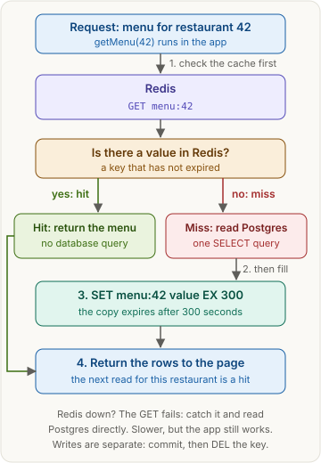
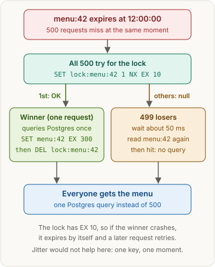
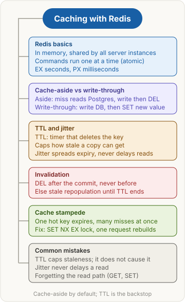

<!-- series:start -->
> [!series]- Backend system design · 2 of 4
> 1. [[system-design/revision|Backend system design quick revision]]
> 2. **Caching with Redis** · you are here
> 3. [[system-design/rate-limiting|Rate limiting]]
> 4. [[system-design/race-conditions|Race conditions in limits and codes]]
<!-- series:end -->

> [!abstract] What this page is for
> **Intent:** explain how a backend uses Redis as a cache, and answer the caching questions asked in system design interviews.
> **You'll learn:** cache-aside vs write-through · TTL and jitter · invalidation after a write · cache stampede and its lock.
> **Time:** about 7 minutes. Each section has a longer version on the [[system-design/deep/caching|detailed caching page]].

## Words you need first

- **Redis**: an in-memory key-value store. A key is a name such as `menu:42`, and a value is what it holds. "In-memory" means the data lives in RAM (computer memory), so reads are fast. Redis runs as its own server, shared by every instance of your app. `GET` reads a key, `SET` writes it, `DEL` deletes it.
- **Atomic**: one Redis command finishes before the next one starts, so a single `SET` never lands halfway.
- **TTL (time to live)**: how long a key lives before Redis deletes it. `EX 300` means 300 seconds; `PX` takes milliseconds. `TTL key` returns the seconds left, `-2` if the key is missing and `-1` if it has no expiry.
- **Postgres**: the database on disk. It is the **source of truth**, the copy you trust. Redis holds copies you can always rebuild.
- **Cache hit, cache miss, hit ratio**: a hit means the key is in Redis, a miss means it is not. The hit ratio is hits divided by all reads. A **stale read** returns an old value after the source changed.
- **Upstash**: a hosted Redis you reach over HTTPS, which suits serverless apps (apps with no servers you manage). Reads usually take single-digit milliseconds.

## Why it exists

Many customers open the same restaurant menu. Each request that reaches Postgres costs disk work and a database connection. A cache answers repeats from memory, so Postgres only handles misses and writes. [[system-design/rate-limiting|Rate limiting]] protects the same database from too many requests. Browser and CDN caching is a different layer, covered in [[networking/http-caching|HTTP caching]].

## The picture



## How it works, with an example

**Simply:** A restaurant keeps its menu on a clipboard at the counter. The cashier checks the clipboard first. If the menu is missing, the cashier copies it from the office file, leaves the copy up for a while, and answers. Cache-aside works the same way: the app checks Redis first, and on a miss it loads from Postgres and keeps a copy.

**What to know:** This is the read path, also called lazy loading, because the cache fills only when someone asks.

```ts
export async function getMenu(restaurantId: number) {
  const key = `menu:${restaurantId}`;

  const cached = await redis.get<MenuItem[]>(key);     // 1. GET
  if (cached !== null) return cached;                   // hit: done, no database

  const rows = await db.select().from(menuItems)        // 2. miss: read Postgres
    .where(eq(menuItems.restaurantId, restaurantId));

  await redis.set(key, rows, { ex: 300 });              // 3. SET with a 300 s TTL
  return rows;                                          // 4. return
}
```

If Redis is down, the `GET` fails. Catch the error and read Postgres directly. It is slower, but the app still works.

## The most common mistake

> [!warning] A TTL is not freshness, and the read path is easy to forget
> A TTL deletes the key when its timer ends, so the next read is a miss. It only caps how long a stale copy can live. Fresh data comes from invalidation after each write. Also, a write that only DELs the key does nothing useful unless the next read runs the whole path: GET, miss, read Postgres, SET.

## Cache-aside vs write-through

**Simply:** When the office changes the menu, the clipboard must change too. Cache-aside throws the old copy away, so the next request makes a new one. Write-through writes the new menu to the clipboard at the same moment as the office file.

**What to know:**
- **Cache-aside**: a write updates Postgres, commits, then DELs the key. It does not SET it. The next read refills the key. Default for read-heavy data that changes rarely, like a menu.
- **Write-through**: a write updates Postgres, then SETs the new value at once, so the cache is always warm. Good for one writer, many readers, and a read right after a write, such as an "open now" flag under its own key `restaurant:42:open`.

```ts
await db.update(restaurants).set({ isOpen }).where(eq(restaurants.id, restaurantId));  // 1. Postgres
await redis.set(`restaurant:${restaurantId}:open`, isOpen ? "1" : "0", { ex: 300 });  // 2. SET
```

The trap: two writers can finish their cache SETs out of order. Writer B commits 120, then writer A commits 150, so Postgres ends at 150. But A's cache SET arrives first and B's arrives last, so Redis ends at 120 until the TTL ends. A DEL has no such problem: the next read fills the key from Postgres.

Write-behind (write-back) in one line: write to the cache first and the database later. It is fast, but it can lose writes. Never use it for orders.

## TTL and jitter

**Simply:** Each cached copy has a timer, and the copy is thrown away when the timer rings. If a thousand copies are made in the same second with the same timer, they all ring together, and a thousand requests hit the database together. Jitter adds a small random amount to each timer, so the rings spread out.

**What to know:**
- A TTL caps staleness: a copy is at most one TTL old since its last SET. It is a backstop; invalidation keeps data fresh.
- Short TTL means fresher data but more misses. Long TTL means fewer misses but longer staleness after a missed invalidation. Ask "how stale can this be at worst?"
- A key with no TTL (`TTL` returns `-1`) can stay stale forever. Always set one.
- Jitter: `const ttl = 300 + Math.floor(Math.random() * 61) - 30;` gives 270 to 330 seconds.
- Example: a deploy warms 1,000 menus with the same TTL, so they expire together and 1,000 queries hit Postgres at once. With jitter over 60 seconds, that is about 17 queries per second.
- Jitter changes when keys expire. It never delays a read.

## Invalidation

**Simply:** When the menu changes, the old copies must go, and they must go after the new menu is saved. If you delete first, a customer can ask in the gap, get the old menu, and put it back on the clipboard after you cleared it.

**What to know:**
- Delete every key that holds a copy: `menu:42`, and any search-results key that showed this restaurant.
- Order: commit first, then DEL.

```ts
await db.transaction(async (tx) => {
  await tx.update(menuItems).set({ price: 349 }).where(eq(menuItems.id, 7));
});                                          // the commit happens when this block ends
await redis.del(`menu:${restaurantId}`);     // only now DEL the copy
```

- Why not before the commit: under Read Committed (Postgres's default: a transaction sees only committed data; see [[databases/transactions|Transactions and concurrency]]), a reader in the gap sees the old price, caches it, and that old value stays in Redis after your commit. This is called stale repopulation.
- If the DEL fails after the commit, the TTL is the backstop.
- Phil Karlton's line: "There are only two hard things in Computer Science: cache invalidation and naming things."

## Cache stampede

**Simply:** A popular menu's copy expires at 12:00:00. In that second, 500 customers ask for it. None finds the copy, so all 500 walk to the database with the same question. The fix is one lock. The first request takes the lock and fetches the menu. The others wait a moment and read the copy the first one put back.

**What to know:**
- A stampede (thundering herd, dogpile) is one hot key expiring while many requests miss at once.
- It is not synchronized expiry, which is many keys expiring together. Jitter fixes that. Jitter does not fix a stampede on one key.
- The lock: `SET lock:menu:42 1 NX EX 10`. `NX` means "only if it does not exist". The check and the set are one atomic command, so exactly one request gets "OK" and the rest get null.
- The lock needs an expiry (`EX 10`). It is a lease: if the winner crashes, the lock ends by itself. Without it, nobody refills the cache, and every request goes to Postgres.



```ts
const got = await redis.set(`lock:menu:${id}`, "1", { nx: true, ex: 10 });
if (got === "OK") {                                    // exactly one request gets here
  const rows = await loadMenu(id);                     // the only Postgres query
  await redis.set(`menu:${id}`, rows, { ex: 300 });
  await redis.del(`lock:menu:${id}`);                  // release the lock
  return rows;
}
for (let i = 0; i < 5; i++) {                          // the others wait, then retry up to 5 times
  await sleep(50);
  const hit = await redis.get<MenuItem[]>(`menu:${id}`);
  if (hit !== null) return hit;                        // the winner has refilled the key
}
return loadMenu(id);                                   // still missing: fall back to Postgres
```

Releasing with a plain DEL can delete a lock another request took after yours expired; the detailed page shows the safe release (a token checked in a Lua script).

Good to know: stale-while-revalidate. Serve the old copy while one request refreshes it in the background.

## Say it in an interview

> "I'd use cache-aside for read-heavy data like a restaurant menu. On a read, the app GETs the key. On a miss, it reads Postgres, SETs the result with a TTL, and returns it. On a write, I commit to Postgres first, then DEL the key so the next read refills it. Every key gets a TTL as a backstop. I add jitter so keys don't all expire together. For a hot key that expires under load, SET with NX and EX acts as a lock, so one request rebuilds it, and the expiry means a crash can't block the cache. If Redis is down, the app reads Postgres directly."

## Questions interviewers ask

Tap a question to see the answer.

> [!question]- What is cache-aside?
> The app checks Redis first. On a miss it reads Postgres, SETs the result with a TTL, and returns it. Also called lazy loading.

> [!question]- What does a write do in cache-aside, and why DEL instead of SET?
> It commits to Postgres, then DELs the key. The next read refills it from fresh data. A DEL has no ordering problem.

> [!question]- What is write-through, and what is its risk?
> A write updates Postgres, then SETs Redis, so the cache stays warm. The risk: two writers' cache SETs can finish out of order, leaving an old value until the TTL ends.

> [!question]- When pick write-through over cache-aside?
> One writer, many readers, and reads right after a write, such as an "open now" flag.

> [!question]- What does a TTL do?
> It deletes the key when the timer ends. It caps staleness: a copy is at most one TTL old since its last SET.

> [!question]- What does `TTL key` return?
> The seconds left. `-2` if the key is missing, `-1` if it has no expiry.

> [!question]- What is jitter, and why use it?
> A small random amount added to each TTL, so keys cached together don't expire together. It changes expiry only, never reads.

> [!question]- Why must invalidation happen after the commit?
> A DEL before the commit lets a reader cache the old value in the gap. It then stays in Redis until the TTL ends. Commit-then-DEL closes most of the gap, not all: a reader that read the old row just before the commit can still SET it after your DEL. The TTL caps that; a second delayed DEL or a versioned key closes it further.

> [!question]- Stampede versus synchronized expiry?
> A stampede is one hot key expiring under load. Synchronized expiry is many keys expiring together. Jitter fixes the second only.

> [!question]- How do you stop a stampede, and why must the lock expire?
> `SET lock:key 1 NX EX 10`: one request rebuilds, the others wait and read. The expiry stops a crashed winner from blocking the cache forever.

## Mental map



## Watch


Software With Shawn, "Caching Strategies With Redis": caching strategies with Redis, to watch after this page.

**Want more?** The [[system-design/deep/caching|detailed caching page]] has the same sections with the exact commands, the stale-repopulation timeline, safe lock release, and harder interview questions.

<!-- series-nav:start -->
---

← [[system-design/revision|Backend system design quick revision]] · [[system-design/rate-limiting|Rate limiting]] →
<!-- series-nav:end -->
