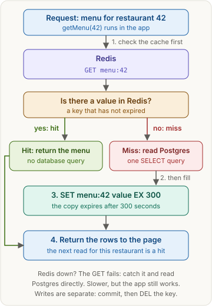
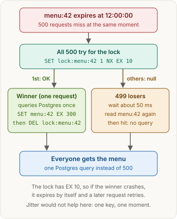
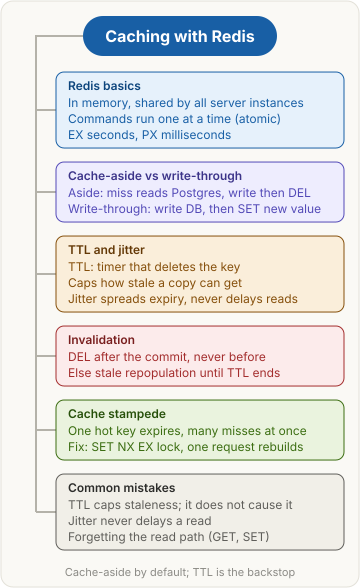

> [!abstract] What this page is for
> **Intent:** the full picture behind the [[system-design/caching|quick caching page]]. Same sections, same order, with exact commands, the timelines behind each failure, and harder interview questions.
> **Read the quick page first.** Each section here starts where the quick one stops.
> **Time:** about 20 minutes.

## Words you need first

Everything from the quick page (in-memory key-value store, atomic, GET, SET, DEL, TTL, Postgres as source of truth, hit, miss, hit ratio, stale read, Upstash), plus:

- **Read Committed**: Postgres's default isolation level. A transaction sees only committed data, never another transaction's uncommitted changes. See [[databases/transactions|Transactions and concurrency]].
- **Commit**: the moment a transaction becomes permanent and visible to others. In Drizzle, `db.transaction(async (tx) => { ... })` commits when the callback finishes without an error.
- **Eviction**: Redis removing keys because memory is full. It is separate from expiry, so a key can vanish before its TTL.
- **Hot key**: one key that many requests read at once, such as a popular restaurant's menu.
- **Lease**: a lock that ends by itself after a fixed time, so a crashed holder cannot block others forever.
- **Lua script**: a small program Redis runs as one atomic step, so a check and a delete cannot be split.

## Why it exists

The arithmetic behind the cache. If 1,000 customers per second open the same menu and the hit ratio is 90%, Redis serves 900 reads and Postgres sees 100 per second. At 99%, Postgres sees 10. The hit ratio is the lever. The TTL, invalidation and stampede rules keep it high without serving bad data.

The cache can fail in two ways. It can be wrong: it holds old data after the source changed. It can be missing: many misses at once send all their load to Postgres. Each section below handles one of those.

Browser and CDN caching follow their own rules (`Cache-Control`, ETags, 304 replies); see [[networking/http-caching|HTTP caching]]. Rate limiting is a different tool for the same database: [[system-design/rate-limiting|Rate limiting]].

## The picture



The same read path as the quick page. The rest of this page zooms into each box: the raw commands, the TTL on the SET, and the write path the picture leaves out.

## How it works, with an example

**Simply:** A restaurant keeps its menu on a clipboard at the counter. The cashier checks the clipboard first. If the menu is missing, the cashier copies it from the office file, leaves the copy up for a while, and answers. Cache-aside works the same way: the app checks Redis first, and on a miss it loads from Postgres and keeps a copy.

**What to know:** Cache-aside is also called lazy loading, because the cache fills only when a request asks. The app owns both the read and the write logic. Redis does not know where the data comes from.

The raw commands for `menu:42`:

| Step | Command | Redis replies |
|---|---|---|
| first read, empty cache | `GET menu:42` | `(nil)`: a miss |
| fill after the database read | `SET menu:42 "<json rows>" EX 300` | `OK` |
| later read | `GET menu:42` | the stored JSON: a hit |
| check the timer | `TTL menu:42` | `287` seconds left |

The Upstash client encodes and decodes the JSON, so `redis.get<MenuItem[]>` returns an array.

```ts
import { eq } from "drizzle-orm";
import { redis } from "./redis";      // Upstash client, over HTTPS
import { db } from "./db";            // Drizzle client over Postgres
import { menuItems } from "./schema";

type MenuItem = typeof menuItems.$inferSelect;

export async function getMenu(restaurantId: number): Promise<MenuItem[]> {
  const key = `menu:${restaurantId}`;

  try {
    const cached = await redis.get<MenuItem[]>(key);   // 1. GET
    if (cached !== null) return cached;                 // hit: no database
  } catch (err) {
    console.warn("redis get failed, reading Postgres", err);   // Redis down: fall through
  }

  const rows = await db.select().from(menuItems)        // 2. miss: read Postgres
    .where(eq(menuItems.restaurantId, restaurantId));

  await redis.set(key, rows, { ex: 300 }).catch(() => {}); // 3. SET with a TTL; a failed fill is not fatal
  return rows;                                          // 4. return
}
```

When Redis comes back after an outage, its cache is empty, so the first burst of misses lands on Postgres. The jitter and stampede sections handle that.

## The most common mistake

> [!warning] Three traps that look harmless
> - **A TTL is not freshness.** It caps how long a stale copy can survive. It does nothing to fix a copy that is wrong now. Fresh data comes from invalidation.
> - **The read path is easy to forget.** A write that only DELs the key does nothing useful unless the next read runs GET, miss, Postgres and SET.
> - **Eviction can remove keys early.** Under memory pressure Redis evicts keys by its `maxmemory-policy`, before their TTL ends. Treat a miss as normal, never as an error.

## Cache-aside vs write-through

**Simply:** When the office changes the menu, the clipboard must change too. Cache-aside throws the old copy away, so the next request makes a new one. Write-through writes the new menu to the clipboard at the same moment as the office file.

**What to know:**

| | Cache-aside | Write-through |
|---|---|---|
| The write does | update Postgres, commit, DEL the key | update Postgres, then SET the new value |
| Next read | miss, then Postgres, then SET | hit, straight from Redis |
| Warm after a write? | no: the first read after a write misses | yes |
| Race risk | low: DEL is order-safe | two writers' SETs can finish out of order |
| Good fit | read-heavy, rarely changed: menus, restaurant names | one writer, many readers, reads right after a write: an "open now" flag |

Write-through with its own key:

```ts
export async function setOpenNow(restaurantId: number, isOpen: boolean) {
  await db.update(restaurants)
    .set({ isOpen })
    .where(eq(restaurants.id, restaurantId));                  // 1. write Postgres first

  await redis.set(`restaurant:${restaurantId}:open`,           // 2. then SET the new value
    isOpen ? "1" : "0", { ex: 300 });
}
```

The race, in order. Writers A and B both update the flag:

| Time | Postgres | Redis |
|---|---|---|
| t1 | B commits `120` | |
| t2 | A commits `150`: Postgres ends at 150 | |
| t3 | | A's SET `150` arrives first |
| t4 | | B's SET `120` arrives last: Redis ends at 120 |

The two stores disagree from t4 until the TTL ends. A DEL avoids this: whichever DEL runs, the next read fills the key from Postgres. With several writers under write-through, you need a version number or a lock. With one writer, the race does not happen.

Write-behind (write-back) writes to the cache first and the database later, in a background job. It is fast, and it can lose writes if Redis fails before the job runs. Use it only for data you can afford to lose, never for orders or payments.

## TTL and jitter

**Simply:** Each cached copy has a timer, and the copy is thrown away when the timer rings. If a thousand copies are made in the same second with the same timer, they all ring together, and a thousand requests hit the database together. Jitter adds a small random amount to each timer, so the rings spread out.

**What to know:**

- **Setting.** `{ ex: 300 }` sets 300 seconds. `px` takes milliseconds. `EXPIRE key 300` sets a TTL on an existing key. `PERSIST key` removes it.
- **Reading.** `TTL key` returns seconds left: `-2` if the key is missing, `-1` if it has no expiry. `PTTL` returns milliseconds.
- **Meaning.** A copy written with `EX 300` is at most 300 seconds old since its last SET, whatever happened in between. It is a backstop; invalidation is the freshness rule. A key with no TTL can stay stale until someone deletes it by hand.
- **Choosing.** Ask "how stale can this be at worst?" A menu can be five minutes old. A restaurant's open or closed status might need 30 seconds, or invalidation. An order status needs invalidation on every change, or no cache at all.
- **Short versus long.** Short TTL: fresher data, more misses, more load on Postgres. Long TTL: fewer misses, but a missed invalidation leaves bad data longer.
- **How expiry runs.** Redis checks a key's TTL when it is read and samples keys in the background. Redis frees expired keys lazily, but GET never returns an expired key. A miss can also come from eviction or a DEL, not only from the TTL.

Jitter:

```ts
const ttl = 300 + Math.floor(Math.random() * 61) - 30;   // 270 to 330 seconds
await redis.set(`menu:${restaurantId}`, rows, { ex: ttl });
```

`Math.random() * 61` gives 0 to 60.99; `Math.floor` makes it 0 to 60; adding 300 and subtracting 30 gives 270 to 330.

The effect: a deploy warms 1,000 menus in the same second with TTL 300. They all expire together five minutes later, and 1,000 Postgres queries arrive at once. Spread over a 60-second window, that is about 17 queries per second.

What jitter does not do: it never delays a read, and it does not fix a stampede on one hot key, because one key still expires at one moment.

## Invalidation

**Simply:** When the menu changes, the old copies must go, and they must go after the new menu is saved. If you delete first, a customer can ask in the gap, get the old menu, and put it back on the clipboard after you cleared it.

**What to know:**

- **Which keys.** Find every key that holds a copy: `menu:42`, plus any search-results key that listed this restaurant, such as `search:pizza:delhi`. A missed key stays stale until its TTL ends.
- **Order.** Commit first, then DEL.

```ts
export async function updatePrice(itemId: number, restaurantId: number, price: number) {
  await db.transaction(async (tx) => {
    await tx.update(menuItems).set({ price }).where(eq(menuItems.id, itemId));
  });                                                       // the commit happens here

  try {
    await redis.del(`menu:${restaurantId}`);                // plus each search key for this restaurant
  } catch (err) {
    console.error("cache DEL failed; the TTL will clean up", err);
  }
}
```

- **Why not before the commit.** Under Read Committed, a reader sees only committed data:

| Time | Writer | Reader | Redis |
|---|---|---|---|
| t1 | DEL `menu:42` | | empty |
| t2 | | GET: miss | empty |
| t3 | | reads Postgres: the committed old price, 320 | empty |
| t4 | UPDATE to 349, COMMIT | | empty |
| t5 | | SET `menu:42` with 320 | 320 |

After t5, Redis holds 320 and Postgres holds 349. The bad copy lives until its TTL ends. This is stale repopulation. It is a race, so it does not happen on every write, which makes it hard to debug.

Commit-then-DEL closes most of the gap, not all: a reader that read the old row just before the commit can still SET it after your DEL. The TTL caps that; a second delayed DEL or a versioned key closes it further.

- **When the DEL fails.** A Redis timeout after the commit leaves the old copy. Options: accept the TTL as the backstop (what the code does), retry the DEL from a queue, or write an outbox row in the same transaction and let a worker send the DEL. The outbox is the strict option, because the DEL is retried even after a crash.
- **Versioned keys.** Instead of deleting, change the name. Keep a version counter in Postgres and put it in the key: `menu:42:v7`. A write makes it v8, so readers never see v7 again, and v7 expires on its own. The cost: one extra read of the version before each cache read.
- **Event-driven.** For many copies in many places, publish "menu 42 changed" after the commit, and each consumer deletes the keys it owns. It still needs the commit-first order.
- **The line.** Phil Karlton, a software engineer, wrote: "There are only two hard things in Computer Science: cache invalidation and naming things."

## Cache stampede

**Simply:** A popular menu's copy expires at 12:00:00. In that second, 500 customers ask for it. None finds the copy, so all 500 walk to the database with the same question. The fix is one lock. The first request takes the lock and fetches the menu. The others wait a moment and read the copy the first one put back.

**What to know:**

- **Definition.** One hot key expires while many requests miss at the same moment. The database gets the same query many times in one burst.
- **Versus synchronized expiry.** A stampede is one key. Synchronized expiry is many keys written together with the same TTL. Jitter fixes the second, not the first. A lock fixes the first.



- **Taking the lock.** `redis.set(lockKey, token, { nx: true, ex: 10 })` returns `"OK"` for exactly one caller and `null` for the rest. `NX` means "only if it does not exist", and the check and the set are one atomic command. Do not use `SETNX` followed by `EXPIRE`: a crash between the two leaves a lock with no expiry.
- **Lease.** `EX 10` makes the lock end by itself if the winner crashes.
- **Releasing safely.** Store a random token as the value and delete only if it still matches. Otherwise your DEL can remove a lock that expired and now belongs to someone else. Do the check and the delete in one step with a Lua script:

```ts
async function release(lockKey: string, token: string) {
  const script = `if redis.call("get", KEYS[1]) == ARGV[1] then
  return redis.call("del", KEYS[1])
else
  return 0
end`;
  await redis.eval(script, [lockKey], [token]);
}
```

- **Sizing.** The lock's `EX` must exceed the worst-case rebuild time (the Postgres query plus the SET). If the lock expires first, a second request takes it and two queries run. For a cache that is wasteful, not wrong.
- **Waiters.** Losers do not query Postgres. They wait 50 ms plus a little random jitter (so they don't all retry together), read the key, and retry a few times. Only after that, when the lock is free and the key is still missing, does a request query Postgres itself.

The full flow:

```ts
export async function getMenuSafe(restaurantId: number): Promise<MenuItem[]> {
  const key = `menu:${restaurantId}`;
  for (let attempt = 0; attempt < 5; attempt++) {
    const cached = await redis.get<MenuItem[]>(key);
    if (cached !== null) return cached;                              // hit

    const token = crypto.randomUUID();
    if ((await redis.set(`lock:${key}`, token, { nx: true, ex: 10 })) === "OK") {
      try {
        const rows = await loadMenu(restaurantId);                   // the only Postgres query
        await redis.set(key, rows, { ex: 270 + Math.floor(Math.random() * 61) });
        return rows;
      } finally {
        await release(`lock:${key}`, token);
      }
    }
    await sleep(50 + Math.floor(Math.random() * 50));                // losers wait, then retry
  }
  return loadMenu(restaurantId);                                     // last resort: should be rare
}
```

If the last-resort line runs often, the lock or the rebuild time is wrong.

- **Single-flight in one process.** Inside one server, keep a map from key to an in-flight promise, and let identical calls await it. This stops stampedes inside one instance only. Across instances you still need the Redis lock.
- **Stale-while-revalidate.** Store a logical expiry inside the value and keep the physical TTL longer. When the logical expiry passes, serve the stale copy at once and let one request refresh it in the background, under the same lock. Users never wait for the rebuild, but they may see a menu one refresh old.
- **Refresh-ahead.** A background job refreshes known hot keys before their TTL ends. It removes the stampede for those keys, but it spends work on keys nobody reads.

## Say it in an interview

Start with the 60-second answer from the [[system-design/caching#Say it in an interview|quick page]]. If the interviewer pushes deeper, add one of these:

- **Ordering:** "Commit first, then DEL. A DEL before the commit lets a reader cache the old value, and it stays until the TTL ends. A DEL that fails after the commit is covered by the TTL, or by an outbox that retries it."
- **Stampede versus synchronized expiry:** "A stampede is one hot key, so a lock fixes it. Synchronized expiry is many keys, so jitter fixes it."
- **Lock details:** "SET NX EX is one atomic command. The lock has a random token, released by a Lua check-then-delete. The expiry bounds the damage if the winner crashes, and it must be longer than the rebuild."

## Questions interviewers ask

The ten from the [[system-design/caching#Questions interviewers ask|quick page]], plus these harder ones. Tap to reveal.

> [!question]- Why `SET ... NX EX` instead of `SETNX` followed by `EXPIRE`?
> Two commands can be interrupted between them. A crash after `SETNX` and before `EXPIRE` leaves a lock with no expiry, which blocks the key forever. One atomic command sets both.

> [!question]- How do you release a lock safely?
> Store a random token as the value. Delete only if the value still matches, in one atomic step, usually a short Lua script. Otherwise your DEL can remove a lock that now belongs to another request.

> [!question]- The rebuild takes longer than the lock's TTL. What happens?
> The lock expires while the winner still works, a second request takes it, and two queries run. Wasteful, not wrong. Size the lock above the worst-case rebuild time.

> [!question]- Why can a write-through cache end up with an old value?
> Two writers commit to Postgres in one order, but their cache SETs arrive in the other order. The last SET wins in Redis, not the last commit. A DEL avoids the race.

> [!question]- Jitter spreads expiries. Why doesn't it stop a stampede?
> A stampede is many requests for one key at one moment. Jitter moves different keys to different times. It does not stop one key from expiring under load.

> [!question]- What happens when Redis is down?
> The app catches the error and reads Postgres, so requests still succeed. When Redis returns, its cache is empty and the first burst of misses lands on Postgres. Warm the hot keys first.

> [!question]- Is a key with no expiry dangerous?
> Yes. `TTL` returns `-1`, so nothing removes the key. If an invalidation is missed, the stale value stays until someone deletes it. Give every cache key a TTL.

> [!question]- The DEL fails after the commit. What now?
> The TTL limits the damage: the stale copy lives at most one TTL more. For stronger guarantees, write an outbox row in the same transaction and let a worker retry the DEL.

> [!question]- Why does Read Committed allow stale repopulation?
> It shows only committed data, so a reader in the gap sees the old committed value and caches it. Your uncommitted write is invisible to that reader. A DEL after the commit closes the gap.

> [!question]- Eviction versus expiry?
> Expiry is the TTL timer ending: a planned delete. Eviction is Redis removing keys under memory pressure, by its `maxmemory-policy`. A key can vanish before its TTL, so a miss can happen at any time.

## Mental map



The same map as the quick page. Each branch is a section above.

## Watch


Software With Shawn, "Caching Strategies With Redis": caching strategies with Redis, to watch after this page.
