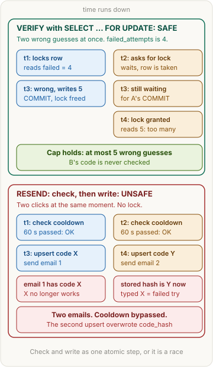
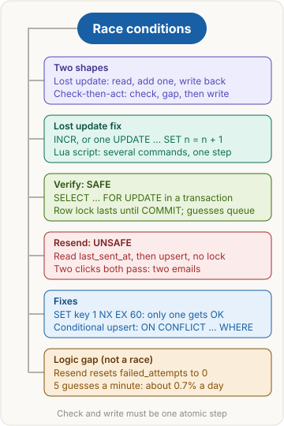

> [!abstract] What this page is for
> **Intent:** the full picture behind the [[system-design/race-conditions|quick race conditions page]]. Same sections, same order, with the exact SQL and Drizzle code, the Redis commands, lock behaviour and the edge cases interviewers push on.
> **Read the quick page first.** Each section here starts where the quick one stops.
> **Time:** about 20 minutes.

## Words you need first

Everything from the quick page (race condition, read-modify-write, lost update, check-then-act, atomic, transaction, row lock, OTP, Redis), plus:

- **Primary key**: the column that identifies one row and cannot repeat. Here `profile_id`, so each profile has one OTP row.
- **Unique violation**: the error raised when an insert repeats a primary key (Postgres error code `23505`).
- **Upsert**: "insert, or update if the row exists", in one statement. Postgres writes it as `INSERT ... ON CONFLICT ... DO UPDATE`.
- **HMAC (hash-based message authentication code)**: a hash that also uses a secret key, so only your server can produce it.
- **Constant-time comparison**: a comparison whose running time does not depend on where the first mismatch is.
- **CSPRNG (cryptographically secure random number generator)**: a random source an attacker cannot predict.
- **Lua script**: a small program Redis runs as one atomic unit.

## Why it matters

The limits (5 wrong guesses, 10 minutes, 60-second resend cooldown) are what make a 6-digit code hard to guess. Each limit is a check on a counter or a timestamp. If two requests can read the same counter before either writes it, the limit is a suggestion. The cost is concrete: attackers get more guesses, and your email provider sends and bills for more mail.

## The picture



The top lane is the verify path. Request A locks the row, so request B waits at the lock, and B's guess is never checked. The bottom lane is the resend path. Both requests read `last_sent_at` before either one writes it, so both pass the check.

## How it works, with an example

**Simply:** A race is two people taking the last seat on a bus at the same moment. In a system, the seat is a counter or a code. If the check and the write are two separate steps, another request can slip in between them. The fix is to make them one step: one command, a lock that makes others wait, or a write that happens only if the rule still holds.

**What to know:** The table has one row per profile. The Drizzle schema:

```ts
import { pgTable, uuid, text, integer, timestamp } from "drizzle-orm/pg-core";

export const emailVerificationOtps = pgTable("email_verification_otps", {
  profileId: uuid("profile_id").primaryKey(),
  codeHash: text("code_hash").notNull(),          // HMAC-SHA256 hex of "profileId:code"
  expiresAt: timestamp("expires_at", { withTimezone: true }).notNull(),
  failedAttempts: integer("failed_attempts").notNull().default(0),
  lastSentAt: timestamp("last_sent_at", { withTimezone: true }).notNull(),
});
```

| Rule | Checked on | Race risk |
|---|---|---|
| Expires after 10 minutes | verify (`expires_at` against the clock) | low: a read, no counter |
| At most 5 wrong guesses | verify (`failed_attempts` before the code check) | high: read 4, write 5, twice |
| One resend per 60 seconds | resend (`last_sent_at`) | high: two requests both read the old time |

The code comes from a CSPRNG and is padded to 6 digits. The table stores only an HMAC of `profileId:code`, never the code. A plain hash is not enough, because there are only a million codes and anyone who can read the table could try them all. The HMAC key lives in server config.

```ts
import { createHmac, randomInt } from "node:crypto";

export function newCode(): string {
  return randomInt(0, 1_000_000).toString().padStart(6, "0");
}

export function hmacCode(profileId: string, code: string): string {
  return createHmac("sha256", process.env.OTP_HMAC_KEY!)
    .update(`${profileId}:${code}`)
    .digest("hex");
}
```

## The most common mistake

> [!warning] Thinking a lock fixes every race
> A row lock covers only what happens while it is held: from the locking read until COMMIT or ROLLBACK. The verify path works because its read, check and write all happen inside one locked transaction. The resend path does its read, check and write as separate statements. A lock on the read alone does not cover the later write. Fix it by making the check and the write one atomic step: a conditional write, or `SET NX`.

## Lost update on a counter

**Simply:** Two people update a shared scoreboard by reading the old number, adding one, and writing it back. Both read 4, both write 5, and one point is lost. Let the database or Redis add one in a single step, and the lost point cannot happen.

**What to know:** The read-modify-write in application code is the bug:

```ts
// BROKEN: read, change in app code, write back
const uses = Number(await redis.get(key)); // both requests read 4
if (uses < 5) {
  await redis.set(key, uses + 1);          // both write 5
}
```

Both requests see 4, which is under the limit of 5, so both are allowed. Two requests got through from 4, but the stored value is 5. The gap is between the `GET` and the `SET`, not inside either command, so making `SET` atomic would not help.

The fixes, each one step:

```ts
// Redis: INCR adds one and returns the new value atomically
const n = await redis.incr("voucher:42:user:7");
if (n > 5) return { ok: false, reason: "limit" };
```

```sql
-- SQL: check and write are one statement; zero rows means the limit is reached
UPDATE vouchers SET uses = uses + 1 WHERE id = $1 AND uses < 5 RETURNING uses;
```

```lua
-- Lua: the counter and its first-time expiry run as one unit
local n = redis.call('INCR', KEYS[1])
if n == 1 then redis.call('EXPIRE', KEYS[1], ARGV[1]) end
return n
```

`INCR` followed by a separate `EXPIRE` is two commands. A crash between them leaves a key with no expiry, so the Lua script is the safer way to set a time window.

## Check-then-act

**Simply:** Like checking that a hotel room is free, then walking to the desk to book it. Someone else books it during the walk. The check was true when you looked, but the write happens later, so it can be false by then.

**What to know:** Check-then-act, also called TOCTOU (time of check to time of use), is the second shape. The OTP app has two paths over one row.

**Verify path (safe).** The whole flow runs in one transaction:

```ts
import { eq, sql } from "drizzle-orm";
import { timingSafeEqual } from "node:crypto";

const MAX_WRONG = 5;

export async function verifyOtp(profileId: string, submitted: string) {
  return db.transaction(async (tx) => {
    const [row] = await tx
      .select()
      .from(emailVerificationOtps)
      .where(eq(emailVerificationOtps.profileId, profileId))
      .for("update"); // row lock until COMMIT or ROLLBACK

    if (!row) return { ok: false, reason: "no-code" as const };
    if (row.expiresAt.getTime() < Date.now()) return { ok: false, reason: "expired" as const };
    if (row.failedAttempts >= MAX_WRONG) return { ok: false, reason: "too-many" as const };

    const expected = Buffer.from(hmacCode(profileId, submitted), "hex");
    const stored = Buffer.from(row.codeHash, "hex");
    const match = expected.length === stored.length && timingSafeEqual(expected, stored);

    if (!match) {
      await tx
        .update(emailVerificationOtps)
        .set({ failedAttempts: sql`${emailVerificationOtps.failedAttempts} + 1` })
        .where(eq(emailVerificationOtps.profileId, profileId));
      return { ok: false, reason: "wrong" as const };
    }
    await tx.delete(emailVerificationOtps).where(eq(emailVerificationOtps.profileId, profileId)); // the code can't be reused
    return { ok: true as const };
  });
}
```

On a match, the row is deleted in the same transaction, so the same code cannot be used twice.

Trace it with `failed_attempts = 4`. Request A runs the locking `SELECT` and checks its code. It is wrong, so A writes 5, then COMMITs, which releases the lock. Request B's locking `SELECT` was waiting. Once the lock is free, B reads the newest committed row, with `failed_attempts = 5`. It returns "too-many" and never runs the code comparison. The cap is exact because requests for one profile run one after another. "Serialised" means that. It is not the Serializable isolation level, which is a database-wide setting. See [[databases/transactions|Transactions and concurrency]].

Without `FOR UPDATE`, a plain `SELECT` takes no lock and never waits. Every parallel guess reads 4, passes the check, compares its code, and writes. The cap is bypassed.

**Resend path (unsafe).** Three separate steps, no lock:

```ts
// UNSAFE: check, then write, with no lock between them
const row = await db.query.emailVerificationOtps.findFirst({
  where: eq(emailVerificationOtps.profileId, profileId),
});
if (row && Date.now() - row.lastSentAt.getTime() < 60_000) {
  return { ok: false, reason: "cooldown" as const };
}
const code = newCode();
await db
  .insert(emailVerificationOtps)
  .values({ profileId, codeHash: hmacCode(profileId, code), expiresAt: sql`now() + interval '10 minutes'`, failedAttempts: 0, lastSentAt: sql`now()` })
  .onConflictDoUpdate({
    target: emailVerificationOtps.profileId,
    set: { codeHash: hmacCode(profileId, code), expiresAt: sql`now() + interval '10 minutes'`, failedAttempts: 0, lastSentAt: sql`now()` },
  });
await sendEmail(profileId, code);
```

Two clicks at the same moment. Both `findFirst` calls see the old `last_sent_at`, so both pass the 60-second check. Both upserts run, each with its own code. The second upsert overwrites `code_hash`, so only the second code is valid. The first email still shows code X, but the stored hash is now Y. Typing X fails and counts as a wrong guess. The user got two emails, the cooldown was bypassed, and both sends were paid for.

**The logic gap (not a race).** Each resend sets `failed_attempts` back to 0. The attacker's loop: submit the victim's address, wait 60 seconds, resend, and guess 5 times on each code. That is 1,440 resends a day times 5 guesses, 7,200 a day. Against 1,000,000 codes, that is about 0.72% of the space each day, and every guess is blind because the attacker never sees the email. Fixes, in order of value:

- Keep the failure count across resends. Reset it only after a successful verify.
- Add a daily resend cap per profile with a [[system-design/rate-limiting|rate limiter]]. For example, 10 resends a day gives 50 guesses a day, which is 0.005% of the space.
- Add a total failure cap, for example 10 wrong guesses a day per profile, that a resend does not reset.

## Fixes: atomic commands, locks, conditional writes

**Simply:** Make the check and the write one step, in one of four ways. One command can do both. A lock can make others wait while you do both. A conditional write happens only if the rule still holds. A key that Redis creates only if absent (`SET NX`) works as a short lock.

**What to know:** The four tools:

| Tool | Use it for | Trade-off |
|---|---|---|
| Atomic command (`INCR`, one `UPDATE`, Lua) | one counter, or a check and write on one row | fastest; Lua covers several commands |
| Row lock (`SELECT ... FOR UPDATE`) | several steps on one row in a transaction | others wait; keep it short |
| Conditional write (`ON CONFLICT ... WHERE`) | insert-or-update with a rule, one round trip | needs a unique key; no row back if the rule fails |
| `SET key value NX EX n` | a short cooldown or lock across app servers | expires; a Redis failover can lose the key |

**Conditional upsert for the resend.** The `WHERE` runs inside the conflict path, so the check and the write are one statement:

```ts
const sent = await db
  .insert(emailVerificationOtps)
  .values({
    profileId,
    codeHash: hmacCode(profileId, code),
    expiresAt: sql`now() + interval '10 minutes'`,
    failedAttempts: 0,
    lastSentAt: sql`now()`,
  })
  .onConflictDoUpdate({
    target: emailVerificationOtps.profileId,
    set: {
      codeHash: hmacCode(profileId, code),
      expiresAt: sql`now() + interval '10 minutes'`,
      lastSentAt: sql`now()`, // failedAttempts is deliberately not reset
    },
    setWhere: sql`${emailVerificationOtps.lastSentAt} < now() - interval '60 seconds'`,
  })
  .returning({ profileId: emailVerificationOtps.profileId });

if (sent.length === 0) return { ok: false, reason: "cooldown" as const };
await sendEmail(profileId, code); // only the request that wrote the row sends
```

The clock is the database's `now()`, so app servers with slightly different clocks agree. The same statement handles the first send for a profile with no row: two first requests both try to insert, one wins, and the other takes the conflict path and rechecks the `WHERE` against the committed row.

**`SET NX` for the cooldown.** Use it when the cooldown must be shared across many app servers and you want to keep the database out of the path:

```ts
const first = await redis.set(`otp:cooldown:${profileId}`, "1", { nx: true, ex: 60 });
if (first !== "OK") return { ok: false, reason: "cooldown" as const };
try {
  const code = newCode();
  // store the hash in Postgres, then send the email
  await sendEmail(profileId, code);
} catch (err) {
  await redis.del(`otp:cooldown:${profileId}`); // let the user retry at once
  throw err;
}
```

Redis runs `SET` with `NX` and `EX` as one command, so exactly one caller gets "OK". If Redis fails over before a write reaches its replica, the key can be lost and the cooldown has a gap. For a cooldown that is acceptable. When the database must be the only source of truth, use the conditional upsert. The same `SET NX` idea guards the cache-stampede lock in [[system-design/caching|Caching with Redis]].

**Edge cases:**

- **`FOR UPDATE` on a missing row locks nothing.** The first OTP for a profile has no row to lock, so two first requests both insert, and one fails with a unique violation (`23505`). The conditional upsert avoids this because its conflict path rechecks the `WHERE`.
- **Keep transactions short.** A transaction holds a connection while it waits. Never call the email provider inside the verify transaction.
- **Lock wait time.** A stuck transaction can block every guess for one profile. A lock timeout makes the waiting request fail instead of waiting forever.
- **Deadlocks.** The verify path locks one row, so it cannot deadlock. If a transaction locks several rows, lock them in one fixed order everywhere.
- **Process mutex.** A lock inside one Node process does nothing across app servers. Use a row lock or Redis.
- **`NOWAIT` and `SKIP LOCKED`.** `FOR UPDATE NOWAIT` fails a blocked request at once, which suits "try again later". `SKIP LOCKED` skips held rows, which suits job queues. Drizzle's `.for("update")` takes options for both.
- **Serializable isolation.** It would also prevent this, but it makes the database abort and retry transactions on conflict. A row lock on one profile is the smaller tool.

To test it, send 10 guesses at one profile with `Promise.all` against a test database, then count code checks and emails. Before the fix, more than 5 (often all 10) guesses reach the code check, and the resend sends more than one email. After the fix, exactly 5 do from a fresh profile, and the email count matches the rules.

## Say it in an interview

Start with the 60-second answer from the [[system-design/race-conditions#Say it in an interview|quick page]]. If they push deeper, add one of these:

- **Why the lock works:** "The lock is held from the locking read until COMMIT. Requests for one profile queue on it, so each guess sees the latest failure count. A plain read would let every parallel guess see 4."
- **Why the resend breaks:** "Its check and write are separate statements with no lock across them, so the check is stale by the time it writes."
- **The clean fix:** "Make the cooldown one atomic step: a conditional upsert with the `WHERE` on `last_sent_at`, or `SET NX EX` on a key."
- **The logic gap:** "The failure count resets on each resend, so the cap is per code, not per profile. That is a design gap, not a race, and it needs a daily cap and a total failure cap."

## Questions interviewers ask

The nine from the quick page are the core. These are harder ones. Tap to reveal.

> [!question]- Why is a plain SELECT not enough for the verify path?
> A plain `SELECT` in Postgres takes no row lock, so it never waits. Parallel requests all read the same `failed_attempts`, pass the cap check and compare their codes. `SELECT ... FOR UPDATE` makes the others wait.

> [!question]- When exactly is the row lock released?
> At COMMIT or ROLLBACK, not when the query returns. A transaction that has read the row but not committed still holds the lock.

> [!question]- Two first requests for a profile with no OTP row. What happens?
> `FOR UPDATE` locks nothing, because there is no row. Both insert, the primary key rejects one with a unique violation, and the code must handle that. The conditional upsert avoids the error, because its conflict path rechecks the `WHERE` against the committed row.

> [!question]- Why use the database's now() instead of Date.now() in the app?
> App servers can disagree about the time by seconds. If each one compares its own clock to `last_sent_at`, the cooldown differs by server. The database clock is one clock for every request.

> [!question]- Why use crypto.randomInt and not Math.random?
> `Math.random` is predictable: an attacker who sees a few outputs can predict later ones. `crypto.randomInt` uses a CSPRNG. It also avoids the modulo bias that a hand-rolled `% 1000000` on random bytes adds.

> [!question]- Why check the lengths before timingSafeEqual?
> `timingSafeEqual` throws when the buffers differ in length. Both sides are HMAC hex strings of the same length, so the check never fails in practice, but it must be there.

> [!question]- The cooldown key is set, then the email send fails. What now?
> The user gets no code and must wait out the cooldown. Deleting the key in the error path lets them retry at once. Otherwise accept the wait and say so.

> [!question]- How would you stop the resend loop from being a cost problem, not just a security one?
> Count sends, not only attempts. Cap resends per profile per day, and cap sends per email address across profiles, using a Redis daily window. See [[system-design/rate-limiting|Rate limiting]].

## Mental map



The same map as the quick page. Each branch is a section above.

## Watch


compilewithsumit, about 6 minutes: "How PostgreSQL Solves a Race Condition". A job-queue example where a Postgres row lock stops two workers taking the same job. The lock idea is the verify path here.


Learn Code With Durgesh, about 26 minutes, for a longer treatment: lost updates, and pessimistic (row lock) against optimistic (version check) locking.
