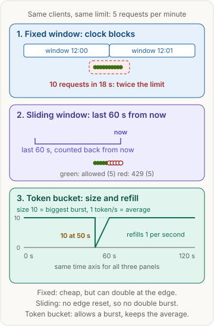
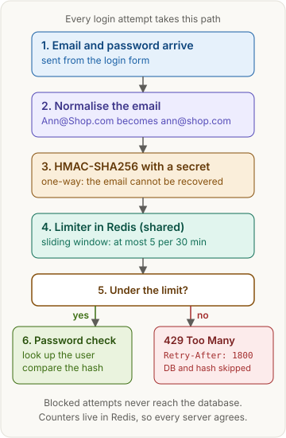
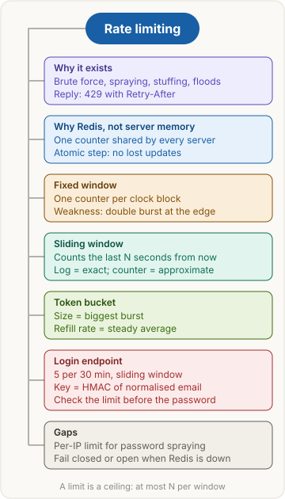

> [!abstract] What this page is for
> **Intent:** the full picture behind the [[system-design/rate-limiting|quick rate limiting page]]. Same sections, same order, with the exact Redis commands, scripts, code and the harder interview questions.
> **Read the quick page first.** Each section here starts where the quick one stops.
> **Time:** about 20 minutes.

## Words you need first

Everything from the quick page (rate limit, key, HTTP 429, Retry-After, Redis, atomic, Lua script, hash, HMAC), plus:

- **Sorted set**: a Redis type where each member has a numeric score. Members stay in score order, so Redis can remove or count a score range quickly.
- **TTL (time to live)**: how long a key lasts before Redis deletes it. `EXPIRE key 60` sets a 60 second TTL.
- **Hash (Redis)**: one key that holds several named fields, like a small record.
- **Normalise**: convert input to one standard form before you use it. Here: trim the spaces, then lowercase.
- **Upstash** (a hosted Redis you call over HTTPS): the service behind the `Ratelimit` helper used in the examples.
- **`reset`**: a timestamp in milliseconds since 1970: the end of the current window for a sliding window, or the next refill for a token bucket. Use it for Retry-After as an estimate; the client may still be limited when it retries.
- **Thundering herd**: many clients retrying at the same moment, for example when all their limits reset together.
- **Jitter**: a small random extra wait, so clients do not all retry at once.
- **Proxy header (`X-Forwarded-For`)**: a header a load balancer adds to tell the server the original client IP. Any client can also send it, so it can be faked.
- **CAPTCHA**: a test that a human can pass easily and a bot struggles with.
- **Fail open, fail closed**: what to do when the limiter itself is broken. Open lets the request through. Closed refuses it.
- **Data minimisation**: store only the data you need.

## Why it exists

| Attack | What it tries | What a limit does |
|---|---|---|
| Brute force | many passwords on one account | caps guesses per account |
| Password spraying | one common password on many accounts | needs a per-IP cap, since each account sees only a few tries |
| Credential stuffing | leaked email and password pairs from other sites | caps attempts; add CAPTCHA and alerts |
| API flood | huge request volume from one client | keeps the server up for everyone else |

A limit is a ceiling: at most N requests per window. Requests over the ceiling get 429 and do no further work.

## The picture



The same three rules as the quick page. The rest of this page gives the exact steps for each one.

## How it works, with an example

**Simply:** Before doing any work, the server asks a shared counter, "is this client still under its limit?" If yes, the counter goes up and the request runs. If no, the server sends back 429 and stops. The key says whose counter it is, and the rule (window or bucket) says when it resets.

**What to know:** The rejected request from the quick page, as raw HTTP:

```http
HTTP/1.1 429 Too Many Requests
Content-Type: application/json
Retry-After: 20

{"error": "too_many_attempts"}
```

The server does the check in one call to Redis:

1. Build the key from the identifier (IP, user id or hashed email) and the window.
2. Redis counts, decides and updates the stored value in one atomic step.
3. Allowed: the handler runs. Over the limit: reply 429 with `Retry-After`, and the handler's database work never starts.

Why a shared Redis counter and not server memory, with a limit of 5 and 3 servers:

| Where the counter lives | Attempts that can pass | Survives a cold start |
|---|---|---|
| Each server's own memory | up to 15 (5 per server) | no, it resets to zero |
| One Redis counter for all servers | 5 | yes |

The main reason is that many instances have separate memory. Atomic updates are the second reason. A read-then-write update loses an increment when two requests run together:

| Step | Request A | Request B | Stored value |
|---|---|---|---|
| 1 | GET, reads 4 | | 4 |
| 2 | | GET, reads 4 | 4 |
| 3 | SET 5 | | 5 |
| 4 | | SET 5 | 5, but it should be 6 |

`INCR` (or a Lua script) does the read and the write as one step, so the second request sees 5 and writes 6. The full race story is on [[system-design/race-conditions|Race conditions in limits and codes]].

## The most common mistake

> [!warning] A limit is a ceiling, not a minimum
> "5 attempts per 30 minutes" means **at most** 5. It never means "at least 5". Requests 1 to 5 pass, and request 6 gets 429.

Other slips to avoid:

- **"Token budget" for a token bucket.** Tokens come back, so it is a rate, not a budget that runs out.
- **"Time since the last request" for a sliding window.** It counts the last N seconds from now, not from the previous request.
- **"HMAC is encryption."** It is one-way. Nothing decrypts it.
- **"Redis is for the atomic step."** Atomicity matters, but the main reason is that many servers share one counter.
- **A per-IP limit too strict for shared IPs.** An office or a mobile carrier can share one IP, so a tight limit locks out many real users.

## Fixed window

**Simply:** Count requests in fixed clock blocks, such as one block per minute. When a block ends, the count starts again at zero. It is cheap and simple, but a client can use the full limit just before a block ends and again just after it, so twice the limit fits into about 20 seconds.

**What to know:** The key holds the window number, for example `rl:login:<hashed-email>:<minute>`, where the minute is the current time divided by 60 seconds, rounded down. This script is the safe version:

```lua
-- KEYS[1] = the counter key, ARGV[1] = window length in seconds
local count = redis.call("INCR", KEYS[1])
if count == 1 then
  redis.call("EXPIRE", KEYS[1], ARGV[1])
end
return count
```

Run it with `EVAL`, then allow the request only when the returned count is at most the limit. Set the TTL only when the count is 1. If you ran `EXPIRE` on every hit, each request would push the deletion time forward, so a steady client would never get a reset.

The weakness is the window-edge problem. With a limit of 5 per minute: 5 requests at 12:00:50 to 12:00:58, then 5 at 12:01:00 to 12:01:09. That is 10 requests in about 20 seconds, twice the limit, and both bursts were allowed. This is cheap to run and easy to reason about, which is why it appears in many systems, but it is not strict.

## Sliding window

**Simply:** Instead of clock blocks, look back over the last N seconds, counted from now. Each request asks how many it made in the last minute. Nothing resets at a clock edge, so there is no double burst. The server can keep every accepted request time (exact, at most `limit` per key, more memory) or blend two block counts (approximate, fixed memory).

**What to know:** Sliding window log. Each accepted request time goes into a sorted set, and the score is the time in milliseconds:

```lua
-- KEYS[1] = sorted set, ARGV[1] = now (ms), ARGV[2] = window (ms),
-- ARGV[3] = limit, ARGV[4] = unique member for this request
local now = tonumber(ARGV[1])
local window = tonumber(ARGV[2])
local limit = tonumber(ARGV[3])

redis.call("ZREMRANGEBYSCORE", KEYS[1], 0, now - window)
if redis.call("ZCARD", KEYS[1]) < limit then
  redis.call("ZADD", KEYS[1], now, ARGV[4])
  redis.call("PEXPIRE", KEYS[1], window)
  return 1
end
return 0
```

The member must be unique. If two requests use the same member, the second one overwrites the first and the count is wrong. Use the time plus a random suffix. The log is exact. Only accepted requests are stored, so each key holds at most `limit` timestamps; memory grows with the number of keys.

Sliding window counter. Keep two counts: `current` (this block) and `previous` (the block before). Estimate the requests in the last window like this:

```text
estimate = previous x (1 - elapsed / window) + current
```

Here `elapsed` is the seconds into the current block, and `window` is the block length. The formula assumes the previous block's requests were spread evenly across it. Example: limit 5 per 60 seconds, now is 15 seconds into the current minute, previous minute had 5 requests, current has 2. The estimate is 5 x (1 - 15/60) + 2 = 5.75. That is not under 5, so the request is rejected. Memory is constant per key, and the result is an approximation.

Upstash's `Ratelimit.slidingWindow(5, "30 m")` is the counter version, run as one atomic Lua script.

## Token bucket

**Simply:** Picture a bucket of tokens. Each request takes one token out. Tokens drip back in at a steady rate, but the bucket never holds more than its size. A quiet client saves up tokens and can send a burst. A busy client runs dry and gets 429. The size sets the biggest burst, and the drip rate sets the long-run average.

**What to know:** The state is a Redis hash with `tokens` and `updatedAt`. Nothing refills the bucket in the background. Each request computes the refill from the time since `updatedAt`, then takes one token if it can. All of that runs as one Lua script:

```lua
-- KEYS[1] = bucket key, ARGV[1] = capacity, ARGV[2] = refill tokens per second,
-- ARGV[3] = now (ms)
local capacity = tonumber(ARGV[1])
local rate = tonumber(ARGV[2]) / 1000          -- tokens per millisecond
local now = tonumber(ARGV[3])

local tokens = tonumber(redis.call("HGET", KEYS[1], "tokens")) or capacity
local updatedAt = tonumber(redis.call("HGET", KEYS[1], "updatedAt")) or now

tokens = math.min(capacity, tokens + (now - updatedAt) * rate)
local allowed = 0
if tokens >= 1 then
  tokens = tokens - 1
  allowed = 1
end

redis.call("HSET", KEYS[1], "tokens", tokens, "updatedAt", now)
redis.call("PEXPIRE", KEYS[1], math.ceil(capacity / rate))
return allowed
```

The script must be atomic. Without that, two servers can both read 1 token and both take it, so the bucket goes negative in effect. For Retry-After on a rejected request, wait `ceil((1 - tokens) / refill rate)` seconds. Capacity is the largest burst. Refill rate is the steady average. Upstash's `Ratelimit.tokenBucket(1, "1 s", 10)` is the same idea with those arguments: refill 1 token per second, capacity 10.

Leaky bucket: requests enter a queue that drains at a constant rate. The output is smooth, and extra requests wait in the queue rather than being rejected. Use it when you need a steady outgoing rate, such as sending to a partner API that has a strict pace.

## Limiting a login endpoint

**Simply:** Take a food-delivery app's login. Count attempts per account, using a scrambled form of the email instead of the email itself. Allow 5 attempts per 30 minutes with a sliding window. Check the count before the password, so blocked guesses never reach the database. Add a looser limit per IP address too, because one attacker can try many accounts from one place.



**What to know:**

- **Key.** HMAC-SHA256 of the normalised email, with a server secret. HMAC is a keyed one-way hash. Plain SHA-256 is weaker, because anyone with a list of common emails can hash the list and match. The secret stops that guessing. Keep the secret in an environment variable, never in code or Git. Changing it changes every key, so all counters reset.
- **Why Redis never sees the email.** Redis is a third-party service, so store the least data needed (data minimisation).
- **Why a sliding window.** A strict cap with no boundary burst. A token bucket would allow a burst on purpose, which is what password guessing wants.
- **Retry-After.** Compute it from the limiter's `reset`: `reset` minus now, in seconds, never less than 1. It is an estimate; the client may still be limited when it retries.
- **Same response for unknown emails.** The limiter runs for every email, real or not, so a 429 does not reveal whether an account exists.

```ts
import { Ratelimit } from "@upstash/ratelimit";
import { Redis } from "@upstash/redis";
import { createHmac } from "node:crypto";

const emailLimiter = new Ratelimit({
  redis: Redis.fromEnv(),
  limiter: Ratelimit.slidingWindow(5, "30 m"),
  prefix: "rl:login:email",
});

const SECRET = process.env.RATE_LIMIT_SECRET!; // never in code or Git

function limiterKey(email: string): string {
  const normalised = email.trim().toLowerCase();
  return createHmac("sha256", SECRET).update(normalised).digest("hex");
}

function json(body: object, status: number, headers: Record<string, string> = {}): Response {
  return new Response(JSON.stringify(body), {
    status,
    headers: { "Content-Type": "application/json", ...headers },
  });
}

export async function login(email: string, password: string): Promise<Response> {
  let result;
  try {
    result = await emailLimiter.limit(limiterKey(email));
  } catch (err) {
    // Fail closed: Redis is unreachable, so refuse instead of skipping the limit.
    console.error("rate limiter unavailable", err);
    return json({ error: "try_again_later" }, 503);
  }

  if (!result.success) {
    const retryAfter = Math.max(1, Math.ceil((result.reset - Date.now()) / 1000));
    return json({ error: "too_many_attempts" }, 429, { "Retry-After": String(retryAfter) });
  }

  // Only now touch the database and the password hash.
  const normalised = email.trim().toLowerCase();
  const user = await findUserByEmail(normalised);            // your own code
  if (!user || !(await verifyPassword(password, user.passwordHash))) { // your own code
    return json({ error: "invalid_login" }, 401);
  }
  return json({ ok: true }, 200);
}
```

This sketch counts every attempt, including successful logins. That is a gap: a user who logs in normally uses up the same budget. To count only failures, keep a separate failure counter. Check it with a read-only call before the password step, and increment it only when the password is wrong.

**The gaps, and the fixes:**

- **Password spraying from one IP.** Each account sees only one or two tries, so the per-email limit never trips. Add a per-IP limit that counts failed attempts, for example about 75 per 10 minutes. Keep it loose, because offices and mobile carriers share IPs.
- **Lockout denial.** An attacker sends junk attempts to lock a known user out. Count failures only, or key the strict limit on email plus IP, so the attacker's IP cannot lock out a user on another IP.
- **Proxy headers.** A per-IP limit is only as good as the IP. `X-Forwarded-For` can be set by any client. Trust it only from your own proxy or load balancer, and use the address that proxy added.
- **Rotating IPs.** A botnet can spread attempts over many IPs. Add a CAPTCHA after several failures for the account, instead of only tightening limits.
- **Redis down.** The `limit` call throws. Options:

| Choice | Good when | Risk |
|---|---|---|
| Fail closed (503) | login, payments, anything with money or accounts | legitimate users are blocked during the outage |
| Fail open (allow and log) | search, public reads | attackers get an open window during the outage |
| Per-instance in-memory limiter as a fallback, plus an alert | a middle ground | each instance counts alone, so the limit is loose |

For login, fail closed is a defensible choice, paired with an alert and a status page.

## Say it in an interview

Start with the 60-second answer from the [[system-design/rate-limiting#Say it in an interview|quick page]]. If the interviewer pushes deeper, add one of these:

- **Internals:** "The counter is one Lua script that does the cleanup, the count and the write as one step. A sliding window log keeps one sorted-set entry per accepted request; the counter version keeps two numbers and estimates."
- **Login:** "The limit is checked before the password, so a blocked attempt costs one Redis call and never touches the database or the slow password hash. The email is an HMAC, so Redis holds no real addresses."
- **Failure and fairness:** "Login fails closed with an alert. Retry-After gets jitter so blocked clients don't retry in the same second. Per-IP limits are loose because of shared IPs."

## Questions interviewers ask

The nine from the [[system-design/rate-limiting#Questions interviewers ask|quick page]], plus these harder ones. Tap to reveal.

> [!question]- Three servers each count in memory with a limit of 5. What can go wrong?
> Each server allows 5, so up to 15 attempts pass. A restart or cold start resets a server's count to zero. One shared Redis counter fixes both.

> [!question]- An office shares one public IP, and a per-IP limit locks staff out. What now?
> Keep the per-IP limit loose, count failed attempts only, and make the strict limit per email. Add a CAPTCHA after several failures for the account, instead of tightening the IP limit.

> [!question]- Why check the limit before the password?
> Password hashing is slow and uses CPU, and a database lookup costs I/O. A blocked attempt should cost one Redis call and nothing more.

> [!question]- Many blocked clients get the same Retry-After and retry together. How do you fix it?
> That is a thundering herd. Add jitter: the computed wait plus a random 0 to 10 seconds, so retries spread out.

> [!question]- Can an attacker fake their IP to dodge a per-IP limit?
> Yes, if the server trusts `X-Forwarded-For` from anyone. Trust that header only from your own proxy or load balancer, and read the address that proxy added.

> [!question]- Why not count successful logins?
> Users who log in normally would use up their own budget. Count failures only, with a separate counter, so good logins are never blocked.

> [!question]- Redis is a bottleneck, since every request makes a call. What do you do?
> Each check is one round trip, so keep Redis in the same region as the app servers, and make the check one Lua call. The check must finish before the handler runs, so it cannot be batched away. Measure the added latency and say so.

> [!question]- How do you enforce a global limit across regions?
> One global Redis adds cross-region latency to every request. Options: per-region limits (the total is about the regions times the limit), or one global counter that accepts a few seconds of drift. State the trade-off out loud.

> [!question]- Redis is down. Why 503 and not 429?
> 429 means the client is over its limit. A Redis failure is the server's fault, so 503 Service Unavailable is correct. The client may retry later.

> [!question]- Should a client retry after a 429?
> Only after the Retry-After wait, with backoff and jitter. 429 is a retryable 4xx code: the request is fine, the timing is not.

## Mental map



The same map as the quick page. Each branch is a section above.

## Watch


ByteMonk, about 7 minutes: token bucket (from 3:41) and leaky bucket (from 4:36), with a Java example. Fixed and sliding windows are explained on this page.
