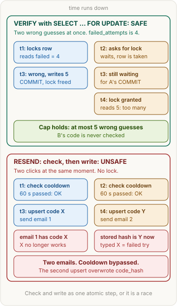
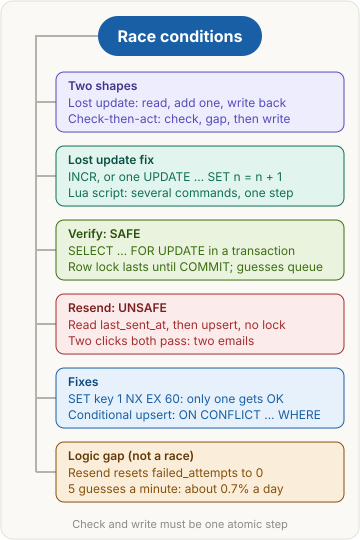

<!-- series:start -->
> [!series]- Backend system design · 4 of 4
> 1. [[system-design/revision|Backend system design quick revision]]
> 2. [[system-design/caching|Caching with Redis]]
> 3. [[system-design/rate-limiting|Rate limiting]]
> 4. **Race conditions in limits and codes** · you are here
<!-- series:end -->

> [!abstract] What this page is for
> **Intent:** see why two requests at the same moment can break a limit or a one-time code, and the fixes that stop it.
> **You'll learn:** race condition · lost update · check-then-act · `SELECT ... FOR UPDATE` · conditional write · `SET NX` · the resend gap.
> **Time:** about 7 minutes. Every section has a longer version on the [[system-design/deep/race-conditions|detailed race conditions page]].

## Words you need first

- **Race condition**: the result depends on the timing of requests that run at the same time.
- **Read-modify-write**: read a value, change it in code, write it back.
- **Lost update**: two read-modify-writes overlap, so one write overwrites the other.
- **Check-then-act** (TOCTOU, "time of check to time of use"): check a value, decide, then write. The value can change in the gap.
- **Atomic**: a step that runs all at once, so no one sees it half done.
- **Row lock, `SELECT ... FOR UPDATE`**: a read that locks the row until the transaction ends. Others that want the row wait.
- **OTP (one-time password)**: a short code, here 6 digits, valid once.

## Why it matters

Limits and codes stop abuse, such as five wrong guesses. Under load, two requests can both pass the same check.

## The picture



Top is safe, bottom is broken. Time runs down.

## How it works, with an example

**Simply:** A race is two people taking the last seat on a bus at the same moment. Both looked, both saw a seat, both sat down. In a system, the seat is a counter or a code, and the check and the write must be one step, or another request can slip in between.

**What to know:** The example is email verification in a food-delivery app. A code expires after 10 minutes, at most 5 wrong guesses are allowed, and a resend is allowed once a minute. The codes sit in Postgres, in a table `email_verification_otps` with one row per profile. Rule of thumb: check a value, then write based on it, is a race unless the check and the write are one atomic step.

## The most common mistake

> [!warning] Thinking a lock fixes every race
> A row lock only helps when it covers the check and the write. `FOR UPDATE` fixes the verify path, because both run while the lock is held. The resend path checks and writes in separate steps with no lock across them. Make the check and the write one atomic step.

## Lost update on a counter

**Simply:** Two people update a shared scoreboard by reading the old number, adding one, and writing it back. Both read 4, both write 5, and one point vanishes. The fix is to let the database or Redis add one in a single step.

**What to know:** A voucher can be used 5 times per user, and the count is 4. Two requests arrive together:

| Step | Request A | Request B | Stored count |
|---|---|---|---|
| 1 | reads 4, under 5, allowed | reads 4, under 5, allowed | 4 |
| 2 | writes 5 | writes 5 | 5 |

Both were allowed, but the counter moved by one. Fixes:

- **Redis `INCR`:** adds one and returns the new value in one command. Over 5 means reject.
- **One SQL statement:** `UPDATE vouchers SET uses = uses + 1 WHERE id = $1 AND uses < 5`. Zero rows updated means the limit is reached.
- **Lua script:** several Redis commands run as one atomic unit.

## Check-then-act

**Simply:** Like checking that a hotel room is free, then walking to the desk to book it. Someone else books it during the walk.

**What to know:** The OTP app has two paths over the same row.

- **Verify (safe):** runs in a transaction and reads the row with `SELECT ... FOR UPDATE`. Two wrong guesses arrive together when `failed_attempts` is 4. Request A locks the row, sees 4, writes 5 and COMMITs, which releases the lock. Request B waited. After the COMMIT it sees 5, rejects the guess as too many attempts, and never checks its code. Requests for one profile are serialised (one after another). That is not the Serializable isolation level, see [[databases/transactions|Transactions and concurrency]]. Without `FOR UPDATE`, both would read 4 and the cap would be bypassed.
- **Resend (unsafe):** reads `last_sent_at`, checks 60 seconds passed, then inserts or updates the code row (an upsert: insert, or update if the row exists) and sends an email, with no lock. Two clicks both pass, so two emails go out. The second upsert overwrites `code_hash`, so the first email's code stops working, and typing it counts as a failed attempt.
- **Logic gap (not a race):** each resend resets `failed_attempts` to 0. That is 7,200 guesses a day against 1,000,000 codes, about 0.7%. Add a daily resend cap (a [[system-design/rate-limiting|rate limiter]]) and a failure cap that a resend does not reset.

## Fixes: atomic commands, locks, conditional writes

**Simply:** Make the check and the write one step. One command can do both, a lock can make others wait, or the write happens only if the rule still holds. A key that Redis creates only if absent (`SET NX`) works as a short lock.

**What to know:** Four tools:

- **Atomic command:** `INCR`, one `UPDATE` with a condition, or a Lua script.
- **Row lock:** `SELECT ... FOR UPDATE`. Others wait until COMMIT.
- **Conditional write:** `INSERT ... ON CONFLICT DO UPDATE ... WHERE`. It returns a row only if it wrote.
- **`SET key value NX EX 60`:** Redis sets the key only if absent, expiring in 60 seconds. Only one caller gets "OK".

Resend cooldown with Redis. Only the request that gets "OK" sends the email:

```ts
const first = await redis.set(`otp:cooldown:${profileId}`, "1", { nx: true, ex: 60 });
if (first !== "OK") return { ok: false, reason: "cooldown" };
// only this request gets here: generate, store and send the code
```

Or one conditional upsert, which leaves the failure count alone:

```sql
INSERT INTO email_verification_otps (profile_id, code_hash, expires_at, failed_attempts, last_sent_at)
VALUES ($1, $2, now() + interval '10 minutes', 0, now())
ON CONFLICT (profile_id) DO UPDATE
  SET code_hash = EXCLUDED.code_hash, expires_at = EXCLUDED.expires_at, last_sent_at = now()
  WHERE email_verification_otps.last_sent_at < now() - interval '60 seconds'
RETURNING profile_id;
```

No row returned means cooldown. The `SET NX` trick also guards the cache-stampede lock in [[system-design/caching|Caching with Redis]].

## Say it in an interview

> "A race condition is when the result depends on the timing of concurrent requests. A lost update is read, add one, write back: two requests both read 4 and write 5, so one increment is lost. The fix is an atomic command. Check-then-act is a check, a gap, then a write. Verifying inside a transaction with SELECT FOR UPDATE makes requests for one profile wait, so the guess cap is exact. The resend has no lock, so two clicks both pass the cooldown check and send two emails. Fix it with SET NX or a conditional upsert. Any check then write is a race unless they are one atomic step."

## Questions interviewers ask

Tap a question to see the answer.

> [!question]- What is a race condition?
> A bug where the result depends on the timing of concurrent requests. Each is correct alone, but together they break a rule.

> [!question]- What is a lost update?
> Two read-modify-write cycles overlap. Both read 4, both write 5, and one increment is lost.

> [!question]- What is check-then-act?
> Read a value, decide from it, then write. The value can change between the check and the write.

> [!question]- How do you stop a counter from losing increments?
> Make the add one atomic: Redis `INCR`, or one SQL `UPDATE` with a condition.

> [!question]- What does SELECT ... FOR UPDATE do, and when is the lock released?
> It locks the row for the transaction. Others wait. The lock is released at COMMIT or ROLLBACK, not when the query returns.

> [!question]- Does FOR UPDATE fix every race?
> No. The lock must cover both the check and the write, inside one transaction.

> [!question]- How do you stop two resend clicks from sending two emails?
> Make the cooldown check and the set one atomic step: Redis `SET key 1 NX EX 60`, or a conditional upsert that sends only when a row comes back.

> [!question]- Why HMAC the OTP and compare with timingSafeEqual?
> A 6-digit code has only a million values, so a plain hash could be reversed. An HMAC needs a secret key. timingSafeEqual compares in constant time, so timing leaks nothing.

> [!question]- Why does resetting failed_attempts on resend break the cap?
> Each resend gives five new guesses, so the attacker can keep guessing. Keep the count across resends, and add a daily resend cap.

## Mental map



## Watch


compilewithsumit, about 6 minutes: "How PostgreSQL Solves a Race Condition". A job-queue example where a Postgres row lock stops two workers taking the same job.

**Want more?** The [[system-design/deep/race-conditions|detailed race conditions page]] has the same sections with the full Drizzle and Redis code, lock edge cases, and more interview questions.

<!-- series-nav:start -->
---

← [[system-design/rate-limiting|Rate limiting]] · [[system-design/index|Back to Backend system design]] →
<!-- series-nav:end -->
