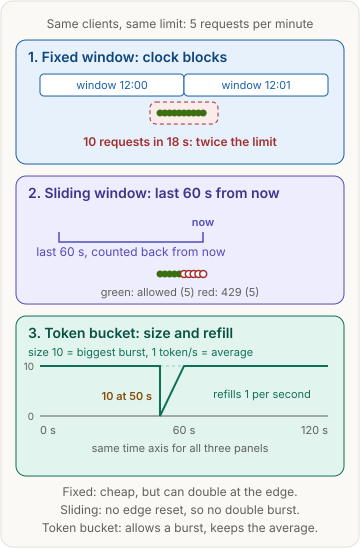
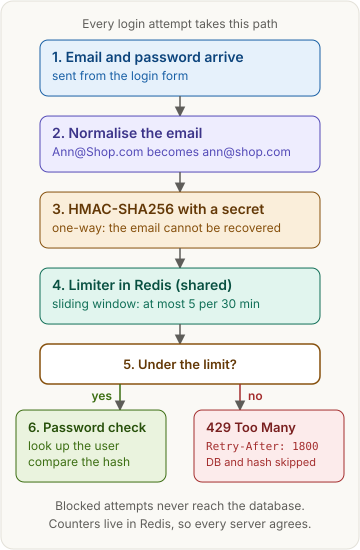
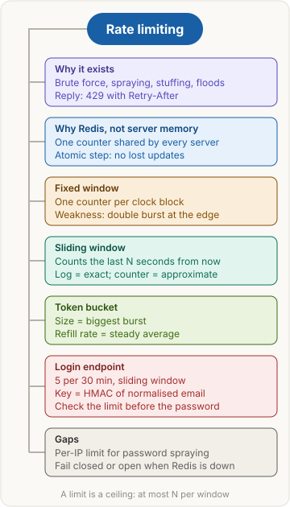

<!-- series:start -->
> [!series]- Backend system design · 3 of 4
> 1. [[system-design/revision|Backend system design quick revision]]
> 2. [[system-design/caching|Caching with Redis]]
> 3. **Rate limiting** · you are here
> 4. [[system-design/race-conditions|Race conditions in limits and codes]]
<!-- series:end -->

> [!abstract] What this page is for
> **Intent:** understand how a server caps how many requests one client may send, why that counter lives in Redis, and how to protect a login endpoint.
> **You'll learn:** the 429 reply · the key · fixed, sliding and token buckets · why Redis · a login limiter.
> **Time:** about 7 minutes. Each section has a longer version on the [[system-design/deep/rate-limiting|detailed page]].

## Words you need first

- **Rate limit**: a cap on how many requests one client may send in a time period. It is a **ceiling**: "at most 5 attempts per 30 minutes".
- **Key**: what the counter is kept against, such as an IP address or a hashed email.
- **HTTP 429 Too Many Requests**: the status code that means "over the limit, try later" (see [[networking/http-message|HTTP message]]).
- **Retry-After**: a header in the 429 reply saying how many seconds to wait.
- **Redis**: a fast data store that every server can read and write over the network.
- **Atomic**: runs as one unbreakable step, so no other request slips in halfway. A **Lua script** is a short program that Redis runs this way.
- **Hash**: a fixed-length code made from text that cannot be turned back. **HMAC**: a hash that also mixes in a secret key.
- **Upstash** (a hosted Redis you call over HTTPS): the service behind the `Ratelimit` helper used in the examples below.

## Why it exists

Four attacks need limits: **brute force** tries many passwords on one account. **Password spraying** tries one common password across many accounts. **Credential stuffing** tries leaked email and password pairs from other sites. **API floods** send so many requests that everyone else slows down. A limit stops each client at a fixed count, and the extra requests get **429** with no further work done.

## The picture

## How it works, with an example

**Simply:** Before doing any work, the server asks a shared counter, "is this client still under its limit?" If yes, the counter goes up and the request runs. If no, the server sends back 429 and stops.

**What to know:** A limit of 3 per minute for key `user:42`. Requests at 12:00:10, 12:00:20 and 12:00:30 pass, so the count goes 1, 2, 3. The request at 12:00:40 gets `429` with `Retry-After: 20`, because the minute ends at 12:01:00.

Every server must see the same counter, so it lives in Redis. Server memory fails: three servers with a limit of 5 let through up to 15 attempts, and a cold start resets to zero. Redis updates are atomic, so parallel requests cannot lose one (see [[system-design/race-conditions|Race conditions in limits and codes]]).

## The most common mistake

> [!warning] A limit is a ceiling, not a minimum
> "5 attempts per 30 minutes" means **at most** 5. It never means "at least 5". Requests 1 to 5 pass, and request 6 gets 429.

## Fixed window

**Simply:** Count requests in fixed clock blocks, such as one per minute, and restart the count at each block. It is cheap, but a client can use the full limit at the end of one block and again at the start of the next.

**What to know:** The key includes the window, for example `rl:login:<id>:<minute>`. Each request runs `INCR` (adds 1 and returns the new count) and, on the first hit, `EXPIRE key 60` (the key deletes itself after 60 seconds). Example of the weakness: 5 requests at 12:00:50 to 12:00:58, then 5 at 12:01:00 to 12:01:09, is 10 requests in about 20 seconds. `INCR` and `EXPIRE` are two commands, so send them together in a Lua script. Otherwise a crash between them leaves a key that never expires.

## Sliding window

**Simply:** Count the last N seconds from now, not clock blocks. Nothing resets at a clock edge, so no double burst. Keeping every accepted request time is exact but uses more memory (at most `limit` timestamps per key). Blending two block counts is approximate but fixed-size.

**What to know:** The log version keeps each accepted request time in a Redis sorted set (ordered by time) and drops old ones. It is exact. Only accepted requests are stored, so each key holds at most `limit` timestamps; memory grows with the number of keys. The counter version keeps two block counts and weights the previous one by how much still falls inside the window. Memory is constant, but it assumes an even spread. Upstash's `Ratelimit.slidingWindow(5, "30 m")` is the counter version.

## Token bucket

**Simply:** Picture a bucket of tokens. Each request takes one. Tokens drip back at a steady rate, up to the bucket's size. A quiet client saves up tokens for a burst. A busy client runs dry and gets 429.

**What to know:** Capacity (for example 10) is the largest burst. Refill rate (for example 1 token per second) is the steady average. An empty bucket means 429. Refill is computed from the elapsed time on each request, so no background job runs. Refill and take must be one atomic Lua script, or two servers can both take the last token. Upstash's `Ratelimit.tokenBucket(1, "1 s", 10)` means refill 1 token per second, capacity 10. It suits bursty traffic such as search-as-you-type, not login, because it allows a burst on purpose. Leaky bucket in one line: a queue drained at a constant rate, so requests wait instead of being rejected.

## Limiting a login endpoint

**Simply:** Take a food-delivery app's login. Count attempts per account, using a scrambled form of the email, not the email itself. Allow 5 attempts per 30 minutes. Check the count before the password, so blocked guesses never reach the database. Add a looser per-IP limit too.

**What to know:**

- **Key:** HMAC-SHA256 of the normalised email (trimmed, lowercased), with a server secret. HMAC is a keyed one-way hash, not encryption, so nothing turns it back into the email. Plain SHA-256 is weaker: anyone with a list of common emails can hash it and match. The secret stops that.
- **Why not the email:** data minimisation. Redis (a third-party service) gets the least data needed.
- **Why a sliding window:** a strict cap with no boundary burst.
- **Order:** normalise, HMAC, limiter, then 429 with `Retry-After` (seconds until the limiter's `reset` time, an estimate) or the password check.
- **Gaps:** a per-email limit does not stop password spraying from one IP, so add a looser per-IP limit (offices share IPs). Junk attempts can lock out a known email, so count only failures, or key on email plus IP. Rotating IPs call for a CAPTCHA after several failures. If Redis is down, fail closed (503) favours security; for login that is defensible.

## Say it in an interview

> "Rate limiting caps requests per client per window. Over the cap, the server answers 429 with Retry-After. The counter lives in Redis so every server shares it, and each check is one atomic step. Fixed windows are cheap but allow double the limit at the edge, so sliding windows are safer. Token buckets allow a controlled burst. For login I'd use a sliding window of 5 per 30 minutes, keyed by an HMAC of the normalised email, checked before the password, plus a looser per-IP limit."

## Questions interviewers ask

Tap a question to see the answer.

> [!question]- What does the server send when a client is over the limit?
> HTTP 429 Too Many Requests, with a `Retry-After` header giving the seconds to wait.

> [!question]- What is the window-edge (boundary burst) problem?
> With fixed windows, a client can use the full limit at the end of one window and again at the start of the next. That is twice the limit in a short time.

> [!question]- Fixed window or sliding window: which would you choose?
> Sliding window for strict limits such as login, since it has no edge reset. Fixed window suits rough limits where cheap matters most.

> [!question]- What do bucket size and refill rate mean in a token bucket?
> Size is the biggest burst at once. Refill rate is the steady average. It is a rate, not a budget that runs out, because tokens come back.

> [!question]- Why store the counter in Redis and not in each server's memory?
> Each server would keep its own count, so a limit of 5 over 3 servers lets 15 through. Redis is one counter that every server shares.

> [!question]- Why must the increment be atomic?
> Otherwise two requests can read 4 and both write 5, losing one. `INCR` or a Lua script runs as one step. See [[system-design/race-conditions|Race conditions in limits and codes]].

> [!question]- Which algorithm for login, and why not a token bucket?
> A sliding window with a strict cap. A token bucket allows bursts by design, and a burst is exactly what password guessing needs.

> [!question]- Why hash the email for the key? Is HMAC encryption?
> So Redis never stores the real email. HMAC is not encryption: it is a keyed one-way hash that cannot be reversed. The secret stops someone from hashing a list of known emails to match.

> [!question]- Redis is down. Fail open or fail closed?
> For login, fail closed (503). Fail open (allow and log) suits low-risk endpoints. Alert either way.

## Mental map

## Watch

ByteMonk, about 7 minutes: token bucket (from 3:41) and leaky bucket (from 4:36), with a Java example.

**Want more?** The [[system-design/deep/rate-limiting|detailed rate limiting page]] has the exact Redis scripts, the sliding window formula, the full login code, and more interview questions.

<!-- series-nav:start -->
---

← [[system-design/caching|Caching with Redis]] · [[system-design/race-conditions|Race conditions in limits and codes]] →
<!-- series-nav:end -->
