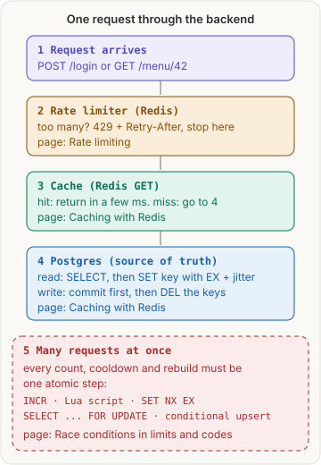
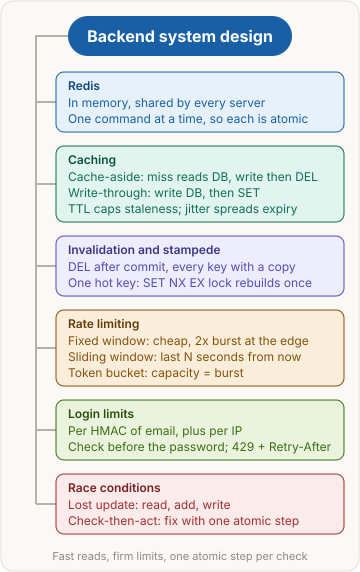

<!-- series:start -->
> [!series]- Backend system design · 1 of 4
> 1. **Backend system design quick revision** · you are here
> 2. [[system-design/caching|Caching with Redis]]
> 3. [[system-design/rate-limiting|Rate limiting]]
> 4. [[system-design/race-conditions|Race conditions in limits and codes]]
<!-- series:end -->

> [!abstract] What this page is for
> **Intent:** revise caching, rate limiting and race conditions in one go, the night before an interview.
> **Covers:** Redis basics · cache-aside vs write-through · TTL and jitter · invalidation · cache stampede · fixed window · sliding window · token bucket · limiting a login endpoint · lost updates · check-then-act.
> **Time:** about 10 minutes. Every topic below links to its quick page and its detailed page.

## Words you need first

- **Redis:** an in-memory key-value store. Very fast, shared by every server instance, and it runs one command at a time, so each single command is **atomic** (it can't be split by another request).
- **Source of truth:** the copy you trust, here Postgres on disk. Cached copies in Redis can be rebuilt from it. Rate-limit counters and cooldown keys live only in Redis, so decide what happens if Redis loses them (fail-open or fail-closed).
- **Cache hit / cache miss:** the key was in Redis / it wasn't, so you go to the database.
- **Stale read:** serving an old copy after the real data changed.
- **TTL (time to live):** a timer on a key, set with `EX` (seconds). When it runs out, Redis deletes the key. `TTL key` returns `-2` if the key doesn't exist and `-1` if it has no expiry.
- **Jitter:** a small random amount added to each TTL so keys don't all expire together.
- **Invalidation:** deleting a cached copy because the real data changed.
- **Cache stampede:** one popular key expires and many requests miss at the same moment.
- **Rate limiting:** capping how many requests an identifier (IP, user, hashed email) may make in a time span. A limit is a ceiling: **at most** N.
- **429 Too Many Requests:** the status code for "slow down", sent with a **Retry-After** header in seconds.
- **HMAC:** a keyed one-way hash (here HMAC-SHA256). It can't be reversed. It is not encryption.
- **Race condition:** the result depends on the timing of requests that run at the same time.
- **Lost update:** two requests read the same value, both add one, both write, so one update disappears.
- **Check-then-act:** read a value, decide, then write, with a gap in between where another request can slip in.
- **`SET key value NX EX n`:** set the key only if it doesn't exist, with an expiry. Atomic, so only one request wins.
- **`SELECT ... FOR UPDATE`:** read a row and lock it until the transaction commits, so other requests wait their turn.

## The big picture

Every topic is one step of handling a request, and the red box applies to all of them:

## Topic by topic

### 1. Caching with Redis
- **Simply:** check the fast copy first; if it's missing, read the database and save a copy with a timer.
- **Cache-aside (the default):** read = `GET` → on a miss, `SELECT` from Postgres → `SET key value EX ttl`. Write = update Postgres, commit, then `DEL` the key. The next read refills it.
- **Write-through:** write = update Postgres, then `SET` the new value right away, so the cache stays warm. Two writers' `SET`s can land out of order and leave the old value until the TTL ends. Fits a single writer with many readers, like a restaurant's "open now" flag.
- **TTL** is the safety net: it caps how long a stale copy can live (at most one TTL). Short TTL is fresher with more database load; long TTL is the reverse. **Jitter** (for example 300 ± 30 s) stops keys cached together from expiring in the same second.
- **Invalidation:** `DEL` **after** the commit, and delete every key that holds a copy. Deleting before the commit lets a reader put the old value back (stale repopulation). Commit-then-delete closes most of that gap, not all of it: a reader that read the old row just before the commit can still write it back after the delete, which is one more reason every key keeps a TTL.
- **Stampede:** one hot key, many misses at once. Fix: `SET lock:key 1 NX EX 10`, so one request rebuilds and the rest wait, then hit. The lock needs an expiry, or a crashed winner leaves it stuck forever.
- **Trap:** a TTL doesn't make data stale; it limits how long stale data survives. And jitter fixes many keys expiring together, not a stampede on one key.
- [[system-design/caching|Quick]] · [[system-design/deep/caching|Detailed]]

### 2. Rate limiting
- **Simply:** count each user's recent requests in Redis, and say "429, try again later" when they pass the limit.
- **Why Redis, not server memory:** with several servers or serverless, each instance has its own memory, so 3 instances with a limit of 5 allow 15. Redis is one shared counter, updated atomically.
- **Fixed window:** one counter per clock minute (`INCR`, expiry on the first hit). Cheap, but the **boundary burst** allows up to 2× the limit across the window edge.
- **Sliding window:** counts requests in the last N seconds from now, so there's no edge to exploit. The **log** version stores a timestamp per accepted request (exact, at most `limit` entries per key, so memory grows with the number of keys); the **counter** version weights the previous window (constant memory, an approximation). Upstash's `slidingWindow` is the counter version.
- **Token bucket:** capacity = the biggest burst allowed, refill rate = the steady speed. Good for bursty traffic, not for login.
- **Login endpoint:** sliding window, 5 per 30 minutes, keyed by an HMAC of the normalised email, checked **before** the password. Add a looser per-IP limit against **password spraying** (one password tried across many accounts). Decide fail-closed (block when Redis is down) or fail-open (allow and log).
- **Trap:** "at least 5 attempts" is wrong; a limit is **at most** 5. And HMAC is not encryption.
- [[system-design/rate-limiting|Quick]] · [[system-design/deep/rate-limiting|Detailed]]

### 3. Race conditions in limits and codes
- **Simply:** if two requests can both read the same value before either writes, the limit can be skipped. Make the check and the write one step.
- **Lost update:** read 4, both write 5, both allowed. Fix with one atomic command: `INCR`, a Lua script, or `UPDATE ... SET n = n + 1`.
- **Check-then-act:** an email code's 60-second resend cooldown reads `last_sent_at`, then writes. Two clicks both pass, two emails go out, and the first code silently stops working. Fix: `SET otp:cooldown:<id> 1 NX EX 60`, or one conditional upsert.
- **Verifying a code is safe** with `SELECT ... FOR UPDATE` in a transaction: parallel guesses wait their turn, so the 5-guess cap is exact.
- **Logic gap:** if each resend resets the wrong-guess counter, someone gets 5 new guesses every minute. Add a daily resend cap.
- **Trap:** "serialised" (one after another) is not the Serializable isolation level. And `FOR UPDATE` alone doesn't fix check-then-act when there's no row to lock yet.
- [[system-design/race-conditions|Quick]] · [[system-design/deep/race-conditions|Detailed]]

## Top questions

> [!question]- What's the difference between cache-aside and write-through?
> Cache-aside fills the cache on a read miss and deletes the key on write. Write-through updates the cache with the new value on every write, so reads are always warm.

> [!question]- Why delete the cache key on write instead of updating it?
> Two concurrent `SET`s can land in the wrong order and leave an old value. Deletes don't depend on order; the next read loads the current value.

> [!question]- What does a TTL protect you from?
> A missed or failed invalidation. It caps how long a stale copy can survive.

> [!question]- Why add jitter to TTLs?
> Keys cached at the same moment would all expire in the same second and spike the database. Jitter spreads their expiry out.

> [!question]- What goes wrong if you delete the cache key before the transaction commits?
> A reader misses, reads the old committed value, and puts it back in the cache. After the commit the cache is stale until the TTL ends.

> [!question]- What is a cache stampede and how do you prevent it?
> One hot key expires and many requests rebuild it at once. Use a `SET NX EX` lock so one request rebuilds while the others wait, or serve the stale value while one request refreshes.

> [!question]- Why must the stampede lock have an expiry?
> If the request holding it crashes, the lock frees itself instead of blocking every future rebuild.

> [!question]- Why use Redis for rate limiting instead of a counter in memory?
> Each server instance has its own memory, so the limit multiplies by the number of instances. Redis is one shared, atomic counter.

> [!question]- What's the weakness of a fixed window?
> The boundary burst: up to twice the limit across the edge between two windows.

> [!question]- How does a sliding window fix it?
> It counts requests in the last N seconds from now, so the window moves with time and there's no edge.

> [!question]- When would you choose a token bucket?
> When short bursts are normal but the average rate must be capped, like search as you type. Capacity sets the burst, refill sets the steady rate.

> [!question]- What status code and header does a rate limiter return?
> `429 Too Many Requests` with `Retry-After` in seconds.

> [!question]- Why hash the email with HMAC before using it as a Redis key?
> The cache never stores real emails, and the secret key stops anyone reversing the hash with a list of known emails. It's a one-way hash, not encryption.

> [!question]- A login limit is per email. How can an attacker get around it?
> Password spraying: one common password across many emails from one IP. Add a per-IP limit and count failed attempts.

> [!question]- What does fail-closed mean for a rate limiter?
> If Redis is down, block the request. It favours security over availability; fail-open favours availability.

> [!question]- What is a lost update?
> Two requests read the same value, both change it, both write, and one change is lost. Fix with an atomic command or a row lock.

> [!question]- What is a check-then-act race?
> Reading a value, deciding, then writing, with a gap where another request can do the same. Make the check and the write one atomic step.

> [!question]- How does `SELECT ... FOR UPDATE` keep a 5-guess limit exact?
> It locks the row until commit, so parallel guesses run one after another and each sees the updated count.

## Mental map

## Watch

ByteByteGo, about 6 minutes: where caches sit in a system (browser, CDN, load balancer, application, database) and why each one helps. For rate limiting, use the video on the [[system-design/rate-limiting|Rate limiting]] page.

<!-- series-nav:start -->
---

← [[system-design/index|Backend system design]] · [[system-design/caching|Caching with Redis]] →
<!-- series-nav:end -->
