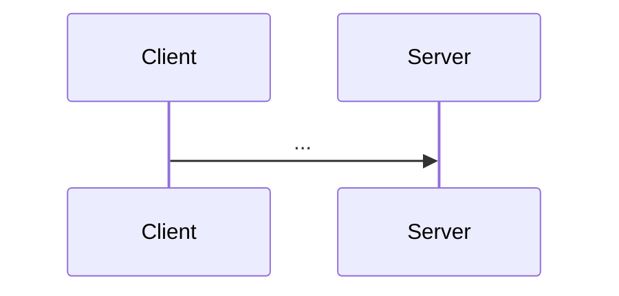

> [!tldr] In three lines
> What it is. What problem it solves. Where you meet it.

## Why it exists

The problem, told as a short story. Without the "why", the mechanics look arbitrary.

## Picture

<!-- interactive widget: runs on the site only; src path is from the site root -->
<iframe src="/static/widgets/<widget>.html" width="100%" height="600" style="border:0" loading="lazy"></iframe>

## Plain version

What it is in everyday words, with one concrete everyday example.

## Precise definition

The definition with the correct terms.

| Term | Definition | Where it's used |
|---|---|---|
| | | |

## How it works

Step by step. Use a Mermaid sequence diagram for protocols, LaTeX for formulas ($O(n \log n)$, $$\sum_i x_i$$).

## The real thing

The real artifact, raw: an HTTP request/response, packet fields, SQL and its result rows, a log line, a worked calculation. Then explain each field.

| Field | Value | What it means |
|---|---|---|
| | | |

## Where it's used

Real products, protocols, and everyday situations.

## Compared with

| | This | Neighbour |
|---|---|---|
| | | |

## Common misconceptions

- **Wrong:** ... **Right:** ... (why)

## Interview questions

> [!question]- Q1. ...
> Model answer.

## Trigger card

> [!example] When I see ___, it means ___ because ___.

## Related

- [[...]]

## Sources

- ...
