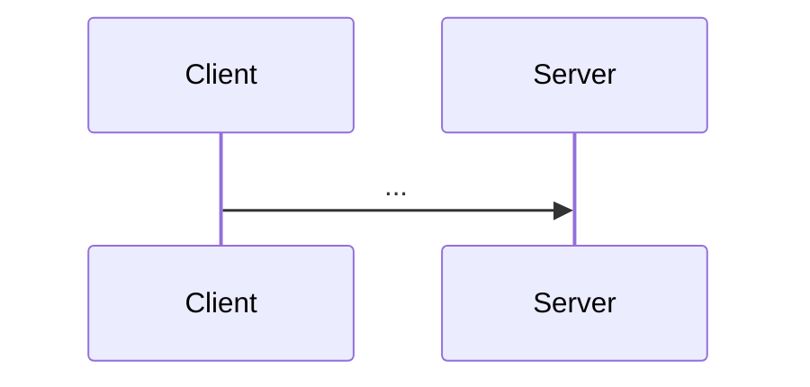

<!-- tools/series.py inserts the reading-order block here. Don't write it by hand. -->

> [!tldr] In three lines
> What it is (expand the full name here, e.g. "Transmission Control Protocol"). What problem it solves. Where you meet it.
>
> [[#Interview questions|→ Self-test: N questions]]

## Why it exists

The problem, told as a short story. Without the "why", the mechanics look arbitrary.

## Picture

<!-- Only if there is a picture. No diagram? Delete this whole section. Never write "no diagram yet". -->

<!-- Interactive widget (site only). The iframe sizes itself; height is the fallback. -->
<iframe src="/static/widgets/<widget>.html" width="100%" height="600" style="border:0" loading="lazy"></iframe>

*What to click and what to notice, in one line.*

## Plain version

What it is in everyday words, with one concrete everyday example.

## Precise definition

The definition with the correct terms.

| Term | Definition | Where it's used |
|---|---|---|
| | | |

## How it works

Numbered steps. Mermaid `sequenceDiagram` for protocols, LaTeX for formulas ($O(n \log n)$).

> [!warning] Gotcha
> Use `warning` callouts for traps worth flagging in place. Optional.

## The real thing

The real artifact, raw (HTTP exchange, packet fields, SQL and result rows, a worked calculation, a log line), then each field explained.

| Field | Value | What it means |
|---|---|---|
| | | |

<!-- Long reference tables (more than ~8 rows) go inside a collapsed callout:
> [!info]- Full header reference
> | Header | Meaning |
> |---|---|
-->

## Common misconceptions

- **Wrong:** ... **Right:** ... (why)

## Interview questions

> [!question]- Q1. ...
> Model answer.

## Trigger card

> [!example] When I see ___, it means ___ because ___.

## Compared with

| | This | Neighbour |
|---|---|---|
| | | |

## Where it's used

Real products, protocols, and everyday situations.

## Related

<!-- Only pages OUTSIDE this subject's reading order, each with one line on why. The series block already links the siblings. No such links? Delete this section. -->
- [[<subject>/<page>|<Label>]]: why it's related.

> [!info]- Sources
> - ...

<!--
Rules
- Callout types mean one thing each: tldr = summary · question = self-test · example = trigger card · warning = gotcha · info = collapsed reference/sources · series = reading order (generated).
- Wikilinks use the full path: [[networking/tcp|TCP]], never [[tcp]] (aliases create root redirect pages that shortest-match wins).
-->
